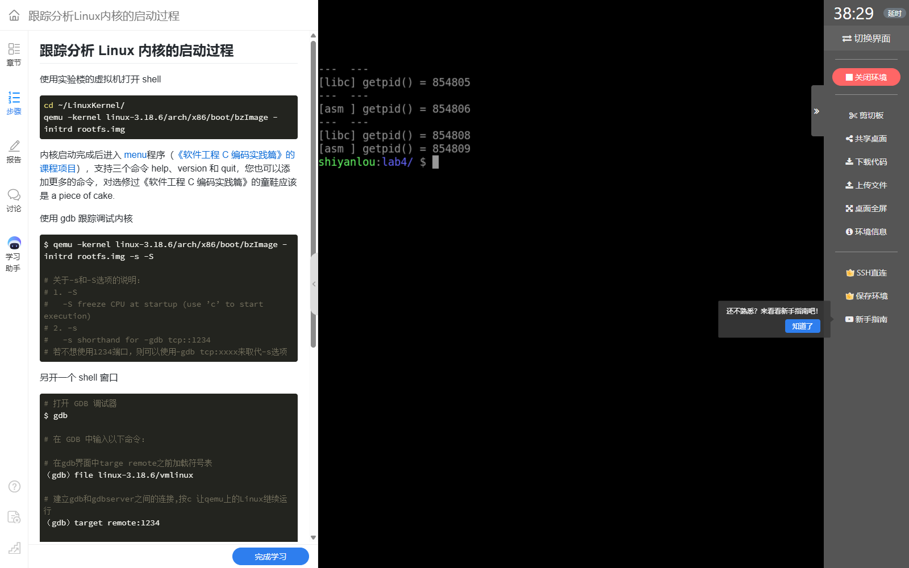
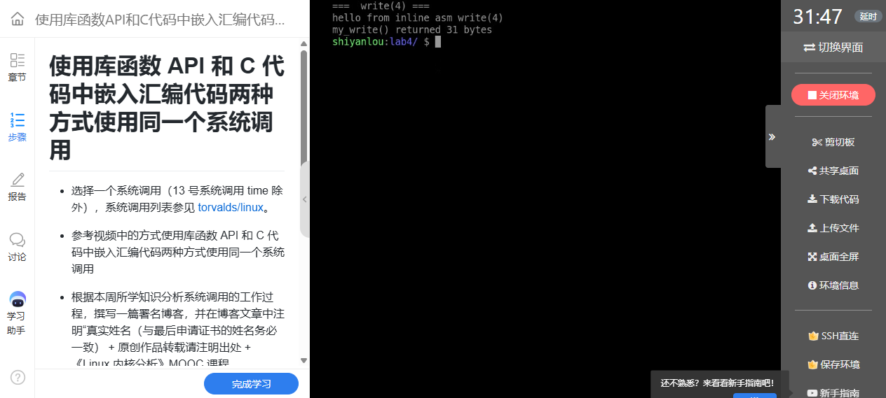

# 实验四：从库函数到内嵌汇编——理解 Linux 系统调用接口

**真实姓名：姚翔　学号：20262822　课程：《Linux内核原理与分析》**  
**实验记录：2026年10月17日　报告整理：2026年10月20日**  
本文根据本人实验程序、运行截图和调试记录整理，内核机制分析参考《Linux 内核分析》MOOC 配套实验与所列源码；引用内容注明出处。

**原创声明：** 原创作品转载请注明出处。  
**课程出处：** [《Linux 内核分析》MOOC 课程](http://mooc.study.163.com/course/USTC-1000029000)。

## 一、实验环境、操作与结果

本实验选用无参数的 `getpid` 比较库函数与内嵌汇编，再用三个参数的 `write` 验证寄存器传参。主要操作如下，在保存四个 C 文件的实验目录执行：

```bash
gcc -o getpid_libc getpid_libc.c
gcc -o getpid_asm getpid_asm.c
gcc -o getpid_both getpid_both.c
./getpid_libc
./getpid_asm
./getpid_both
objdump -d getpid_asm
```

四个文件分别验证接口封装、直接调用、同进程对照和带参数调用：

```text
源码/
├── getpid_libc.c    调用 libc 的 getpid()
├── getpid_asm.c     使用 int $0x80 和调用号 20
├── getpid_both.c    同一进程内对照两种结果
└── write_asm.c      使用调用号 4，传入 fd、buf、len
```

PID 是进程的属性。要比较两种接口是否取得同一个 PID，应当让它们在同一进程中执行，而不能要求两次启动的程序返回相同数字。`getpid_both` 中两个值均为 **884186**，并输出 `same process? YES`，说明本次两种方法取得了同一个进程的身份。


**图1：** 同一进程中，libc 与内嵌汇编返回相同 PID。

分别运行两个可执行文件时，截图中的 PID 为 854805 和 854806；再次启动后为 854808 和 854809。每次启动都会产生新的进程，数值变化符合预期。这张图应与上一张共同理解：分开运行检验各自能调用成功，同进程对照才检验结果的一致性。



**图2：** 独立运行两个程序时 PID 不同，再次运行后数值继续变化。

### 1. 位数与调用约定的核对

反汇编中既出现 `%rbp`、`%rsp`、`callq`，也出现 `int $0x80`。前一组说明这里默认编译出的程序使用了 64 位指令；后一条指令则显式使用 Linux 的 i386 兼容系统调用接口。因此，不能仅凭 `eax` 或 `int $0x80` 就把整个可执行文件判断为 32 位。后续实验中 QEMU 运行的 Linux 3.18.6 i386 内核，也应与这里的宿主实验终端区分。


**图3：** 反汇编同时展示 64 位函数指令和显式 int $0x80 指令。

`getpid` 不需要传递指针，因此这一兼容调用可以用于本次对照；带指针的兼容调用要求地址能由 32 位参数表示，不能直接推广到任意 64 位程序。若复现实验时希望严格统一为 i386，应安装相应的 32 位编译依赖并使用 `gcc -m32`，再用 `file` 核对产物。这里的解释以截图中实际生成的指令为准。[系统调用架构约定](https://man7.org/linux/man-pages/man2/syscall.2.html)

## 二、getpid 的程序与接口分析

### 1. 库函数方式

```c
#include <stdio.h>
#include <unistd.h>
#include <sys/types.h>

int main(void)
{
    pid_t pid;

    pid = getpid();
    printf("[libc] getpid() = %d\n", (int)pid);

    return 0;
}
```

`unistd.h` 提供接口声明，`pid_t` 表示进程号类型。调用者只需要遵守 C 接口，无须自己选择系统调用指令、保存输入寄存器或处理各架构的参数布局。库函数接口相同，不代表所有 libc 版本都使用同一条底层指令，也不能由 PID 相等推导出两条路径的内部实现完全一致。

### 2. 内嵌汇编方式

```c
#include <stdio.h>

/* i386 架构下 getpid 的系统调用号 */
#define __NR_getpid 20

int main(void)
{
    int pid;

    /* 不经过 glibc 封装，直接把系统调用号放入 eax，用 int 0x80 陷入内核 */
    asm volatile("int $0x80"
                 : "=a"(pid)
                 : "a"(__NR_getpid));

    printf("[asm ] getpid() = %d\n", pid);

    return 0;
}
```

这里使用的是 **i386 ABI 的调用号 20**。输入约束 `"a"(__NR_getpid)` 将调用号准备到累加寄存器；输出约束 `"=a"(pid)` 取得返回值；`volatile` 表明该汇编具有不可随意删除的作用。`int $0x80` 经过内核设置的系统调用入口进行受控的特权级转换，内核根据调用号选择服务，返回后将 PID 交给用户程序。

这个过程始终可以由同一任务完成。进入内核并不等于创建新进程，也不必然引起调度切换；只有内核执行中需要阻塞或调度时，才可能进一步切换任务。

### 3. 同一进程中的比较程序

```c
#include <stdio.h>
#include <unistd.h>

#define __NR_getpid 20

int main(void)
{
    int pid_asm;
    int pid_libc;

    /* 方式一：库函数封装 */
    pid_libc = (int)getpid();

    /* 方式二：内嵌汇编直接 int 0x80 */
    asm volatile("int $0x80"
                 : "=a"(pid_asm)
                 : "a"(__NR_getpid));

    printf("libc getpid = %d\n", pid_libc);
    printf("asm  getpid = %d\n", pid_asm);
    printf("same process? %s\n", (pid_libc == pid_asm) ? "YES" : "NO");

    return 0;
}
```

两次读取之间没有 `fork` 或 `exec`。对照变量具有相同的进程身份，这是比较成立的条件。将比较放进同一 `main`，消除了“程序每运行一次 PID 都变化”对结论的干扰。

## 三、三个参数的 write 系统调用

### 1. 操作和运行结果

```bash
gcc -o write_asm write_asm.c
./write_asm
gcc -S -o write_asm.s write_asm.c
```

`write` 将缓冲区写入指定文件描述符。程序以 `fd=1` 输出到标准输出，字符串连同结尾换行共 **31 字节**，截图中直接调用的返回值也为 31。返回值表示实际写出的字节数；它不是 C 字符串长度加一，也不包含末尾的 `\0`。



**图4：** 直接调用 write 输出字符串，并返回 31 字节。

### 2. 程序与寄存器对应

以下保留实测程序，便于与附件和截图对应。

```c
#include <stdio.h>
#include <string.h>

/* i386 架构下 write 的系统调用号为 4 */
#define __NR_write 4

static int my_write(int fd, const char *buf, int len)
{
    int ret;

    /* 参数按约定放入 ebx/ecx/edx，系统调用号放入 eax，然后 int 0x80 */
    asm volatile("int $0x80"
                 : "=a"(ret)
                 : "a"(__NR_write), "b"(fd), "c"(buf), "d"(len));

    return ret;
}

int main(void)
{
    const char *msg = "hello from inline asm write(4)\n";
    int n;

    n = my_write(1, msg, (int)strlen(msg));
    printf("my_write() returned %d bytes\n", n);

    return 0;
}
```

| i386 寄存器 | 调用前的意义 | 本次传入内容 |
|---|---|---|
| `eax` | 系统调用号 | `4`，即 `write` |
| `ebx` | 第一个参数 | `1`，标准输出 |
| `ecx` | 第二个参数 | 字符串缓冲区地址 |
| `edx` | 第三个参数 | 长度 `31` |
| `eax` | 调用返回后的结果 | 实际写出字节数，或负错误码 |

编译后的汇编能够检查 C 约束最终是否形成相应的寄存器准备。截图中寄存器赋值和 `int $0x80` 对应上表，证明参数不是靠 C 函数调用栈自动传给内核的，而是由内嵌汇编约束落实到约定的寄存器。


**图5：** 生成的汇编展示 write 调用前的寄存器准备与中断指令。

### 3. 从实验代码到稳健实现

本次程序的指针能够用于兼容调用，但这不保证 64 位进程中任意缓冲区地址都适用。兼容 ABI 只使用 32 位地址参数，高地址指针可能被截断，出现 `EFAULT`。更稳妥的教学复现方法是统一编译为 32 位，或改用本机原生系统调用 ABI，不能混用调用号和寄存器约定。

另一个值得改进之处是向编译器说明汇编会访问指针所指向的内存。实测附件中的约束没有 `"memory"`；学习改进时可在最后加入该 clobber：

```c
asm volatile("int $0x80"
             : "=a"(ret)
             : "a"(__NR_write), "b"(fd), "c"(buf), "d"(len)
             : "memory");
```

这是对编译器优化可见性的补充，不是 CPU 内存屏障。直接系统调用得到负错误码时，还要自己处理；libc 通常将其转换为 `-1` 并设置 `errno`。此外，真实应用还应处理短写与中断，不能只检查返回值是否为正。[GCC 内嵌汇编约束说明](https://gcc.gnu.org/onlinedocs/gcc/Extended-Asm.html)

## 四、问题、原因与解决思路

| 学习中的问题 | 原因分析 | 处理与验证 |
|---|---|---|
| 为什么两个程序的 PID 不一样？ | 它们是两次独立创建的进程 | 增加 `getpid_both`；同进程两种方法都得到 884186 |
| 有 int 0x80，程序就一定是 32 位吗？ | 混淆了 ELF 架构与系统调用 ABI | 结合 `%rsp`、`callq` 判断产物位数，说明 i386 兼容入口 |
| 只把调用号写进 eax 是否足够？ | getpid 无参数，掩盖了参数传递要求 | 用 write 验证 ebx、ecx、edx 及返回值 31 |
| 为什么不能把示例直接用于任意指针？ | 64 位指针与兼容接口的地址宽度不同 | 统一为 32 位环境，或按原生 ABI 重写 |
| 返回值相同能否证明底层路径相同？ | 混淆接口语义与实现细节 | 用结果验证语义，用反汇编和版本源码分析实现 |

## 五、实验认识

我对系统调用的理解从“调用一个特殊函数”转为“按架构协议提交内核服务请求”：用户程序准备调用号和参数，入口代码保存现场，内核分发执行，再把结果交还调用者。库函数把这套协议封装起来，内嵌汇编则让调用约定变得可见。本实验也提醒我，程序位数、调用号和指针宽度必须一起核对，不能只认某一条汇编指令。

## 六、附件与参考

完整实测程序见 [getpid_libc.c](源码/getpid_libc.c)、[getpid_asm.c](源码/getpid_asm.c)、[getpid_both.c](源码/getpid_both.c)、[write_asm.c](源码/write_asm.c)。

- 课程来源：[《Linux 内核分析》MOOC](http://mooc.study.163.com/course/USTC-1000029000)。
- 接口与架构：[Linux syscall(2)](https://man7.org/linux/man-pages/man2/syscall.2.html)。
- 编译器约束：[GCC Extended Asm](https://gcc.gnu.org/onlinedocs/gcc/Extended-Asm.html)。

