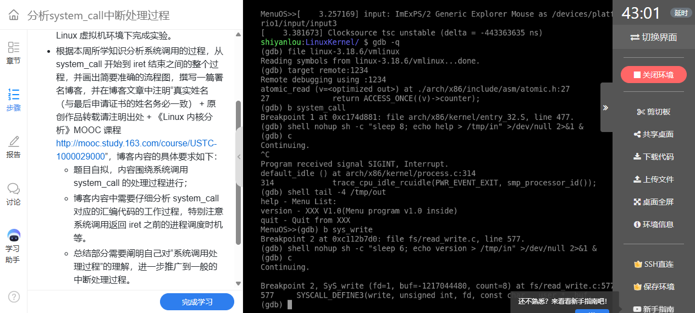
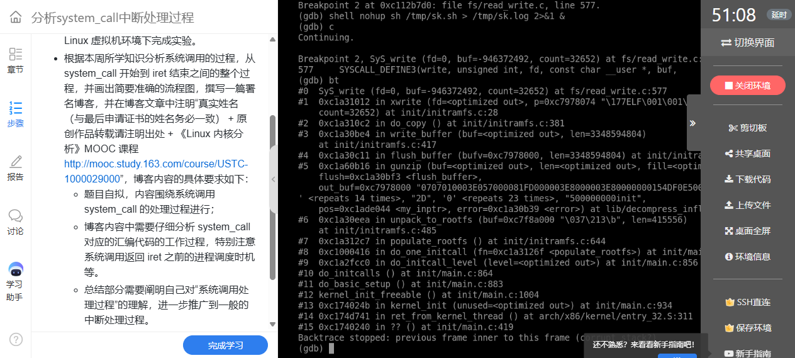
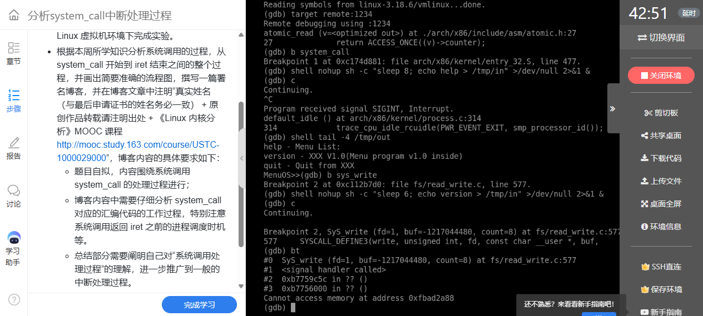
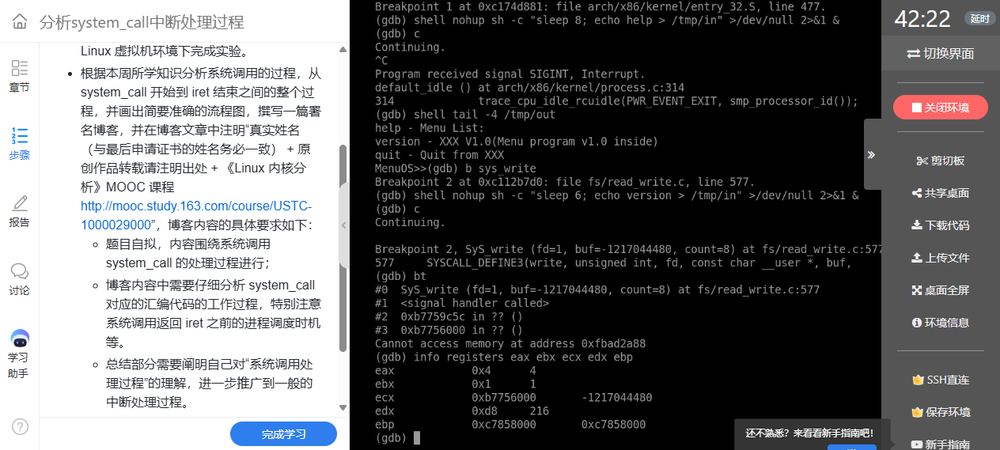
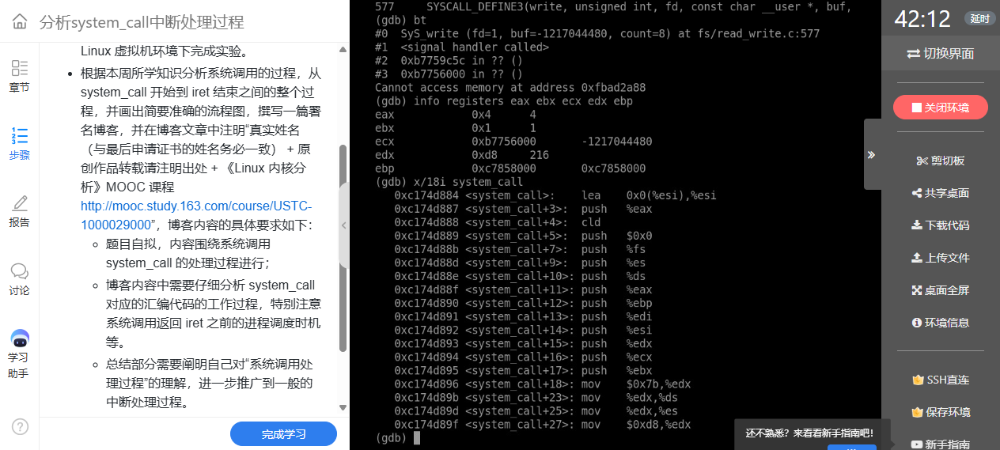
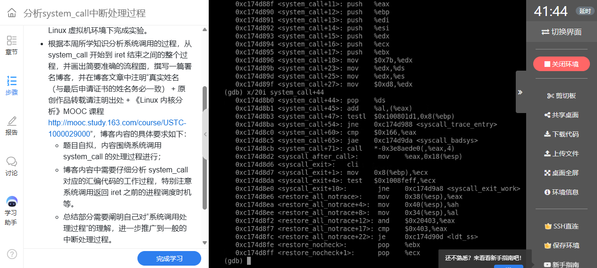
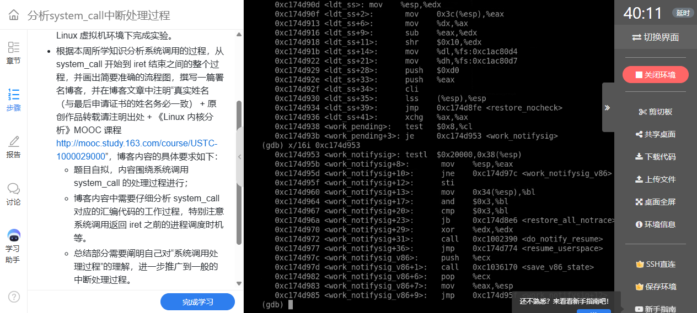
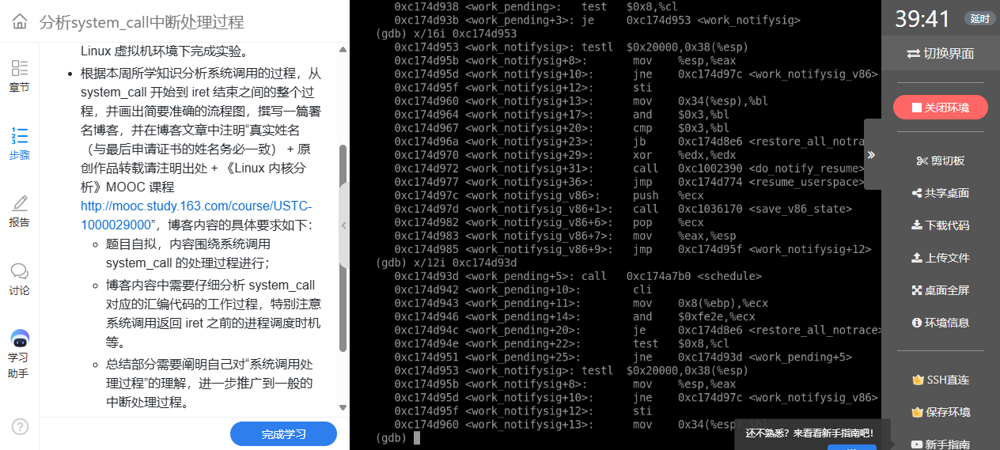
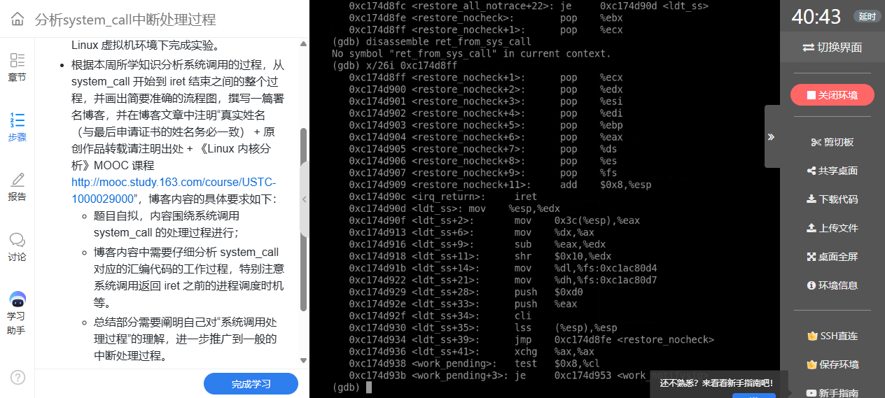

# 实验五：分析 system_call 的入口、分发与返回过程

**姓名：姚翔　学号：20262822　课程：《Linux内核原理与分析》**  
**实验记录：2026年10月18日　报告整理：2026年10月20日**  
本文根据本人 QEMU/GDB 调试记录和实验截图整理，源码分析注明版本与来源。课程来源为《Linux 内核分析》MOOC 配套实验。

## 一、环境、操作与初步结果

实验使用 Linux 3.18.6 的 i386 内核、QEMU 和 GDB。内核映像用于启动，未压缩的 `vmlinux` 用于符号和源码调试；二者必须对应同一次构建。主要操作如下，QEMU 与 GDB 分别在两个终端运行：

```bash
cd ~/LinuxKernel
mkfifo /tmp/in
qemu -kernel linux-3.18.6/arch/x86/boot/bzImage \
  -initrd rootfs.img -nographic -append "console=ttyS0" \
  -s < /tmp/in > /tmp/out 2>&1 &
exec 3>/tmp/in
gdb linux-3.18.6/vmlinux
```

```gdb
target remote :1234
break system_call
break SyS_write
continue
```

串口输出保存到 `/tmp/out`，命名管道用于输入 MenuOS 命令，文件描述符 3 保持管道写端开启；`-s` 提供远程调试端口。本次命令没有 `-S`，连接时内核可能已经运行，不能把连接位置直接当成系统调用入口。

```text
linux-3.18.6/
├── arch/x86/kernel/entry_32.S   system_call、现场保存、返回分支
├── arch/x86/syscalls/          i386 系统调用表的生成依据
├── fs/read_write.c            write 的服务实现
└── vmlinux                    与运行内核对应的调试符号
```

向 MenuOS 注入 `help` 或 `version` 后，程序需要输出文字，能够触发 `write`。截图中的服务断点参数为 `fd=1`、用户缓冲区、`count=8`，把实验四中自行准备的参数与真实内核服务连接起来。



**图1：** MenuOS 输出时命中 SyS_write，参数为标准输出与 8 字节缓冲区。

## 二、如何识别一次系统调用

### 1. 命中服务函数不等于命中用户态入口

最初命中 `SyS_write` 时，调用栈包含 `xwrite`、`do_copy`、`gunzip`、`unpack_to_rootfs`、`populate_rootfs` 等函数。这是内核解包 initramfs 的内部写入路径。它说明服务函数可以被内核内部路径调用，不能仅凭断点名称就认定用户程序执行了 `int $0x80`。



**图2：** 启动阶段的写入调用栈来自 initramfs 解包，应与用户系统调用区分。

后续命中中，参数指向用户空间，并出现用户地址范围的栈帧，结合 MenuOS 命令触发的输出，可以识别用户程序请求内核服务的情形。GDB 的 `<signal handler called>` 是跨特殊栈帧展开时的显示形式，不能据此断定应用真的执行了信号处理函数，也不足以单独确定使用的是 `int 0x80` 还是快速系统调用入口。



**图3：** 用户输出调用的回溯中出现特殊展开帧及用户地址。

### 2. 寄存器证据

本次停止位置可见 `eax=4`、`ebx=1`、`ecx=0xb7756000`、`edx=8`，与 i386 的 `write(fd, buf, count)` 约定相符。但普通 C 函数执行后可以改写寄存器，长期保存的用户现场应结合入口构造的 `pt_regs` 查看，不能假定服务函数内任意位置的寄存器都保持原值。



**图4：** 本次 write 断点处的寄存器值与调用号、三个参数对应。

## 三、system_call 的入口与保存现场

本节分析的是 Linux 3.18.6 i386 的 `system_call`，不是新版本的同类入口符号。实际服务断点观察与这条入口的静态分析分别提供证据：前者验证调用参数与业务效果，后者解释传统 `int $0x80` 路径如何工作。

从用户态经中断门进入内核时，处理器完成特权级切换并保存必要的返回控制状态；通用寄存器和段寄存器还需要入口汇编继续保存。源码逻辑可概括为：

```text
用户态：eax=调用号，其他约定寄存器=参数
    ↓ int $0x80
硬件：切换到内核栈，保存用户返回控制现场
    ↓
system_call：保存 orig_ax，SAVE_ALL 形成 pt_regs
    ↓
检查跟踪/审计等入口工作，检查调用号范围
    ↓
调用 sys_call_table 中的服务函数
```

截图中的压栈顺序与 `SAVE_ALL` 对应。第一次保存的 `eax` 作为原始调用号，后续保存的 `eax` 槽可以容纳最终返回值，二者不能混为同一个位置。



**图5：** system_call 的反汇编展示原始调用号和通用寄存器的保存。

入口还设置供内核入口使用的段寄存器值。截图中的 `0x7b` 对应这一版本的 `__USER_DS`，不能将它写成“由用户数据段改成 __KERNEL_DS”；在 x86 平坦段模型下，数值和源码常量需要逐项核对。[Linux 3.18.6 entry_32.S](https://github.com/gregkh/linux/blob/v3.18.6/arch/x86/kernel/entry_32.S)

典型 32 位现场中，低地址向高地址依次包含 `bx、cx、dx、si、di、bp、ax` 等字段，`ax` 位于栈帧偏移 `0x18`，`orig_ax` 位于 `0x2c`，随后是用户返回的 `ip、cs、flags、sp、ss`。这些偏移与配置、入口代码一起分析，不能套到 x86-64。

## 四、调用号检查与分发

正常分发路径的关键逻辑如下。这里是按该版本整理的流程示意，省略跟踪等分支，不作为独立汇编程序编译：

```asm
cmpl $NR_syscalls, %eax
jae syscall_badsys
call *sys_call_table(,%eax,4)
movl %eax, PT_EAX(%esp)
```

每项入口地址为 4 字节，所以索引使用 `eax*4`。范围检查使用无符号的“大于等于”跳转；截图中的界限值为 `0x166`，即 358，因此该检查所允许的索引范围是 **0～357**，不能说“358 仍是有效调用号”。无效入口转入错误处理，避免越界取函数指针。



**图6：** 调用号范围检查、间接调用和返回值写回保存现场。

服务函数执行后，`eax` 被写回保存现场的返回值槽。即使后续返回路径还要临时使用处理器寄存器，最终恢复现场时，用户仍能在约定的累加寄存器中取得结果。这也解释了实验四中 `"=a"(ret)` 的意义。

## 五、返回前的工作与现场恢复

### 1. 调度并非每次发生

系统调用完成后，需要检查线程标志；当存在重调度请求时，返回路径可以转入 `work_pending` 并调用 `schedule`。检查后通常还要重新读取标志，避免只处理一次就遗漏随后出现的工作。



**图7：** work_pending 分支围绕待处理标志决定后续路径。

反汇编中可以直接看到对 `schedule` 的调用。这说明返回用户态前存在明确的调度检查点，但不是每次系统调用都会切换任务；如果没有必要工作，会走较短的恢复路径。系统调用处理函数本身也可能因等待资源而阻塞，调度并不限于返回前。



**图8：** 返回路径中的 schedule 调用及重新检查标志的操作。

### 2. 恢复顺序与 iret

恢复时必须按与压栈布局相符的顺序取值。若从一条指令的中间字节开始反汇编，可能得到错误指令，因此应优先使用符号边界及源码核对。`RESTORE_REGS` 的第一个通用寄存器恢复项是 `ebx`，之后才依次恢复其他保存值；最终的 `eax` 恢复为服务返回值。



**图9：** 恢复寄存器及 iret 所在区域；具体指令须从正确边界核对。

在本文讨论的 `int $0x80` 返回路径中，`iret` 使用保存的控制现场回到用户态，恢复指令地址、代码段、标志，以及跨特权级返回所需的用户栈。它与普通函数的 `ret` 不同。快速入口在合适条件下可以使用其他返回指令，不能把所有 Linux 系统调用都概括为同一条 `iret` 路径。

## 六、问题与解决方案

| 问题 | 原因 | 解决办法与依据 |
|---|---|---|
| 首次 write 断点为何不是 MenuOS 输出？ | 内核解包根文件系统也调用了写入服务 | 依据完整调用链区分内部调用与用户请求 |
| 为什么服务断点和入口断点的表现不同？ | 服务可能由不同入口或内核内部到达 | 分开验证服务参数和入口源码，不从单个断点反推全部路径 |
| 回溯显示 signal handler 是否代表信号？ | 调试器对特殊栈帧的展开存在表示差异 | 与用户地址、参数和源码共同判断 |
| 如何理解 syscall 返回值不被后续操作覆盖？ | 返回值写入 pt_regs，末尾再恢复 | 对照 `mov %eax,0x18(%esp)` 与恢复顺序 |
| 调度为何出现在系统调用返回前？ | 需要在合适边界处理重调度请求 | 对照标志检查、schedule 调用及重新检查流程 |

## 七、实验认识与参考

本实验把一次 `write` 分成了接口、入口、服务和返回四层。最有价值的调试方法，是先确认断点所处的上下文，再解释栈与寄存器；只看到熟悉的函数名，还不足以说明一次用户态到内核态的完整转换。系统调用可以在同一进程中完成，返回前也可能调度其他任务，这两件事应分别分析。

- 课程来源：[《Linux 内核分析》MOOC](http://mooc.study.163.com/course/USTC-1000029000)。
- 入口源码：[Linux 3.18.6 entry_32.S](https://github.com/gregkh/linux/blob/v3.18.6/arch/x86/kernel/entry_32.S)。
- 写入服务：[Linux 3.18.6 fs/read_write.c](https://github.com/gregkh/linux/blob/v3.18.6/fs/read_write.c)。
- 调试说明：[QEMU GDB 使用说明](https://www.qemu.org/docs/master/system/gdb.html)。
