# 实验六：从 fork 到子进程首次运行——分析 Linux 创建新进程

**真实姓名：姚翔　学号：20262822　课程：《Linux内核原理与分析》**  
**实验记录：2026年10月18日　报告整理：2026年10月20日**  
本文根据本人测试程序、QEMU/GDB 截图与调试记录整理；内核分析以 Linux 3.18.6 i386 为依据，参考《Linux 内核分析》MOOC 配套实验并注明源码来源。

**原创声明：** 原创作品转载请注明出处。  
**课程出处：** [《Linux 内核分析》MOOC 课程](http://mooc.study.163.com/course/USTC-1000029000)。

## 一、实验操作与运行结果

实验用一个最小测试程序担任 initramfs 中的 `/init`：先打印 PID，再 `fork`；父进程等待子进程，子进程输出自己的身份后退出，父进程最终常驻。主要构建和启动命令如下：

```bash
cd ~/lab6
gcc -m32 -static -o fork_test fork_test.c
mkdir -p /tmp/ird6
cp fork_test /tmp/ird6/init
(cd /tmp/ird6 && find . | cpio -o -H newc | gzip > /tmp/e6.img)
cd ~/LinuxKernel
qemu -kernel linux-3.18.6/arch/x86/boot/bzImage \
  -initrd /tmp/e6.img -nographic -append "console=ttyS0" \
  -s -S </dev/null >/tmp/out6 2>&1 &
gdb linux-3.18.6/vmlinux
```

`-static` 使这个 32 位测试程序可以在最小根文件系统中运行，无须另行放入动态链接器和共享库。根目录中的可执行文件名必须是 `init`；PID 1 最后保持存活，避免测试结束后因 init 退出而导致内核异常。

```text
源码/fork_test.c               用户态测试程序
/tmp/ird6/init                 initramfs 中的 PID 1 程序
kernel/fork.c                  do_fork、copy_process、dup_task_struct
arch/x86/kernel/process_32.c   copy_thread，构造新任务的初始现场
arch/x86/kernel/entry_32.S     ret_from_fork，子进程首次返回路径
```

父进程调用前后仍为 **PID 1**；本次创建的子进程为 **PID 864**，它看到的父进程号为 1。父进程输出 `child=864`，子进程输出 `pid=864 ppid=1`，对应同一次创建。PID 不要求从 2 连续分配给本实验子进程，因为系统此前已经创建过其他任务。

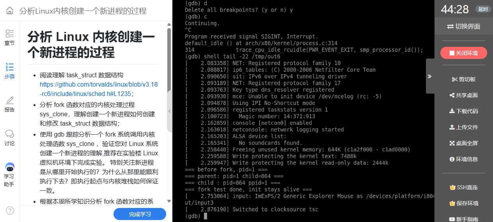

**图1：** 父进程 PID 1 创建子进程 PID 864，子进程正确识别父进程。

## 二、测试程序与调试方法

### 1. 程序的观察点

```c
#include <stdio.h>
#include <unistd.h>
#include <sys/wait.h>

int main(void)
{
    pid_t pid;

    printf("=== before fork, pid=%d ===\n", (int)getpid());
    fflush(stdout);

    pid = fork();

    if (pid == 0) {
        printf("=== child : pid=%d ppid=%d ===\n", (int)getpid(), (int)getppid());
        fflush(stdout);
        _exit(0);
    } else {
        printf("=== parent: pid=%d child=%d ===\n", (int)getpid(), (int)pid);
        fflush(stdout);
        wait(NULL);
    }

    printf("=== fork test done, init stays alive ===\n");
    fflush(stdout);

    for (;;)
        pause();

    return 0;
}
```

`fork` 之前的 `fflush` 避免尚未输出的 stdio 缓冲随地址空间一起复制，造成看似执行了两次的输出。子进程用 `_exit(0)` 结束，父进程 `wait(NULL)` 回收子进程。示例将非零返回值归入父分支；作为更完整的程序，还应先检查 `pid<0`，调用 `perror` 报告创建失败，不能把失败返回值当作有效子进程号。

`file` 确认产物为 32 位静态链接 ELF，这一点与后续 i386 的寄存器、内核栈及 `copy_thread` 分析一致。

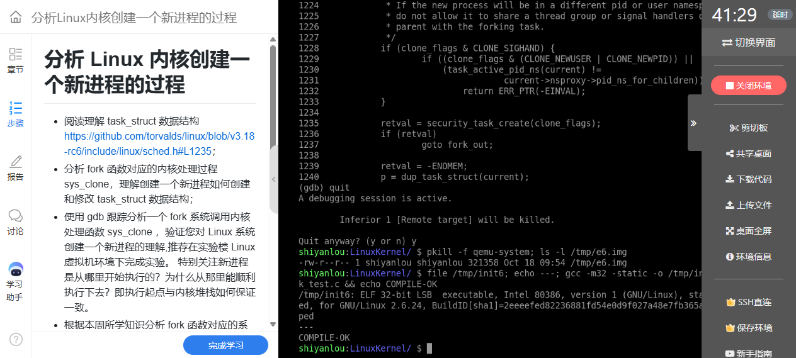

**图2：** 测试程序被编译为 32 位静态 ELF，用作最小 init。

### 2. 逐层设置断点

```gdb
target remote :1234
break sys_clone
break do_fork
break copy_thread
break ret_from_fork
continue
bt
```

启动过程本身也会创建任务，因此每次断点命中都应结合参数与调用栈识别来源。用户态 `fork()` 是库接口，本环境中的实际系统调用路径进入 `sys_clone`，不能仅按库函数名称寻找名为 `sys_fork` 的唯一入口。

## 三、从 sys_clone 到 copy_process

### 1. 创建参数与统一入口

截图中系统调用号 `eax=0x78`，即 120，对应 i386 的 `clone`。克隆标志 `0x1200011` 包含退出信号 `SIGCHLD` 以及子任务相关的 TID 标志，不含 `CLONE_VM` 和 `CLONE_THREAD`，与普通 `fork` 创建独立进程的语义相符。调用进入 C 函数后，一部分寄存器会被用于临时计算，应优先查看 GDB 的函数参数与保存现场，不能机械套用任意时刻的寄存器值。

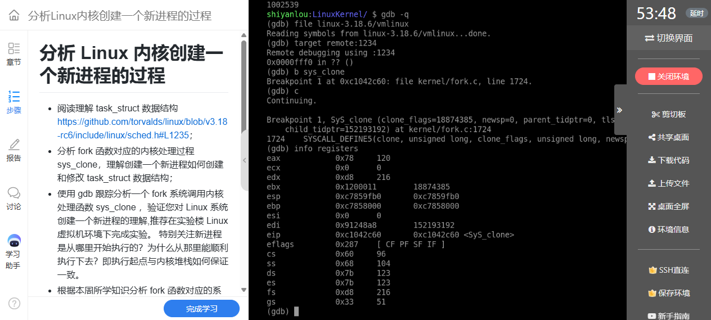

**图3：** 命中 sys_clone，通过调用号和 flags 识别本次 fork 对应的创建请求。

源码及调用栈共同表明，本次路径为：

```text
用户态 fork()
  → clone 系统调用入口
  → sys_clone
  → do_fork
  → copy_process
  → copy_thread
```

`do_fork` 负责组织创建、获得新任务、使其可以参与调度，并向父进程返回新 PID；`copy_process` 则执行主体的资源复制、引用关系建立与检查。创建成功不等于子进程已经执行，它还需要被唤醒并由调度器选中。

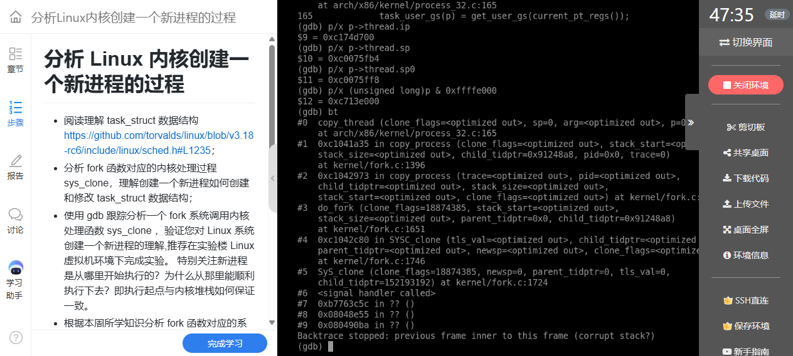

**图4：** copy_thread 的调用栈把 sys_clone、do_fork 和 copy_process 串联起来。

### 2. task_struct 是资源关系的枢纽

`task_struct` 保存身份、状态、调度信息和体系结构上下文，也通过 `mm`、`files`、`fs`、信号相关字段等引用资源。不能理解为“一个进程的全部数据都直接存放在 task_struct 内部”。内核线程的 `mm` 可以为空，普通用户任务有对应地址空间；是否共享还必须结合克隆标志及资源指针关系判断。

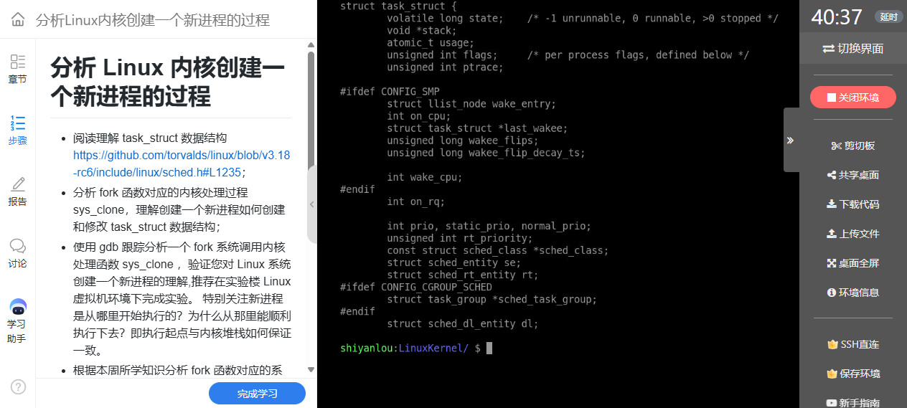

**图5：** 通过源码查看 task_struct 的定义与任务相关信息。

`dup_task_struct` 为新描述符和内核栈建立存储，复制父任务的基础状态后，再由后续步骤修正新任务自身的指针、计数和资源关系。`copy_mm`、`copy_files` 等根据标志决定复制或共享；普通 fork 的用户内存通常采用写时复制，不能简单写成立即复制所有物理页。[Linux 3.18.6 kernel/fork.c](https://github.com/gregkh/linux/blob/v3.18.6/kernel/fork.c)

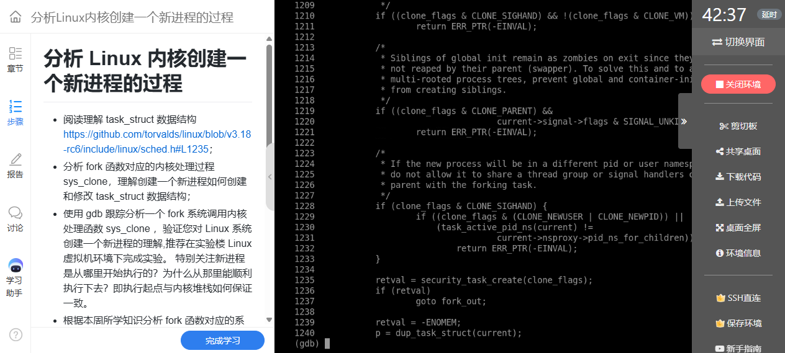

**图6：** dup_task_struct 展示新任务结构和内核栈的建立过程。

### 3. 为什么构造中的 p->pid 仍可能像父进程

调试停在 `copy_thread` 时，新描述符 `p` 尚未完成全部初始化。该版本 `copy_process` 先调用 `copy_thread`，随后才分配和写入新 PID，并建立最终的父子关系。因此截图中此时的 `p->pid=1`、父字段指向 PID 0，是复制基础状态后的中间值，不能解释为创建完成的子进程身份。

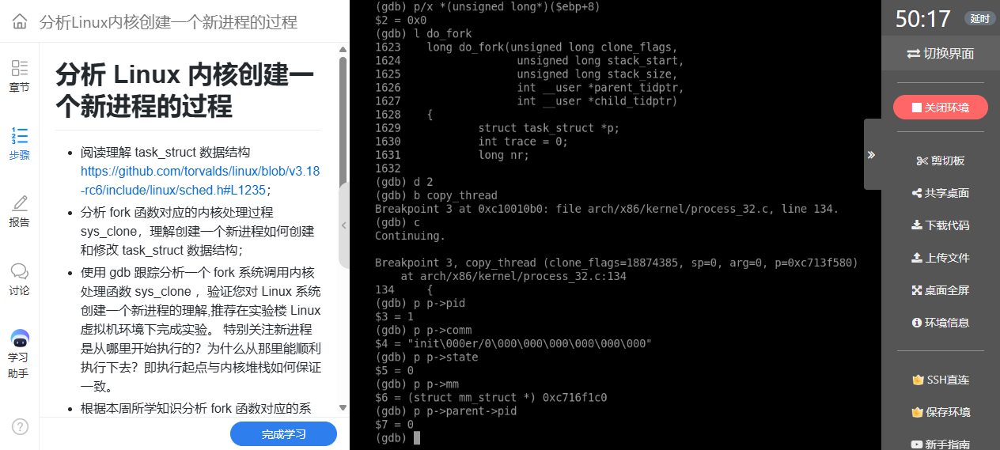

**图7：** copy_thread 阶段的新 task_struct 仍包含尚待后续更新的身份字段。

正确的方法是按源码顺序跟踪字段的生效阶段，并用最终控制台输出验证。前面 PID 864、PPID 1 的结果才是本次子进程创建完成后执行到用户态时的身份。这次观察让我认识到：同一个字段，在对象构造中和构造完成后具有不同的解释前提。

## 四、copy_thread 如何准备子进程的首次执行

### 1. 用户返回现场与内核切换现场

对本实验的普通用户任务分支，`copy_thread` 的关键作用可以用以下源码逻辑概括：

```c
/* 根据 Linux 3.18.6 的用户任务分支整理，省略其他初始化。 */
childregs = task_pt_regs(p);
p->thread.sp = (unsigned long)childregs;
p->thread.sp0 = (unsigned long)(childregs + 1);
*childregs = *current_pt_regs();
childregs->ax = 0;
p->thread.ip = (unsigned long)ret_from_fork;
```

复制的 `pt_regs` 保存将来返回用户态所需的寄存器；`thread.sp` 和 `thread.ip` 则帮助调度器第一次切换到这个任务。它们分别回答“返回用户态时继续哪里”和“首次获得 CPU 时先从内核哪里运行”，不是同一个执行起点。内核线程分支另有启动安排，不能直接套用普通用户子进程的说明。

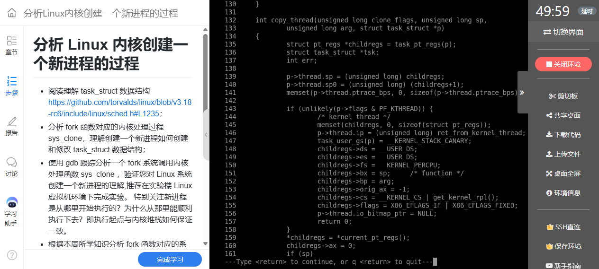

**图8：** copy_thread 为子进程复制用户寄存器、设置返回值和内核启动入口。

### 2. 地址之间的对应关系

本次 `thread.ip=0xc174d700`，与 `ret_from_fork` 符号地址相同；`thread.sp=0xc0075fb4`，`thread.sp0=0xc0075ff8`。两者相差 `0x44`，即 68 字节，与本次 32 位用户寄存器现场的布局对应。这里的具体地址只属于本次运行，关键是字段与栈布局之间的关系。

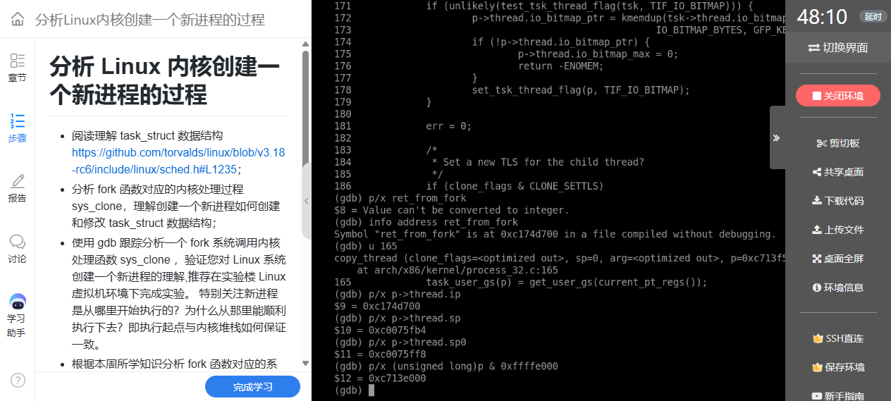

**图9：** 核对 thread.ip、thread.sp 与线程内核栈顶附近的现场布局。

## 五、从 ret_from_fork 返回到用户态

### 1. 子进程不是重新调用 main

子进程第一次被调度时，内核切换机制使用准备好的 SP 和 IP，进入 `ret_from_fork`。断点命中证明这不是父进程像调用普通函数一样进入子进程；两者分别具有任务上下文，调度器在它们之间交接 CPU。

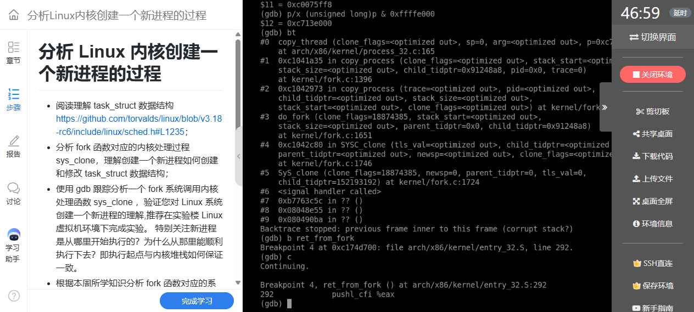

**图10：** ret_from_fork 断点命中，子进程开始执行预先准备的内核返回路径。

`ret_from_fork` 中的 `schedule_tail` 完成首次切换所需的收尾及子任务 TID 等相关处理，然后进入系统调用返回通路。它不是泛指所有父子进程同步，更不能把 vfork 完成通知统一归到这里；相关语义应按该版本源码分别查证。

### 2. 为什么同一行 fork 有两个不同返回值

在首次入口处，ESP 为 `0xc0075fb4`，与此前准备的 `thread.sp` 相等，说明实际使用的是为子进程构造的内核栈现场。子进程 `pt_regs` 中 `ax=0`，用户返回地址为 `0xb7763c5c`，用户栈地址为 `0xbffd5e00`，代码段选择子为 `0x73`。其中 `ax=0` 是子分支成立的直接机制；父进程则从正常创建调用链取得新 PID 864 作为返回值。

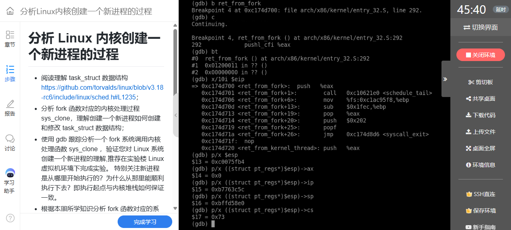

**图11：** 子进程保存的用户现场中 ax 为 0，并保留用户返回地址与栈。

父子任务在各自的用户地址空间中继续执行 fork 调用之后的程序逻辑，因此可以从同一处 C 代码分出两个分支。相同的用户虚拟地址不意味着共用同一个内核栈，也不意味着用户写入会永久相互影响：普通 fork 采用独立地址空间和写时复制语义。但继承的文件描述符可能引用同一打开文件对象，不能把“独立进程”理解为所有内核资源都完全隔离。[fork 接口语义](https://man7.org/linux/man-pages/man2/fork.2.html)

### 3. 把首次内核入口与两份栈对应起来

下面按本次已核对的地址画出子任务内核栈的局部示意，突出首次入口与用户返回现场的对应关系：

```text
高地址
0xc0075ff8  ── thread.sp0，位于子任务 pt_regs 区域之后
             │ 保存的用户返回现场 pt_regs
             │ ax=0，用户 ip=0xb7763c5c
             │ 用户 sp=0xbffd5e00，cs=0x73
0xc0075fb4  ── pt_regs 起始；thread.sp；首次入口处 ESP
             │ ret_from_fork 后续调用使用的内核栈空间
             ↓ 栈向低地址增长
```

父进程继续使用自己的内核栈和创建调用链；子进程有新分配的内核栈，并以 `ret_from_fork` 为首次内核入口。两者返回用户态时，可以沿相同的用户代码位置继续，但使用各自的地址空间和用户栈现场。这里 `thread.ip` 是首次内核执行位置，`pt_regs.ip` 是用户返回位置；把它们分开，才能同时解释“从哪里开始”和“为什么能够正确返回”。

## 六、问题与解决方案

| 问题 | 机制原因 | 解决与核验 |
|---|---|---|
| fork 为什么命中 sys_clone？ | 库函数可选择 clone 系统调用实现 fork 语义 | 对照调用号 120、flags 和调用栈 |
| 新结构体的 PID 为什么还是 1？ | 断点处于初始化中间阶段 | 查明 copy_thread 在分配 PID 前，最终输出为 864 |
| 子进程为什么返回 0？ | childregs->ax 被显式清零 | 检查子进程 pt_regs，而非只看 C 分支输出 |
| 子进程从哪里首次获得执行？ | 调度器使用构造好的内核上下文 | 核对 thread.ip 与 ret_from_fork 地址、断点 |
| 自定义 init 如何正常结束实验？ | PID 1 的退出具有特殊影响 | 子进程退出并由父进程回收；PID 1 最终 pause 常驻 |

## 七、实验认识与附件

创建进程不只是分配一个 PID，而是同时建立描述符、资源关系、可调度状态以及首次执行的寄存器和栈。fork 的“一次调用、两处继续”来自两份任务上下文中不同的返回值。沿着创建顺序解释字段，再追踪子进程的第一条内核返回路径，比单独记住函数名称更能说明进程是怎样开始运行的。

完整实测程序：[fork_test.c](源码/fork_test.c)。

- 课程来源：[《Linux 内核分析》MOOC](http://mooc.study.163.com/course/USTC-1000029000)。
- 创建主体：[Linux 3.18.6 kernel/fork.c](https://github.com/gregkh/linux/blob/v3.18.6/kernel/fork.c)。
- 架构现场：[Linux 3.18.6 process_32.c](https://github.com/gregkh/linux/blob/v3.18.6/arch/x86/kernel/process_32.c)。
- 首次返回：[Linux 3.18.6 entry_32.S](https://github.com/gregkh/linux/blob/v3.18.6/arch/x86/kernel/entry_32.S)。

