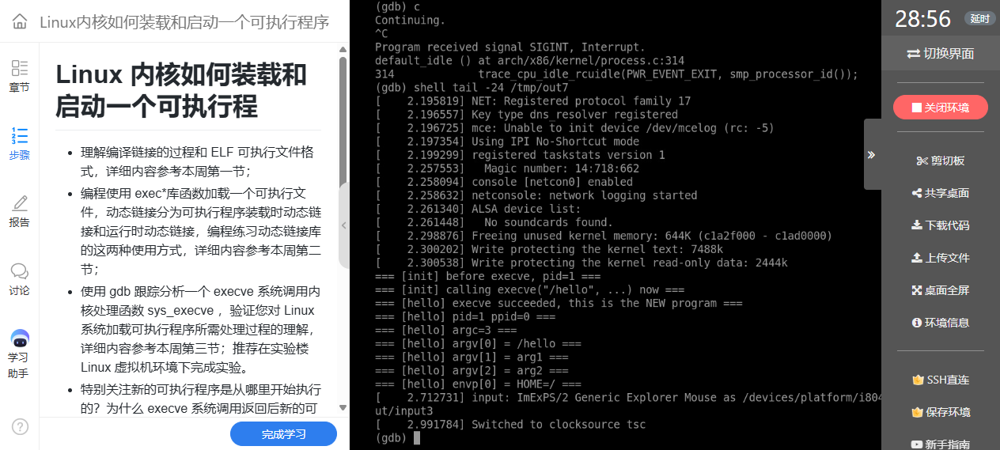
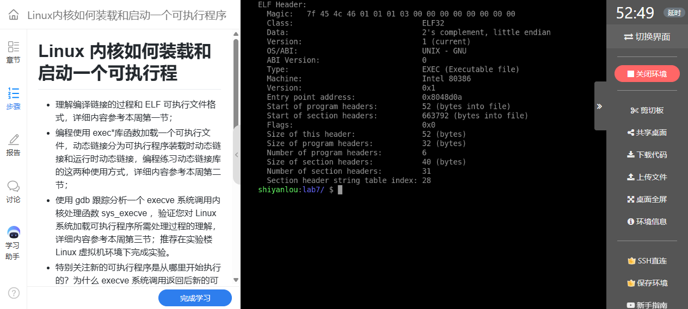
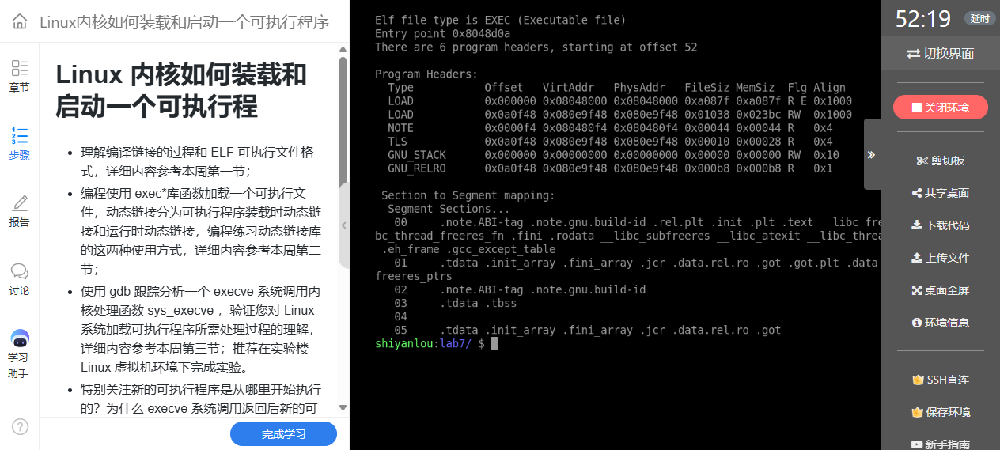
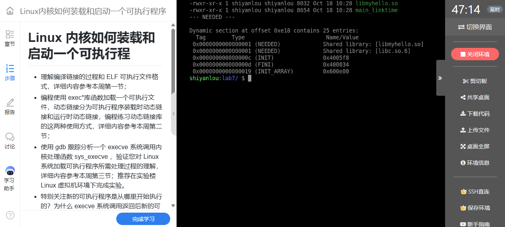
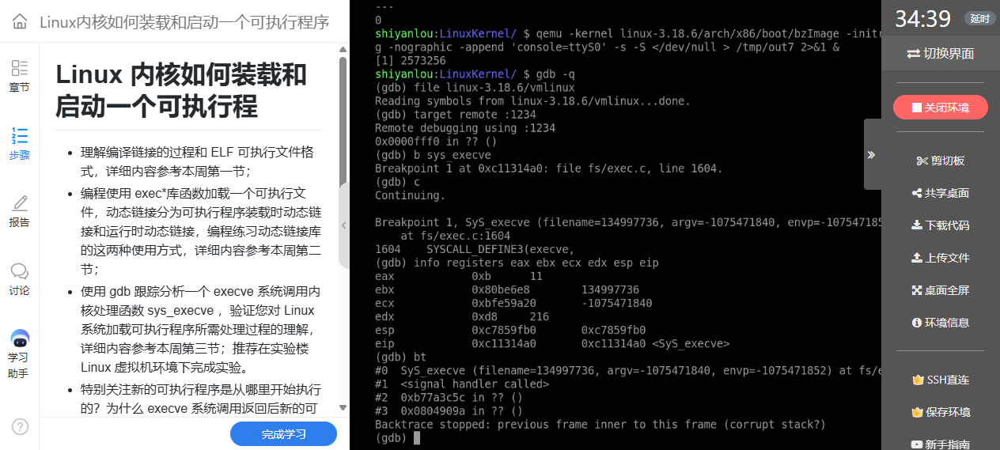
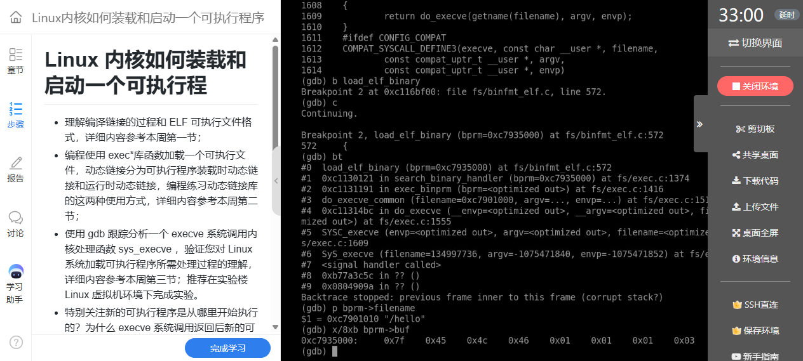
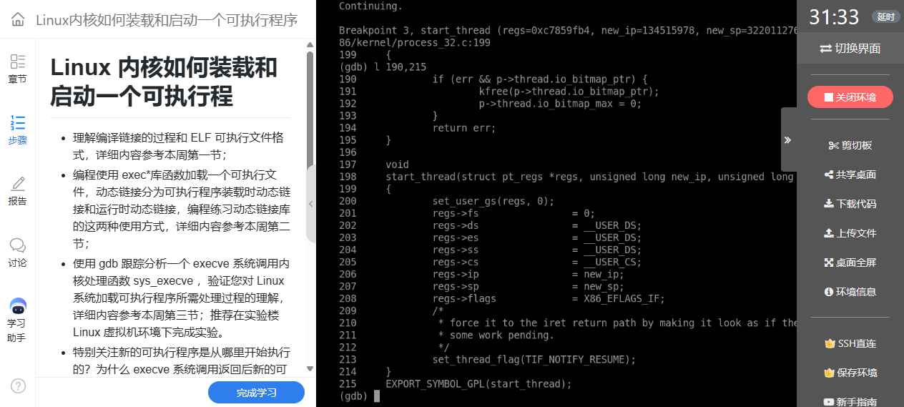
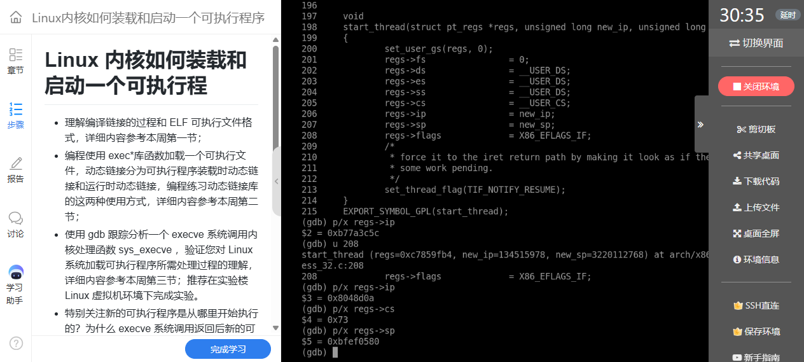
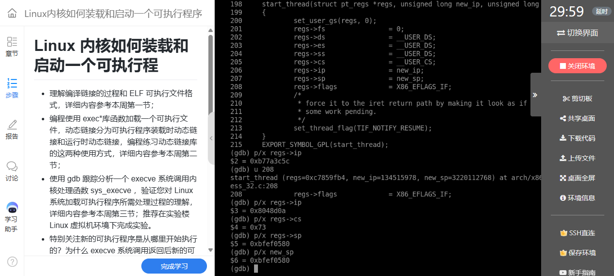

# 实验七：ELF 装载、动态链接与 execve 后的新执行起点

**真实姓名：姚翔　学号：20262822　课程：《Linux内核原理与分析》**  
**实验记录：2026年10月18日　报告整理：2026年10月20日**  
本文根据本人 ELF 检查、共享库程序与 QEMU/GDB 实验记录整理，源码分析限定 Linux 3.18.6 i386，参考《Linux 内核分析》MOOC 配套实验并注明引用。

**原创声明：** 原创作品转载请注明出处。  
**课程出处：** [《Linux 内核分析》MOOC 课程](http://mooc.study.163.com/course/USTC-1000029000)。

## 一、实验操作与结果

本实验先分析可执行文件和两种动态链接方式，再用最小 initramfs 跟踪 `/init` 执行 `execve("/hello", ...)`。主要命令如下：

```bash
cd ~/lab7
gcc -m32 -static -o init exec_test.c
gcc -m32 -static -o hello hello.c
readelf -h hello
readelf -l hello
mkdir -p /tmp/ird7
cp init hello /tmp/ird7/
(cd /tmp/ird7 && find . | cpio -o -H newc | gzip > /tmp/e7.img)
cd ~/LinuxKernel
qemu -kernel linux-3.18.6/arch/x86/boot/bzImage \
  -initrd /tmp/e7.img -nographic -append "console=ttyS0" \
  -s -S </dev/null >/tmp/out7 2>&1 &
```

源码的分工如下。前两个文件用于客户机内的 exec 跟踪，后三个文件用于实验终端内的动态链接比较；两组实验的运行环境应分别核对。

```text
源码/
├── exec_test.c       /init：准备 argv、envp，调用 execve
├── hello.c           /hello：打印身份、参数和环境，随后常驻
├── libmy.c           共享库：hello_from_lib 与 add
├── main_linktime.c   ELF 依赖共享库，装载时由动态链接器处理
└── main_runtime.c    用 dlopen、dlsym 在运行中请求共享库
```

控制台先输出旧程序准备执行 `/hello`，随后显示新程序启动、`argc=3` 以及 `/hello`、`arg1`、`arg2`。新旧程序的 PID 均为 1，说明 exec 更换了该进程执行的程序；它没有像 fork 一样产生一个新的子进程。



**图1：** exec 前后 PID 保持为 1，新程序接收到三个参数与环境变量。

## 二、从 ELF 文件认识装载

### 1. 文件头与入口

`readelf -h hello` 表明目标为 32 位 Intel 80386 ELF，可执行文件类型为 `EXEC`，入口地址为 **0x08048d0a**。这是文件声明的执行入口，不能直接写成 C 的 `main` 地址；静态链接的 C 程序通常先进入运行时启动代码，再调用 `main`。



**图2：** ELF 文件头给出位数、体系结构、文件类型及入口地址。

### 2. 程序头决定内存映射

截图列出 6 个程序头，其中有 **两个 `PT_LOAD`**，另有 `NOTE`、`TLS`、`GNU_STACK`、`GNU_RELRO`。不能把第三行 `NOTE` 也计为装载段。两个 LOAD 分别具有可读可执行、可读可写权限，承担代码/只读内容与可写数据等映射。



**图3：** 六个程序头中两个 LOAD 分别映射可执行与可写内容。

| 字段 | 装载时的含义 |
|---|---|
| `p_offset` | 段数据在文件中的偏移 |
| `p_vaddr` | 段在进程虚拟地址空间中的地址依据 |
| `p_filesz` | 文件中实际提供的数据长度 |
| `p_memsz` | 内存中所需长度，可以大于文件长度 |
| `p_flags` | 段的读、写、执行权限 |
| `p_align` | 装载对齐要求 |

第二个 LOAD 中内存长度大于文件长度，多出的区域需要零初始化，可对应 BSS 等内容。实现时既涉及文件末页剩余部分清零，也可能建立额外的零页映射；不能把所有 BSS 初始化都归结为一次 `padzero`。程序装载主要依据程序头，不能把面向链接和分析的节表等同于装载映射表。

## 三、装载时与运行时动态链接

### 1. 构建与检查命令

```bash
gcc -fPIC -shared -o libmyhello.so libmy.c
gcc -o main_linktime main_linktime.c -L. -lmyhello
readelf -d main_linktime | grep NEEDED
LD_LIBRARY_PATH=. ./main_linktime
gcc -o main_runtime main_runtime.c -ldl
./main_runtime
```

装载时动态链接的程序在编译链接阶段记录对 `libmyhello.so` 的依赖。截图中的 `NEEDED` 正是这一记录；实际装入共享库及解析符号由用户态动态链接器负责，不能把它描述成内核直接逐个完成所有共享库函数链接。



**图4：** 动态段中的 NEEDED 记录 libmyhello.so 等依赖。

运行结果中，直接链接的调用得到 `add(3,4)=7`；`dlopen` 示例在运行时装载库、取得函数地址，得到 `add(20,22)=42`。两者使用同一份共享库，区别在于依赖建立和显式请求装载的时机。


**图5：** 装载时与运行时动态链接分别运行成功，计算结果为 7 和 42。

### 2. 程序与错误处理

共享库实现：

```c
#include <stdio.h>

/* 共享库实现：libmyhello.so */
void hello_from_lib(void)
{
    printf("[libmyhello.so] hello, I am a shared library function\n");
}

int add(int a, int b)
{
    return a + b;
}
```

装载时动态链接的调用方：

```c
#include <stdio.h>

/*
 * 方式一：装载时动态链接（load-time dynamic linking）
 * 编译时链接 libmyhello.so，生成的 ELF 中记录 DT_NEEDED，
 * 由动态链接器 ld-linux.so 在 execve 装载程序时一并把这个 .so 映射进来。
 *
 *   gcc -o main_linktime main_linktime.c -L. -lmyhello
 *   readelf -d main_linktime | grep NEEDED
 *   ./main_linktime            (需要 LD_LIBRARY_PATH=.)
 */
extern void hello_from_lib(void);
extern int add(int a, int b);

int main(void)
{
    printf("[main_linktime] before calling library function\n");
    hello_from_lib();
    printf("[main_linktime] add(3, 4) = %d\n", add(3, 4));
    return 0;
}
```

运行时动态链接的调用方：

```c
#include <stdio.h>
#include <dlfcn.h>

/*
 * 方式二：运行时动态链接（run-time dynamic linking）
 * 编译时完全不依赖 libmyhello.so，程序运行时由 dlopen() 主动装载，
 * 再用 dlsym() 找到函数地址后调用。
 *
 *   gcc -o main_runtime main_runtime.c -ldl
 *   ./main_runtime
 */
int main(void)
{
    void *handle;
    void (*fn)(void);
    int (*add)(int, int);
    char *err;

    printf("[main_runtime] before dlopen\n");

    handle = dlopen("./libmyhello.so", RTLD_NOW);
    if (!handle) {
        printf("[main_runtime] dlopen failed: %s\n", dlerror());
        return 1;
    }
    printf("[main_runtime] dlopen OK, handle = %p\n", handle);

    dlerror();
    fn = (void (*)(void)) dlsym(handle, "hello_from_lib");
    err = dlerror();
    if (err) {
        printf("[main_runtime] dlsym hello_from_lib failed: %s\n", err);
        dlclose(handle);
        return 1;
    }
    fn();

    add = (int (*)(int, int)) dlsym(handle, "add");
    printf("[main_runtime] add(20, 22) = %d\n", add(20, 22));

    dlclose(handle);
    printf("[main_runtime] done\n");
    return 0;
}
```

原程序检查了 `dlopen` 和第一个 `dlsym`，第二次查询 `add` 后也应按同样方法清除并读取 `dlerror`，确认成功再调用，避免空函数指针。`LD_LIBRARY_PATH=.` 用于本次实验的库搜索，`dlopen("./libmyhello.so", ...)` 则提供相对路径；程序的当前目录变化后，两者都需要重新检查。

## 四、跟踪 execve 的内核处理

### 1. 断点与调用链

```gdb
file linux-3.18.6/vmlinux
target remote :1234
break sys_execve
break load_elf_binary
break start_thread
continue
bt
```

本次用户调用对应 i386 系统调用号 11，即 `eax=0xb`。内核检查文件名、参数与环境，把待执行文件组织为 `linux_binprm`，再寻找合适的二进制格式处理函数。跟踪时需要识别目标为 `/hello` 的这次请求，避免把启动过程装载初始 `/init` 的动作混在一起。



**图6：** sys_execve 断点及寄存器、调用栈用于定位用户的装载请求。

`load_elf_binary` 断点处可以检查 `bprm->filename` 及文件头。`/hello` 与 ELF 魔数 `7f 45 4c 46` 把本次调试对象和前面的 readelf 分析连接起来。



**图7：** load_elf_binary 的参数与调用链表明正在处理目标 ELF。

### 2. 装载主体的职责

在 Linux 3.18.6 中，可将主体工作概括为：检查 ELF 和程序头；处理可能存在的解释器；准备替换当前进程的执行环境；按 LOAD 映射内容并处理零初始化；安排用户栈、参数与辅助向量；最后设置即将返回用户态的寄存器现场。

`setup_arg_pages` 参与参数栈映射，`create_elf_tables` 则构造包含 `argc`、`argv`、`envp` 和辅助向量的用户初始栈。不能把“传了三个参数”简单解释成调用内核 C 函数时的三个栈槽，它是面向新程序启动协议组织的数据。[Linux 3.18.6 binfmt_elf.c](https://github.com/gregkh/linux/blob/v3.18.6/fs/binfmt_elf.c)

## 五、start_thread 为什么改变 exec 之后的执行位置

### 1. 修改的是保存的用户寄存器

`start_thread(regs, new_ip, new_sp)` 为当前任务准备新的用户返回状态，关键操作如下：

```c
/* 按 Linux 3.18.6 i386 源码整理关键赋值。 */
regs->ip = new_ip;
regs->sp = new_sp;
regs->cs = __USER_CS;
regs->ss = __USER_DS;
regs->flags = X86_EFLAGS_IF;
```

这些赋值没有立即在内核中调用用户 `main`，而是改变将来返回用户态时使用的控制现场。函数名称中的 thread 也不表示这里又创建了一个调度实体。



**图8：** start_thread 设置新的用户代码段、入口、栈和标志。

本次旧 `regs->ip=0xb77a3c5c`，执行赋值后变为 **0x08048d0a**，恰好等于静态 `/hello` 的 ELF 入口。由文件头到内核字段的对应，解释了为什么成功的 exec 不再回到旧程序调用点之后。



**图9：** 保存的用户 IP 从旧程序位置变为 hello 的 ELF 入口。

同时，`regs->sp` 与参数 `new_sp` 都为 **0xbfef0580**，`cs=0x73`。新入口和新栈必须一起准备：只有入口而没有符合启动协议的栈，运行时仍无法正确读取参数。



**图10：** 新用户栈指针等于 new_sp，用户代码段选择子为 0x73。

### 2. 静态目标与动态目标的区别

本次 `/hello` 静态链接，观察到的入口直接对应它的 ELF `e_entry`。动态 ELF 若包含 `PT_INTERP`，初始执行通常先交给解释器/动态链接器；主程序入口等信息通过辅助向量传递，随后才进入主程序。因此，“exec 总是直接跳到主程序 e_entry”不是适用于所有 ELF 的结论。

### 3. 同一个进程，新的程序映像

成功的 exec 不返回旧程序；若失败，用户接口通常返回 `-1` 并设置 `errno`。它会替换地址空间和用户执行现场，但通常保留进程身份；未设置 `FD_CLOEXEC` 的文件描述符一般继续保持打开，不能说“旧进程所有资源一律清空”。本实验使用单线程 PID 1，前后 PID 相同就是这一语义的直接观察。[execve 接口说明](https://man7.org/linux/man-pages/man2/execve.2.html)

### 4. exec 后的初始用户栈与内核保存现场

`start_thread` 仍在内核中执行，它修改的 `regs` 属于保存的用户返回现场。本次 `regs->ip=0x08048d0a`、`regs->sp=0xbfef0580`，分别决定回到用户态后的入口和栈位置，不能将它们误当成此刻内核正在使用的 EIP、ESP。

新用户栈按启动协议组织。下面是本次 `argc=3` 的逻辑布局，省略对齐、辅助数据细节；指针数组和字符串内容不是同一层：

```text
低地址
new_sp → argc = 3
          argv[0] 指针 → "/hello"
          argv[1] 指针 → "arg1"
          argv[2] 指针 → "arg2"
          NULL，结束 argv
          envp 各项指针
          NULL，结束 envp
          辅助向量 auxv，最后为 AT_NULL
          对齐与辅助数据、参数及环境字符串等
高地址
```

这不是内核直接按 C 调用约定调用 `main(argc, argv)`：CPU 先进入 ELF 启动入口，用户运行时再读取这份初始栈并建立 C 程序环境。静态目标通常先进入它自己的启动代码；带 `PT_INTERP` 的动态目标通常先进入解释器，解释器可由 `AT_ENTRY` 等辅助信息取得主程序入口。两条路径都依赖新用户栈，却不一定先执行同一个 ELF 的入口。可对照 [Linux 3.18.6 的 create_elf_tables 与装载实现](https://github.com/gregkh/linux/blob/v3.18.6/fs/binfmt_elf.c)。

## 六、测试程序与参数验证

下面保留原始实测程序。其中 `exec_test.c` 开头注释中的“execve 返回后”应按前文理解为成功后进入新程序，而非回到旧调用点；实际执行逻辑也仅在失败时落到后面的打印语句。

```c
#include <stdio.h>
#include <unistd.h>

/*
 * /init —— 作为 initramfs 的 init，用 execve 装载 /hello。
 * 观察点：execve 返回后，这个进程"变成"了 /hello，
 * 用户态 IP 跳到了 /hello 的 ELF 入口（elf_entry）。
 */
int main(void)
{
    char *argv[] = { "/hello", "arg1", "arg2", NULL };
    char *envp[] = { "HOME=/", "PATH=/bin:/sbin", NULL };

    printf("=== [init] before execve, pid=%d ===\n", (int)getpid());
    printf("=== [init] calling execve(\"/hello\", ...) now ===\n");
    fflush(stdout);

    execve("/hello", argv, envp);

    /* 只有 execve 失败才会走到这里 */
    printf("=== [init] execve FAILED ===\n");
    fflush(stdout);

    for (;;)
        pause();

    return 0;
}
```

目标程序输出参数与身份，最后保持 PID 1 存活：

```c
#include <stdio.h>
#include <unistd.h>

/*
 * /hello —— 被 execve 装载的目标可执行程序
 * 装载成功后它会打印自己的 pid/ppid/argv，然后常驻，
 * 这样它作为 PID 1 不会退出，内核不会 panic。
 */
int main(int argc, char *argv[], char *envp[])
{
    int i;

    printf("=== [hello] execve succeeded, this is the NEW program ===\n");
    printf("=== [hello] pid=%d ppid=%d ===\n", (int)getpid(), (int)getppid());
    printf("=== [hello] argc=%d ===\n", argc);
    for (i = 0; i < argc; i++)
        printf("=== [hello] argv[%d] = %s ===\n", i, argv[i]);

    printf("=== [hello] envp[0] = %s ===\n", envp[0] ? envp[0] : "(null)");
    fflush(stdout);

    for (;;)
        pause();

    return 0;
}
```

`argv` 末尾必须为空指针，`argc=3` 计算的是三个非空参数，不计终止项。新程序显示的环境变量来自提供的 `envp`。二者经新用户栈交给运行时，再以 C 接口形式传递给 `main`。

## 七、问题、解决与认识

| 问题 | 解释与处理 | 对应验证 |
|---|---|---|
| ELF 的入口就是 main 吗？ | 先进入运行时启动入口，再由启动代码调用 main | readelf 入口与 start_thread 的新 IP 一致 |
| 程序头有三段 LOAD 吗？ | 逐行识别 Type，NOTE 不属于 LOAD | 截图共 6 个程序头，只有 2 个 LOAD |
| exec 为什么不执行后面的正常语句？ | 成功后使用新 IP、新 SP 返回用户态 | IP 变为 0x08048d0a，新程序实际输出 |
| 动态库找不到怎么办？ | 检查库路径、NEEDED、位数和解释器依赖 | LD_LIBRARY_PATH 配合 readelf，dlopen 检查 dlerror |
| exec 和 fork 是否都是创建进程？ | fork 建立新任务，exec 更换现有任务执行内容 | exec 前后 PID 仍为 1 |

本实验把磁盘上的 ELF、地址空间中的映射和 CPU 即将使用的用户现场联系起来。程序能运行，需要文件格式、映射权限、参数栈和返回寄存器彼此一致；仅知道入口地址，仍不足以解释完整的装载过程。

## 八、附件与参考

完整程序见 [exec_test.c](源码/exec_test.c)、[hello.c](源码/hello.c)、[libmy.c](源码/libmy.c)、[main_linktime.c](源码/main_linktime.c)、[main_runtime.c](源码/main_runtime.c)。

- 课程来源：[《Linux 内核分析》MOOC](http://mooc.study.163.com/course/USTC-1000029000)。
- 通用 exec：[Linux 3.18.6 fs/exec.c](https://github.com/gregkh/linux/blob/v3.18.6/fs/exec.c)。
- ELF 装载：[Linux 3.18.6 fs/binfmt_elf.c](https://github.com/gregkh/linux/blob/v3.18.6/fs/binfmt_elf.c)。
- i386 用户现场：[Linux 3.18.6 process_32.c](https://github.com/gregkh/linux/blob/v3.18.6/arch/x86/kernel/process_32.c)。
