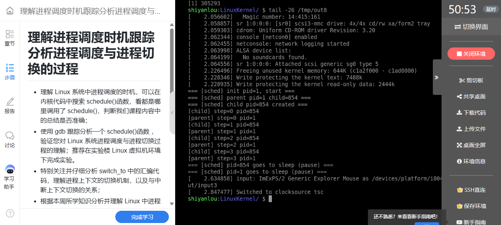
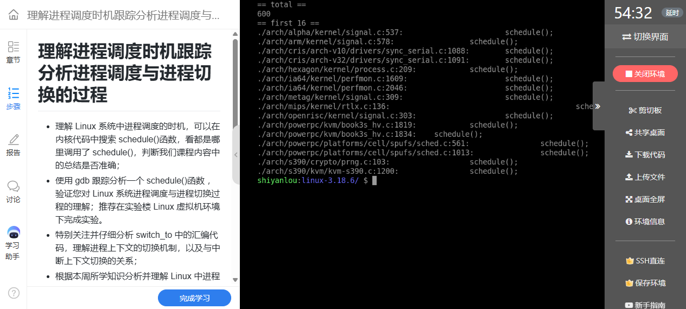
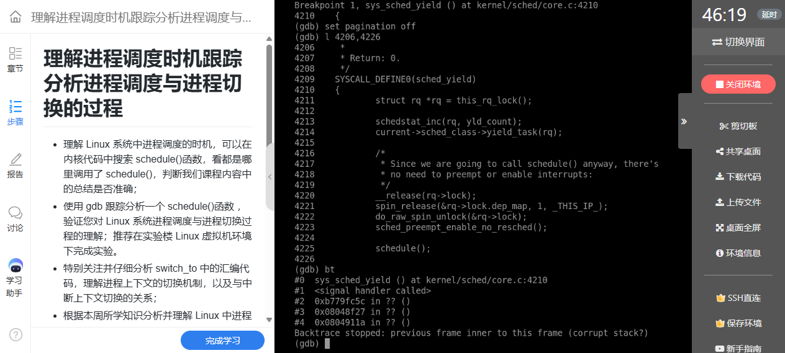
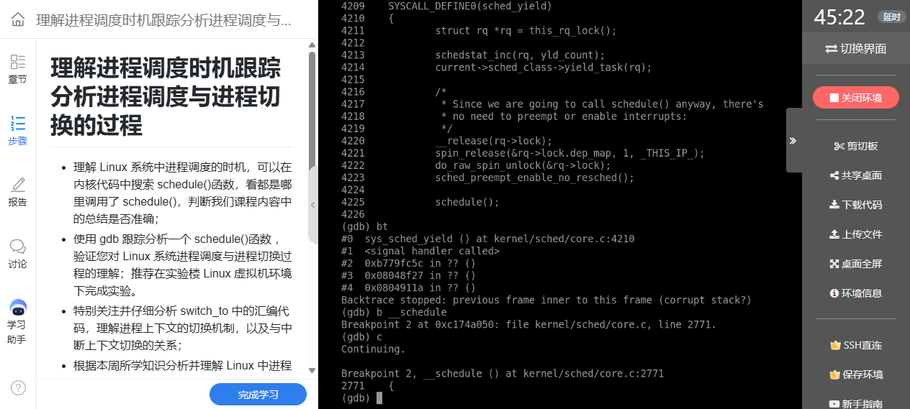
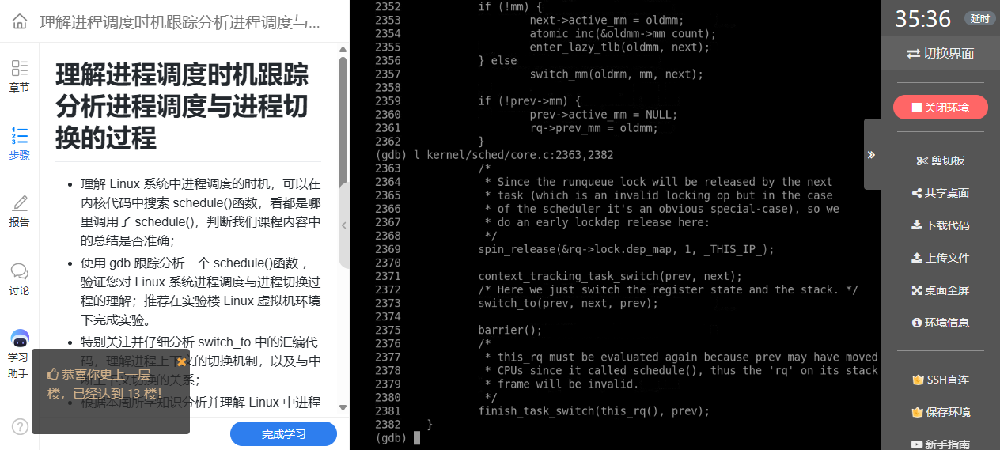
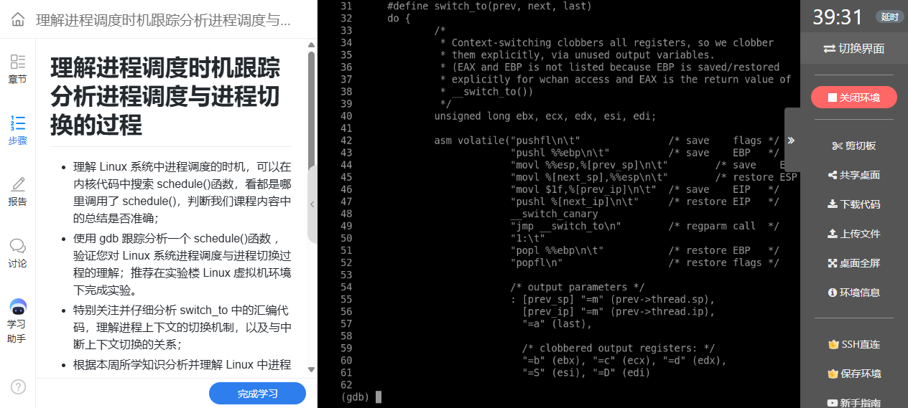
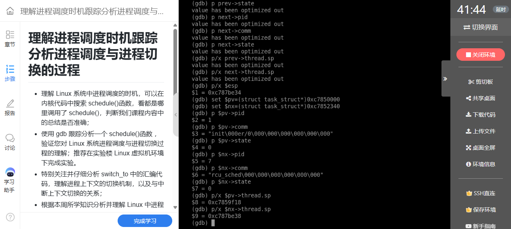
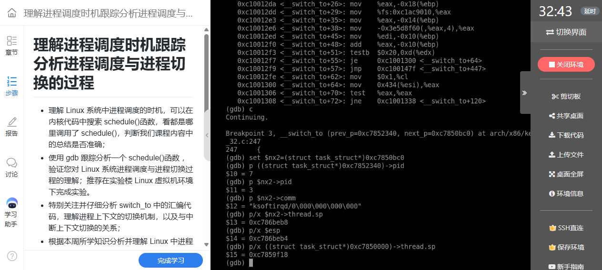
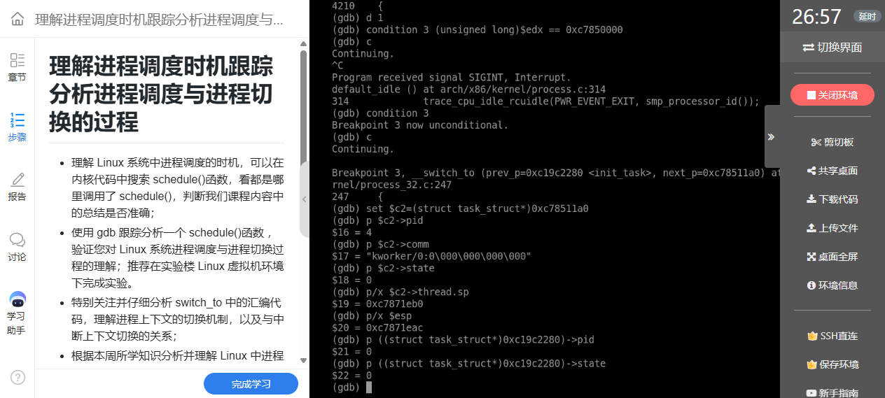

# 实验八：调度何时发生——跟踪 schedule 与 switch_to

**真实姓名：姚翔　学号：20262822　课程：《Linux内核原理与分析》**  
**实验记录：2026年10月18日　报告整理：2026年10月20日**  
本文根据本人调度测试程序与 QEMU/GDB 截图整理，源码分析限定 Linux 3.18.6 i386；课程及源码出处见文末。

**原创声明：** 原创作品转载请注明出处。  
**课程出处：** [《Linux 内核分析》MOOC 课程](http://mooc.study.163.com/course/USTC-1000029000)。

## 一、实验操作、文件与运行结果

实验程序作为 `/init` 启动，创建一个子进程，父子各打印四次并调用 `sched_yield()`，随后进入 `pause()`。主要操作如下：

```bash
cd ~/lab8
gcc -m32 -static -o sched_test sched_test.c
mkdir -p /tmp/ird8
cp sched_test /tmp/ird8/init
(cd /tmp/ird8 && find . | cpio -o -H newc | gzip > /tmp/e8.img)
cd ~/LinuxKernel
qemu -kernel linux-3.18.6/arch/x86/boot/bzImage \
  -initrd /tmp/e8.img -nographic -append "console=ttyS0" \
  -s -S </dev/null >/tmp/out8 2>&1 &
gdb linux-3.18.6/vmlinux
```

```text
源码/sched_test.c              制造两个可运行任务与主动让出 CPU 的机会
kernel/sched/core.c            schedule、__schedule、context_switch
arch/x86/include/asm/switch_to.h  32 位 switch_to 汇编与约束
arch/x86/kernel/process_32.c   __switch_to 的体系结构状态处理
```

本次控制台中父进程为 PID 1、子进程为 PID 854，双方 `step=0～3` 交替出现，最后进入睡眠。它显示两个进程都实际获得了执行；但 `sched_yield()` 不是同步原语，不承诺每次调用后都严格由另一个进程运行。这次交替顺序是本次调度结果，不是程序的跨环境保证。



**图1：** 本次父子进程各输出四步，并在最后 pause 常驻。

## 二、从调度调用点理解调度时机

### 1. 搜索入口，不把搜索数量当作行为次数

```bash
cd ~/LinuxKernel/linux-3.18.6
grep -Rn 'schedule();' . | wc -l
grep -Rn 'schedule();' kernel | wc -l
grep -n 'schedule();' kernel/sched/core.c
```

截图中的全树搜索为 600 行、`kernel` 子目录为 70 行。它们是该源码树中匹配文本的行数，可能包含其他体系结构和未启用配置；不是运行时发生了 600 次调度，也不是严格统计所有调度机制。搜索的价值在于定位等待、同步、让出 CPU 和返回路径等可继续阅读的位置。



**图2：** 源码文本搜索得到 600 个匹配行，用于定位调度相关代码。

调度大致可以从三类情况理解：任务等待资源而主动睡眠；可运行任务主动让出 CPU；抢占请求在允许调度的边界得到处理。硬中断处理通常不能像普通进程上下文那样任意睡眠，必须区分“设置需要调度的标志”和“实际执行任务切换”。

### 2. sched_yield 的实际含义

```gdb
target remote :1234
break sys_sched_yield
break __schedule
break __switch_to
continue
```

`sys_sched_yield` 通过当前调度类的 `yield_task` 操作调整调度状态，随后调用 `schedule`。不能把所有调度类都解释成“无条件把任务放到同一个队列末尾”；尤其普通 CFS 任务的行为有自身实现。源码中的 `preempt_enable_no_resched` 是允许抢占但不在该操作中立即执行重调度，不能解释成关闭抢占。



**图3：** sys_sched_yield 调用调度类操作，并进入 schedule 路径。

调度器最终选出的 `next` 若与 `prev` 相同，就无须做任务上下文切换。因此 `schedule` 被调用、`sched_yield` 返回与“肯定切换到指定进程”不是同一个结论。[sched_yield 接口说明](https://man7.org/linux/man-pages/man2/sched_yield.2.html)

## 三、从 __schedule 到 context_switch

### 1. 选择任务与交接 CPU

可将核心流程概括为：

```text
schedule
  → __schedule
      更新当前任务及运行队列状态
      选择 next，维护 rq->curr 等信息
      若 prev != next：context_switch
          处理地址空间
          switch_to(prev, next, prev)
          finish_task_switch 等收尾
```

调度策略决定选谁，体系结构切换代码负责让选中的任务真正接着执行。二者有明确分工；仅分析汇编换栈，还无法说明为什么选择了这个任务。[Linux 3.18.6 调度核心](https://github.com/gregkh/linux/blob/v3.18.6/kernel/sched/core.c)



**图4：** __schedule 断点用于追踪选择与切换前的调度过程。

### 2. 地址空间不总是重新装入

`context_switch` 先处理地址空间关系。用户任务有 `mm`；内核线程常见 `mm=NULL`，可借用前一个任务的 `active_mm`。不同地址空间可能需要切换页表与 TLB 上下文，同一地址空间则存在优化路径，不能写成每次 `switch_to` 都必定重写 CR3。


**图5：** context_switch 上半部分按任务地址空间关系准备内存管理上下文。

调用 `switch_to` 之后，执行者已经可能是另一个任务。源码要重新取得合适的运行队列并完成上次切换的收尾；涉及编译器 `barrier()` 的位置也不能直接当成处理器的通用内存屏障。理解这里必须跟着“当前在谁的栈上”变化，而不是把整个函数当作普通的单任务顺序调用。



**图6：** context_switch 调用 switch_to，恢复后继续执行切换收尾。

## 四、逐条分析 32 位 switch_to

以下按该版本宏整理主要汇编，省略可配置的栈保护指令和 C 约束。`prev_sp`、`next_sp`、`prev_ip`、`next_ip` 代表对应任务字段，不是可直接编译的独立汇编操作数：

```asm
pushfl                     # 在 prev 内核栈保存标志
pushl %ebp                 # 保存帧指针
movl %esp, prev_sp         # 记住 prev 暂停时的栈位置
movl next_sp, %esp         # 切换到 next 内核栈
movl $1f, prev_ip          # prev 将来从局部标号 1 恢复
pushl next_ip              # 在 next 栈上放置返回目标
jmp __switch_to            # 继续处理体系结构状态
1:
popl %ebp                  # 恢复该任务此前保存的帧指针
popfl                      # 恢复该任务标志
```

这是九条主要指令加一个局部标号，真实宏还包含约束和可选配置。`mov next_sp,%esp` 是栈归属发生变化的关键；其后压入的返回目标属于新任务的栈。原任务的 `thread.ip` 被写为 `1f`，为未来恢复保留续执行位置。



**图7：** switch_to 的原始宏展示换栈、保存恢复位置和跳转的配合。

`jmp` 本身不压入返回地址，前一条 `pushl next_ip` 人工准备了返回目标。`__switch_to` 按本版本内核的寄存器传参约定接收 `prev` 与 `next`，并处理 TLS、段寄存器、内核栈入口信息以及与配置和标志有关的其他状态。它不是用户态普通 C ABI 调用，也不能把所有通用寄存器的处理都归给这九条可见指令；宏的输出约束同样参与编译器的寄存器保存安排。[Linux 3.18.6 switch_to.h](https://github.com/gregkh/linux/blob/v3.18.6/arch/x86/include/asm/switch_to.h)

### 1. 已运行任务的恢复

假设 A 切到 B，A 的栈位置和恢复点被保存。以后 C 选择 A，恢复 A 的栈并以 A 保存的 `thread.ip` 作为返回目标，A 便从自己的 `1:` 继续，弹出此前保存的 EBP 和标志，回到自己的调度调用后方。它看到的是一次暂停后继续，期间 CPU 实际执行过其他任务。

`last` 接收的是这次把 CPU 交给恢复者的前一任务；不能一直按最初 A→B 的局部命名理解。返回后的变量属于恢复任务自己的栈，阅读时要同时标明“谁正在恢复”和“谁刚被换下”。

### 2. 新任务的首次执行

实验六中的子进程还没有执行过 `1:`，其 `thread.ip` 由 `copy_thread` 预设为 `ret_from_fork`。同一套 `push next_ip` 与返回机制既可以恢复旧任务，也可以把新任务带入首次运行路径。这样，创建阶段构造的现场与调度阶段使用的现场就连接起来了。

### 3. 已运行任务切换时，栈上的返回目标是什么

对于已经运行过、暂停在本宏中的任务 B，恢复 B 的 SP 后又压入 `B.thread.ip`，因此跳入 `__switch_to` 前的局部布局为：

```text
高地址
B.thread.sp + 4  保存的 B 标志寄存器
B.thread.sp      保存的 B 帧指针 EBP
B.thread.sp - 4  人工压入的 B 恢复地址 ← 入口处 ESP
低地址
```

辅助函数返回时取得人工准备的恢复地址，B 进入自己的 `1:`，再恢复 EBP 和标志。首次运行的新任务则使用创建阶段准备的栈与入口，不能把上面“已运行任务”的两项保存布局直接套给它。该区别把本节的九条汇编与实验六的初始现场联系起来，也说明同样是恢复控制流，栈内容必须与返回位置匹配。

## 五、用实际栈指针验证换栈

### 1. 三次切换的数据

第一次观察为 PID 1 的 `init` 切到 PID 7 的 `rcu_sched`；两者状态值均为 0，即可运行状态。`prev->thread.sp=0xc7859f18`，`next->thread.sp=0xc787be38`，而停止处的 ESP 为 `0xc787be34`，相差 4 字节。



**图8：** 根据明确的任务地址重新读取 prev、next 字段，验证已切换到 next 的栈。

第二次为 PID 7 切到 PID 3 的 `ksoftirqd/0`，`next->thread.sp=0xc786beb8`，`esp=0xc786beb4`。再次得到 4 字节差值。



**图9：** 第二次切换的 next 栈指针与 ESP 相差一个 32 位返回地址。

第三次为 PID 0 的 idle 切到 PID 4 的 `kworker/0:0`，`next->thread.sp=0xc7871eb0`，`esp=0xc7871eac`，相同关系继续成立。



**图10：** idle 切向 kworker 的现场中，同样可以核对 next 栈与返回地址。

| 切换 | next 保存的 SP | __switch_to 入口 ESP | 差值 |
|---|---|---|---|
| init(1) → rcu_sched(7) | `0xc787be38` | `0xc787be34` | `4` |
| rcu_sched(7) → ksoftirqd/0(3) | `0xc786beb8` | `0xc786beb4` | `4` |
| idle(0) → kworker/0:0(4) | `0xc7871eb0` | `0xc7871eac` | `4` |

### 2. 为什么必须限定断点位置

在宏刚执行 `push next_ip`、并跳到 `__switch_to` 符号入口时，32 位栈新增一个 4 字节返回地址，因而有 `ESP = next->thread.sp - 4`。这条关系适用于本次入口位置；编译器生成的函数序言继续压栈或分配局部空间之后，ESP 会变化，不能将它当成函数内部任意位置的不变式。

优化使局部变量显示 `optimized out` 时，可根据已确认的函数实参或 ABI 寄存器取得任务地址，再用强制类型转换检查字段。不能从无效局部变量猜值，也不能把内核地址固定为跨运行的常量。

## 六、中断、系统调用与任务切换的区别

| 情形 | 核心变化 | 是否必然更换当前任务 |
|---|---|---|
| 系统调用进入内核 | 保存用户现场，按入口协议转入内核执行 | 否 |
| 硬件中断处理 | 响应事件，按架构保存和恢复被打断现场 | 否 |
| 任务上下文切换 | 交接可执行任务，切换内核栈和体系结构状态 | 是 |

中断与异常的栈使用还可能受架构和配置影响，不能统一断言永远只在某一块栈上。系统调用属于当前任务的进程上下文，可以在允许的位置阻塞；硬中断上下文受到更严格的限制。实验五的返回前调度检查与本实验的 `schedule` 分析，说明了事件发生和任务真正切换之间存在机制上的衔接。

### Linux 系统的一般执行过程

结合启动、系统调用、异常中断、创建和切换，可以把课程中的一般执行过程整理为以下机制示意：

```text
初始化建立任务、内存和中断等运行条件
  → 可运行任务获得 CPU，执行自己的用户态或内核态代码
  → 系统调用、异常或硬件中断引起控制转移
  → 入口保存必要现场，执行相应内核处理
      ├─ 原任务仍可继续：完成返回前工作，恢复原执行
      ├─ 任务阻塞或允许抢占：在合法调度点执行 schedule
      │   → 选择 next；需要时切换地址空间、内核栈及架构状态
      │   → 恢复已有任务，或执行新任务预设的首次入口
      └─ 没有普通可运行任务：执行该 CPU 的 idle 路径
```

硬件中断也可以打断内核代码，返回目标不总是用户态。系统调用处理、异常恢复、任务唤醒和调度相互协作，但不要求每次入口都切换任务。本实验看到的栈交接，正是把调度选择落实为下一段实际执行的关键步骤；它需要与入口保存的用户现场共同理解，而不能把 `switch_to` 当成一次普通函数跳转。

## 七、测试程序、问题与总结

下列保留实测程序。开头注释中的“于是会发生真正的进程切换”表示本实验制造切换机会的意图；严格说仍要以 `prev != next` 和具体断点结果判断，不能理解为每次 yield 的保证。

```c
#include <stdio.h>
#include <unistd.h>
#include <sched.h>

/*
 * sched_test.c —— 作为 initramfs 的 init
 *
 * 目的：制造可观察的进程调度。
 *   1) fork 出父子两个可运行(R)进程，双方都反复调用 sched_yield()
 *      → 触发 sys_sched_yield() → schedule()，prev->state 仍是 TASK_RUNNING，
 *        于是会发生真正的"进程切换"（不是睡眠后唤醒）。
 *   2) 最后双方都 pause() 常驻，保证 init 不退出（否则内核 panic）。
 */

static void work(const char *who, int n)
{
    int i;
    for (i = 0; i < n; i++) {
        printf("[%s] step=%d pid=%d\n", who, i, (int)getpid());
        fflush(stdout);
        sched_yield();          /* → sys_sched_yield() → schedule() */
    }
}

int main(void)
{
    pid_t pid;

    printf("=== [sched] init pid=%d, start ===\n", (int)getpid());
    fflush(stdout);

    pid = fork();
    if (pid == 0) {
        printf("=== [sched] child pid=%d created ===\n", (int)getpid());
        fflush(stdout);
        work("child", 4);
    } else {
        printf("=== [sched] parent pid=%d child=%d ===\n", (int)getpid(), (int)pid);
        fflush(stdout);
        work("parent", 4);
    }

    printf("=== [sched] pid=%d goes to sleep (pause) ===\n", (int)getpid());
    fflush(stdout);

    for (;;)
        pause();

    return 0;
}
```

| 问题 | 原因 | 解决方案 |
|---|---|---|
| yield 后是否必须轮到另一个进程？ | 让出 CPU 不等于建立同步顺序 | 将输出作为一次结果，以 prev/next 验证具体切换 |
| 全树搜索数量能说明调度次数吗？ | 静态匹配与实际执行不同 | 用搜索找位置，用断点观察运行 |
| 为什么 jmp 后还能 ret？ | 返回目标已手工压到 next 栈上 | 逐条跟踪 ESP 与 next_ip |
| 为什么入口 ESP 比 thread.sp 小 4？ | 32 位返回地址占一个栈字 | 在函数序言前核对，三次结果一致 |
| 新任务没有旧的恢复点，如何执行？ | 创建阶段已构造首次入口和栈 | 结合实验六的 ret_from_fork 解释 |

我对切换的理解是：调度器先决定谁继续，架构代码再让 CPU 使用该任务的栈和续执行状态。看似“同一个函数返回了”，背后可能已经跨越多次调度。将任务、栈和返回地址一起跟踪，才能正确解释这一现象。

完整实测程序：[sched_test.c](源码/sched_test.c)。

- 课程来源：[《Linux 内核分析》MOOC](http://mooc.study.163.com/course/USTC-1000029000)。
- 调度主体：[Linux 3.18.6 kernel/sched/core.c](https://github.com/gregkh/linux/blob/v3.18.6/kernel/sched/core.c)。
- 切换宏：[Linux 3.18.6 switch_to.h](https://github.com/gregkh/linux/blob/v3.18.6/arch/x86/include/asm/switch_to.h)。
- 架构状态：[Linux 3.18.6 process_32.c](https://github.com/gregkh/linux/blob/v3.18.6/arch/x86/kernel/process_32.c)。

