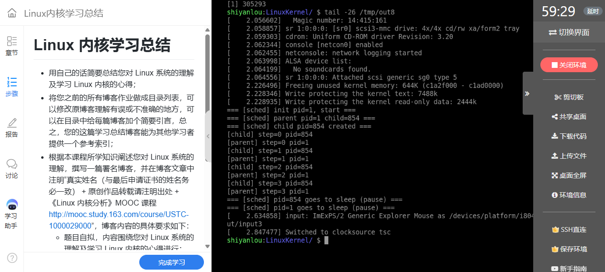

# 实验九：Linux 内核学习总结——把程序、进程、栈和执行路径联系起来

**姓名：姚翔　学号：20262822　课程：《Linux内核原理与分析》**  
**报告整理：2026年10月20日**  
本文为本人课程实验与学习记录的总结。各实验的操作、截图和程序见下文索引；引用《Linux 内核分析》MOOC 与版本源码的内容已注明来源，转载请注明出处。

## 一、任务与总结范围

本次实验要求用自己的话概括对 Linux 系统和内核的理解，将此前实验报告整理成带引言的目录，并说明学习中最大的收获与遗憾。因此本文沿着已有实验重新组织认识，重点回答“前后几个实验怎样解释同一个程序的执行过程”。

任务页给出的要求也提醒我：总结不能只罗列函数名，还要给读者可继续查阅的入口，并把具体观察转化成自己的解释。

**图1：** 实验九要求总结内核理解、整理实验目录，并说明收获与遗憾。

## 二、我对 Linux 系统的理解

### 1. 内核管理资源，也维护运行的秩序

从用户的角度，程序执行、文件读写和终端输出似乎是应用自己的行为；从内核的角度，它们涉及 CPU 时间、地址空间、文件对象、权限和设备。Linux 内核通过数据结构记录资源及其关系，通过系统调用提供服务，通过调度让可运行任务获得 CPU，通过中断和异常响应事件。

这里不能把系统调用写成所有用户态转入内核态的唯一途径，异常和硬件中断也会带来控制转移；也不能说内核从不主动运行，启动阶段和内核线程同样执行内核代码。系统调用的特殊之处，是为应用主动请求服务提供约定明确、经过检查的接口。

### 2. 程序、进程和线程需要分别理解

程序文件描述可以执行的内容，进程具有运行中的地址空间和资源关系，Linux 用任务结构表示可调度实体。线程可以共享地址空间和资源，但各自仍有独立的调度与执行上下文。`task_struct` 是理解这些关系的重要入口，却不是整个进程所有数据都直接放入其中的容器。

实验六和七给出了清楚的对照：fork 产生新任务，exec 在已有进程中装入新程序。实验八进一步说明，任务已经创建并且可运行，也不等于它此刻正在 CPU 上执行；还必须由调度器选中。

## 三、把实验串成完整的执行过程

### 1. 启动：从内核初始化到第一个用户程序

实验三跟踪的 `start_kernel`、`rest_init`、`kernel_init` 和执行用户 init 的路径，为后续实验提供了起点。启动并不是普通函数一层层调用到所有进程：初始任务继续承担 PID 0 的 idle 路径，PID 1 与 PID 2 由任务创建机制建立，随后分别执行自身的任务入口。

我需要特别区分“创建了 PID 1”与“PID 1 已经在用户态运行”。前者准备任务，后者还要完成初始化、装载和返回用户态。实验七解释了其中的 ELF 装载与用户现场准备；它与实验三的启动分析形成了衔接。具体函数名要按 Linux 3.18.6 查证，不能把其他版本的 exec 辅助函数名称直接套入。[Linux 3.18.6 init/main.c](https://github.com/gregkh/linux/blob/v3.18.6/init/main.c)

### 2. 系统调用：从接口语义到架构协议

实验四在同一进程中用库函数和内嵌汇编取得同一个 PID 884186，说明两种方法可以完成相同的服务请求；它不证明 libc 内部一定执行同一条 `int $0x80`。反汇编中出现 64 位指令和 i386 兼容调用，也让我认识到可执行文件位数与使用的系统调用 ABI 必须分开核对。

实验五把注意力移到内核端：入口保存现场，按调用号选择服务，将返回值写回保存区域，检查返回前工作，最后恢复用户执行。首次 write 断点来自内核解包根文件系统，这件事说明“看见服务函数”与“证明一次用户态入口”之间还需要上下文证据。

我现在会把一个系统调用拆成四个问题：用户提出什么请求、按什么 ABI 传递、内核如何执行、如何把结果交回。这样既能理解接口，也能容纳不同架构和版本的实现差异。

### 3. fork 与 exec：创建运行者和替换运行内容

| 比较项 | fork，实验六 | execve，实验七 |
|---|---|---|
| 主要作用 | 创建新的任务与资源关系 | 将当前进程执行内容替换为新程序 |
| 本次身份变化 | PID 1 创建 PID 864 | 执行前后 PID 均为 1 |
| 关键现场准备 | 子任务返回值清零，准备首次内核入口 | 设置新用户入口与用户栈 |
| 关键观察 | thread.ip 对应 ret_from_fork | 新 IP 对应 hello 的 ELF 入口 |
| 用户代码如何继续 | 父子分别从 fork 之后继续 | 成功后不回到旧程序的后续语句 |

实验六中，一个容易误读的现象是 `copy_thread` 里的新描述符还显示父任务复制来的 PID。沿着初始化顺序检查后，才能知道当时尚未赋予最终身份；真正运行到用户态的子进程为 PID 864。这比单看某个字段的截图更能说明源码顺序的重要性。

实验七则把文件与寄存器联系起来：`readelf` 给出的静态程序入口是 `0x08048d0a`，`start_thread` 最终把保存的用户 IP 改成同一个值，新栈为 `0xbfef0580`。返回用户态时使用了新现场，所以 CPU 执行新程序的启动代码，而不是旧程序中 execve 后的正常语句。

这些结论也有边界：普通 fork 的独立地址空间可以采用写时复制，并不要求立即复制所有物理页；exec 通常保留未设置 close-on-exec 的文件描述符；动态 ELF 还可能先进入解释器，不能把静态目标的路径推广成所有程序的唯一过程。

### 4. 调度：从“轮流运行”到具体的栈交接

实验八的控制台中父子进程交替输出，GDB 则把“轮流”解释为实际的任务选择和上下文切换。`schedule` 组织调度，`__schedule` 选择任务，`context_switch` 处理切换，`switch_to` 保存旧任务恢复点并使用新任务的栈。

最直观的数据是三个 `__switch_to` 入口现场：ESP 都比 next 保存的 SP 小 4 字节。这对应宏手工压入的一个 32 位返回地址，也解释了为什么使用 `jmp` 进入 C 辅助函数后，仍然能够通过返回继续 next 的执行。这个关系依赖入口断点位置，继续执行函数序言后就不能原样套用。

我因此不再把“系统调用进入内核”“中断打断当前执行”和“切换到另一个任务”视为同一件事。它们可能前后衔接，但各自保存什么状态、是否更换任务以及什么时候恢复，都需要单独分析。

## 四、以前的实验与作业目录

以下链接指向仓库内的正式报告。每一项的引言说明可以从中查看什么；实验四至九的 PDF 与 Markdown 保存在各自目录，其他作业保留原有位置。

| 阶段 | 报告入口 | 阅读引言 |
|---|---|---|
| 先修实践 | [Linux 命令实践](../../第一周作业/20262822-姚翔-Linux命令实践.md) | 用终端操作理解文件、目录、权限和命令工具，为后续实验准备环境知识。 |
| 汇编基础 | [从 C 函数到 32 位汇编](../../第二周作业/从%20C%20函数到%2032%20位汇编.md) | 结合函数调用分析参数、返回地址和栈帧，是阅读切换代码的基础。 |
| 第二周综合 | [第二周作业](../../第二周作业/20262822《Linux内核原理与分析》第2周作业.md) | 整理 C、汇编与运行机制之间的关系。 |
| 实验二 | [mykernel 与时间片轮转](../../第三周预习作业/20262822-姚翔-实验二报告.md) | 通过教学内核分析时钟中断、任务结构和轮转切换。 |
| 第三周综合 | [第三周预习作业](../../第三周预习作业/20262822《Linux内核原理与分析》第三周预习作业.md) | 将 mykernel 分析与教材学习组织在同一份作业中。 |
| 编程补充 | [Linux 命令行参数实践](../../第三周作业/20262822-姚翔-Linux命令行参数实践.md) | 理解 argc、argv 及程序启动参数，衔接 exec 实验。 |
| 编译补充 | [GCC 编译与库实践](../../第三周作业/C编译与库实践/20262822-姚翔-GCC编译与库实践.md) | 认识编译、链接和库文件，为 ELF 和动态链接提供背景。 |
| 实验三 | [跟踪 Linux 内核启动](../../第四周预习作业/20262822-姚翔-实验三报告.md) | 追踪初始化、PID 0/1/2 和用户 init 启动的关系。 |
| 第四周综合 | [第四周作业](../../第四周预习作业/20262822《Linux内核原理与分析》第四周作业.md) | 将启动实验与系统调用相关教材学习结合。 |
| 实验四 | [库函数与内嵌汇编](../实验4-库函数与内嵌汇编系统调用/20262822-姚翔-实验四报告.md) | 从同一进程的 PID 比较出发，检查调用号、寄存器与兼容 ABI。 |
| 实验五 | [system_call 入口与返回](../实验5-分析system_call中断处理过程/20262822-姚翔-实验五报告.md) | 分析保存现场、分发、返回值与返回前调度，区分内部调用与用户请求。 |
| 实验六 | [创建新进程](../实验6-分析内核创建新进程/20262822-姚翔-实验六报告.md) | 解释任务构造、资源关系、子进程返回值和 ret_from_fork。 |
| 实验七 | [装载与启动可执行程序](../实验7-内核加载与启动可执行程序/20262822-姚翔-实验七报告.md) | 用 ELF 文件、动态链接和 start_thread 解释新程序如何开始执行。 |
| 实验八 | [进程调度与切换](../实验8-进程调度与进程切换/20262822-姚翔-实验八报告.md) | 分析调度时机、换栈汇编，以及三次切换入口的栈指针关系。 |
| 实验九 | [Linux 内核学习总结](20262822-姚翔-实验九报告.md) | 本文，将前面各实验整理成可交叉查阅的学习路径。 |
| 扩展实践 | [MenuOS 扩展作业](../../第五周MenuOS扩展作业/README.md) | 查阅命令扩展的目标、实现与相关文档。 |

## 五、最大的收获：形成可以核验的解释方法

对我而言，最大的收获是能把“程序出现了什么现象”继续追问为“哪个任务、哪份现场、哪条路径导致它发生”。例如，同样是返回用户态，普通系统调用交回服务结果，fork 的子进程交回 0，exec 却使用新的程序入口。共同点是恢复执行现场，差别在于谁准备了这份现场、哪些字段被修改。

这套方法可以落实为四步：先限定内核版本和程序位数；再找会触发的具体操作；随后通过源码、符号、寄存器和调用栈相互核对；最后给结论注明成立条件。优化导致的 `optimized out`、特殊栈帧和不完整回溯，都提醒我不能只依靠一个调试器输出下判断。

我也更重视反例。两个独立程序的 PID 不同，并不否定两种接口语义一致；首次命中 write，不一定来自用户态；yield 后有机会切换，不等于保证轮流；构造中的任务字段，也不能当作最终身份。能解释这些差异，比背下一个固定调用链更有价值。

## 六、最大的遗憾与后续计划

这轮学习主要围绕 Linux 3.18.6 的单核 i386 环境展开。它适合观察寄存器和栈，但我还没有把这些结论系统地放到多核并发、任务迁移以及较新 x86-64 内核中比较。许多在单核截图中看起来顺序明确的动作，到了多核需要进一步考虑锁、内存顺序和每 CPU 数据。

另一个遗憾是，目前对真实内核主体的学习以观察和跟踪为主，还缺少一组由小幅修改、重新构建和对照结果组成的验证。例如可以先增加可控的跟踪点，观察一次阻塞和唤醒，再对照已有的 yield 路径；后续再尝试最小系统调用或其他安全的教学修改，而不是直接破坏关键栈字段。

我希望按下面的顺序继续：先在相同镜像中固定复现已有结果，再比较两核运行下的任务选择和迁移，最后迁移到较新的 64 位内核。每一步都保留源版本、配置、触发程序与输出，让“理解了”能够由下一次实验重新验证。

## 七、参考资料

- 课程来源：[《Linux 内核分析》MOOC](http://mooc.study.163.com/course/USTC-1000029000)。
- 版本源码：[Linux 3.18.6 源码树](https://github.com/gregkh/linux/tree/v3.18.6)。
- 创建、装载、调度的具体依据及原始程序见上方各实验报告。
