# 20262822《Linux内核原理与分析》第七周作业

**真实姓名：姚翔　学号：20262822　整理日期：2026年10月31日**  
**学习内容：教材第 7 章“中断处理、内核线程和设备驱动”；实验六“分析 Linux 内核创建一个新进程的过程”；课程视频“进程的执行和进程的切换”。**

**原创声明：** 原创作品转载请注明出处。  
**课程出处：** [《Linux 内核分析》MOOC 课程](http://mooc.study.163.com/course/USTC-1000029000)  
**课程网址：** http://mooc.study.163.com/course/USTC-1000029000

## 一、实验六：从 fork 到子进程首次运行

### 1. 实验操作与运行结果

实验用一个最小测试程序担任 initramfs 中的 `/init`：先打印 PID，再 `fork`；父进程等待子进程，子进程输出自己的身份后退出，父进程最终常驻。主要构建和启动命令如下：

```bash
cd ~/lab6
gcc -m32 -static -o fork_test fork_test.c
mkdir -p /tmp/ird6
cp fork_test /tmp/ird6/init
(cd /tmp/ird6 && find . | cpio -o -H newc | gzip > /tmp/e6.img)
cd ~/LinuxKernel
qemu -kernel linux-3.18.6/arch/x86/boot/bzImage \
  -initrd /tmp/e6.img -nographic -append "console=ttyS0" \
  -s -S </dev/null >/tmp/out6 2>&1 &
gdb linux-3.18.6/vmlinux
```

`-static` 使这个 32 位测试程序可以在最小根文件系统中运行，无须另行放入动态链接器和共享库。根目录中的可执行文件名必须是 `init`；PID 1 最后保持存活，避免测试结束后因 init 退出而导致内核异常。

```text
源码/fork_test.c               用户态测试程序
/tmp/ird6/init                 initramfs 中的 PID 1 程序
kernel/fork.c                  do_fork、copy_process、dup_task_struct
arch/x86/kernel/process_32.c   copy_thread，构造新任务的初始现场
arch/x86/kernel/entry_32.S     ret_from_fork，子进程首次返回路径
```

父进程调用前后仍为 **PID 1**；本次创建的子进程为 **PID 864**，它看到的父进程号为 1。父进程输出 `child=864`，子进程输出 `pid=864 ppid=1`，对应同一次创建。PID 不要求从 2 连续分配给本实验子进程，因为系统此前已经创建过其他任务。

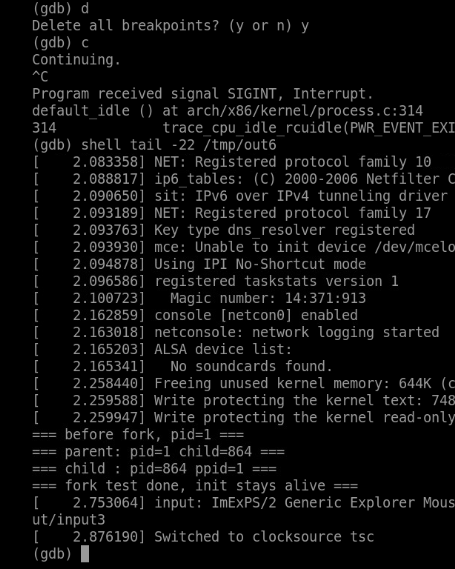

**图1：** 父进程 PID 1 创建子进程 PID 864，子进程正确识别父进程。

### 2. 测试程序与调试方法

#### （1）程序的观察点

```c
#include <stdio.h>
#include <unistd.h>
#include <sys/wait.h>

int main(void)
{
    pid_t pid;

    printf("=== before fork, pid=%d ===\n", (int)getpid());
    fflush(stdout);

    pid = fork();

    if (pid == 0) {
        printf("=== child : pid=%d ppid=%d ===\n", (int)getpid(), (int)getppid());
        fflush(stdout);
        _exit(0);
    } else {
        printf("=== parent: pid=%d child=%d ===\n", (int)getpid(), (int)pid);
        fflush(stdout);
        wait(NULL);
    }

    printf("=== fork test done, init stays alive ===\n");
    fflush(stdout);

    for (;;)
        pause();

    return 0;
}
```

`fork` 之前的 `fflush` 避免尚未输出的 stdio 缓冲随地址空间一起复制，造成看似执行了两次的输出。子进程用 `_exit(0)` 结束，父进程 `wait(NULL)` 回收子进程。示例将非零返回值归入父分支；作为更完整的程序，还应先检查 `pid<0`，调用 `perror` 报告创建失败，不能把失败返回值当作有效子进程号。

`file` 确认产物为 32 位静态链接 ELF，这一点与后续 i386 的寄存器、内核栈及 `copy_thread` 分析一致。

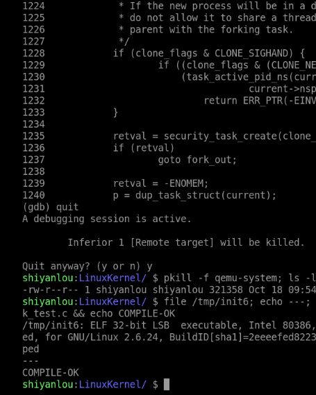

**图2：** 测试程序被编译为 32 位静态 ELF，用作最小 init。

#### （2）逐层设置断点

```gdb
target remote :1234
break sys_clone
break do_fork
break copy_thread
break ret_from_fork
continue
bt
```

启动过程本身也会创建任务，因此每次断点命中都应结合参数与调用栈识别来源。用户态 `fork()` 是库接口，本环境中的实际系统调用路径进入 `sys_clone`，不能仅按库函数名称寻找名为 `sys_fork` 的唯一入口。

### 3. 从 sys_clone 到 copy_process

#### （1）创建参数与统一入口

截图中系统调用号 `eax=0x78`，即 120，对应 i386 的 `clone`。克隆标志 `0x1200011` 包含退出信号 `SIGCHLD` 以及子任务相关的 TID 标志，不含 `CLONE_VM` 和 `CLONE_THREAD`，与普通 `fork` 创建独立进程的语义相符。调用进入 C 函数后，一部分寄存器会被用于临时计算，应优先查看 GDB 的函数参数与保存现场，不能机械套用任意时刻的寄存器值。

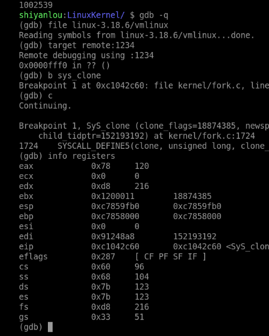

**图3：** 命中 sys_clone，通过调用号和 flags 识别本次 fork 对应的创建请求。

源码及调用栈共同表明，本次路径为：

```text
用户态 fork()
  → clone 系统调用入口
  → sys_clone
  → do_fork
  → copy_process
  → copy_thread
```

`do_fork` 负责组织创建、获得新任务、使其可以参与调度，并向父进程返回新 PID；`copy_process` 则执行主体的资源复制、引用关系建立与检查。创建成功不等于子进程已经执行，它还需要被唤醒并由调度器选中。

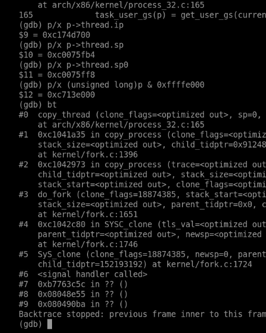

**图4：** copy_thread 的调用栈把 sys_clone、do_fork 和 copy_process 串联起来。

#### （2）task_struct 是资源关系的枢纽

`task_struct` 保存身份、状态、调度信息和体系结构上下文，也通过 `mm`、`files`、`fs`、信号相关字段等引用资源。不能理解为“一个进程的全部数据都直接存放在 task_struct 内部”。内核线程的 `mm` 可以为空，普通用户任务有对应地址空间；是否共享还必须结合克隆标志及资源指针关系判断。

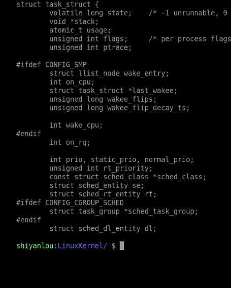

**图5：** 通过源码查看 task_struct 的定义与任务相关信息。

`dup_task_struct` 为新描述符和内核栈建立存储，复制父任务的基础状态后，再由后续步骤修正新任务自身的指针、计数和资源关系。`copy_mm`、`copy_files` 等根据标志决定复制或共享；普通 fork 的用户内存通常采用写时复制，不能简单写成立即复制所有物理页。[Linux 3.18.6 kernel/fork.c](https://github.com/gregkh/linux/blob/v3.18.6/kernel/fork.c)

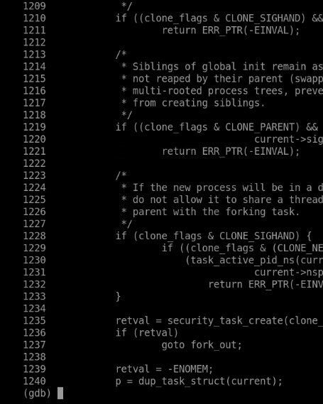

**图6：** dup_task_struct 展示新任务结构和内核栈的建立过程。

#### （3）为什么构造中的 p->pid 仍可能像父进程

调试停在 `copy_thread` 时，新描述符 `p` 尚未完成全部初始化。该版本 `copy_process` 先调用 `copy_thread`，随后才分配和写入新 PID，并建立最终的父子关系。因此截图中此时的 `p->pid=1`、父字段指向 PID 0，是复制基础状态后的中间值，不能解释为创建完成的子进程身份。

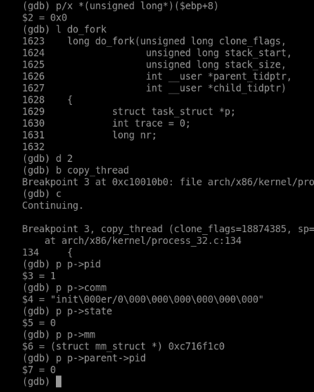

**图7：** copy_thread 阶段的新 task_struct 仍包含尚待后续更新的身份字段。

正确的方法是按源码顺序跟踪字段的生效阶段，并用最终控制台输出验证。前面 PID 864、PPID 1 的结果才是本次子进程创建完成后执行到用户态时的身份。这次观察让我认识到：同一个字段，在对象构造中和构造完成后具有不同的解释前提。

### 4. copy_thread 如何准备子进程的首次执行

#### （1）用户返回现场与内核切换现场

对本实验的普通用户任务分支，`copy_thread` 的关键作用可以用以下源码逻辑概括：

```c
/* 根据 Linux 3.18.6 的用户任务分支整理，省略其他初始化。 */
childregs = task_pt_regs(p);
p->thread.sp = (unsigned long)childregs;
p->thread.sp0 = (unsigned long)(childregs + 1);
*childregs = *current_pt_regs();
childregs->ax = 0;
p->thread.ip = (unsigned long)ret_from_fork;
```

复制的 `pt_regs` 保存将来返回用户态所需的寄存器；`thread.sp` 和 `thread.ip` 则帮助调度器第一次切换到这个任务。它们分别回答“返回用户态时继续哪里”和“首次获得 CPU 时先从内核哪里运行”，不是同一个执行起点。内核线程分支另有启动安排，不能直接套用普通用户子进程的说明。

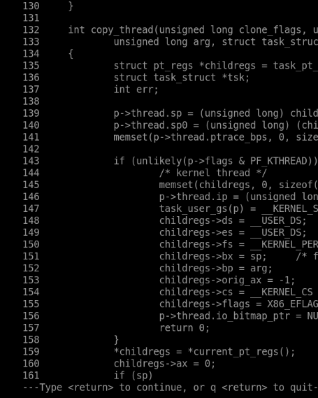

**图8：** copy_thread 为子进程复制用户寄存器、设置返回值和内核启动入口。

#### （2）地址之间的对应关系

本次 `thread.ip=0xc174d700`，与 `ret_from_fork` 符号地址相同；`thread.sp=0xc0075fb4`，`thread.sp0=0xc0075ff8`。两者相差 `0x44`，即 68 字节，与本次 32 位用户寄存器现场的布局对应。这里的具体地址只属于本次运行，关键是字段与栈布局之间的关系。

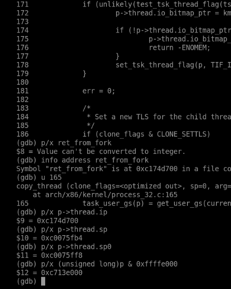

**图9：** 核对 thread.ip、thread.sp 与线程内核栈顶附近的现场布局。

### 5. 从 ret_from_fork 返回到用户态

#### （1）子进程不是重新调用 main

子进程第一次被调度时，内核切换机制使用准备好的 SP 和 IP，进入 `ret_from_fork`。断点命中证明这不是父进程像调用普通函数一样进入子进程；两者分别具有任务上下文，调度器在它们之间交接 CPU。

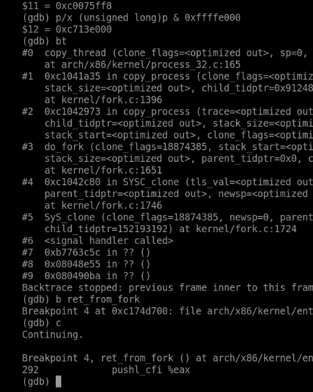

**图10：** ret_from_fork 断点命中，子进程开始执行预先准备的内核返回路径。

`ret_from_fork` 中的 `schedule_tail` 完成首次切换所需的收尾及子任务 TID 等相关处理，然后进入系统调用返回通路。它不是泛指所有父子进程同步，更不能把 vfork 完成通知统一归到这里；相关语义应按该版本源码分别查证。

#### （2）为什么同一行 fork 有两个不同返回值

在首次入口处，ESP 为 `0xc0075fb4`，与此前准备的 `thread.sp` 相等，说明实际使用的是为子进程构造的内核栈现场。子进程 `pt_regs` 中 `ax=0`，用户返回地址为 `0xb7763c5c`，用户栈地址为 `0xbffd5e00`，代码段选择子为 `0x73`。其中 `ax=0` 是子分支成立的直接机制；父进程则从正常创建调用链取得新 PID 864 作为返回值。

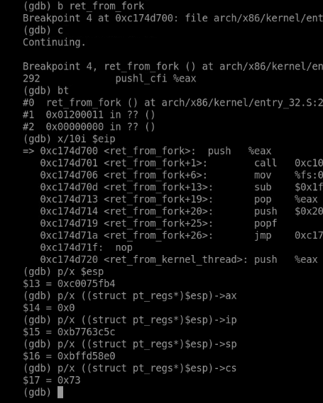

**图11：** 子进程保存的用户现场中 ax 为 0，并保留用户返回地址与栈。

父子任务在各自的用户地址空间中继续执行 fork 调用之后的程序逻辑，因此可以从同一处 C 代码分出两个分支。相同的用户虚拟地址不意味着共用同一个内核栈，也不意味着用户写入会永久相互影响：普通 fork 采用独立地址空间和写时复制语义。但继承的文件描述符可能引用同一打开文件对象，不能把“独立进程”理解为所有内核资源都完全隔离。[fork 接口语义](https://man7.org/linux/man-pages/man2/fork.2.html)

#### （3）把首次内核入口与两份栈对应起来

下面按本次已核对的地址画出子任务内核栈的局部示意，突出首次入口与用户返回现场的对应关系：

```text
高地址
0xc0075ff8  ── thread.sp0，位于子任务 pt_regs 区域之后
             │ 保存的用户返回现场 pt_regs
             │ ax=0，用户 ip=0xb7763c5c
             │ 用户 sp=0xbffd5e00，cs=0x73
0xc0075fb4  ── pt_regs 起始；thread.sp；首次入口处 ESP
             │ ret_from_fork 后续调用使用的内核栈空间
             ↓ 栈向低地址增长
```

父进程继续使用自己的内核栈和创建调用链；子进程有新分配的内核栈，并以 `ret_from_fork` 为首次内核入口。两者返回用户态时，可以沿相同的用户代码位置继续，但使用各自的地址空间和用户栈现场。这里 `thread.ip` 是首次内核执行位置，`pt_regs.ip` 是用户返回位置；把它们分开，才能同时解释“从哪里开始”和“为什么能够正确返回”。

### 6. 实验中的问题与处理

| 问题 | 机制原因 | 解决与核验 |
|---|---|---|
| fork 为什么命中 sys_clone？ | 库函数可选择 clone 系统调用实现 fork 语义 | 对照调用号 120、flags 和调用栈 |
| 新结构体的 PID 为什么还是 1？ | 断点处于初始化中间阶段 | 查明 copy_thread 在分配 PID 前，最终输出为 864 |
| 子进程为什么返回 0？ | childregs->ax 被显式清零 | 检查子进程 pt_regs，而非只看 C 分支输出 |
| 子进程从哪里首次获得执行？ | 调度器使用构造好的内核上下文 | 核对 thread.ip 与 ret_from_fork 地址、断点 |
| 自定义 init 如何正常结束实验？ | PID 1 的退出具有特殊影响 | 子进程退出并由父进程回收；PID 1 最终 pause 常驻 |

### 7. 实验认识

创建进程不只是分配一个 PID，而是同时建立描述符、资源关系、可调度状态以及首次执行的寄存器和栈。fork 的“一次调用、两处继续”来自两份任务上下文中不同的返回值。沿着创建顺序解释字段，再追踪子进程的第一条内核返回路径，比单独记住函数名称更能说明进程是怎样开始运行的。

## 二、教材第 7 章学习：中断处理、内核线程和设备驱动

### 1. 阅读范围与问题主线

本周阅读第 7 章“中断处理、内核线程和设备驱动”，印刷页 **234—254**，对应扫描 PDF 的第 **253—273** 页。教材开篇给出的线索很重要：中断处理分为上半部和下半部，**下半部在新版本内核中以内核线程这一特殊进程的方式执行**，最后以设备驱动为例说明中断和内核线程怎样配合。

| 教材部分 | 印刷页 | 本周重点解决的问题 |
|---|---|---|
| 7.1 中断处理概述 | 234—241 | 中断与异常怎样分类？为什么分上半部和下半部？ |
| 7.2 内核线程概述 | 242—247 | 内核线程是线程还是进程？`kthreadd` 怎样创建它们？ |
| 7.3 设备驱动程序 | 248—253 | 驱动怎样接入文件接口？中断和延迟工作放在哪里？ |
| 本章实验 | 254 | 将中断处理、内核线程与驱动放在一个可观察的框架里 |

这一章与实验六的连接点不在函数名，而在“任务可以由内核自己创建”这一事实：实验六从用户态 `fork` 出发，看到 `do_fork` 构造新任务；本章则说明内核线程使用同一套创建机制，只是入口、地址空间和运行环境不同。

### 2. 问题一：中断上下文和进程上下文，边界在哪里？

**疑问与原因。** 两种说法都表示“正在内核里执行代码”，如果只看 CPU 处在内核态，很容易把它们当成同一件事；但教材反复强调硬中断不能睡眠，说明二者有硬性区别。

**理解与解决。** 关键不在特权级，而在“当前有没有一个可被调度、可睡眠的任务上下文”：

| 维度 | 进程上下文 | 硬中断上下文 |
|---|---|---|
| 当前任务 | 有明确的 `current`，是某个任务在内核中的执行 | 借用被中断任务的栈，但不是该任务的正常调用流程 |
| 能否睡眠 | 在允许的位置可以阻塞、等待、调度 | 通常不能睡眠，不能调用可能引起调度的函数 |
| 栈 | 当前任务的内核栈 | 中断栈或借用内核栈，取决于架构与配置 |
| 处理时长 | 可以较长，但应避免无谓占用 | 应尽量短，把可延迟工作推给下半部 |

系统调用也属于进程上下文：它由当前任务主动发起，服务函数可以等待 I/O。硬中断则是对外部事件的即时响应，如果允许它长时间阻塞，整个 CPU 上的其他工作都会被拖住。把这条边界记住，才能理解为什么内核要把中断处理拆成两段。

### 3. 问题二：为什么要把中断处理分成上半部和下半部？

**疑问与原因。** 如果处理程序一次做完所有工作，逻辑上更直接；分成两段后，还要考虑“什么时候执行下半部”，看起来增加了复杂度。

**理解与解决。** 上半部面对的是“必须马上做”的部分：应答中断控制器、读取必要的设备状态、清除中断源，避免丢失后续事件。下半部面对的是“可以稍后做”的部分：协议处理、数据拷贝、唤醒等待者等。拆分的目标是缩短关中断/硬中断处理的时间窗口，提高系统的响应性。

```text
设备产生中断
  → CPU 转入中断入口，保存被打断现场
      → 上半部：应答设备、取状态、标记待处理工作
          → 触发下半部（softirq / tasklet / workqueue）
  → 中断返回
      → 在合适时机执行下半部
          → 完成可延迟的处理
```

教材特别指出，下半部并不只有一种实现：软中断、tasklet 和工作队列的上下文不同，能否睡眠也不同。不能把“下半部”统一理解为“内核线程”；只有工作队列这一类，才明确由内核线程在进程上下文中执行。

### 4. 问题三：软中断、tasklet 和工作队列有什么区别？

**疑问与原因。** 三者都承担“延后执行”，名字又都与中断有关，实际使用时很容易混用。

**理解与解决。** 可以按“运行上下文”和“能否睡眠”来区分：

| 机制 | 运行上下文 | 能否睡眠 | 适用场景 |
|---|---|---|---|
| 软中断 `softirq` | 中断上下文（含 `ksoftirqd` 线程兜底） | 否 | 网络收发等高性能、可并行处理的路径 |
| `tasklet` | 基于软中断实现 | 否 | 同一 tasklet 不会并行执行的延迟任务 |
| 工作队列 `workqueue` | 内核线程，进程上下文 | 是 | 需要睡眠、可能阻塞的延迟工作 |

`ksoftirqd` 是内核线程，但它执行的是软中断；线程身份不等于“可以随意睡眠”，软中断处理函数仍然受中断上下文的约束。反过来，工作队列的函数运行在内核线程中，才可以调用可能睡眠的接口。这个区别是本章最容易混淆、也最需要按上下文而不是按名字判断的地方。

### 5. 问题四：内核线程是“线程”还是“进程”？

**疑问与原因。** 名字里有“线程”，操作系统教材又把线程描述为共享地址空间的执行单元；但内核线程看起来没有用户地址空间，也不属于某个用户进程。

**理解与解决。** 教材的判断很明确：Linux 内核中没有操作系统原理意义上的线程概念，`thread` 一词仅指 CPU 上执行的指令流；内核线程本质上是**进程**。它有自己的 `task_struct`、自己的内核栈、自己的调度状态，可以被独立调度，也可以睡眠和唤醒。

“共享地址空间”不是内核线程的定义特征。普通用户线程通过 `CLONE_VM` 等标志共享同一 `mm`；内核线程通常没有用户 `mm`，只使用内核地址空间。把“线程”理解为“共享地址空间的轻量执行体”，在这里反而会妨碍理解。

### 6. 问题五：`kthreadd` 怎样创建内核线程？

**疑问与原因。** 用户进程用 `fork` 创建子进程，内核线程由谁创建？如果每个内核子系统都直接调用 `do_fork`，创建逻辑会分散且难以管理。

**理解与解决。** 教材 7.2.2 给出了两级结构：

```text
kthread_create(...)
  → kthread_create_on_node(...)
      → 分配 kthread_create_info
      → 挂入 kthread_create_list
      → 唤醒 kthreadd

kthreadd（PID 2，常驻内核线程）
  → 循环取出 kthread_create_list 中的请求
      → create_kthread / 对应创建函数
          → kernel_thread(threadfn, data, ...)
              → do_fork(...)
                  → copy_process → copy_thread
```

`kernel_thread` 是对 `do_fork` 的封装，因此内核线程与用户进程共用创建主体：都要建立 `task_struct`、内核栈和执行现场。差别在参数和分支：内核线程没有用户态返回现场，首次执行进入内核线程的启动路径，然后调用指定的 `threadfn`；用户子进程则从 `ret_from_fork` 返回用户态。

这也解释了实验六中 PID 0、1、2 的关系：启动阶段由 `kernel_thread` 建立 PID 1 和 PID 2，PID 2 `kthreadd` 之后承担常规内核线程的创建请求。实验六观察的是用户 `fork` 的子进程，但底层 `do_fork` 与 `copy_process` 是同一套设施。

### 7. 问题六：内核线程的地址空间与用户进程有什么不同？

**疑问与原因。** `task_struct` 中 `mm` 指向用户地址空间；内核线程没有用户程序，是否意味着它完全没有地址转换上下文？

**理解与解决。** 要区分 `mm` 与 `active_mm`：

- 用户任务的 `mm` 指向自己的地址空间，`active_mm` 通常与 `mm` 相同；
- 内核线程的 `mm` 为 `NULL`，但可以借用前一个任务的 `active_mm`，避免每次进入内核线程都切换页表；
- 内核线程访问的是内核虚拟地址空间，这部分映射在所有地址空间中共享，因此不需要自己的用户页表。

所以“没有用户 `mm`”不等于“CPU 没有可用的地址转换上下文”。这也是上下文切换时 `switch_mm` 可以做优化、内核线程切换不一定重写页表基址的原因。

### 8. 问题七：内核线程第一次执行与 fork 子进程第一次执行有何不同？

**疑问与原因。** 两者都通过 `copy_thread` 构造首次现场，都从某个“返回路径”开始执行，容易认为只差一个函数名。

**理解与解决。** 差别在“返回到哪里”：

| 对象 | 首次内核入口 | 用户返回现场 | 首次执行的去向 |
|---|---|---|---|
| 用户子进程（实验六） | `ret_from_fork` | 复制父任务的 `pt_regs`，`ax=0` | `iret` 回到用户态 fork 之后 |
| 内核线程 | 内核线程启动路径 | 无用户现场 | 调用指定的 `threadfn`，在内核态运行 |

用户子进程最终要回到用户态，所以必须有一份完整的用户寄存器现场；内核线程从不返回用户态，构造的重点是内核栈和入口函数。两者都使用 `thread.sp`/`thread.ip` 一类字段，但字段所指的内容不同。实验六验证了前者：`thread.ip` 等于 `ret_from_fork`，`pt_regs.ax=0`；后者则需要在 `kthreadd` 或某个内核线程上另设断点验证。

### 9. 问题八：设备驱动为什么能用 `read`/`write` 访问？

**疑问与原因。** 驱动程序直接操作硬件寄存器，用户程序却只调用文件接口；中间隔着 VFS、设备号和驱动注册，容易把“文件”理解成磁盘上的普通文件。

**理解与解决。** Linux 把设备抽象成文件，通过 VFS 统一接口：

```text
用户：open("/dev/xxx") → read/write/ioctl
  → VFS：根据路径找到 inode
      → 字符设备：cdev → file_operations
      → 块设备：块层 → 请求队列
          → 驱动：read/write/ioctl 的具体实现
              → 访问设备寄存器 / 发起 I/O
```

设备文件用主设备号定位驱动、次设备号区分同一驱动下的具体设备。驱动注册 `file_operations`，把 `read`、`write`、`ioctl` 等回调挂到 VFS 上；用户调用文件接口时，VFS 按 inode 类型分派到对应驱动。中断处理则负责设备完成事件：上半部应答硬件，下半部完成数据整理和唤醒等待者。

“一切皆是文件”是接口层面的统一，不表示设备真的按普通文件的方式存储数据。把 VFS 分派、设备号和驱动回调分开看，才能解释为什么同一个 `read` 既能读磁盘文件，也能读串口。

### 10. 问题九：中断处理怎样与进程调度衔接？

**疑问与原因。** 中断处理“不能睡眠”，但中断返回后系统却可能切换到另一个任务；如果中断里不能调度，切换是在哪里发生的？

**理解与解决。** 中断处理可以**设置**需要调度的标志，真正的切换发生在允许调度的边界：

```text
硬中断处理（上半部）
  → 唤醒等待任务、设置 need_resched 等标志
  → 返回路径检查标志
      → 允许抢占且确实需要切换
          → schedule() → context_switch → switch_to
      → 否则恢复被打断的现场
```

这与实验五看到的系统调用返回路径一致：`work_pending` 检查待办标志，必要时调用 `schedule`。中断上下文本身不做任务切换，它把“该调度了”的信息留下，由返回路径完成实际交接。下一周分析 `schedule` 和 `switch_to` 时，这条衔接会是主要线索。

## 三、课程视频学习：进程的执行和进程的切换

本周视频“进程的执行和进程的切换”把前面几周的内容串成一条执行链。我按三个问题整理：

### 1. 一个进程怎样“执行”？

进程的执行不是一条直线，而是在用户态和内核态之间往返：用户代码运行，遇到系统调用、异常或中断后进入内核；内核保存现场、处理事件，再恢复现场返回。实验五和实验六分别展示了这条往返的两端：前者是系统调用的公共入口与返回，后者是新建任务第一次从内核返回用户态。

### 2. 什么时候发生“切换”？

视频把切换时机与调度点联系起来：任务阻塞、主动让出、时间片用完或被更高优先级任务抢占时，内核在允许调度的位置调用 `schedule`。这与教材第 7 章“中断返回前检查标志”的描述一致。需要区分“请求调度”和“实际切换”：只有选出的 `next` 与当前任务不同，才发生上下文交接。

### 3. 切换时到底换了什么？

视频给出的直观图景是：每个任务有自己的内核栈和 `thread` 现场，切换时保存当前任务的栈指针和恢复位置，换到下一个任务的栈，再恢复它的执行。实验六已经看到这份现场的一半——`copy_thread` 为新任务准备的 `thread.sp` 和 `thread.ip`；下一周分析 `switch_to` 时，会看到同一套字段怎样被真正使用。

视频的作用是建立整体流程，具体寄存器、栈布局和调用链仍以教材第 6、7 章和实验截图为准。我在笔记里把视频内容标为“流程概览”，把实验观察标为“现场证据”，避免把两者混成同一个来源。

## 四、本周问题、原因与解决

| 问题 | 原因分析 | 处理与验证 |
|---|---|---|
| 为什么 `fork` 进的是 `sys_clone`？ | `fork` 是库封装，实际可走 `clone` | 对照调用号 120、flags 与调用栈 |
| `copy_thread` 时 `p->pid` 为什么还是 1？ | 断点位于字段初始化中间阶段 | 按源码顺序核对，最终输出 PID 864 |
| 子进程为什么从 `ret_from_fork` 开始？ | 首次执行没有“旧调用点”可返回 | 核对 `thread.ip` 与断点、`pt_regs.ax=0` |
| 内核线程没有 `mm`，怎样访问内存？ | 混淆 `mm` 与 `active_mm` | 内核线程借用 `active_mm`，使用内核映射 |
| 软中断运行在 `ksoftirqd` 中，能否睡眠？ | 把线程身份当成进程上下文 | 软中断仍受中断上下文约束，工作队列才可睡眠 |
| 中断处理不能调度，切换从哪里来？ | 混淆“设置标志”与“执行切换” | 返回路径检查 `need_resched`，在边界调用 `schedule` |
| 设备文件为什么能用 `read`/`write`？ | 把设备文件当成普通磁盘文件 | VFS 按 inode 分派到驱动 `file_operations` |

## 五、AI 辅助学习中的核验记录

| 向 AI 梳理的问题 | 需要核验的点 | 本次形成的结论 |
|---|---|---|
| `task_struct` 是否包含进程全部资源？ | 成员是指针还是实体 | 它组织资源关系，资源实体另在 `mm`、`files` 等结构中 |
| `thread.ip` 与 `pt_regs.ip` 是否同一个？ | 首次内核入口与用户返回位置 | 不同，分别服务调度恢复和 `iret` 返回 |
| 内核线程是否共享创建者的地址空间？ | `CLONE_VM` 与 `mm=NULL` 的区别 | 创建路径可复用，运行时不拥有用户 `mm` |
| `kthreadd` 是调度器吗？ | 创建请求与实际调度 | 它负责创建内核线程，调度由调度器完成 |
| tasklet 与工作队列能否互换？ | 运行上下文与睡眠限制 | 不能，按能否睡眠选择 |
| 中断上下文是否一定有独立栈？ | 架构与配置差异 | 不能一概而论，需按版本和架构核对 |

AI 在这里最大的帮助是把“线程”“上下文”“下半部”这些容易混用的词拆开；我最终的判断仍以教材 7.1—7.3 的源码和实验六的现场为准。

## 六、本周学习总结

实验六回答了“新任务怎样被造出来、又怎样第一次运行”：`do_fork` 组织创建，`copy_process` 复制和修正资源关系，`copy_thread` 准备内核栈与入口，`ret_from_fork` 完成第一次返回。第 7 章则把视野从用户进程扩展到内核自身：中断处理分上半部和下半部，下半部可以由内核线程在进程上下文中完成；内核线程不是“共享地址空间的线程”，而是有独立 `task_struct` 和内核栈的可调度进程；设备驱动通过 VFS 接入文件接口，用中断和延迟工作完成 I/O。

我本周修正了两个理解：第一，`thread.ip` 和 `pt_regs.ip` 不是同一个“入口”，前者是首次内核执行位置，后者是用户返回位置；第二，“下半部”不等于“内核线程”，只有工作队列才明确运行在进程上下文。把这两点与实验六的栈示意对应起来，创建、执行和切换就不再是三个孤立的名词。

## 参考资料

1. 孟宁、娄嘉鹏：《庖丁解牛 Linux 操作系统分析》，第 7 章“中断处理、内核线程和设备驱动”，印刷页 234—254。
2. [《Linux 内核分析》MOOC](http://mooc.study.163.com/course/USTC-1000029000)，第六、七周视频与实验六。
3. [作者提供的课程与教材配套资料](https://github.com/mengning/linuxkernel)。
4. Linux 3.18.6 源码：[进程创建](https://github.com/gregkh/linux/blob/v3.18.6/kernel/fork.c)、[i386 创建现场](https://github.com/gregkh/linux/blob/v3.18.6/arch/x86/kernel/process_32.c)、[首次返回](https://github.com/gregkh/linux/blob/v3.18.6/arch/x86/kernel/entry_32.S)、[内核线程](https://github.com/gregkh/linux/blob/v3.18.6/kernel/kthread.c)。
5. [Linux man-pages：fork(2)](https://man7.org/linux/man-pages/man2/fork.2.html)、[clone(2)](https://man7.org/linux/man-pages/man2/clone.2.html)。
6. [QEMU GDB 使用说明](https://www.qemu.org/docs/master/system/gdb.html)。
