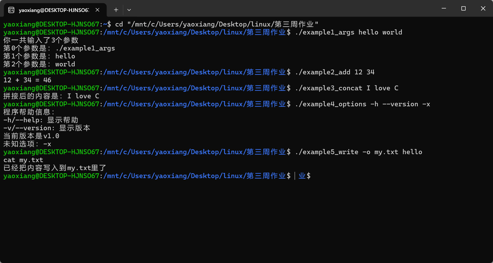

# Linux C 语言 `main` 函数参数实践

**姓名：** 姚翔  
**学号：** 20262822  
**实践环境：** WSL 2 Ubuntu（x86_64）  
**实践日期：** 2026 年 10 月 12 日

## 一、实验背景与原理

平时在 Linux 终端中，我们会用 `ls -l` 查看详细信息，也会用 `ls a.txt` 指定要查看的文件。同一个命令因为启动时收到的内容不同，执行结果也会不同。若 C 程序只能依赖写在源代码里的固定数据，需求一变就要修改并重新编译；若使用 `scanf`，则必须等程序启动后再手动输入，不便于脚本自动调用。命令行参数可以在程序启动时直接传入数据，让程序更灵活，也更容易与其他 Linux 命令组合。

C 程序通常通过 `int main(int argc, char *argv[])` 接收这些参数。`argc` 表示参数字符串的数量，包含程序名；`argv` 是保存这些字符串的数组，`argv[0]` 通常是程序名或路径，用户输入的参数从 `argv[1]` 开始，数组末尾由 `argv[argc] == NULL` 标记。Shell 会按空格拆分命令行；需要把带空格的内容作为单个参数时，应使用引号。

程序拿到的参数都是字符串，因此处理前要检查参数数量和格式，再按用途转换为数字、识别选项，或作为文件名和文件内容。本次实践从查看参数开始，逐步完成整数求和、字符串拼接、选项处理和文件写入，观察同一套 `argc/argv` 机制如何支持不同的命令行功能。

## 二、运行结果



图 1：五个示例在 Ubuntu 终端中的运行记录。截图没有显示 `cat my.txt` 的回显，可在终端补运行该命令，预期输出 `hello`。

本实验关注 C 程序如何在启动时接收命令行输入。`argc` 记录参数数量，`argv` 保存参数字符串；通常从 `argv[1]` 开始读取用户输入，再按需要转换、判断或用于文件操作。

## 三、五个实验源码与分析

### 1. 查看参数个数和每个参数

**运行命令：** `./example1_args hello world`
**运行结果：** `argc` 为 3；索引 0 是程序路径，索引 1、2 分别为 `hello`、`world`。

**实验源码：**

```c
#include <stdio.h>

int main(int argc, char *argv[])
{
    printf("你一共输入了%d个参数\n", argc);
    for (int i = 0; i < argc; i++) {
        printf("第%d个参数是：%s\n", i, argv[i]);
    }
    return 0;
}
```

**代码分析：** `argc` 包含程序名，所以这次命令有 3 个字符串参数。循环从下标 0 开始，依次打印程序名、`hello` 和 `world`；实际处理用户输入时通常从 `argv[1]` 开始。

### 2. 把两个参数转换为整数并求和

**运行命令：** `./example2_add 12 34`
**运行结果：** 输出 `12 + 34 = 46`。若参数数量不是 2 个用户参数，程序会提示正确用法。

**实验源码：**

```c
#include <stdio.h>
#include <stdlib.h>

int main(int argc, char *argv[])
{
    if (argc != 3) {
        printf("用法错误！正确格式：%s 第一个整数 第二个整数\n", argv[0]);
        return 1;
    }

    int a = atoi(argv[1]);
    int b = atoi(argv[2]);
    printf("%d + %d = %d\n", a, b, a + b);
    return 0;
}
```

**代码分析：** 程序先检查 `argc == 3`，也就是程序名加两个用户参数。`argv[1]`、`argv[2]` 起初都是字符串，示例用 `atoi` 转成整数后求和。`atoi` 对非法输入的报错能力有限，正式程序可改用 `strtol` 并检查转换结果。

### 3. 遍历参数并拼接字符串

**运行命令：** `./example3_concat I love C`
**运行结果：** 输出 `拼接后的内容是：I love C`。

**实验源码：**

```c
#include <stdio.h>
#include <string.h>

int main(int argc, char *argv[])
{
    char result[1024] = {0};
    for (int i = 1; i < argc; i++) {
        strcat(result, argv[i]);
        if (i < argc - 1) {
            strcat(result, " ");
        }
    }
    printf("拼接后的内容是：%s\n", result);
    return 0;
}
```

**代码分析：** 循环只拼接用户参数，并在相邻参数间加入空格。示例用 `strcat` 写入固定的 1024 字节数组，适合短输入演示；如果输入总长度超出数组容量，会造成越界写入，实际应用应检查剩余空间。

### 4. 处理帮助、版本和未知选项

**运行命令：** `./example4_options -h --version -x`
**运行结果：** `-h` 显示帮助，`--version` 显示版本，`-x` 被报告为未知选项。

**实验源码：**

```c
#include <stdio.h>
#include <string.h>

int main(int argc, char *argv[])
{
    for (int i = 1; i < argc; i++) {
        if (argv[i][0] != '-') {
            continue;
        }
        if (strcmp(argv[i], "-h") == 0 || strcmp(argv[i], "--help") == 0) {
            printf("程序帮助信息：\n");
            printf("-h/--help: 显示帮助\n");
            printf("-v/--version: 显示版本\n");
        } else if (strcmp(argv[i], "-v") == 0 ||
                   strcmp(argv[i], "--version") == 0) {
            printf("当前版本是v1.0\n");
        } else {
            printf("未知选项：%s\n", argv[i]);
        }
    }
    return 0;
}
```

**代码分析：** 程序逐个检查以连字符开头的参数，用 `strcmp` 识别帮助和版本选项，并对未知选项给出提示。它将选项解析与输出逻辑放在同一循环中，因此一次命令可以连续处理多个选项。

### 5. 解析带值的 `-o` 选项并写文件

**运行命令：** `./example5_write -o my.txt hello`，随后执行 `cat my.txt` 查看文件。
**运行结果：** 程序输出写入成功提示；本次截图未能确认 `cat my.txt` 的回显内容。请在终端补充运行 `cat my.txt`，预期显示 `hello`。

**实验源码：**

```c
#include <stdio.h>
#include <string.h>

int main(int argc, char *argv[])
{
    char *output_file = NULL;
    char *content = NULL;

    for (int i = 1; i < argc; i++) {
        if (strcmp(argv[i], "-o") == 0) {
            if (i + 1 >= argc) {
                printf("-o选项必须指定输出文件名\n");
                return 1;
            }
            output_file = argv[i + 1];
            i++;
        } else {
            content = argv[i];
        }
    }

    if (!output_file || !content) {
        printf("用法：%s -o 输出文件名 要写入的内容\n", argv[0]);
        return 1;
    }

    FILE *f = fopen(output_file, "w");
    if (!f) {
        printf("打开文件%s失败\n", output_file);
        return 1;
    }
    fputs(content, f);
    fclose(f);
    printf("已经把内容写入到%s里了\n", output_file);
    return 0;
}
```

**代码分析：** 遇到 `-o` 后，程序读取下一个参数作为文件名，并用 `i++` 跳过已经消费的文件名；其他普通参数被当作写入内容。随后通过 `fopen`、`fputs` 写文件。截图显示写入成功提示，但没有显示 `cat my.txt` 的内容；在终端补运行 `cat my.txt` 可查看文件回显。正式程序还应检查写入和关闭操作的返回值。