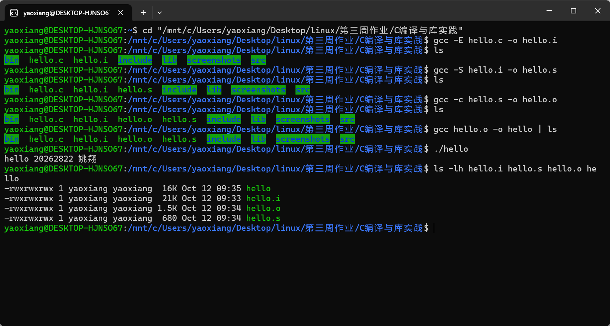
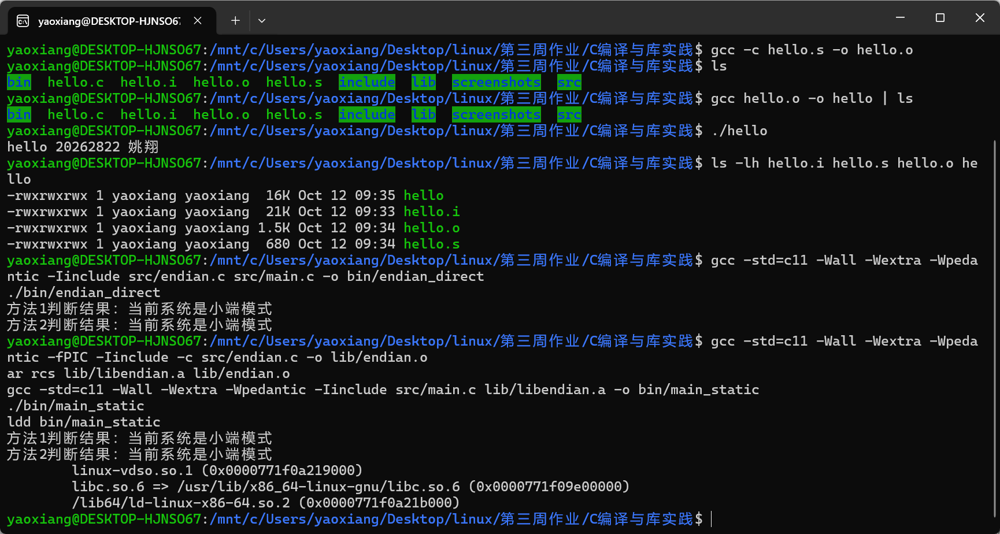
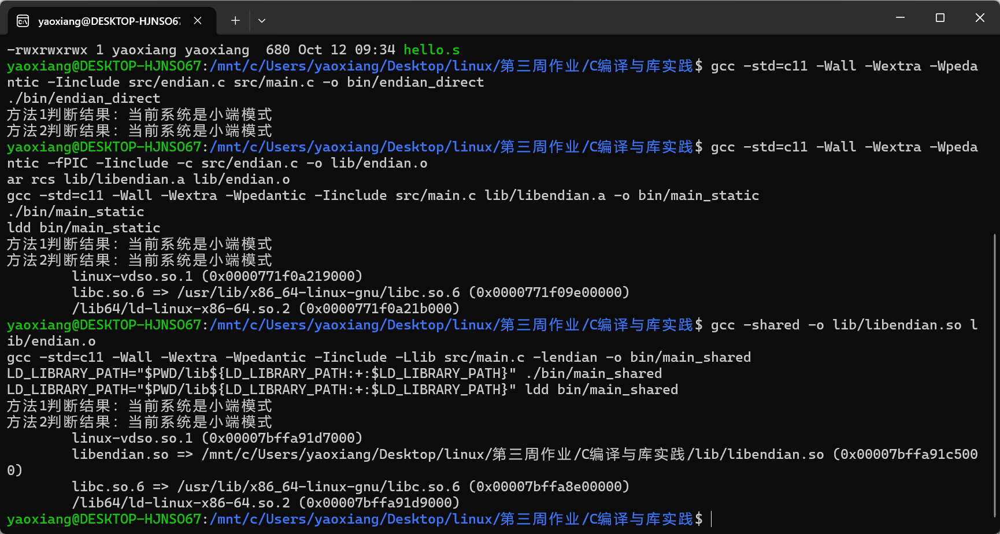
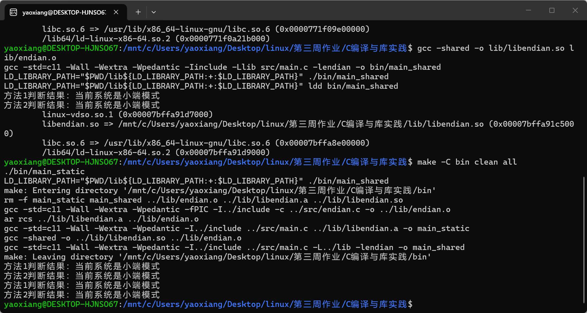

# GCC 编译过程、大小端与库实践

**姓名：** 姚翔　　**学号：** 20262822  
**实践环境：** WSL 2 Ubuntu（x86_64）　　**实践日期：** 2026 年 10 月 12 日

## 一、实验背景

C 程序从源文件变成可运行程序，需要经过预处理、编译、汇编和链接。理解各阶段的输入与输出，可以帮助我们定位头文件展开、语法翻译、目标文件生成和符号解析等问题。GCC 提供 `-E`、`-S`、`-c` 等选项，可以分别观察各阶段的中间产物。

本次实践还检查 `0x12345678` 在内存中的字节排列，以判断系统大小端，并将判断函数打包成静态库和共享库。静态库在链接时把所需代码合入可执行文件；共享库则保留为独立文件，由动态加载器在运行时查找。最后通过 Makefile 描述源文件、库和可执行程序之间的依赖，实现自动构建。

作业推荐在 openEuler 完成。本次使用已有的 WSL 2 Ubuntu 环境完成，并在该 Linux 环境中编译、运行和截图；本报告中的终端结果均来自实际运行。

## 二、实践运行结果

### 1. `hello.c` 分步编译与运行



图 1：依次执行预处理、编译、汇编、链接和运行，输出 `hello 20262822 姚翔`，并查看中间文件。

### 2. 直接编译端序程序、构建并运行静态库



图 2：两种方法均判断为小端；静态链接版本运行成功，`ldd` 输出中没有 `libendian`。

### 3. 构建并运行共享库



图 3：共享库链接版本运行成功；`ldd` 显示程序从项目 `lib` 目录加载 `libendian.so`。

### 4. Makefile 自动构建



图 4：`make -C bin clean all` 重新生成静态和共享版本，两个程序均输出小端判断结果。

## 三、实验源码与分析

### 1. `hello.c` 与 GCC 分步编译

源码 `hello.c`：

```c
#include <stdio.h>

int main(void)
{
    printf("hello 20262822 姚翔\n");
    return 0;
}
```

在项目根目录运行：

```bash
gcc -E hello.c -o hello.i
gcc -S hello.i -o hello.s
gcc -c hello.s -o hello.o
gcc hello.o -o hello
./hello
```

`-E` 只做预处理，生成 `hello.i`；`-S` 将预处理结果编译成汇编文件 `hello.s`；`-c` 将汇编文件转换为目标文件 `hello.o`，暂不链接；最后链接得到可执行文件 `hello`。截图中的输出为 `hello 20262822 姚翔`。

### 2. 大小端判断

头文件 `include/endian.h`：

```c
#ifndef ENDIAN_H
#define ENDIAN_H

int is_little_endian1(void);
int is_little_endian2(void);

#endif
```

实现文件 `src/endian.c`：

```c
#include "endian.h"

/* 方法1：通过 union 观察同一存储空间的首字节 */
int is_little_endian1(void)
{
    union {
        unsigned int num;
        unsigned char byte;
    } u;

    u.num = 0x12345678u;
    return u.byte == 0x78u;
}

/* 方法2：通过 unsigned char 指针查看对象表示 */
int is_little_endian2(void)
{
    unsigned int num = 0x12345678u;
    const unsigned char *p = (const unsigned char *)&num;
    return *p == 0x78u;
}
```

入口文件 `src/main.c`：

```c
#include <stdio.h>
#include "endian.h"

int main(void)
{
    if (is_little_endian1()) {
        printf("方法1判断结果：当前系统是小端模式\n");
    } else {
        printf("方法1判断结果：当前系统是大端模式\n");
    }

    if (is_little_endian2()) {
        printf("方法2判断结果：当前系统是小端模式\n");
    } else {
        printf("方法2判断结果：当前系统是大端模式\n");
    }
    return 0;
}
```

直接编译运行：

```bash
gcc -std=c11 -Wall -Wextra -Wpedantic -Iinclude \
    src/endian.c src/main.c -o bin/endian_direct
./bin/endian_direct
```

如果数值 `0x12345678` 的最低有效字节 `0x78` 位于最低地址，系统为小端；本次 WSL Ubuntu x86_64 环境中两种方法都输出小端。方法 1 使用 `union` 查看共享存储空间，方法 2 通过 `unsigned char` 指针读取对象表示。字节序是平台属性，结果会随目标架构而变化。

### 3. 静态库

```bash
gcc -std=c11 -Wall -Wextra -Wpedantic -fPIC -Iinclude \
    -c src/endian.c -o lib/endian.o
ar rcs lib/libendian.a lib/endian.o
gcc -std=c11 -Wall -Wextra -Wpedantic -Iinclude \
    src/main.c lib/libendian.a -o bin/main_static
./bin/main_static
ldd bin/main_static
```

`ar rcs` 将目标文件归档为 `libendian.a`。链接时直接指定 `.a` 文件，明确使用静态库；程序运行成功。`ldd` 仍会列出系统运行库，但不应列出 `libendian.so`，因为 `endian` 实现已经静态链接进程序。这里的目标文件同时使用 `-fPIC` 编译，是为了后续复用它生成共享库；静态库本身并不要求位置无关代码。

### 4. 共享库

```bash
gcc -shared -o lib/libendian.so lib/endian.o
gcc -std=c11 -Wall -Wextra -Wpedantic -Iinclude \
    -Llib src/main.c -lendian -o bin/main_shared
LD_LIBRARY_PATH="$PWD/lib${LD_LIBRARY_PATH:+:$LD_LIBRARY_PATH}" \
    ./bin/main_shared
LD_LIBRARY_PATH="$PWD/lib${LD_LIBRARY_PATH:+:$LD_LIBRARY_PATH}" \
    ldd bin/main_shared
```

`-shared` 将使用 `-fPIC` 编译的目标文件生成 `libendian.so`。`-Llib -lendian` 告诉链接器查找共享库；运行时通过 `LD_LIBRARY_PATH` 告诉动态加载器到项目的 `lib` 目录寻找它。截图中的 `ldd` 结果确认程序加载了该目录下的 `libendian.so`。

### 5. Makefile

`bin/Makefile`：

```makefile
CC = gcc
CFLAGS = -std=c11 -Wall -Wextra -Wpedantic
ROOT = ..
HEADER = $(ROOT)/include/endian.h
OBJECT = $(ROOT)/lib/endian.o
STATIC_LIB = $(ROOT)/lib/libendian.a
SHARED_LIB = $(ROOT)/lib/libendian.so

.PHONY: all clean
all: main_static main_shared

$(OBJECT): $(ROOT)/src/endian.c $(HEADER)
	$(CC) $(CFLAGS) -fPIC -I$(ROOT)/include -c $< -o $@

$(STATIC_LIB): $(OBJECT)
	ar rcs $@ $<

$(SHARED_LIB): $(OBJECT)
	$(CC) -shared -o $@ $<

main_static: $(ROOT)/src/main.c $(HEADER) $(STATIC_LIB)
	$(CC) $(CFLAGS) -I$(ROOT)/include $(ROOT)/src/main.c $(STATIC_LIB) -o $@

main_shared: $(ROOT)/src/main.c $(HEADER) $(SHARED_LIB)
	$(CC) $(CFLAGS) -I$(ROOT)/include $(ROOT)/src/main.c -L$(ROOT)/lib -lendian -o $@

clean:
	rm -f main_static main_shared $(OBJECT) $(STATIC_LIB) $(SHARED_LIB)
```

从项目根目录执行：

```bash
make -C bin clean all
./bin/main_static
LD_LIBRARY_PATH="$PWD/lib${LD_LIBRARY_PATH:+:$LD_LIBRARY_PATH}" \
    ./bin/main_shared
```

`make -C bin` 让 Make 在 `bin` 目录读取 Makefile。`all` 构建两个版本，依赖关系确保源文件或头文件变化后相关目标重新生成；`clean` 删除可执行文件、目标文件和库，便于从干净状态重建。截图显示两个版本都构建并运行成功。

## 四、实现中修正的细节

- 编译 `src/main.c` 时添加 `-Iinclude`，使编译器能够找到 `endian.h`。
- 生成共享库所需的 `-fPIC` 放在编译 `endian.c` 的阶段，而不是仅在链接阶段添加。
- 静态版本链接时直接指定 `lib/libendian.a`。如果静态库和共享库同时存在，单用 `-Llib -lendian` 通常会优先选择 `.so`。
- Makefile 从 `bin/` 运行，因此源文件和头文件依赖路径均使用 `../`。

## 五、总结

本次实践完成了 GCC 四阶段编译、两种端序判断、静态库和共享库的生成与链接，以及 Makefile 自动构建。实验结果也展示了链接时库的选择与运行时共享库搜索路径之间的区别。

**源码目录：** `hello.c`、`include/`、`src/`、`lib/`、`bin/Makefile`。实践截图保存在 `screenshots/`。