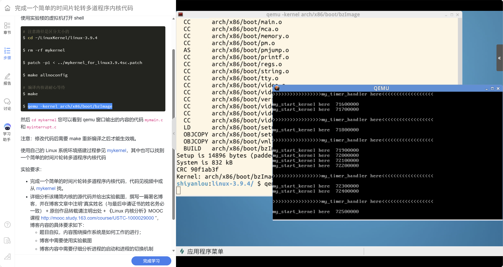
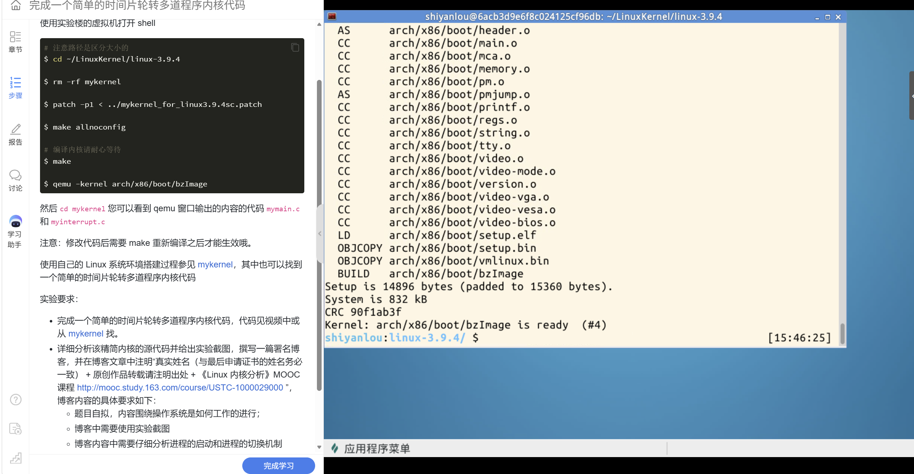
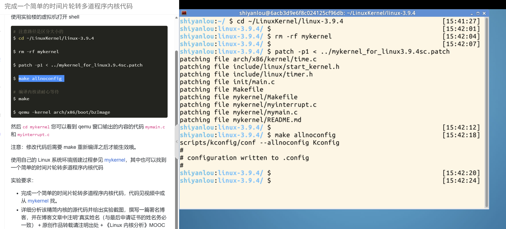
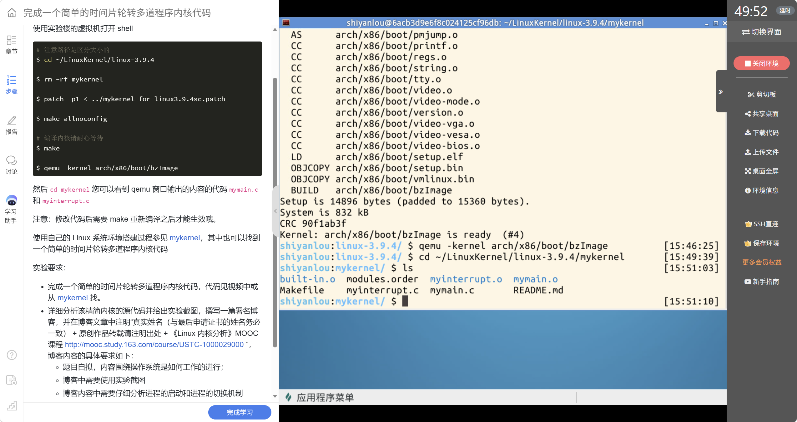

# 20262822《Linux内核原理与分析》第三周预习作业

**姓名：** 姚翔  
**学号：** 20262822  
**提交日期：** 2026 年 10 月 11 日  
**学习内容：** 实验二、教材第 3 章与课程视频主题“操作系统是如何工作的”。

## 一、实验二：从时钟中断理解操作系统如何工作

**实验专题：** mykernel 中的进程启动与时间片轮转机制。  
**实验环境：** 实验楼 Linux 虚拟机、Linux 3.9.4 源码、mykernel 补丁、QEMU。  

### 1. 实验环境与步骤

实验使用实验楼提供的 Linux 虚拟机，内核源码版本为 Linux 3.9.4。进入源码目录，应用 mykernel 补丁并编译、启动内核：

```bash
cd ~/LinuxKernel/linux-3.9.4
rm -rf mykernel
patch -p1 < ../mykernel_for_linux3.9.4sc.patch
make allnoconfig
make
qemu -kernel arch/x86/boot/bzImage
```

内核编译完成后，使用 QEMU 启动生成的 `bzImage`。运行时，主循环输出与时钟中断输出交替出现，实验结果如下。



**图1：** QEMU 中 `my_start_kernel here` 与 `my_timer_handler here` 交替出现。



**图2：** 编译完成，生成 `arch/x86/boot/bzImage`。



**图3：** mykernel 补丁应用完成，配置写入 `.config`。



**图4：** `mykernel` 目录中的源文件及构建产物。

### 2. 操作结果判读

#### （1）应用补丁并生成配置

`patch -p1` 中的 `-p1` 去掉补丁路径最前面一级目录；当前目录应是内核源码根目录。`make allnoconfig` 生成尽量精简的配置，具体生效选项仍受 Kconfig 依赖和默认规则影响，不能理解成“最后得到一个完全没有任何功能的内核”。

**结果判读：** 终端列出 `arch/x86/kernel/time.c`、`init/main.c`、`mykernel/mymain.c`、`mykernel/myinterrupt.c` 等补丁目标，随后显示 `configuration written to .config`。这说明补丁不仅增加两个教学文件，还修改了启动与时钟路径，把教学代码接入 Linux 提供的运行环境。

#### （2）检查内核编译的完成标志

**结果判读：** 末尾出现 `BUILD arch/x86/boot/bzImage`，并明确显示：

```text
Setup is 14896 bytes (padded to 15360 bytes).
System is 832 kB
CRC 90f1ab3f
Kernel: arch/x86/boot/bzImage is ready (#4)
```

判断编译成功应看最终镜像生成提示，而不能只凭中途有很多 `CC`、`AS` 或 `LD` 输出。它们分别表示编译、汇编和链接过程；图2的最终结果证明此次生成了可交给 QEMU 的内核镜像。

#### （3）在 QEMU 中观察主循环和时钟中断

**结果判读：** QEMU 窗口中交替出现 `my_start_kernel here` 和 `my_timer_handler here`。主循环计数从 7160000、7170000 等继续增加，中断信息插入其间，随后主循环继续输出。

这表明基础教学入口已经运行，周期性时钟中断也能得到处理。它还说明无限循环不会阻止硬件中断带来的控制流转移。轮转版本在这一基础上增加 PCB、调度标志和上下文切换，后面按源码详细展开。

#### （4）找到与输出对应的源码

```bash
cd ~/LinuxKernel/linux-3.9.4/mykernel
ls
```

**结果判读：** 目录中能看到 `mymain.c`、`myinterrupt.c`、`Makefile`、`README.md`，以及 `mymain.o`、`myinterrupt.o`、`built-in.o` 等构建产物。源码文件与目标文件不是同一种材料；修改 `.c` 后必须回到内核源码根目录重新 `make`，再启动更新后的 `bzImage`。

基础补丁中的两个 C 文件提供入口和中断环境；轮转模型进一步增加 `mypcb.h`，把这两个执行路径连接到任务管理与调度机制。

### 3. 轮转示例源码与整体结构

下面按文件给出课程 IA-32 示例的学习整理版，结合前面的实验结果建立整体结构，随后逐段分析。它用于解释实验要求中的轮转内核。代码适用于课程 Linux 3.9.4 的 32 位教学环境，不能直接混入教材 Linux 5.4.34 的 64 位示例。

来源固定为 [mengning/mykernel 的历史版本 726a79f](https://github.com/mengning/mykernel/tree/726a79f008c3981383db5e679b6f3be570a49bbe)，避免上游现版升级为 64 位后出现混用。为使控制流分析完整，我在 `myinterrupt.c` 的首次启动分支中补全了向前引用 `1f` 对应的续接标签 `1:` 与 `popl %%ebp`；其余保留示例结构，仅统一排版。下文围绕这一整理版追踪任务创建、首次启动和上下文恢复。

#### （1）mypcb.h：描述任务及保存运行位置

```c
/*
 *  linux/mykernel/mypcb.h
 *
 *  Kernel internal PCB types
 *
 *  Copyright (C) 2013  Mengning
 *
 */

#define MAX_TASK_NUM        4
#define KERNEL_STACK_SIZE   1024*8

/* CPU-specific state of this task */
struct Thread {
    unsigned long        ip;
    unsigned long        sp;
};

typedef struct PCB{
    int pid;
    volatile long state;    /* -1 unrunnable, 0 runnable, >0 stopped */
    char stack[KERNEL_STACK_SIZE];
    /* CPU-specific state of this task */
    struct Thread thread;
    unsigned long    task_entry;
    struct PCB *next;
}tPCB;

void my_schedule(void);
```

#### （2）mymain.c：建立任务链表并启动第一个任务

```c
/*
 *  linux/mykernel/mymain.c
 *
 *  Kernel internal my_start_kernel
 *
 *  Copyright (C) 2013  Mengning
 *
 */
#include <linux/types.h>
#include <linux/string.h>
#include <linux/ctype.h>
#include <linux/tty.h>
#include <linux/vmalloc.h>


#include "mypcb.h"

tPCB task[MAX_TASK_NUM];
tPCB * my_current_task = NULL;
volatile int my_need_sched = 0;

void my_process(void);


void __init my_start_kernel(void)
{
    int pid = 0;
    int i;
    /* Initialize process 0*/
    task[pid].pid = pid;
    task[pid].state = 0;/* -1 unrunnable, 0 runnable, >0 stopped */
    task[pid].task_entry = task[pid].thread.ip = (unsigned long)my_process;
    task[pid].thread.sp = (unsigned long)&task[pid].stack[KERNEL_STACK_SIZE-1];
    task[pid].next = &task[pid];
    /*fork more process */
    for(i=1;i<MAX_TASK_NUM;i++)
    {
        memcpy(&task[i],&task[0],sizeof(tPCB));
        task[i].pid = i;
        task[i].state = -1;
        task[i].thread.sp = (unsigned long)&task[i].stack[KERNEL_STACK_SIZE-1];
        task[i].next = task[i-1].next;
        task[i-1].next = &task[i];
    }
    /* start process 0 by task[0] */
    pid = 0;
    my_current_task = &task[pid];
    asm volatile(
        "movl %1,%%esp\n\t"     /* set task[pid].thread.sp to esp */
        "pushl %1\n\t"             /* push ebp */
        "pushl %0\n\t"             /* push task[pid].thread.ip */
        "ret\n\t"                 /* pop task[pid].thread.ip to eip */
        "popl %%ebp\n\t"
        : 
        : "c" (task[pid].thread.ip),"d" (task[pid].thread.sp)    /* input c or d mean %ecx/%edx*/
    );
}   
void my_process(void)
{
    int i = 0;
    while(1)
    {
        i++;
        if(i%10000000 == 0)
        {
            printk(KERN_NOTICE "this is process %d -\n",my_current_task->pid);
            if(my_need_sched == 1)
            {
                my_need_sched = 0;
                my_schedule();
            }
            printk(KERN_NOTICE "this is process %d +\n",my_current_task->pid);
        }     
    }
}
```

#### （3）myinterrupt.c：提出调度请求并切换任务

```c
/*
 *  linux/mykernel/myinterrupt.c
 *
 *  Kernel internal my_timer_handler
 *
 *  Copyright (C) 2013  Mengning
 *
 */
#include <linux/types.h>
#include <linux/string.h>
#include <linux/ctype.h>
#include <linux/tty.h>
#include <linux/vmalloc.h>

#include "mypcb.h"

extern tPCB task[MAX_TASK_NUM];
extern tPCB * my_current_task;
extern volatile int my_need_sched;
volatile int time_count = 0;

/*
 * Called by timer interrupt.
 * it runs in the name of current running process,
 * so it use kernel stack of current running process
 */
void my_timer_handler(void)
{
#if 1
    if(time_count%1000 == 0 && my_need_sched != 1)
    {
        printk(KERN_NOTICE ">>>my_timer_handler here<<<\n");
        my_need_sched = 1;
    } 
    time_count ++ ;  
#endif
    return;      
}

void my_schedule(void)
{
    tPCB * next;
    tPCB * prev;

    if(my_current_task == NULL 
        || my_current_task->next == NULL)
    {
        return;
    }
    printk(KERN_NOTICE ">>>my_schedule<<<\n");
    /* schedule */
    next = my_current_task->next;
    prev = my_current_task;
    if(next->state == 0)/* -1 unrunnable, 0 runnable, >0 stopped */
    {
        my_current_task = next; 
        printk(KERN_NOTICE ">>>switch %d to %d<<<\n",prev->pid,next->pid);  
        /* switch to next process */
        asm volatile(    
            "pushl %%ebp\n\t"         /* save ebp */
            "movl %%esp,%0\n\t"     /* save esp */
            "movl %2,%%esp\n\t"     /* restore  esp */
            "movl $1f,%1\n\t"       /* save eip */    
            "pushl %3\n\t" 
            "ret\n\t"                 /* restore  eip */
            "1:\t"                  /* next process start here */
            "popl %%ebp\n\t"
            : "=m" (prev->thread.sp),"=m" (prev->thread.ip)
            : "m" (next->thread.sp),"m" (next->thread.ip)
        ); 
     
    }
    else
    {
        next->state = 0;
        my_current_task = next;
        printk(KERN_NOTICE ">>>switch %d to %d<<<\n",prev->pid,next->pid);
        /* switch to new process */
        asm volatile(    
            "pushl %%ebp\n\t"         /* save ebp */
            "movl %%esp,%0\n\t"     /* save esp */
            "movl %2,%%esp\n\t"     /* restore  esp */
            "movl %2,%%ebp\n\t"     /* restore  ebp */
            "movl $1f,%1\n\t"       /* save eip */    
            "pushl %3\n\t" 
            "ret\n\t"                 /* restore  eip */
            "1:\n\t"                 /* Resume prev here when scheduled again. */
            "popl %%ebp\n\t"          /* Restore the saved frame pointer. */
            : "=m" (prev->thread.sp),"=m" (prev->thread.ip)
            : "m" (next->thread.sp),"m" (next->thread.ip)
        );          
    }   
    return;    
}
```

### 4. 代码分析：PCB 与任务上下文

三个文件的关系可以概括为：`mypcb.h` 定义“保存什么”，`mymain.c` 决定“任务从哪里开始”，`myinterrupt.c` 处理“何时请求切换、如何保存和恢复”。上面的 `Makefile` 由实验补丁提供，头文件无需单独编译。

`tPCB` 是教学进程控制块。各字段的用途如下：

| 字段 | 含义 | 在切换中的作用 |
|---|---|---|
| `pid` | 任务编号 | 用于识别输出来自哪个任务 |
| `state` | 示例的简化状态 | 区分已有运行现场和尚待首次启动的任务 |
| `stack[8192]` | 每个任务的独立栈区域 | 保存局部变量、调用链和切换现场 |
| `thread.sp` | 保存的栈指针 | 找到该任务的栈现场 |
| `thread.ip` | 保存的执行位置 | 首次为入口，运行后为续接位置 |
| `task_entry` | 任务入口地址 | 说明任务最初应从哪里开始 |
| `next` | 下一个 PCB | 构成轮转链表 |

四个任务都执行 `my_process()`，代码地址相同，但栈和保存的运行位置不同，所以它们不是把同一个循环简单打印四次。任务身份由当前 PCB 和相应上下文共同决定。

这里的 `state=-1` 被示例用作首次启动的标记，调度器的 `else` 分支会把它置为 0 并启动。它不能直接等同于完整 Linux 的阻塞状态；真实 Linux 中“尚未启动”“睡眠”“可运行”等关系更复杂。同样，`memcpy` 复制 PCB 只是在教学模型中建立任务，不能称为实现了完整的 `fork()`。

### 5. 任务创建：为什么要重新设置每个任务的栈指针

0 号任务先设置 PID、运行状态、入口和栈指针，`next` 最初指向自己。随后每次复制 `task[0]`，都必须重写新任务的 PID、状态、栈指针和链表指针。

最容易漏掉的是：

```c
task[i].thread.sp =
    (unsigned long)&task[i].stack[KERNEL_STACK_SIZE-1];
```

如果只复制 PCB 而不重新赋值，多个任务保存的栈指针仍可能指向 0 号任务的栈，局部变量和返回地址就会互相覆盖。复制结构体并不自动把其中的指针“变成新对象内部对应位置的指针”。

循环插入完毕后得到：

```text
task[0] -> task[1] -> task[2] -> task[3]
   ^                                |
   |--------------------------------|
```

因为最后一个任务的 `next` 指回 0 号任务，调度器反复取 `current->next`，才能实现 `0 -> 1 -> 2 -> 3 -> 0` 的循环顺序。

### 6. 首次启动：不是只给 my_current_task 赋值

`my_current_task = &task[0]` 只更新软件中的当前任务指针，CPU 还没有因此自动使用 0 号任务的栈。首次运行必须设置实际的 ESP，并把入口地址送入控制流。

在启动汇编中，`movl %1,%%esp` 切换到任务栈；`pushl %0` 把入口地址压栈；`ret` 将栈顶地址弹出作为 EIP，因而进入 `my_process()`。这里使用 `ret` 是借助其“从栈顶取得下一执行地址”的效果，不表示之前一定发生过普通的函数调用。

还需要注意源码中 `ret` 后的 `popl %%ebp`：首次跳入无限循环的 `my_process()` 后，不会顺序执行这条指令。不能把它当作“首次启动立刻恢复 EBP”的步骤。该教学代码依赖指定的编译环境和栈组织；理解这个跳转性质，比逐行机械翻译注释更重要。

### 7. 时钟中断：提出调度请求与实际切换是两件事

`my_timer_handler()` 在计数满足条件且没有待处理请求时，把 `my_need_sched` 设为 1。`my_process()` 在循环检查点发现此标志后清零，再调用 `my_schedule()`。

```text
时钟中断
  -> my_timer_handler()
  -> my_need_sched = 1
  -> 从中断返回
  -> 当前任务继续到检查点
  -> my_schedule()
```

因此，这个模型由时钟事件推动轮转，但切换发生在任务主动检查标志的位置。不能把它写成“每次时钟中断都直接切到下一个任务”，也不能说它已经实现了任意指令处的完整抢占式调度。

另一个细节是 `time_count` 初值为 0，第一次检查 `time_count % 1000 == 0` 就成立，并不是先累计 1000 次才提出首次请求。1000 表示计数间隔；如果没有确认时钟频率，就不能把它直接写成 1000 毫秒。忙循环的 `i % 10000000` 也是检查间隔，不是可靠的时间计量。

### 8. 上下文切换：保存旧栈，恢复新栈，再恢复执行位置

调度器先取 `prev=current` 和 `next=current->next`，在切换前把 `my_current_task` 更新为 `next`。否则 CPU 已经在新任务栈中运行，而日志仍可能用旧任务的 PID，出现“运行现场和当前任务指针不一致”的问题。

对于已经运行过的任务，关键步骤是：

| 汇编操作 | 作用 |
|---|---|
| `pushl %%ebp` | 把旧任务的帧指针保存在旧栈 |
| `movl %%esp,%0` | 把旧 ESP 写入旧 PCB |
| `movl %2,%%esp` | 改用新任务保存的 ESP |
| `movl $1f,%1` | 保存旧任务将来恢复的续接地址 |
| `pushl %3; ret` | 进入新任务保存的执行位置 |
| `1:; popl %%ebp` | 此任务将来恢复时取回自己的 EBP |

`1f` 是汇编局部标签的向前引用，表示后面的 `1:`。保存的 `thread.ip` 不是把 EIP 当作普通寄存器直接搬出，而是记录一个约定的恢复点。

切换后，原任务并没有正常顺序执行完当前 `my_schedule()` 调用，而是暂时挂起。当轮转回这个任务时，恢复它原来的栈并跳到保存的标签，再沿原调用链返回 `my_process()`。局部变量和返回地址之所以能继续使用，关键在于任务各有独立栈。

**首次启动与恢复旧任务的区别：** 新任务尚未留下调用栈和续接地址，只能从 `my_process` 入口开始；旧任务已在切换时保存了现场，必须从自己的续接位置恢复。把两种情况都跳回入口，会导致旧任务的局部状态重新初始化，失去“继续执行”的意义。

前面学习整理版对首次启动分支补全续接标签，就是为了让“旧任务在该分支被切出后，未来从哪里回来”有明确答案。这样才能让首次启动分支保存的地址与日后的恢复位置配对。

### 9. 一次完整轮转的预期控制流

以下按课程源码推导一次完整轮转：

```text
task 0 运行
  -> 时钟提出调度请求
  -> task 0 到达检查点并调用 my_schedule
  -> 保存 task 0 的栈和续接位置
  -> 首次启动 task 1
  -> 同理启动 task 2、task 3
  -> 恢复 task 0 先前保存的上下文
  -> task 0 从暂停的位置继续运行
```

若完成轮转版本的运行，应同时观察任务编号变化、`my_schedule` 和 `switch` 输出，并检查最后能否从 3 回到 0。光看到任务 1 的入口打印，还不足以证明“旧任务的恢复”正确。

源代码里的 `this is process N -` 在检查点前打印，`this is process N +` 在调度调用返回后打印。任务被切出后，它的 `+` 可能要等下一轮恢复才出现，不要求一对符号在输出中紧邻。日志的顺序要结合保存和恢复位置分析，不能只按屏幕行距判断。

### 10. 两个关键切换案例：0→1 与 3→0

#### （1）0→1：给一个新任务建立第一次执行机会

调度前，0 号任务正在自己的 `my_process()` 中运行，1 号任务的 `state=-1`，`thread.ip` 仍是 `my_process` 入口，`thread.sp` 指向其独立栈的初始位置。

1. 0 号任务在检查点读到 `my_need_sched=1`，清零后调用 `my_schedule()`。
2. 调度器得到 `prev=&task[0]`、`next=&task[1]`，进入首次启动分支。
3. 设置 1 号任务状态为 0，并把当前任务指针更新为 1。
4. 在 0 号栈压入 EBP，保存这时的 ESP 和未来的恢复标签。
5. ESP 改为 1 号任务的栈，EBP 也按教学代码初始化为该栈指针。
6. 将 1 号任务入口压栈，`ret` 弹出该地址，CPU 从 `my_process()` 开始运行。
7. 1 号任务建立自己的函数栈帧和局部变量 `i`；0 号任务的调用链留在原栈中。

用于理解的输出顺序是：

```text
this is process 0 -
>>>my_schedule<<<
>>>switch 0 to 1<<<
this is process 1 -
```

这是理论示意，省略了其他循环打印和时钟消息。调度请求可能早已被中断设置，所以 `my_timer_handler` 的打印不必紧邻 `my_schedule`。0 号任务的 `+` 暂时未出现，是因为它还没有从自己的调度调用返回。

#### （2）3→0：不是重新创建 0 号任务，而是恢复它

当 1、2、3 号任务依次得到首次启动机会后，3 号任务的 `next` 指向 0。此时 0 的 `state=0`，且 PCB 中已经保存了上次被切出时的栈指针和续接标签。

1. 3 号任务到达检查点，进入调度器。
2. 调度器确定 `prev=&task[3]`、`next=&task[0]`，进入恢复分支。
3. 保存 3 号任务的 EBP、ESP 和恢复地址，以备下一轮使用。
4. ESP 改为 0 号任务曾经保存的值。
5. 把 0 号任务的 `thread.ip` 压入 0 号栈，再用 `ret` 进入它自己的续接点。
6. 0 号任务在上次切出分支的 `1:` 后恢复 EBP，随后完成原来的 `my_schedule()` 调用。
7. CPU 回到 0 号任务 `my_process()` 中的调度调用之后，打印相应的 `+`，然后继续循环。

理论示意如下：

```text
this is process 3 -
>>>my_schedule<<<
>>>switch 3 to 0<<<
this is process 0 +
```

这里出现 `process 0 +`，恰好说明应从“旧调用的返回位置”继续，而不是再次执行 `my_process()` 的初始化。0 号任务的局部计数仍由其原栈承载；如果每轮都回到入口，计数会被重置，任务也无法保留此前的执行进度。

#### （3）从寄存器、PCB 和栈三方面检查切换

| 阶段 | CPU 使用的栈 | PCB 中保存的内容 | 控制流位置 |
|---|---|---|---|
| 0 正在运行 | task 0 栈 | 1 的入口和初始 SP 已准备 | 0 的 `my_process` |
| 保存 0 | task 0 栈 | 0 的 SP 与续接地址写回 | 0 的 `my_schedule` |
| 首次启动 1 | task 1 栈 | 当前任务指针为 1 | 1 的 `my_process` 入口 |
| 3 准备恢复 0 | 先使用 task 3 栈 | 保存 3，读取 0 的旧现场 | 3 的 `my_schedule` |
| 0 恢复 | task 0 原栈 | 0 的旧现场已用于恢复 | 0 的续接标签，然后返回原循环 |

需要保存的现场不仅是“下一条指令”。如果只恢复执行地址而仍使用别人的栈，函数返回和局部变量都会失去对应关系；如果只换栈却跳回入口，也无法继续原来的调用链。栈位置与控制流位置必须配套。

### 11. 实验中的问题、解决方法与验证依据

下面归纳实验操作和源码学习中需要解决的问题，给出原因、解决方法和判断依据。

| 问题或疑问 | 原因分析 | 解决方法 | 依据与验证范围 |
|---|---|---|---|
| 怎样判断补丁是否进入正确目录？ | 补丁的相对路径依赖当前目录与 `-p1` | 先进入 `linux-3.9.4`，核对补丁目标 | 图3列出启动、时钟及 mykernel 文件 |
| 怎样判断编译真正结束？ | 中途编译输出不代表最终镜像可用 | 检查 `bzImage is ready` 与输出路径 | 图2已验证镜像生成 |
| 无限循环为何还会打印中断消息？ | 硬件中断能暂时改变 CPU 控制流 | 分开追踪主循环与中断处理入口 | 图1已验证交替输出 |
| 找到源文件后，修改为什么需要重新编译？ | QEMU 运行的是镜像，而不是磁盘上的 C 文本 | 回源码根目录 `make`，再启动新镜像 | 图4用于定位源文件与构建产物 |
| 为什么要为每个任务重写 SP？ | PCB 复制不会自动修正内部地址 | SP 指向该任务自己的栈 | 轮转初始化源码分析 |
| 中断出现是否就是任务切换？ | 中断只设置标志，任务检查点才调用调度器 | 跟踪 `my_need_sched` 的写入与检查 | 轮转源码分析 |
| 为何恢复后不能再从入口开始？ | 旧任务已有未完成调用链和局部状态 | 保存续接地址和独立栈，成对恢复 | 汇编与栈布局推导 |
| 历史代码的 `1f` 在首次启动分支如何续接？ | 被切出任务需要对应的恢复标签 | 学习整理版补全 `1:` 与 EBP 恢复 | 汇编标签与栈恢复的对应关系 |
| 能否直接复制上游最新代码？ | 新版可能已改成 x86-64，寄存器与指令宽度不同 | 固定 IA-32 历史版本，并说明教材版本 | 上游版本记录与截图环境 |

### 12. 我对“操作系统如何工作”的理解

CPU 始终是在执行具体指令。操作系统要管理任务，也必须先获得执行机会。时钟中断提供了周期性进入内核代码的机会，PCB 则提供了记录各任务身份、栈和执行位置的结构。

调度策略决定下一个任务是谁，上下文切换落实“把 CPU 的运行现场改成另一个任务的现场”。循环链表可以给出简单轮转顺序，但如果没有独立栈和可靠的恢复地址，轮转策略就无法成为可持续运行的多任务机制。

本次实践直接验证了基础主循环和中断环境。结合课程源码，我进一步理解了从“中断发生”到“提出调度请求”，再到“保存旧任务、启动或恢复新任务”的完整关系。四任务共享同一段代码的模型适合看清这个核心机制；真实 Linux 还需要地址空间、权限、完整寄存器现场、同步与复杂调度策略，不能用这百余行教学代码概括全部实现。

## 二、教材第 3 章学习报告：Linux 内核源代码及调试环境

### 2. 阅读范围与本章的核心问题

本次阅读《庖丁解牛Linux操作系统分析》（孟宁、娄嘉鹏）第 3 章，纸质页码 90–111，对应所提供 PDF 的第 109–130 页。该章分为 3.1“Linux 内核源代码”、3.2“搭建 Linux 内核调试环境”和 3.3“跟踪 Linux 内核的启动过程”。

本章帮助我把前面实验中的“编译后运行”推进到“定位源码并跟踪执行”：看懂一条输出来自哪里只是起点，还应能借助符号、断点和调用栈，确认代码何时执行、由谁调用、关键数据如何变化。

教材以 Linux 5.4.34 和 x86-64 为例；前面的实验二使用 Linux 3.9.4 和 IA-32。学习时保留两条清楚的线索：用实验二理解任务运行和切换的基本机制，用第 3 章理解真实内核源码的组织、调试环境和启动链。

### 3. 3.1 节：源码规模大，阅读应从问题与目录入手

#### （1）先建立目录地图，再追踪调用关系

教材先展示代码规模，再说明各目录分工。我不把这些统计数字当作当前所有 Linux 版本的固定事实；它们是教材对特定版本的统计，作用是提醒读者不能从第一行一直读到最后一行。

| 目录 | 主要内容 | 本周阅读中的用途 |
|---|---|---|
| `arch/` | 各 CPU 架构相关代码 | 区分 IA-32、x86-64、ARM64 的入口和寄存器 |
| `init/` | 启动初始化 | 查找 `init/main.c` 与 `start_kernel` |
| `kernel/` | 内核核心机制 | 阅读调度及 `kernel/kthread.c` |
| `mm/` | 内存管理 | 理解启动时为何需要内存初始化 |
| `fs/` | 文件系统 | 连接根文件系统与用户空间启动 |
| `ipc/` | 进程间通信 | 认识任务通信与任务切换是不同问题 |
| `net/` | 网络协议与相关实现 | 判断网络问题应从哪里定位 |
| `drivers/` | 设备驱动 | 认识大量源码服务于不同硬件 |
| `include/` | 公共头文件 | 查找类型、接口及生成头文件 |
| `lib/` | 内核内部辅助函数 | 区分内核接口和用户态标准库 |

本周阅读的入口不是整个源码树，而是一个具体问题：内核怎样从初始化进入可调度状态？围绕这个问题优先读 `init/main.c`，遇到 `init_task` 再去 `init/init_task.c`，遇到 `kthreadd` 再去 `kernel/kthread.c`。这样每一次跳转都有目标。

#### （2）内核文件叫 main.c，不代表入口函数叫 main

教材第 92–93 页强调，`init/main.c` 中应关注的是 `start_kernel()`。在这之前，体系结构相关的汇编入口已进行了必要的硬件和执行环境准备。x86-64 的相关代码可从 `arch/x86/kernel/head_64.S` 查看，ARM64 则有自己的入口路径。

因此，“`start_kernel` 是通用 C 初始化的重要起点”比“计算机上电第一条指令就是 `start_kernel`”准确。实验二的 `my_start_kernel` 又是补丁接入的教学入口，不能因名称接近就把它等同于真实 Linux 的 `start_kernel`。

#### （3）内核为什么用 printk，而不是 printf

用户态程序依赖标准库及相应运行环境，内核代码不能直接照搬用户态 `printf` 的使用方法。实验输出使用 `printk(KERN_NOTICE ...)`，体现了内核自身的日志接口和日志级别。

解决这一疑问的办法是把“名字相似的函数”放回所属执行环境理解：用户程序通过操作系统提供的接口工作，内核则需要使用自身可用的设施。类似地，不能因为在用户程序中使用了某个库函数，就认定内核中也能按同样方式调用它。

### 4. VS Code 阅读源码：为什么 includePath 不足以解决所有跳转问题

内核通过 Kconfig、架构选择、生成头文件和每个编译单元的参数决定实际代码。仅把所有目录加入 `includePath`，可能仍无法正确理解宏、条件编译和包含关系。

教材第 93–96 页给出的思路是借助 `compile_commands.json`，让编辑器获取更接近实际构建的编译信息。学习步骤可整理为：

```bash
# 在支持该脚本的内核源码版本中，先完成相应配置与构建
python ./scripts/gen_compile_commands.py
```

随后在 VS Code 的 C/C++ 配置中指定该文件，例如：

```json
{
  "configurations": [
    {
      "name": "Linux",
      "compileCommands": "${workspaceFolder}/compile_commands.json",
      "intelliSenseMode": "gcc-x64"
    }
  ],
  "version": 4
}
```

这里展示的是教材 x86-64 环境的配置思路，32 位实验应使用与其目标架构匹配的设置。还必须先检查对应内核版本是否提供脚本；不能把教材脚本路径直接套到 Linux 3.9.4 后，因文件不存在而误判整个配置方法无效。

教材还展示了按学习目标排除暂时无关目录的配置。这个方法有助于减少搜索结果，但排除不等于删除，也不表示那些目录“不重要”。当阅读任务转向驱动或其他架构时，就应重新调整搜索范围。

**问题与解决：** 阅读内核时编辑器出现红线或跳转失败，首先检查配置、生成文件和编译数据库是否匹配，不立即改动源码来迎合编辑器。编辑器诊断与真实编译结果是两种证据，应分别判断。

### 5. 3.2 节：编译、启动与调试是连续但不同的阶段

#### （1）配置决定编译什么，调试选项决定能看到什么

教材列出安装开发工具、下载源码、准备 `.config`、配置内核、编译、安装模块和内核、准备根文件系统及引导等步骤。在 QEMU 学习环境中，可直接指定内核镜像，简化向宿主系统安装新内核的环节。

我把几种配置方法的区别整理如下：

| 方法 | 作用 | 应注意的区别 |
|---|---|---|
| `make menuconfig` | 交互调整内核配置 | 依赖相应界面开发库 |
| `make defconfig` | 生成目标架构的默认配置 | 适合作为一般环境起点 |
| `make allnoconfig` | 生成尽量精简的配置 | 实验二采用，受 Kconfig 规则约束 |
| `make allyesconfig` | 尽可能启用选项 | 不适合作为本实验的精简目标 |

教材的调试环境还要开启调试信息和 GDB 支持，并处理 KASLR 带来的地址随机化。对固定教材环境，可按该版本菜单关闭相应随机化选项；也可按所用版本的支持情况使用启动参数控制。关键目的在于让 GDB 的符号地址与内核实际加载地址相符。

“可以编译”不等于“可以按源码行调试”。如果没有需要的调试信息，GDB 可能只能展示有限的符号或汇编位置。

#### （2）bzImage 和 vmlinux 不能混淆

实验二交给 QEMU 的文件是：

```text
arch/x86/boot/bzImage
```

而教材用 GDB 加载的是：

```text
vmlinux
```

`bzImage` 用于启动，`vmlinux` 是供符号分析和调试使用的 ELF 镜像；源码级调试还要求它包含相应调试信息。两个文件必须来自同一次相容构建，不能用新镜像启动却加载旧版本符号。

**解决方法：** 每次改代码后重新构建，明确记录 QEMU 使用的镜像路径、GDB 使用的符号文件路径和对应源码版本。出现断点位置异常时，先核对这三者，而不急着认定断点命令写错。

### 6. 内核镜像能启动，为什么还需要根文件系统

教材第 98–99 页讲解 BusyBox 制作极简内存根文件系统。内核完成相应初始化后，还需要用户空间的初始程序、必要文件和运行环境，才能继续到可用的系统。

这帮助我解决了一个容易混淆的问题：仅传 `-kernel` 给 QEMU，看到内核日志并不等于完整 Linux 用户空间已经建立。若后续无法挂载根文件系统或执行 init，应按错误消息检查根文件系统和初始程序；这类故障不能一概归因于内核没有编译成功。

教材采用静态链接 BusyBox，是为了减少最小文件系统对动态链接器和共享库的依赖。其 `init` 脚本的核心思路如下：

```sh
#!/bin/sh
mount -t proc none /proc
mount -t sysfs none /sys

echo "Welcome MengningOS!"
cd /home
/bin/sh
```

除了脚本内容，还需要相应目录、设备节点、可执行权限以及能运行的 `/bin/sh`。打包成 `newc` 格式的 cpio 镜像并压缩后，通过 QEMU 的 `-initrd` 参数提供给内核。

这一流程属于教材第 3 章的调试环境学习内容。实验二的 mykernel 利用已有 Linux 框架进入简化教学循环，它的学习目标是观察任务与中断机制，不应把二者的启动目标混为一谈。

### 7. QEMU 与 GDB：两个相似参数解决两个不同问题

教材第 99–101 页的关键参数是：

| 参数或命令 | 含义 |
|---|---|
| QEMU `-s` | 为 GDB 提供默认 TCP 1234 端口连接 |
| QEMU `-S` | 启动时暂停客户机 CPU，等待继续执行 |
| GDB `target remote :1234` | 连接 QEMU 调试端 |
| GDB `break start_kernel` | 在通用 C 初始化入口设置断点 |
| GDB `continue` | 让客户机继续执行 |
| GDB `bt` | 查看调用栈 |
| GDB `list` | 查看断点附近源码 |

`-s` 与 `-S` 区分大小写。只开启监听不保证内核会停在启动初期，只暂停而没有完成连接与 `continue` 又会让窗口看起来一直不动。参数含义已结合 [QEMU 官方 GDB 使用说明](https://www.qemu.org/docs/master/system/gdb.html)核对。

下面是依据教材整理的操作示例，路径需换成所用 Linux 5.4.34 构建目录：

```bash
qemu-system-x86_64 \
  -kernel linux-5.4.34/arch/x86/boot/bzImage \
  -initrd rootfs.cpio.gz \
  -s -S
```

在另一个终端：

```text
gdb linux-5.4.34/vmlinux
(gdb) target remote :1234
(gdb) break start_kernel
(gdb) continue
(gdb) bt
(gdb) list
```

**问题与解决：** 如果 QEMU 看似“卡住”，先判断是否由 `-S` 主动暂停；如果连接失败，检查 QEMU 是否还在运行、端口是否一致；如果连接成功但断点位置不对，检查符号、源码、镜像、调试信息和地址随机化设置。

VS Code 的 `tasks.json` 可负责启动 QEMU 或构建，`launch.json` 则负责指定 GDB、`vmlinux`、远程地址和架构。图形界面只是把这些关系配置化，不能代替对命令含义的理解。

### 8. 3.3 节：从 start_kernel 到最初的 0、1、2 号任务

#### （1）启动不是一个函数完成所有工作

按教材第 103–110 页，可把关键链条整理为：

```text
体系结构相关的早期入口
  -> 为通用 C 代码准备运行环境
  -> start_kernel()
     -> CPU、内存、调度、中断等初始化
     -> arch_call_rest_init()
        -> rest_init()
           -> 创建 kernel_init（PID 1）
           -> 创建 kthreadd（PID 2）
           -> 启动调度并进入空闲路径（PID 0）
```

`start_kernel` 的早期阶段关闭中断，在必要的基础结构就绪后再按启动流程开放相应机制。这与实验二的观察相呼应：要让中断和任务执行正常交替，前面必须有可以承载它们的栈、入口和初始化环境。

阅读时我不要求一次弄清每个初始化函数的内部实现，而是先确定启动顺序和依赖关系。例如调度器初始化与“首次实际调度”不是同一个动作，创建任务与“该任务已经运行”也不是同一件事。

#### （2）0 号任务来自静态初始化

教材从 `set_task_stack_end_magic(&init_task)` 引出 `init_task`。它是 `task_struct` 类型的初始任务描述符，能在 `init/init_task.c` 中找到初始化定义。

0 号任务不是先有另一个普通进程再调用 `fork` 创建的；系统需要首先有一个初始任务上下文，才能进行后续任务创建。实验二先手工初始化 `task[0]`，在概念上帮助我理解“第一个运行上下文必须有来源”，但教学 PCB 不能等同于 Linux 的完整 `task_struct`。

系统进入稳定运行后，启动 CPU 的 0 号任务进入空闲执行路径。多 CPU 系统还会有相应的每 CPU 空闲任务，本周先沿教材的启动 CPU 路径理解。

#### （3）1 号任务：从 kernel_init 进入用户空间

`rest_init()` 创建执行 `kernel_init` 的任务。它先在内核中继续初始化，随后尝试运行指定的或默认的 init 用户程序，成功后进入用户态。教材列出 `/sbin/init`、`/etc/init`、`/bin/init`、`/bin/sh` 等候选路径。

因此，不能把 `kernel_init` 的创建理解成“用户程序已在这一条语句上立即运行”。任务创建、任务被调度、初始化完成和执行用户程序，是连续但不同的步骤。在一般系统中 PID 1 常由 init 或 systemd 承担，实际名字取决于根文件系统和启动配置。

#### （4）2 号任务：kthreadd 管理内核线程创建

教材指出 `kthreadd` 的定义位于 `kernel/kthread.c`，它处理内核线程创建请求。在没有请求时可以睡眠，收到请求后继续处理，不是一直无意义地忙循环。

| 初始任务 | 建立方式与后续工作 | 与实验二的联系 |
|---|---|---|
| PID 0 | `init_task` 提供初始上下文，后进入空闲路径 | 对应“先准备首个可运行上下文”的思想 |
| PID 1 | `rest_init` 创建，执行 `kernel_init` 后进入用户空间 | 说明任务创建与用户程序装载有先后关系 |
| PID 2 | `rest_init` 创建，执行 `kthreadd` | 说明内核也通过可调度任务组织工作 |

教材第 111 页用 `pstree` 帮助观察进程树。我理解这些命令的用途是对照系统中实际的亲子关系；用户态工具能显示哪些节点取决于系统环境，不能把教材删减后的输出当作每台机器必须完全一致的结果。

### 9. 教材学习的问题与解决方案汇总

| 学习问题 | 分析与解决方案 | 对应教材 |
|---|---|---|
| 源码太多，应从哪里开始？ | 以问题为入口，先看目录地图，再沿函数调用与数据定义跳转 | 3.1.1，90–93 页 |
| `main.c` 为什么没有普通 `main` 入口？ | 查找 `start_kernel`，并联系此前的架构汇编入口 | 3.1.1、3.3.1 |
| 编辑器报错是否表示源码坏了？ | 先检查配置、生成头文件和编译数据库，区分编辑器与编译器证据 | 3.1.2，93–96 页 |
| 教材配置能否直接套用实验楼？ | 分别记录内核版本、目标位数、镜像和编译工具，不混用汇编与配置 | 3.2 与实验二对照 |
| 镜像启动后出现 panic 怎么定位？ | 先读错误信息，区分根文件系统、init 程序与内核编译问题 | 3.2.2–3.2.3 |
| 为什么 GDB 不加载 `bzImage`？ | QEMU 启动镜像与 GDB 符号文件用途不同，加载同次构建的 `vmlinux` | 3.2.4 |
| QEMU 窗口为何暂时没有输出？ | 检查 `-S` 是否主动暂停，完成连接后执行 `continue` | 3.2.4 |
| 断点为何可能失效或位置不对？ | 检查符号与镜像匹配、调试信息及 KASLR，核对源码路径 | 3.2.2、3.2.4 |
| PID 0、1、2 都是普通用户程序吗？ | 分清初始空闲任务、进入用户态的 init 和内核线程管理任务 | 3.3.2，105–111 页 |

这些解决方案是阅读教材形成的排查方法。报告中的调试命令用于说明第 3 章的学习路线，不把教材展示的 GDB 截图和命令结果写成本人的实测记录。

## 三、课程视频主题学习：操作系统是如何工作的

本部分围绕实验指导所对应的“操作系统是如何工作的”视频主题，结合课程配套 mykernel 源码整理学习问题。重点不是重复实验步骤，而是解释为什么这些步骤能体现操作系统的核心机制。课程入口为 [《Linux内核分析》MOOC](http://mooc.study.163.com/course/USTC-1000029000)，配套材料为 [mykernel 历史版本](https://github.com/mengning/mykernel/tree/726a79f008c3981383db5e679b6f3be570a49bbe)。

### 2. CPU 怎样给操作系统执行机会

从上一周函数调用的角度看，程序通常沿调用和返回执行。如果一个任务不主动返回，操作系统是否就无法工作？本周的时钟中断说明，控制流并非只有普通函数调用一种来源。

中断到来时，处理器与内核中断入口协作保存必要状态并进入处理路径，之后才能恢复执行。mykernel 的基础输出让这个过程可观察；轮转版本再把中断事件转化成调度请求。我由此理解，中断是操作系统取得控制机会的重要机制，但“取得机会”还需要调度器和上下文切换才能落实为任务交替。

### 3. 同一函数为何可以代表四个任务

任务不是仅由函数名字定义的。四个任务共享 `my_process` 代码入口，但 PID、栈和保存的执行位置不同。某个任务切出后，它的局部计数、调用链和恢复地址应由自己的上下文保存。

解决这一疑问时，最有效的办法不是再看一遍函数文本，而是画出“共享代码、四个 PCB、四块独立栈”，并追踪 ESP 究竟指向哪一块。程序是静态代码，任务是代码在特定上下文中的一次运行，这个区别在栈切换时体现得最清楚。

### 4. 上一周的 call/ret 怎样连接到本周的进程切换

上一周学习 `call` 保存返回地址、`ret` 从栈中取得返回位置。本周进一步看到，`ret` 本身只是按照栈顶给出的地址改变控制流。

只要先切换栈并准备目标地址，`ret` 就能用于进入新任务或恢复旧任务。因此，不能把“看到 ret”机械理解成“当前函数返回给原来的调用者”。应该先问栈属于谁、栈顶地址从哪里来、目标是入口还是续接点。

### 5. 时间片轮转是否表示严格的等长 CPU 使用时间

在教学代码里，时钟计数触发调度请求，任务只在循环检查点调用调度器。检查点之间的执行速度、打印开销及标志设置时机，都影响实际切换时刻。

因此，可以把它理解成由时钟推动的简单轮转示例，而不应直接宣布它具有严格等长时间片、任意位置抢占或精确实时性。要得到更完整的调度行为，还必须研究真实内核的抢占点、中断返回路径、任务状态和调度策略。

### 6. 视频主题中的疑问与解决方式

| 疑问 | 学习中采用的方法 | 得到的理解 |
|---|---|---|
| 死循环为什么不能独占一切？ | 对照主循环输出和时钟处理入口 | 硬件中断能够引入另一条执行路径 |
| CPU 怎样知道现在运行谁？ | 同时跟踪当前 PCB、ESP 和续接地址 | 软件任务指针与实际上下文应保持一致 |
| 为什么保存栈比保存一个 PID 重要？ | 分析局部变量、返回地址和 EBP 的位置 | PID 只标识身份，栈承载未完成的执行现场 |
| task 3 回到 task 0 为什么不能跳入口？ | 追踪 task 0 上次切出时的 `thread.ip` | 恢复任务必须继续旧执行，而非重启 |
| 中断日志和 switch 日志为何不一定相邻？ | 分开观察设置标志和检查标志的位置 | 中断请求与实际调度发生在不同阶段 |

## 四、本周学习收获与后续验证思路

本周把三类知识连在一起：实验记录说明内核镜像可以承载教学入口和时钟中断；轮转源码说明多个任务如何拥有独立现场并交替继续运行；教材第 3 章说明怎样从真实 Linux 的源码、符号和断点获得更具体的执行证据。

我最大的收获是分析内核时要同时追踪数据与控制流。对一个任务切换问题，不仅要知道“下一个任务是谁”，还要知道旧任务现场保存在何处、新任务的栈来自哪里、首次入口和恢复地址有什么区别。对启动问题，也不能只看屏幕出现了日志，而要确认当前处于编译、内核初始化、根文件系统准备还是用户空间启动的哪一个阶段。

后续验证可以围绕三个明确问题开展：在匹配的实验环境中观察完整的 `0→1→2→3→0` 轮转；在调度前后检查各 PCB 保存的 SP/IP 与任务栈；按照教材用 GDB 在 `start_kernel` 和 `rest_init` 设置断点，对照最初任务的建立与执行路径。这些检查能把当前源码推导进一步落实为可观察的运行状态。

## 五、参考资料

1. 孟宁、娄嘉鹏：《庖丁解牛Linux操作系统分析》，第 3 章“Linux 内核源代码及调试环境”，90–111 页；本次阅读用户提供的教材 PDF。
2. [《Linux内核分析》MOOC 课程入口](http://mooc.study.163.com/course/USTC-1000029000)。
3. [mykernel IA-32 配套源码与实验说明，固定历史版本 726a79f](https://github.com/mengning/mykernel/tree/726a79f008c3981383db5e679b6f3be570a49bbe)。
4. [QEMU 官方文档：GDB usage](https://www.qemu.org/docs/master/system/gdb.html)，用于核对 `-s`、`-S` 和远程调试连接含义。

