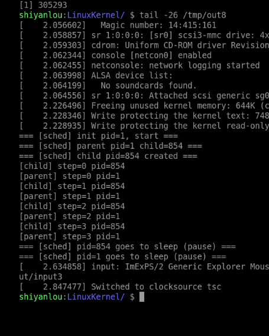
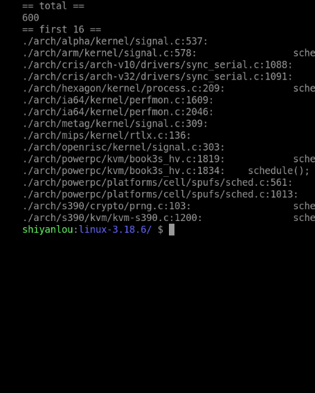
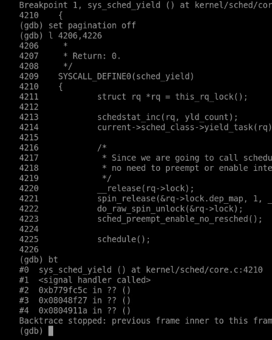
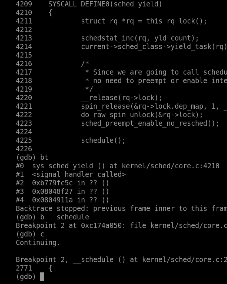
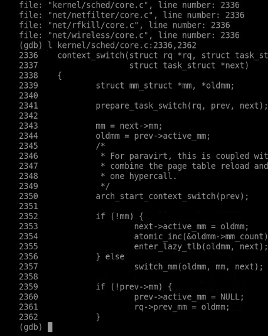
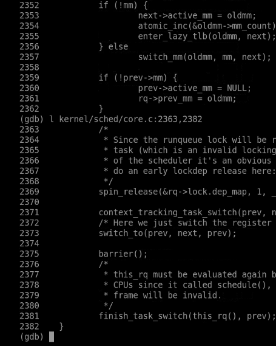
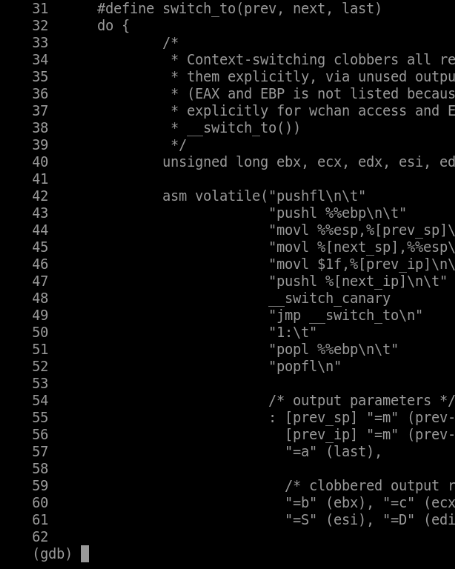
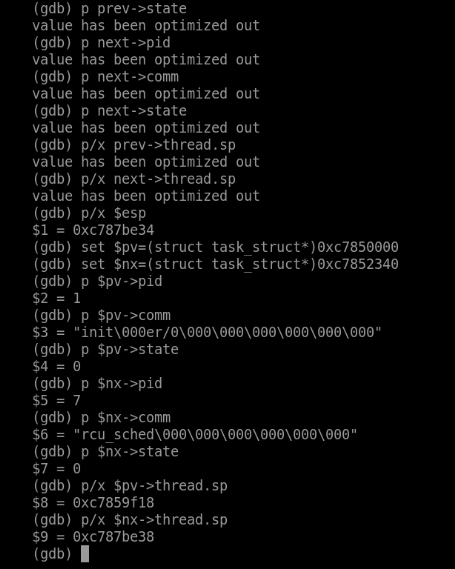
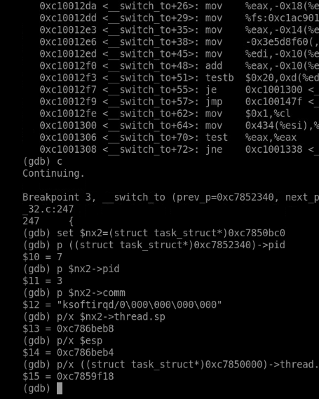
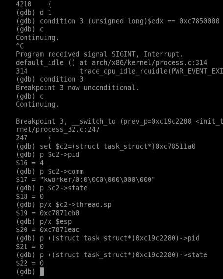

# 20262822《Linux内核原理与分析》第九周作业

**真实姓名：姚翔　学号：20262822　整理日期：2026年10月31日**  
**学习内容：教材第 9 章“Linux 操作系统的软件架构”；实验八“理解进程调度时机，跟踪分析进程调度与进程切换的过程”；课程视频“Linux 系统架构和执行过程概览”。**

**原创声明：** 原创作品转载请注明出处。  
**课程出处：** [《Linux 内核分析》MOOC 课程](http://mooc.study.163.com/course/USTC-1000029000)  
**课程网址：** http://mooc.study.163.com/course/USTC-1000029000

## 一、实验八：调度何时发生——跟踪 schedule 与 switch_to

### 1. 实验操作、文件与运行结果

实验程序作为 `/init` 启动，创建一个子进程，父子各打印四次并调用 `sched_yield()`，随后进入 `pause()`。主要操作如下：

```bash
cd ~/lab8
gcc -m32 -static -o sched_test sched_test.c
mkdir -p /tmp/ird8
cp sched_test /tmp/ird8/init
(cd /tmp/ird8 && find . | cpio -o -H newc | gzip > /tmp/e8.img)
cd ~/LinuxKernel
qemu -kernel linux-3.18.6/arch/x86/boot/bzImage \
  -initrd /tmp/e8.img -nographic -append "console=ttyS0" \
  -s -S </dev/null >/tmp/out8 2>&1 &
gdb linux-3.18.6/vmlinux
```

```text
源码/sched_test.c              制造两个可运行任务与主动让出 CPU 的机会
kernel/sched/core.c            schedule、__schedule、context_switch
arch/x86/include/asm/switch_to.h  32 位 switch_to 汇编与约束
arch/x86/kernel/process_32.c   __switch_to 的体系结构状态处理
```

本次控制台中父进程为 PID 1、子进程为 PID 854，双方 `step=0～3` 交替出现，最后进入睡眠。它显示两个进程都实际获得了执行；但 `sched_yield()` 不是同步原语，不承诺每次调用后都严格由另一个进程运行。这次交替顺序是本次调度结果，不是程序的跨环境保证。



**图1：** 本次父子进程各输出四步，并在最后 pause 常驻。

### 2. 从调度调用点理解调度时机

#### （1）搜索入口，不把搜索数量当作行为次数

```bash
cd ~/LinuxKernel/linux-3.18.6
grep -Rn 'schedule();' . | wc -l
grep -Rn 'schedule();' kernel | wc -l
grep -n 'schedule();' kernel/sched/core.c
```

截图中的全树搜索为 600 行、`kernel` 子目录为 70 行。它们是该源码树中匹配文本的行数，可能包含其他体系结构和未启用配置；不是运行时发生了 600 次调度，也不是严格统计所有调度机制。搜索的价值在于定位等待、同步、让出 CPU 和返回路径等可继续阅读的位置。



**图2：** 源码文本搜索得到 600 个匹配行，用于定位调度相关代码。

调度大致可以从三类情况理解：任务等待资源而主动睡眠；可运行任务主动让出 CPU；抢占请求在允许调度的边界得到处理。硬中断处理通常不能像普通进程上下文那样任意睡眠，必须区分“设置需要调度的标志”和“实际执行任务切换”。

#### （2）sched_yield 的实际含义

```gdb
target remote :1234
break sys_sched_yield
break __schedule
break __switch_to
continue
```

`sys_sched_yield` 通过当前调度类的 `yield_task` 操作调整调度状态，随后调用 `schedule`。不能把所有调度类都解释成“无条件把任务放到同一个队列末尾”；尤其普通 CFS 任务的行为有自身实现。源码中的 `preempt_enable_no_resched` 是允许抢占但不在该操作中立即执行重调度，不能解释成关闭抢占。



**图3：** sys_sched_yield 调用调度类操作，并进入 schedule 路径。

调度器最终选出的 `next` 若与 `prev` 相同，就无须做任务上下文切换。因此 `schedule` 被调用、`sched_yield` 返回与“肯定切换到指定进程”不是同一个结论。[sched_yield 接口说明](https://man7.org/linux/man-pages/man2/sched_yield.2.html)

### 3. 从 __schedule 到 context_switch

#### （1）选择任务与交接 CPU

可将核心流程概括为：

```text
schedule
  → __schedule
      更新当前任务及运行队列状态
      选择 next，维护 rq->curr 等信息
      若 prev != next：context_switch
          处理地址空间
          switch_to(prev, next, prev)
          finish_task_switch 等收尾
```

调度策略决定选谁，体系结构切换代码负责让选中的任务真正接着执行。二者有明确分工；仅分析汇编换栈，还无法说明为什么选择了这个任务。[Linux 3.18.6 调度核心](https://github.com/gregkh/linux/blob/v3.18.6/kernel/sched/core.c)



**图4：** __schedule 断点用于追踪选择与切换前的调度过程。

#### （2）地址空间不总是重新装入

`context_switch` 先处理地址空间关系。用户任务有 `mm`；内核线程常见 `mm=NULL`，可借用前一个任务的 `active_mm`。不同地址空间可能需要切换页表与 TLB 上下文，同一地址空间则存在优化路径，不能写成每次 `switch_to` 都必定重写 CR3。



**图5：** context_switch 上半部分按任务地址空间关系准备内存管理上下文。

调用 `switch_to` 之后，执行者已经可能是另一个任务。源码要重新取得合适的运行队列并完成上次切换的收尾；涉及编译器 `barrier()` 的位置也不能直接当成处理器的通用内存屏障。理解这里必须跟着“当前在谁的栈上”变化，而不是把整个函数当作普通的单任务顺序调用。



**图6：** context_switch 调用 switch_to，恢复后继续执行切换收尾。

### 4. 逐条分析 32 位 switch_to

以下按该版本宏整理主要汇编，省略可配置的栈保护指令和 C 约束。`prev_sp`、`next_sp`、`prev_ip`、`next_ip` 代表对应任务字段，不是可直接编译的独立汇编操作数：

```asm
pushfl                     # 在 prev 内核栈保存标志
pushl %ebp                 # 保存帧指针
movl %esp, prev_sp         # 记住 prev 暂停时的栈位置
movl next_sp, %esp         # 切换到 next 内核栈
movl $1f, prev_ip          # prev 将来从局部标号 1 恢复
pushl next_ip              # 在 next 栈上放置返回目标
jmp __switch_to            # 继续处理体系结构状态
1:
popl %ebp                  # 恢复该任务此前保存的帧指针
popfl                      # 恢复该任务标志
```

这是九条主要指令加一个局部标号，真实宏还包含约束和可选配置。`mov next_sp,%esp` 是栈归属发生变化的关键；其后压入的返回目标属于新任务的栈。原任务的 `thread.ip` 被写为 `1f`，为未来恢复保留续执行位置。



**图7：** switch_to 的原始宏展示换栈、保存恢复位置和跳转的配合。

`jmp` 本身不压入返回地址，前一条 `pushl next_ip` 人工准备了返回目标。`__switch_to` 按本版本内核的寄存器传参约定接收 `prev` 与 `next`，并处理 TLS、段寄存器、内核栈入口信息以及与配置和标志有关的其他状态。它不是用户态普通 C ABI 调用，也不能把所有通用寄存器的处理都归给这九条可见指令；宏的输出约束同样参与编译器的寄存器保存安排。[Linux 3.18.6 switch_to.h](https://github.com/gregkh/linux/blob/v3.18.6/arch/x86/include/asm/switch_to.h)

#### （1）已运行任务的恢复

假设 A 切到 B，A 的栈位置和恢复点被保存。以后 C 选择 A，恢复 A 的栈并以 A 保存的 `thread.ip` 作为返回目标，A 便从自己的 `1:` 继续，弹出此前保存的 EBP 和标志，回到自己的调度调用后方。它看到的是一次暂停后继续，期间 CPU 实际执行过其他任务。

`last` 接收的是这次把 CPU 交给恢复者的前一任务；不能一直按最初 A→B 的局部命名理解。返回后的变量属于恢复任务自己的栈，阅读时要同时标明“谁正在恢复”和“谁刚被换下”。

#### （2）新任务的首次执行

实验六中的子进程还没有执行过 `1:`，其 `thread.ip` 由 `copy_thread` 预设为 `ret_from_fork`。同一套 `push next_ip` 与返回机制既可以恢复旧任务，也可以把新任务带入首次运行路径。这样，创建阶段构造的现场与调度阶段使用的现场就连接起来了。

#### （3）已运行任务切换时，栈上的返回目标是什么

对于已经运行过、暂停在本宏中的任务 B，恢复 B 的 SP 后又压入 `B.thread.ip`，因此跳入 `__switch_to` 前的局部布局为：

```text
高地址
B.thread.sp + 4  保存的 B 标志寄存器
B.thread.sp      保存的 B 帧指针 EBP
B.thread.sp - 4  人工压入的 B 恢复地址 ← 入口处 ESP
低地址
```

辅助函数返回时取得人工准备的恢复地址，B 进入自己的 `1:`，再恢复 EBP 和标志。首次运行的新任务则使用创建阶段准备的栈与入口，不能把上面“已运行任务”的两项保存布局直接套给它。该区别把本节的九条汇编与实验六的初始现场联系起来，也说明同样是恢复控制流，栈内容必须与返回位置匹配。

### 5. 用实际栈指针验证换栈

#### （1）三次切换的数据

第一次观察为 PID 1 的 `init` 切到 PID 7 的 `rcu_sched`；两者状态值均为 0，即可运行状态。`prev->thread.sp=0xc7859f18`，`next->thread.sp=0xc787be38`，而停止处的 ESP 为 `0xc787be34`，相差 4 字节。



**图8：** 根据明确的任务地址重新读取 prev、next 字段，验证已切换到 next 的栈。

第二次为 PID 7 切到 PID 3 的 `ksoftirqd/0`，`next->thread.sp=0xc786beb8`，`esp=0xc786beb4`。再次得到 4 字节差值。



**图9：** 第二次切换的 next 栈指针与 ESP 相差一个 32 位返回地址。

第三次为 PID 0 的 idle 切到 PID 4 的 `kworker/0:0`，`next->thread.sp=0xc7871eb0`，`esp=0xc7871eac`，相同关系继续成立。



**图10：** idle 切向 kworker 的现场中，同样可以核对 next 栈与返回地址。

| 切换 | next 保存的 SP | __switch_to 入口 ESP | 差值 |
|---|---|---|---|
| init(1) → rcu_sched(7) | `0xc787be38` | `0xc787be34` | `4` |
| rcu_sched(7) → ksoftirqd/0(3) | `0xc786beb8` | `0xc786beb4` | `4` |
| idle(0) → kworker/0:0(4) | `0xc7871eb0` | `0xc7871eac` | `4` |

#### （2）为什么必须限定断点位置

在宏刚执行 `push next_ip`、并跳到 `__switch_to` 符号入口时，32 位栈新增一个 4 字节返回地址，因而有 `ESP = next->thread.sp - 4`。这条关系适用于本次入口位置；编译器生成的函数序言继续压栈或分配局部空间之后，ESP 会变化，不能将它当成函数内部任意位置的不变式。

优化使局部变量显示 `optimized out` 时，可根据已确认的函数实参或 ABI 寄存器取得任务地址，再用强制类型转换检查字段。不能从无效局部变量猜值，也不能把内核地址固定为跨运行的常量。

### 6. 中断、系统调用与任务切换的区别

| 情形 | 核心变化 | 是否必然更换当前任务 |
|---|---|---|
| 系统调用进入内核 | 保存用户现场，按入口协议转入内核执行 | 否 |
| 硬件中断处理 | 响应事件，按架构保存和恢复被打断现场 | 否 |
| 任务上下文切换 | 交接可执行任务，切换内核栈和体系结构状态 | 是 |

中断与异常的栈使用还可能受架构和配置影响，不能统一断言永远只在某一块栈上。系统调用属于当前任务的进程上下文，可以在允许的位置阻塞；硬中断上下文受到更严格的限制。实验五的返回前调度检查与本实验的 `schedule` 分析，说明了事件发生和任务真正切换之间存在机制上的衔接。

### 7. Linux 系统的一般执行过程

结合启动、系统调用、异常中断、创建和切换，可以把课程中的一般执行过程整理为以下机制示意：

```text
初始化建立任务、内存和中断等运行条件
  → 可运行任务获得 CPU，执行自己的用户态或内核态代码
  → 系统调用、异常或硬件中断引起控制转移
  → 入口保存必要现场，执行相应内核处理
      ├─ 原任务仍可继续：完成返回前工作，恢复原执行
      ├─ 任务阻塞或允许抢占：在合法调度点执行 schedule
      │   → 选择 next；需要时切换地址空间、内核栈及架构状态
      │   → 恢复已有任务，或执行新任务预设的首次入口
      └─ 没有普通可运行任务：执行该 CPU 的 idle 路径
```

硬件中断也可以打断内核代码，返回目标不总是用户态。系统调用处理、异常恢复、任务唤醒和调度相互协作，但不要求每次入口都切换任务。本实验看到的栈交接，正是把调度选择落实为下一段实际执行的关键步骤；它需要与入口保存的用户现场共同理解，而不能把 `switch_to` 当成一次普通函数跳转。

### 8. 测试程序、问题与总结

下列保留实测程序。开头注释中的“于是会发生真正的进程切换”表示本实验制造切换机会的意图；严格说仍要以 `prev != next` 和具体断点结果判断，不能理解为每次 yield 的保证。

```c
#include <stdio.h>
#include <unistd.h>
#include <sched.h>

/*
 * sched_test.c —— 作为 initramfs 的 init
 *
 * 目的：制造可观察的进程调度。
 *   1) fork 出父子两个可运行(R)进程，双方都反复调用 sched_yield()
 *      → 触发 sys_sched_yield() → schedule()，prev->state 仍是 TASK_RUNNING，
 *        于是会发生真正的"进程切换"（不是睡眠后唤醒）。
 *   2) 最后双方都 pause() 常驻，保证 init 不退出（否则内核 panic）。
 */

static void work(const char *who, int n)
{
    int i;
    for (i = 0; i < n; i++) {
        printf("[%s] step=%d pid=%d\n", who, i, (int)getpid());
        fflush(stdout);
        sched_yield();          /* → sys_sched_yield() → schedule() */
    }
}

int main(void)
{
    pid_t pid;

    printf("=== [sched] init pid=%d, start ===\n", (int)getpid());
    fflush(stdout);

    pid = fork();
    if (pid == 0) {
        printf("=== [sched] child pid=%d created ===\n", (int)getpid());
        fflush(stdout);
        work("child", 4);
    } else {
        printf("=== [sched] parent pid=%d child=%d ===\n", (int)getpid(), (int)pid);
        fflush(stdout);
        work("parent", 4);
    }

    printf("=== [sched] pid=%d goes to sleep (pause) ===\n", (int)getpid());
    fflush(stdout);

    for (;;)
        pause();

    return 0;
}
```

| 问题 | 原因 | 解决方案 |
|---|---|---|
| yield 后是否必须轮到另一个进程？ | 让出 CPU 不等于建立同步顺序 | 将输出作为一次结果，以 prev/next 验证具体切换 |
| 全树搜索数量能说明调度次数吗？ | 静态匹配与实际执行不同 | 用搜索找位置，用断点观察运行 |
| 为什么 jmp 后还能 ret？ | 返回目标已手工压到 next 栈上 | 逐条跟踪 ESP 与 next_ip |
| 为什么入口 ESP 比 thread.sp 小 4？ | 32 位返回地址占一个栈字 | 在函数序言前核对，三次结果一致 |
| 新任务没有旧的恢复点，如何执行？ | 创建阶段已构造首次入口和栈 | 结合实验六的 ret_from_fork 解释 |

我对切换的理解是：调度器先决定谁继续，架构代码再让 CPU 使用该任务的栈和续执行状态。看似“同一个函数返回了”，背后可能已经跨越多次调度。将任务、栈和返回地址一起跟踪，才能正确解释这一现象。

## 二、教材第 9 章学习：Linux 操作系统的软件架构

### 1. 阅读范围与问题主线

本周阅读第 9 章“Linux 操作系统的软件架构”，印刷页 **283—290**，对应扫描 PDF 的第 **302—309** 页。这一章不再引入新的子系统，而是把前八章拼成一张整体图：一次执行怎样从用户态进入内核，又怎样回到用户态；软件分成哪些层；所有进程为什么能共享同一个内核。

| 教材部分 | 印刷页 | 本周重点解决的问题 |
|---|---|---|
| 9.1.1—9.1.3 一般执行过程 | 283—285 | 32 位、64 位、ARM64 的步骤有何异同？ |
| 9.1.4 5 种特殊情况 | 286—287 | fork、exec、内核线程怎样改变一般流程？ |
| 9.2.1 层次架构 | 287—288 | 用户程序、库、系统调用、内核、硬件怎样分层？ |
| 9.2.2 地址空间结构 | 288—289 | 为什么所有进程都能执行同一份内核代码？ |
| 9.2.3 执行路径 | 289—290 | 系统调用、中断、异常三条路径怎样区分？ |

本章与实验八的连接最直接：实验八看到的 `schedule`、`context_switch`、`switch_to` 正是 9.1 一般执行过程的第（4）步；`switch_to` 的栈交换可以在 9.1.4 的 5 种特殊情况下进一步分类。

### 2. 问题一：一般执行过程的八个步骤，哪些属于“进入内核”，哪些属于“切换”？

**疑问与原因。** 教材用“进程 X 切换到进程 Y”描述一般过程，步骤较多，容易把保存现场、调度、切换、返回到用户态混成一个动作。

**理解与解决。** 以 32 位 x86、Linux 3.18.6 为例，可以把八个步骤归成四组：

| 阶段 | 步骤 | 主要动作 |
|---|---|---|
| 进入内核 | （1）（2）（3） | X 运行；中断发生，CPU 保存 `CS:EIP`、`SS:ESP`、`EFLAGS` 并切换内核栈；`SAVE_ALL` 保存通用寄存器 |
| 内核处理 | （4）前半 | 执行中断/异常/系统调用处理，完成业务逻辑 |
| 决定与切换 | （4）后半 | 返回前调用 `schedule`；`switch_mm` 切地址空间，`switch_to` 切内核栈和 CPU 上下文 |
| 返回用户态 | （5）—（8） | 恢复 next 的现场，`iret` 回到用户态，继续执行 Y |

关键在第（3）步：`SAVE_ALL` 完成后，才形成完整的 `pt_regs`，此时“用户态进程上下文”变成“内核态中断上下文”。第（7）步的 `iret` 与第（2）步的硬件保存动作相反，完成从内核态回到用户态的转换。把“保存现场”“选择任务”“换栈”“返回”分开，才能与实验八的断点一一对应。

64 位与 ARM64 的步骤在指令和寄存器上不同：x86-64 入口涉及 `swapgs`、`iretq` 等，ARM64 通过异常向量表进入、用 `eret` 返回；但“保存现场—处理—调度—恢复”的结构一致。教材 9.1.2、9.1.3 分别给出这两条路径，本文的寄存器名和栈数值只对应 32 位实验环境，不能直接套到另外两种架构。

### 3. 问题二：5 种特殊情况分别改变了哪一步？

**疑问与原因。** 一般过程假设“从用户态 X 进入内核，再回到用户态 Y”；但 fork 的子进程、exec 后的任务、内核线程都不完全符合这个假设。

**理解与解决。** 教材 9.1.4 列出 5 种情况，我按“改变了哪一步”整理：

| 特殊情况 | 与一般过程的差异 | 改变的关键步骤 |
|---|---|---|
| 内核线程之间切换 | 没有用户态/内核态转换，只有内核线程之间的调度 | 省去（2）（7）的用户态往返 |
| 用户进程切换到内核线程 | 内核线程不返回用户态 | 返回目标不是用户态，省去（7） |
| 内核线程切换到用户进程 | 若内核线程主动 `schedule`，只有进程上下文切换；通常仍需中断返回路径回到用户态 | （7）是否存在取决于进入方式 |
| fork 的子进程第一次执行 | 没有“上次暂停点”，从 `ret_from_fork` 开始 | 第（4）步的恢复位置由 `copy_thread` 预设 |
| execve 装载新程序 | 保存的中断上下文被改写为新程序入口 | 第（7）步的 `iret` 返回到新 `ip` |

这张表解释了为什么“一般过程”不能覆盖所有情况：一般过程描述的是最常见路径，特殊情况改变的是入口、返回位置或是否存在用户态往返，而不是另起一套机制。

### 4. 问题三：fork 的子进程为什么从 `ret_from_fork` 开始，而不是从 `schedule` 返回？

**疑问与原因。** 按一般过程，任务被调度后应该从 `switch_to` 的标号 1 继续；但实验六看到子进程第一次执行落在 `ret_from_fork`。

**理解与解决。** 因为子进程从未执行过 `switch_to` 的那条路径，没有“标号 1”可返回。`copy_thread` 为它构造了全新的内核栈和 `thread.ip=ret_from_fork`，调度器第一次选中它时，`switch_to` 把 `thread.ip` 压入栈，`__switch_to` 返回后自然进入 `ret_from_fork`，而不是旧的恢复点。

```text
已运行任务：switch_to 保存 1f → 下次恢复 → 从 1: 继续
fork 子进程：copy_thread 预设 ret_from_fork → 首次调度 → 从 ret_from_fork 开始
```

这也是教材把“创建的子进程第一次执行”列为特殊情况的原因：它不是“恢复”，而是“首次进入”。两者共用 `switch_to` 的换栈机制，但栈上的返回目标来源不同。

### 5. 问题四：`execve` 怎样“篡改”中断上下文？

**疑问与原因。** exec 是系统调用，按一般过程应该返回用户态继续执行；但实验七看到返回地址变成了新程序入口，旧程序后面的语句没有执行。

**理解与解决。** exec 没有绕过返回路径，而是修改了返回路径要用的现场。`load_elf_binary` 建立新地址空间和用户栈后，`start_thread` 把保存的 `pt_regs` 中的 `ip`、`sp`、`cs`、`ss`、`flags` 改为新程序的值；系统调用返回时，`iret` 照常执行，但恢复的是新现场。

```text
execve 系统调用
  → 保存现场（旧程序的 pt_regs）
  → load_elf_binary 建立新 mm、新栈
  → start_thread 改写 pt_regs->ip/sp
  → 返回路径 iret
  → 用户态从新程序入口开始
```

因此，“exec 不返回”与“系统调用有返回路径”并不矛盾：返回动作发生了，只是目的地被换掉了。这也说明为什么 exec 成功后旧程序的用户栈、代码都不再使用——它们已不属于新的地址空间。

### 6. 问题五：内核线程之间的切换为什么少了两次状态转换？

**疑问与原因。** 一般过程包含“用户态 → 内核态”和“内核态 → 用户态”两次转换；内核线程切换似乎只有中间一段。

**理解与解决。** 内核线程始终在内核态运行，没有用户态现场需要保存或恢复。两个内核线程之间的切换，只需要保存/恢复内核栈和 `thread` 现场，不涉及 `iret` 返回用户态：

```text
用户进程 ↔ 用户进程：用户态 → 内核态 → 调度 → 内核态 → 用户态
内核线程 ↔ 内核线程：内核态 → 调度 → 内核态
用户进程 → 内核线程：用户态 → 内核态 → 调度 → 内核态（不返回用户）
内核线程 → 用户进程：内核态 → 调度 → 内核态 → 用户态
```

这也解释了为什么内核线程可以主动调用 `schedule`：它本来就在进程上下文中，不需要借助中断返回点。与之相对，用户进程通常要等到系统调用、异常或中断进入内核后，才有合法的调度边界。

### 7. 问题六：Linux 的层次架构怎样对应一次 `read` 调用？

**疑问与原因。** 图 9-1 把系统分成用户程序、Shell/库、系统调用接口、内核实现、硬件管理几层；实际调用 `read` 时，这些层是怎样协作的？

**理解与解决。** 以读取一个普通文件为例：

```text
应用程序：read(fd, buf, n)
  → C 库：封装系统调用，准备参数
      → 系统调用接口：陷入内核，进入 sys_read
          → VFS：按 fd 找到 file，调用 file->f_op->read
              → 具体文件系统：读取页缓存/发起块 I/O
                  → 块层与设备驱动：访问磁盘
                      → 硬件：完成传输，产生中断
          → 数据拷贝到用户缓冲区
      → 返回用户态，read 返回字节数
```

图 9-1 的意义在于把“接口”和“实现”分开：上层只依赖系统调用接口，下层可以替换文件系统、驱动或硬件，而不改变应用程序。内核实现层再细分为进程管理、内存管理、文件系统、设备驱动、网络等子系统；它们通过内部接口协作，而不是把所有逻辑塞进一个系统调用。

### 8. 问题七：为什么所有进程都能执行同一个内核？

**疑问与原因。** 每个进程有独立的用户地址空间，按理说代码互不可见；但所有进程都能调用同一个 `system_call`、执行同一份内核代码，这似乎矛盾。

**理解与解决。** 教材 9.2.2 指出：32 位 Linux 中，所有进程地址空间 **3 GB 以上**的部分是共享的，内容完全一样；64 位 Linux 同样把高地址部分的内核空间映射到每个进程。逻辑上每个进程的地址空间独立，但内核映射位于相同的高地址区域，因此进入内核后，当前页表仍然能访问内核代码和数据。

```text
32 位进程地址空间：
0x00000000 ───────── 用户空间（每个进程不同）
0xC0000000 ───────── 内核空间（所有进程共享同一映射）
0xFFFFFFFF
```

这也带来一个重要的理解：内核不是一个单独运行的“大进程”，而是**中断处理程序和内核线程的集合**，存放在所有进程共享的地址空间里。系统调用时，当前进程只是切换到了这段共享代码；内核线程则直接在这段空间里运行。教材这句话把“进程”和“内核”的关系说得很清楚。

### 9. 问题八：系统调用、异常、中断三条执行路径有什么异同？

**疑问与原因。** 三者都从当前执行流转入内核，入口和返回都涉及保存现场，容易当成同一类事件。

**理解与解决。** 可以从触发、返回目标和是否可恢复三个维度区分：

| 路径 | 触发 | 返回目标 | 典型处理 |
|---|---|---|---|
| 系统调用 | 用户程序主动请求 | 下一条指令（exec 例外） | 按调用号分发，执行服务 |
| 异常 | 指令执行出错或特殊指令 | 重试指令、继续或终止 | 缺页、除零、断点等 |
| 硬件中断 | 外部设备/时钟 | 被打断的位置 | 上半部应答，下半部延迟 |

三者共享“保存现场—处理—恢复”的框架，但异常要判断是否可恢复，中断要区分上半部/下半部，系统调用要校验参数和调用号。把它们统一成“中断”会丢失这些差异；把它们完全分开，又会看不到共同的入口/返回机制。教材 9.2.3 的“执行路径”正是要求同时看到共性和差异。

### 10. 问题九：“内核是中断处理程序和内核线程的集合”应该怎样理解？

**疑问与原因。** 这句话听起来像把内核缩小成两类代码，忽略了文件系统、内存管理等大量子系统。

**理解与解决。** 这句话描述的是**执行形态**，不是功能清单。内核代码可以在两种上下文中运行：

- **中断处理程序**：由系统调用、异常或硬件中断触发，借用当前任务的上下文执行；
- **内核线程**：由内核创建，拥有自己的 `task_struct` 和内核栈，可以被调度、睡眠和唤醒。

文件系统、内存管理、驱动等子系统，最终都以这两种形态之一被执行。说“内核是集合”，强调的是内核没有独立的“进程”来承载所有工作，它依附于用户进程的中断上下文，或运行在内核线程中。这与第 7 章“内核线程是进程”的判断一致，也解释了为什么内核代码既能阻塞（内核线程），又能在硬中断中受到不能睡眠的限制。

## 三、课程视频学习：Linux 系统架构和执行过程概览

本周视频“Linux 系统架构和执行过程概览”与教材第 9 章对应。我按“架构图—执行链—特殊情况”三层整理：

### 1. 架构图：从应用到硬件

视频用分层图说明：应用程序通过库和系统调用接口使用内核服务；内核内部再分为进程管理、内存管理、文件系统、设备驱动等子系统；最下层是对硬件资源的管理。这个分层与教材图 9-1 一致，重点是**接口稳定、实现可替换**：应用不直接操作硬件，驱动也不越过 VFS 直接面对应用。

### 2. 执行链：一次往返的完整路径

视频把一次执行描述为“用户态运行 → 事件进入内核 → 保存现场 → 处理 → 返回前调度 → 恢复/切换 → 返回用户态”。这与实验八的 `schedule → context_switch → switch_to` 能够对应：`schedule` 发生在返回前的边界，`switch_to` 完成栈和现场的交接，`iret` 完成回到用户态的最后一步。

### 3. 特殊情况：一般流程的边界

视频提到内核线程、fork 子进程、exec 等情形与一般流程不同。教材 9.1.4 把它们归纳为 5 种特殊情况，我在上一节已经逐条对应。视频给的是“哪里不一样”的提示，具体的现场和栈布局仍以教材和实验为准。

视频的架构图帮助我把前面几周的子问题放回整体：系统调用是接口，进程是资源与调度的单位，中断是事件入口，内核线程是内核自己的执行者。理解这张图，比记住单个函数名更重要。

## 四、本周问题、原因与解决

| 问题 | 原因分析 | 处理与验证 |
|---|---|---|
| `yield` 后一定轮到另一个进程吗？ | 让出 CPU 不等于同步 | 以 `prev/next` 和断点结果判断 |
| 搜索结果 600 能说明调度次数吗？ | 静态文本匹配不等于运行行为 | 只用于定位，实际次数靠断点 |
| 为什么入口 ESP 比 `thread.sp` 小 4？ | 人工压入了一个 32 位返回地址 | 三次切换均在函数序言前核对 |
| 新任务为什么从 `ret_from_fork` 开始？ | 没有旧恢复点，首次进入 | 结合实验六的 `copy_thread` |
| exec 为什么能改变返回位置？ | 修改保存的 `pt_regs`，不绕过返回路径 | 实验七的 `regs->ip` 变化 |
| 所有进程为什么能执行同一内核？ | 内核映射位于共享高地址区 | 教材 9.2.2 的 3 GB/1 GB 划分 |
| 内核线程切换为何没有 `iret`？ | 始终在内核态，无用户现场 | 对照 5 种特殊情况 |

## 五、AI 辅助学习中的核验记录

| 向 AI 梳理的问题 | 需要核验的点 | 本次形成的结论 |
|---|---|---|
| 一般执行过程的 8 步能否合并？ | 保存、调度、切换、返回的边界 | 可分四组，但不能把保存与切换混为一谈 |
| 5 种特殊情况是否各有一套机制？ | 与一般流程的差异点 | 共用入口/切换机制，改变的是入口或返回位置 |
| fork 子进程是否“恢复”执行？ | 有无旧恢复点 | 是首次进入，不是恢复 |
| exec 是否跳过返回路径？ | `pt_regs` 的修改时机 | 仍走返回路径，只是现场被替换 |
| 内核线程是否有用户态？ | `mm`、`pt_regs` 与返回目标 | 没有用户态往返，不需要 `iret` 回用户 |
| 内核是否独立于进程运行？ | 内核映射与执行上下文 | 内核代码在共享空间中被中断上下文或内核线程执行 |

## 六、本周学习总结

实验八把“调度”从概念变成了可检查的栈操作：`schedule` 选择任务，`context_switch` 处理地址空间，`switch_to` 换栈并把返回地址压到 next 的栈上；三次切换入口的 ESP 都比 `next->thread.sp` 小 4 字节，正好对应人工压入的返回地址。第 9 章则把这一动作放回完整执行过程：进入内核、保存现场、处理、调度、切换、`iret` 返回；并用 5 种特殊情况说明 fork、exec 和内核线程为什么不能完全套用一般流程。

我本周最大的收获，是能把“同一个函数返回了”解释成“可能已经换了任务和栈”。另一个收获是理解了内核与进程的关系：内核代码存在于所有进程共享的高地址空间，由中断上下文或内核线程执行，而不是一个脱离进程的独立实体。这两点会在最后的总结中继续展开。

## 参考资料

1. 孟宁、娄嘉鹏：《庖丁解牛 Linux 操作系统分析》，第 9 章“Linux 操作系统的软件架构”，印刷页 283—290。
2. [《Linux 内核分析》MOOC](http://mooc.study.163.com/course/USTC-1000029000)，第八、九周视频与实验八。
3. [作者提供的课程与教材配套资料](https://github.com/mengning/linuxkernel)。
4. Linux 3.18.6 源码：[调度核心](https://github.com/gregkh/linux/blob/v3.18.6/kernel/sched/core.c)、[32 位 switch_to](https://github.com/gregkh/linux/blob/v3.18.6/arch/x86/include/asm/switch_to.h)、[进程创建](https://github.com/gregkh/linux/blob/v3.18.6/kernel/fork.c)、[系统调用入口](https://github.com/gregkh/linux/blob/v3.18.6/arch/x86/kernel/entry_32.S)。
5. [Linux man-pages：sched_yield(2)](https://man7.org/linux/man-pages/man2/sched_yield.2.html)、[clone(2)](https://man7.org/linux/man-pages/man2/clone.2.html)。
6. [QEMU GDB 使用说明](https://www.qemu.org/docs/master/system/gdb.html)。
