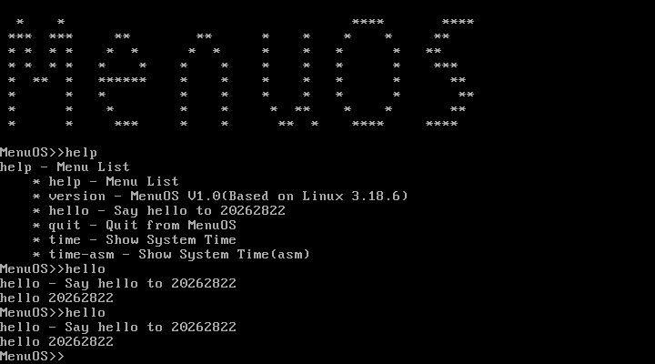

# 第五周 MenuOS 扩展作业

学号：20262822

## 作业内容

从 <https://github.com/mengning/menu.git> 克隆代码，增加 `hello` 命令，输出 `hello 20262822`；重新制作根文件系统，在 QEMU 中启动并测试。

上游版本：`f61389b6cb759dc80d14e3081957c95a74815ffe`。

## 代码修改

修改文件：[menu/test.c](menu/test.c)。只增加命令处理函数和命令注册，共 7 行：

```c
int Hello(int argc, char *argv[])
{
    printf("hello 20262822\n");
    return 0;
}
```

在 `main()` 中、`ExecuteMenu()` 之前注册：

```c
MenuConfig("hello","Say hello to 20262822",Hello);
```

原仓库的 `hello.c` 是独立示例程序；本次新增的菜单命令由 `test.c` 中的 `Hello` 函数处理。

本机 GCC 15 默认采用 C23，原项目的旧式函数声明在该标准下会报错，因此在 `Makefile` 的根文件系统构建命令中增加 `-std=gnu99`，保留原项目的 C 语言语义。其余上游代码不变。

## 在 Ubuntu 中重新制作文件系统并运行

安装实验依赖：

```bash
sudo apt update
sudo apt install build-essential gcc-multilib cpio gzip qemu-system-x86
```

本机已经安装上述依赖。进入本作业文件夹，使用本次已下载的测试内核：

```bash
bash 运行测试.sh .tools/vmlinuz-lts
```

如果使用另一台电脑上上周已编译的内核，传入实际镜像路径：

```bash
bash 运行测试.sh ~/LinuxKernel/linux-3.18.6/arch/x86/boot/bzImage
```

脚本会调用原仓库的 `make rootfs`，重新编译 32 位静态程序并生成 `rootfs.img`，随后启动 QEMU。内核镜像路径应替换为电脑上的实际路径。

也可以手动执行：

```bash
cd menu
make rootfs
qemu-system-i386 -kernel ~/LinuxKernel/linux-3.18.6/arch/x86/boot/bzImage \
    -initrd ../rootfs.img -append 'console=ttyS0' -nographic
```

作业原文中的 `qmenu` 按 QEMU 理解；原仓库提供的运行目标为 `make qemu`。

## 实际测试结果

在 QEMU 中输入 `help`，命令表包含 `hello`；连续输入两次 `hello`，均输出：

```text
hello 20262822
```



正式测试环境：本机 WSL 1、Ubuntu 26.04.1 LTS、GCC 15.2.0、QEMU 10.2.1。通过原仓库的 `make rootfs` 编译并打包 32 位静态程序，使用 Alpine 官方提供的 Linux `6.1.128-0-lts` 内核启动。截图里的 `Based on Linux 3.18.6` 是原项目写死的版本说明，不代表本次实际运行内核版本。

关键节点截图：

- [Ubuntu、WSL 1 和实验工具检查](screenshots/03-ubuntu-wsl1-environment.png)。
- [重新编译、制作文件系统和核对镜像内容](screenshots/04-ubuntu-rootfs-build.png)。
- [MenuOS 的 help 和 hello 命令测试](screenshots/05-menuos-hello-ubuntu.png)。

测试内核来源：[Alpine 官方内核镜像](https://dl-cdn.alpinelinux.org/alpine/v3.18/releases/x86/netboot/vmlinuz-lts)。

## 提交材料

- 代码：[hello 命令源码（menu/test.c）](https://github.com/xiang0829/linux-/blob/codex/week5-menuos-20262822/%E7%AC%AC%E4%BA%94%E5%91%A8MenuOS%E6%89%A9%E5%B1%95%E4%BD%9C%E4%B8%9A/menu/test.c)。
- 附件：优先提交 `screenshots/05-menuos-hello-ubuntu.png`；如可提交多个附件，可同时提交 `03` 环境截图和 `04` 构建截图。

代码分支：`codex/week5-menuos-20262822`。
