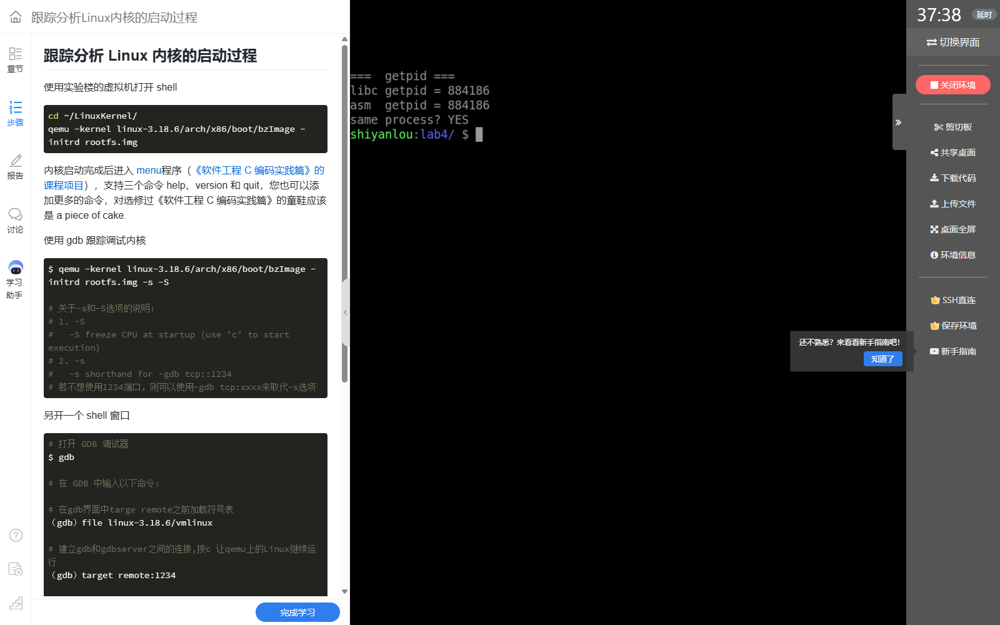
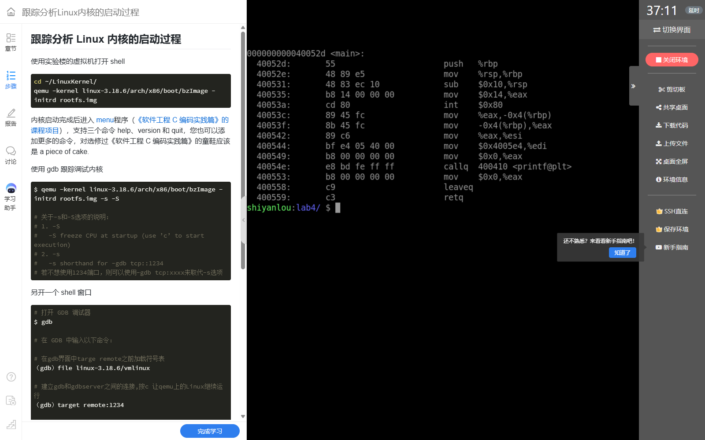
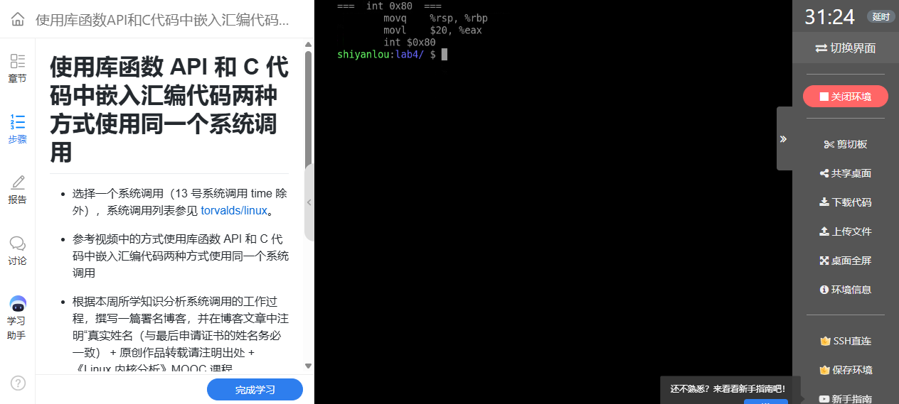

# 20262822《Linux内核原理与分析》第五周作业

**真实姓名：姚翔　学号：20262822　整理日期：2026年10月25日**  
**学习内容：教材第 5 章“进程的描述和创建”；实验四“库函数与内嵌汇编系统调用”。**

**原创声明：** 原创作品转载请注明出处。  
**课程出处：** [《Linux 内核分析》MOOC 课程](http://mooc.study.163.com/course/USTC-1000029000)。

## 一、实验四：从库函数到内嵌汇编——理解 Linux 系统调用接口

### 一、实验环境、操作与结果

本实验选用无参数的 `getpid` 比较库函数与内嵌汇编，再用三个参数的 `write` 验证寄存器传参。主要操作如下，在保存四个 C 文件的实验目录执行：

```bash
gcc -o getpid_libc getpid_libc.c
gcc -o getpid_asm getpid_asm.c
gcc -o getpid_both getpid_both.c
./getpid_libc
./getpid_asm
./getpid_both
objdump -d getpid_asm
```

四个文件分别验证接口封装、直接调用、同进程对照和带参数调用：

```text
源码/
├── getpid_libc.c    调用 libc 的 getpid()
├── getpid_asm.c     使用 int $0x80 和调用号 20
├── getpid_both.c    同一进程内对照两种结果
└── write_asm.c      使用调用号 4，传入 fd、buf、len
```

PID 是进程的属性。要比较两种接口是否取得同一个 PID，应当让它们在同一进程中执行，而不能要求两次启动的程序返回相同数字。`getpid_both` 中两个值均为 **884186**，并输出 `same process? YES`，说明本次两种方法取得了同一个进程的身份。



**图1：** 同一进程中，libc 与内嵌汇编返回相同 PID。

分别运行两个可执行文件时，截图中的 PID 为 854805 和 854806；再次启动后为 854808 和 854809。每次启动都会产生新的进程，数值变化符合预期。这张图应与上一张共同理解：分开运行检验各自能调用成功，同进程对照才检验结果的一致性。


**图2：** 独立运行两个程序时 PID 不同，再次运行后数值继续变化。

#### 1. 位数与调用约定的核对

反汇编中既出现 `%rbp`、`%rsp`、`callq`，也出现 `int $0x80`。前一组说明这里默认编译出的程序使用了 64 位指令；后一条指令则显式使用 Linux 的 i386 兼容系统调用接口。因此，不能仅凭 `eax` 或 `int $0x80` 就把整个可执行文件判断为 32 位。后续实验中 QEMU 运行的 Linux 3.18.6 i386 内核，也应与这里的宿主实验终端区分。



**图3：** 反汇编同时展示 64 位函数指令和显式 int $0x80 指令。

`getpid` 不需要传递指针，因此这一兼容调用可以用于本次对照；带指针的兼容调用要求地址能由 32 位参数表示，不能直接推广到任意 64 位程序。若复现实验时希望严格统一为 i386，应安装相应的 32 位编译依赖并使用 `gcc -m32`，再用 `file` 核对产物。这里的解释以截图中实际生成的指令为准。[系统调用架构约定](https://man7.org/linux/man-pages/man2/syscall.2.html)

### 二、getpid 的程序与接口分析

#### 1. 库函数方式

```c
#include <stdio.h>
#include <unistd.h>
#include <sys/types.h>

int main(void)
{
    pid_t pid;

    pid = getpid();
    printf("[libc] getpid() = %d\n", (int)pid);

    return 0;
}
```

`unistd.h` 提供接口声明，`pid_t` 表示进程号类型。调用者只需要遵守 C 接口，无须自己选择系统调用指令、保存输入寄存器或处理各架构的参数布局。库函数接口相同，不代表所有 libc 版本都使用同一条底层指令，也不能由 PID 相等推导出两条路径的内部实现完全一致。

#### 2. 内嵌汇编方式

```c
#include <stdio.h>

/* i386 架构下 getpid 的系统调用号 */
#define __NR_getpid 20

int main(void)
{
    int pid;

    /* 不经过 glibc 封装，直接把系统调用号放入 eax，用 int 0x80 陷入内核 */
    asm volatile("int $0x80"
                 : "=a"(pid)
                 : "a"(__NR_getpid));

    printf("[asm ] getpid() = %d\n", pid);

    return 0;
}
```

这里使用的是 **i386 ABI 的调用号 20**。输入约束 `"a"(__NR_getpid)` 将调用号准备到累加寄存器；输出约束 `"=a"(pid)` 取得返回值；`volatile` 表明该汇编具有不可随意删除的作用。`int $0x80` 经过内核设置的系统调用入口进行受控的特权级转换，内核根据调用号选择服务，返回后将 PID 交给用户程序。

这个过程始终可以由同一任务完成。进入内核并不等于创建新进程，也不必然引起调度切换；只有内核执行中需要阻塞或调度时，才可能进一步切换任务。

#### 3. 同一进程中的比较程序

```c
#include <stdio.h>
#include <unistd.h>

#define __NR_getpid 20

int main(void)
{
    int pid_asm;
    int pid_libc;

    /* 方式一：库函数封装 */
    pid_libc = (int)getpid();

    /* 方式二：内嵌汇编直接 int 0x80 */
    asm volatile("int $0x80"
                 : "=a"(pid_asm)
                 : "a"(__NR_getpid));

    printf("libc getpid = %d\n", pid_libc);
    printf("asm  getpid = %d\n", pid_asm);
    printf("same process? %s\n", (pid_libc == pid_asm) ? "YES" : "NO");

    return 0;
}
```

两次读取之间没有 `fork` 或 `exec`。对照变量具有相同的进程身份，这是比较成立的条件。将比较放进同一 `main`，消除了“程序每运行一次 PID 都变化”对结论的干扰。

### 三、三个参数的 write 系统调用

#### 1. 操作和运行结果

```bash
gcc -o write_asm write_asm.c
./write_asm
gcc -S -o write_asm.s write_asm.c
```

`write` 将缓冲区写入指定文件描述符。程序以 `fd=1` 输出到标准输出，字符串连同结尾换行共 **31 字节**，截图中直接调用的返回值也为 31。返回值表示实际写出的字节数；它不是 C 字符串长度加一，也不包含末尾的 `\0`。


**图4：** 直接调用 write 输出字符串，并返回 31 字节。

#### 2. 程序与寄存器对应

以下保留实测程序，便于与附件和截图对应。

```c
#include <stdio.h>
#include <string.h>

/* i386 架构下 write 的系统调用号为 4 */
#define __NR_write 4

static int my_write(int fd, const char *buf, int len)
{
    int ret;

    /* 参数按约定放入 ebx/ecx/edx，系统调用号放入 eax，然后 int 0x80 */
    asm volatile("int $0x80"
                 : "=a"(ret)
                 : "a"(__NR_write), "b"(fd), "c"(buf), "d"(len));

    return ret;
}

int main(void)
{
    const char *msg = "hello from inline asm write(4)\n";
    int n;

    n = my_write(1, msg, (int)strlen(msg));
    printf("my_write() returned %d bytes\n", n);

    return 0;
}
```

| i386 寄存器 | 调用前的意义 | 本次传入内容 |
|---|---|---|
| `eax` | 系统调用号 | `4`，即 `write` |
| `ebx` | 第一个参数 | `1`，标准输出 |
| `ecx` | 第二个参数 | 字符串缓冲区地址 |
| `edx` | 第三个参数 | 长度 `31` |
| `eax` | 调用返回后的结果 | 实际写出字节数，或负错误码 |

编译后的汇编能够检查 C 约束最终是否形成相应的寄存器准备。截图中寄存器赋值和 `int $0x80` 对应上表，证明参数不是靠 C 函数调用栈自动传给内核的，而是由内嵌汇编约束落实到约定的寄存器。



**图5：** 生成的汇编展示 write 调用前的寄存器准备与中断指令。

#### 3. 从实验代码到稳健实现

本次程序的指针能够用于兼容调用，但这不保证 64 位进程中任意缓冲区地址都适用。兼容 ABI 只使用 32 位地址参数，高地址指针可能被截断，出现 `EFAULT`。更稳妥的教学复现方法是统一编译为 32 位，或改用本机原生系统调用 ABI，不能混用调用号和寄存器约定。

另一个值得改进之处是向编译器说明汇编会访问指针所指向的内存。实测附件中的约束没有 `"memory"`；学习改进时可在最后加入该 clobber：

```c
asm volatile("int $0x80"
             : "=a"(ret)
             : "a"(__NR_write), "b"(fd), "c"(buf), "d"(len)
             : "memory");
```

这是对编译器优化可见性的补充，不是 CPU 内存屏障。直接系统调用得到负错误码时，还要自己处理；libc 通常将其转换为 `-1` 并设置 `errno`。此外，真实应用还应处理短写与中断，不能只检查返回值是否为正。[GCC 内嵌汇编约束说明](https://gcc.gnu.org/onlinedocs/gcc/Extended-Asm.html)

### 四、问题、原因与解决思路

| 学习中的问题 | 原因分析 | 处理与验证 |
|---|---|---|
| 为什么两个程序的 PID 不一样？ | 它们是两次独立创建的进程 | 增加 `getpid_both`；同进程两种方法都得到 884186 |
| 有 int 0x80，程序就一定是 32 位吗？ | 混淆了 ELF 架构与系统调用 ABI | 结合 `%rsp`、`callq` 判断产物位数，说明 i386 兼容入口 |
| 只把调用号写进 eax 是否足够？ | getpid 无参数，掩盖了参数传递要求 | 用 write 验证 ebx、ecx、edx 及返回值 31 |
| 为什么不能把示例直接用于任意指针？ | 64 位指针与兼容接口的地址宽度不同 | 统一为 32 位环境，或按原生 ABI 重写 |
| 返回值相同能否证明底层路径相同？ | 混淆接口语义与实现细节 | 用结果验证语义，用反汇编和版本源码分析实现 |

### 五、实验认识

我对系统调用的理解从“调用一个特殊函数”转为“按架构协议提交内核服务请求”：用户程序准备调用号和参数，入口代码保存现场，内核分发执行，再把结果交还调用者。库函数把这套协议封装起来，内嵌汇编则让调用约定变得可见。本实验也提醒我，程序位数、调用号和指针宽度必须一起核对，不能只认某一条汇编指令。

完整实测程序附件：[getpid_libc.c](源码/getpid_libc.c)、[getpid_asm.c](源码/getpid_asm.c)、[getpid_both.c](源码/getpid_both.c)、[write_asm.c](源码/write_asm.c)。

## 二、教材第 5 章学习：进程的描述和创建

### 1. 阅读范围与问题主线

本周阅读《庖丁解牛 Linux 操作系统分析》第 5 章“进程的描述和创建”，印刷页 **154—197**，对应所用扫描 PDF 的第 **173—216** 页。本章不是单独介绍一个 `fork` 函数，而是先说明内核如何描述进程、组织地址空间，再分析如何建立一个能被调度执行的新任务。

| 教材部分 | 印刷页 | 本周重点解决的问题 |
|---|---|---|
| 5.1 进程的描述 | 154—162 | 任务信息放在哪里？运行与就绪如何区分？链表如何表达父子关系？ |
| 5.2 进程地址空间 | 163—171 | 相同虚拟地址如何互不干扰？mm、页表、TLB 与大页分别解决什么问题？ |
| 5.3 进程的创建 | 172—197 | PID 0/1/2 如何产生？fork 复制什么？子进程怎样开始执行？ |
| 本章实验 | 197 | 大页测试与 fork 跟踪的任务要求，用于明确机制的进一步验证方法 |

教材同时对照 Linux **3.18.6** 和 **5.4.34**，并涉及 x86 与 ARM64。实验四使用库函数和显式 `int $0x80` 比较系统调用，其反汇编包含 64 位程序指令与 i386 兼容 ABI；下文的内核结构分析按教材所列版本单独说明。程序位数、系统调用 ABI、内核版本和架构应分开核对，不能将不同环境拼接成一条调用链。

### 2. 问题一：task_struct 是“进程的全部内容”吗？

**疑问与原因。** 教材从进程控制块讲起，容易让人以为一份 `task_struct` 就直接装下程序代码、全部内存和所有打开文件。实际阅读图 5-1 和结构定义后，可以看到许多成员是指向其他对象的指针，而不是资源内容本身。

**理解与解决。** `task_struct` 是任务身份、调度状态和资源联系的枢纽。把成员按职责分类，比逐行背字段更容易理解：

| 类别 | 典型成员或结构 | 表达的关系 |
|---|---|---|
| 身份与状态 | `pid`、`tgid`、`state`、`exit_state` | 是谁、属于哪个线程组、处于何种状态 |
| 任务组织 | `tasks`、`real_parent`、`parent`、`children`、`sibling` | 全局任务组织与父子、兄弟关系 |
| 地址空间 | `mm`、`active_mm`，指向 `mm_struct` | 用户地址空间的描述与当前借用关系 |
| 文件和目录 | `files`、`fs` | 文件描述符表、根目录与当前目录等 |
| 信号相关 | `signal`、`sighand`、待处理信号相关成员 | 信号状态与处理方式 |
| 架构执行现场 | `thread`，类型为 `thread_struct` | 与 CPU 架构相关的内核续执行状态 |

同一个资源对象可以被不同任务引用，因此“新建描述符”和“复制资源实体”是两个不同动作。Linux 调度所处理的是任务；线程也有自己的任务结构和执行上下文，同时可以共享同一个地址空间。这里的依据是教材 5.1.1、5.1.3 和 5.1.4 的数据结构联系。

### 3. 问题二：TASK_RUNNING 是否说明任务此刻正在 CPU 上运行？

**疑问与原因。** 操作系统原理常把就绪和运行画成两个状态，但 Linux 又将两者都记作 `TASK_RUNNING`，容易产生冲突。

**理解与解决。** `TASK_RUNNING` 的核心意义是任务可运行。它可能正在某个 CPU 上执行，也可能位于运行队列中等待选择；是否正在执行，需要结合运行队列的当前任务等信息判断。单核上存在多个 `TASK_RUNNING` 任务完全正常，同一时刻只有其中一个使用该 CPU。

睡眠也不等于退出。`TASK_INTERRUPTIBLE` 和 `TASK_UNINTERRUPTIBLE` 表示不同的等待与唤醒条件；`EXIT_ZOMBIE`、`EXIT_DEAD` 是退出状态，应与可运行状态分开看。子进程已经退出但尚待父进程回收时，也不能把它解释成“还在运行的子进程”。

进一步对照 Linux 5.4.34，可以看到构造中的新任务先在 `sched_fork` 中标为 `TASK_NEW`，之后由 `wake_up_new_task` 转成 `TASK_RUNNING` 并安排入队。因此，教材把创建结果概括为可运行，不能代替对初始化中间阶段的判断。[5.4.34 的状态定义](https://github.com/gregkh/linux/blob/v5.4.34/include/linux/sched.h)与[调度初始化源码](https://github.com/gregkh/linux/blob/v5.4.34/kernel/sched/core.c)支持这一核对。

可以把两个判断分开写：

```text
任务是否具备运行条件？——看状态、唤醒与入队过程。
任务此刻是否占用 CPU？——看它是否是该 CPU 当前执行的任务。
```

### 4. 问题三：tasks、children 和 sibling 为什么不能混着遍历？

**疑问与原因。** 它们都与 `list_head` 有关，看起来都是双向链表，容易认为换一个字段也能列出所有任务。

**理解与解决。** 同一个 `task_struct` 可以嵌入多个链表节点，每个节点参与的关系不同。`tasks` 用于任务链表关系；父任务的 `children` 是子任务链表头，子任务通过自己的 `sibling` 节点挂入该表。遍历时不仅要知道链表地址，还要知道节点属于哪个结构、是哪个成员。

```text
父任务 A
  children 链表头
    ↔ 子任务 B 的 sibling 节点
    ↔ 子任务 C 的 sibling 节点
    ↔ 回到 A.children

B.real_parent、C.real_parent 记录相应的父关系。
```

`real_parent` 与 `parent` 也不是永远可以互换：调试跟踪等机制会使二者承担不同角色。阅读普通 fork 时可以先理解基本父子关系，再对照特殊分支；不能据此把进程树简单看成任意一条全局链表。教材 5.1.3 的关系图解决的正是“相同数据结构形式，如何表达不同语义”的问题。

### 5. 问题四：两个进程的相同虚拟地址为什么可以保存不同的数据？

**疑问与原因。** 如果把 C 指针数值当作直接的物理地址，就会认为不同进程使用相同地址必然互相覆盖。

**理解与解决。** 用户程序使用虚拟地址。内核通过地址空间描述和页表建立映射，CPU 的 MMU 按当前地址转换上下文完成翻译。不同进程可以让相同虚拟页映射到不同物理页，因此数值相同的用户指针不必表示同一块物理内存。

`mm_struct` 描述地址空间，`vm_area_struct` 描述其中一段具有相应权限和属性的虚拟区间，页表负责落实具体的页映射。VMA 不是每个物理页的替代品；在本章对应版本中，VMA 通过链表和红黑树等结构组织，不应直接套用其他内核版本的管理结构。

普通用户任务的 `mm` 指向自己的用户地址空间描述；共享地址空间的线程可以指向同一个 `mm`。内核线程通常 `mm=NULL`，但可以借用 `active_mm`，所以“没有用户 mm”和“CPU 完全没有地址转换上下文”不是同一回事。教材中的初始任务和内核线程，为这一差别提供了具体对象。

教材采用 48 位虚拟地址、四级页表、4 KiB 页的 x86-64 示例，可以用下面的位数拆分帮助理解：

```text
虚拟地址：9 位 | 9 位 | 9 位 | 9 位 | 12 位页内偏移
           四级索引，共 36 位          4 KiB = 2^12 字节
```

这是给定配置下的模型，不是所有 64 位 CPU 的统一地址宽度；虚拟地址空间大小也不等于已经安装的物理内存容量。实验四中兼容调用的 32 位地址参数，也不能据此容纳任意 64 位用户指针。

### 6. 问题五：页表、TLB、CPU 缓存和缺页异常分别做什么？

**疑问与原因。** 它们都影响内存访问速度，如果把“TLB 没命中”和“数据没在缓存里”混为一谈，就无法解释访问过程。

**理解与解决。** 页表保存地址映射与权限，TLB 缓存地址转换结果，数据缓存缓存实际的数据块。TLB 未命中可能引发页表遍历，但不必然发生缺页异常；只有映射、权限等检查需要异常处理时，才进入对应的缺页处理路径。数据缓存未命中则需要继续从其他缓存层级或内存取得数据。

| 对象或事件 | 关注的内容 | 不应混淆的地方 |
|---|---|---|
| 页表 | 虚拟页到物理页的映射及权限 | 不是整个程序数据的副本 |
| TLB | 已缓存的地址转换 | 未命中不等于物理页不存在 |
| L1/L2/L3 数据缓存 | 数据块 | 与映射缓存承担不同任务 |
| 缺页异常 | 当前访问需要内核处理映射或权限 | 可以是正常的按需分配或写时复制，不一定是程序错误 |

内存分配也有不同层次：伙伴系统组织页块，slab 等分配器面向较小的内核对象，用户态 `malloc` 则由运行库管理并在需要时请求内核。`malloc` 成功取得虚拟范围，不意味着所有页面都立即占用了新的物理页。这样再阅读 fork 的写时复制，就不会把“复制了地址空间”理解为“马上复制了全部数据”。

### 7. 问题六：为什么大页能改善性能，却不能只看池中的空闲页数下结论？

**疑问与原因。** 教材 5.2.3 使用 `libhugetlbfs`、hugetlbfs 和大页池演示大页分配。若只看 `HugePages_Free` 变化，容易直接推出“程序运行更快”。

**理解与解决。** 大页让一条地址转换覆盖更大的范围，可以降低映射数量和 TLB 压力。以连续覆盖 **40 GiB** 数据的理论计算为例，不计额外结构开销：

| 页面大小 | 所需页面数 | 相对数量 |
|---|---:|---|
| 4 KiB | `40 × 2^30 / 2^12 = 10,485,760` | 基准 |
| 2 MiB | `40 × 2^30 / 2^21 = 20,480` | 为前者的 `1/512` |

这是页数量和覆盖范围的计算，不是本次程序耗时测试。实际性能还取决于访问方式、内存碎片、分配成本和 CPU 的 TLB 结构；页面增大也可能增加内部碎片和预留资源成本。

教材示例中的大页池最小值 20、最大值 40，以及分配前后空闲页数的变化，属于书中给出的演示记录。本周将它们作为阅读对象，验证设计可分两层：先确认程序确实使用了大页，再在相同负载和条件下比较性能。不能把“确认分配”和“确认性能收益”合并成一个检查。

```bash
# 教材示例的观察命令：先检查池与页面使用情况
hugeadm --pool-list
grep -E 'HugePages|Hugepagesize|Hugetlb' /proc/meminfo
```

显式 HugeTLB 大页池与透明大页的管理路径也需要分别理解；普通程序调用 `malloc` 并不会在所有环境下自动使用教材配置的大页池。[内核 HugeTLB 文档](https://docs.kernel.org/admin-guide/mm/hugetlbpage.html)可用于核对池统计字段的含义。

### 8. 问题七：教材中的 PID 0/1/2 与实验四取得的 PID 怎样联系？

**疑问与原因。** 实验四能够取得当前进程的 PID，但获取进程号并不解释任务从何产生，也不能把“进入内核”理解为创建一个新的内核进程。

**理解与解决。** 教材 5.3.1 说明了早期任务的来源：初始任务 `init_task` 由静态定义和引导执行环境建立；`rest_init` 创建 PID 1，入口为 `kernel_init`，再创建承担常规内核线程创建工作的 PID 2 `kthreadd`；原启动任务最终成为该 CPU 的 idle。这里的创建动作依赖内存、调度和进程管理基础设施，不是一次简单的接口查询。

| 对象或操作 | 建立或观察依据 | 与实验四的联系 |
|---|---|---|
| PID 0 的初始任务 | 教材的 init_task 静态定义及启动路径 | 进程模型并非从每一次系统调用才开始存在 |
| PID 1 的 init | rest_init 创建，先运行 kernel_init | 创建任务和查询当前任务身份是不同服务 |
| PID 2 的 kthreadd | rest_init 创建，承担常规内核线程创建请求 | 内核中运行的代码不等于都属于新建内核线程 |
| 实验四的 getpid_both | 图1 中两种方式都返回 884186 | 两次服务请求仍属于同一进程，没有因进入内核而改变 PID |
| 实验四的独立程序运行 | 图2 中每次启动取得不同 PID | 运行了不同的进程，不代表两种接口语义不一致 |

实验四观察“当前进程是谁”，本章进一步解释“这个任务如何被描述和建立”。两者连接后，可以区分三种行为：getpid 查询身份，fork 建立新任务，exec 更换现有进程的程序映像。它们都可能通过内核服务完成，但对任务身份产生的影响不同。

### 9. 问题八：fork 为什么像是把一个 if-else 执行了两遍？

**疑问与原因。** 教材 5.3.2 的程序在 fork 后分别打印父、子分支，终端上出现两种输出，直观上像同一个进程打破了条件分支。

**理解与解决。** fork 成功后有两个任务继续执行相同的后续代码，但各自的返回值不同：父进程得到新子进程 PID，子进程得到 0；失败时原进程得到 -1，不存在本次成功创建的子进程。每个任务仍只执行符合自身条件的那个分支。

下面是根据这一语义整理的代码阅读示例：

```c
#include <stdio.h>
#include <unistd.h>
#include <sys/wait.h>

int main(void)
{
    pid_t pid = fork();
    if (pid < 0) {
        perror("fork");
        return 1;
    }
    if (pid == 0) {
        printf("child: pid=%d\n", (int)getpid());
        fflush(stdout);
        _exit(0);
    }
    waitpid(pid, NULL, 0);
    printf("parent: child=%d\n", (int)pid);
    return 0;
}
```

这里父分支在输出前等待指定子进程，是为了明确示例中的先后关系。一般 fork 后谁先获得 CPU 不由 `if` 的书写位置保证；不使用等待、管道等同步手段，就不能把某次输出顺序当成固定规则。若 fork 前已有未刷新的 stdio 缓冲，也应考虑缓冲随进程复制导致的重复输出。[fork 的返回值与继承语义](https://man7.org/linux/man-pages/man2/fork.2.html)

### 10. 问题九：fork 是立即复制全部内存，还是完全共享父进程？

**疑问与原因。** “复制当前进程”与“采用写时复制”看起来相互矛盾：既然已经复制，为什么还能共享页面？

**理解与解决。** 需要把任务结构、地址空间描述、物理页和其他资源分别分析。普通 fork 建立独立的任务和用户地址空间管理结构；适用写时复制的私有页面可以暂时引用相同物理内容，并通过页表权限和引用计数等机制管理。后续有任务写入时，再按情况建立私有可写内容；共享映射等资源则遵循自身语义。

```text
普通 fork 后：
  父任务的虚拟页 V ─┐
                    ├─ 暂时引用相同的物理内容（适用 COW 的私有页）
  子任务的虚拟页 V ─┘

需要写入时：
  通过缺页处理等机制建立相应任务的私有可写映射。
```

因此，独立地址空间不等于物理页必须立即全复制；共享物理内容也不等于父子对私有内存的修改永久互相可见。`CLONE_VM` 则表示共享同一个地址空间管理对象，是另一层含义。`copy_files` 等也按标志决定复制或共享，复制文件描述符表后，表项仍可能指向相同的打开文件对象。

教材 5.3.4 的 `copy_process` 以这些资源为单位逐项处理，并进行检查与失败清理，而不是对整个进程执行一次 `memcpy` 就结束。[5.4.34 的 copy_process 与 copy_mm](https://github.com/gregkh/linux/blob/v5.4.34/kernel/fork.c)及[页表复制和写时复制相关实现](https://github.com/gregkh/linux/blob/v5.4.34/mm/memory.c)可用于继续核对。

### 11. 问题十：描述符复制完成后，子进程为什么还不能直接运行？

**疑问与原因。** 如果新描述符已经有了名字、PID 和资源指针，似乎调度器选中它后就能运行。但 CPU 还需要知道用哪块内核栈、从什么位置开始恢复。

**理解与解决。** 创建要同时准备“资源身份”和“执行现场”。以教材分析的 5.4.34 路径为主线，可以按功能而不是按行号整理：

```text
用户态创建接口，或内核 kernel_thread 请求
  → 组织创建参数
  → _do_fork
      → copy_process
          → dup_task_struct：建立新描述符和内核栈
          → 检查并建立资源关系、调度信息
          → copy_thread_tls / copy_thread：准备首次执行现场
          → 分配身份、建立任务与父子关系
      → wake_up_new_task：使新任务具备被调度的机会
      → 父任务沿原调用路径取得新 PID

子任务真正被选中后：
  使用预设内核栈和启动入口 → ret_from_fork → 相应返回路径
```

上图省略错误处理等分支，不表示所有架构的函数签名完全相同。尤其是 `wake_up_new_task`，它不是在父任务栈上直接调用子任务用户代码；它安排调度机会，子任务随后沿自身的现场执行。

创建中的对象还可能保留从父任务复制来的中间值，因此应在相应字段被写入之后判断其最终意义。学习时可以按“分配前—基础复制后—字段修正后—唤醒后”给断点分类，避免把未完成初始化的对象当作最终进程。

### 12. 问题十一：为什么教材有时写 thread.ip，有时又在栈里保存返回地址？

**疑问与原因。** 教材先分析 3.18.6，又对照 5.4.34；如果只记住 `thread.ip`，阅读新一些的 x86 结构时会误以为少了关键字段。实验四已经表明架构和 ABI 需要区分，阅读内核字段也要坚持相同的核对方法。

**理解与解决。** 要区分两个执行位置：一是任务在内核中首次调度或恢复的位置，二是最终返回用户态时继续的位置。它们可以分别存放在不同结构或栈帧中。

| 场景 | 首次内核入口与内核栈的准备 | 用户态子分支返回值 |
|---|---|---|
| Linux 3.18.6 i386 用户子任务 | `thread.ip` 指向 `ret_from_fork`，`thread.sp` 指向构造的内核现场 | `childregs->ax = 0` |
| Linux 5.4.34 x86-64 用户子任务 | `fork_frame` 包含 `inactive_task_frame` 和 `pt_regs`；`frame->ret_addr` 保存入口，`thread.sp` 指向相应栈帧 | `childregs->ax = 0` |
| Linux 5.4.34 ARM64 用户子任务 | `thread.cpu_context.pc` 指向 `ret_from_fork`，相应 `sp` 指向子任务内核现场 | `childregs->regs[0] = 0` |

这一对照说明，版本和架构变了，表达方式可以变化，但都需要构造“首次调度入口、内核栈、用户返回现场”之间的配合。x86-64 的 `ret_addr` 是内核恢复位置，不是用户程序 fork 后的指令地址；ARM64 的 `cpu_context.pc` 也不能与保存的用户 `pt_regs.pc` 混为一谈。

相应依据见教材 5.1.4、5.3.5、5.3.6，以及 [5.4.34 x86-64 的 copy_thread_tls](https://github.com/gregkh/linux/blob/v5.4.34/arch/x86/kernel/process_64.c)、[fork_frame 定义](https://github.com/gregkh/linux/blob/v5.4.34/arch/x86/include/asm/switch_to.h)与 [ARM64 的 copy_thread](https://github.com/gregkh/linux/blob/v5.4.34/arch/arm64/kernel/process.c)。

### 13. 问题十二：同名的 fork 接口是否总对应同名、同号的系统调用？

**疑问与原因。** 用户代码只写 `fork()`，教材却同时讨论 `sys_fork`、`clone` 和 `kernel_thread`，容易误以为有几套互不相干的创建机制。

**理解与解决。** 库函数 API、架构系统调用 ABI 和内核创建主体是不同层次。教材 5.3.3 指出，x86 32 位、x86-64 和 ARM64 的调用号及入口不同；ARM64 的通用系统调用集合通过 clone 等接口提供相关创建能力，不能机械寻找一个与所有平台相同的 fork 调用号。

内核通过参数说明要复制或共享哪些资源，之后进入相应版本的创建主体。内核线程也能复用其中的创建设施，但它的启动现场与普通用户子进程不同。阅读时应先确认版本和架构，再从具体调用入口向内追踪，不能将用户 API 名称直接当成唯一的内核符号名。

这也与实验四相呼应：库函数名、显式调用号和内核入口不应混成一层。两种 getpid 方法返回同一个 PID，验证的是接口结果；它并不证明 libc 内部一定执行了同一条 `int $0x80`。同样，阅读 fork 也要从接口语义继续追到具体架构的创建路径。

## 三、AI 辅助学习中的核验记录

本周按“提出疑问—借助 ChatGPT 梳理—回到教材定位—用版本源码核对”的顺序处理难点。对我来说，AI 最有帮助的是将容易混淆的名词拆成不同层次；最终的字段和路径仍以相应版本教材、源码及已有实验记录为依据。

| 向 AI 梳理的问题 | 需要进一步核验的点 | 本次形成的结论 |
|---|---|---|
| TASK_RUNNING 为什么同时表示就绪和运行？ | 状态定义与 CPU 当前任务是否为同一判断 | 状态表示可运行，实际占用 CPU 要另看执行关系 |
| fork 是否复制父进程全部物理页？ | 独立 mm、页表和 COW 分别处于哪一层 | 独立地址空间可以暂时共享适用 COW 的物理内容 |
| mm 为空的内核线程怎么访问内存？ | mm 与 active_mm 的用途 | 没有用户地址空间不等于没有可用的内核地址转换上下文 |
| 子进程为什么返回 0？ | 哪份保存现场被修改 | 架构创建代码修改子任务保存的返回值寄存器 |
| 新版 x86 为什么没有旧例子的 thread.ip？ | 版本、架构和内核栈中的恢复地址 | 用 fork_frame 中的 ret_addr 与旧字段按功能对照 |
| 大页池使用增加能证明性能提升吗？ | 分配证据和性能指标是否分开 | 池统计确认使用情况，性能结论需要另外比较 |

这次核验中最有启发的一点，是不能只问“这个函数做什么”，还要问“它在什么版本、什么架构、对象的哪个阶段执行”。同一名词在教材概括、源码中间状态和实验断点中可能有不同的解释前提。

## 四、本周学习总结与后续验证思路

实验四让我从库函数与内嵌汇编两条路径观察同一个进程怎样请求内核服务；第 5 章则补上了服务对象的内部结构：每个任务由描述符联系资源，由地址空间管理隔离用户内存，由体系结构代码准备可恢复的执行现场。两次 getpid 返回同一 PID，不意味着创建了两个任务；fork 形成两个继续执行的任务，也不是同一个 if-else 被破坏。

我本周重点修正了三个理解：`TASK_RUNNING` 不等于正在占用 CPU；fork 的复制不等于立即复制全部物理内容；内核首次入口与用户返回位置不能混为一个 IP。将这些认识与实验中的 PID、寄存器和接口返回值联系起来，再按教材追踪栈与创建路径后，创建过程就不再只是一个长调用链，而是一步步建立运行条件的过程。

后续验证可以围绕两个问题展开：一是用同版本调试器比较新任务在构造、唤醒和首次运行时的状态；二是分别确认大页使用情况和相同工作负载下的性能。前者检验“任务何时能运行”，后者检验“地址映射的变化带来什么效果”。每次都应保留触发程序、配置和观察点，让结论可以重复核对。

## 参考资料

1. 孟宁、娄嘉鹏：《庖丁解牛 Linux 操作系统分析》，第 5 章“进程的描述和创建”，印刷页 154—197；第 4 章相关内容用于联系实验四。
2. [《Linux 内核分析》MOOC](http://mooc.study.163.com/course/USTC-1000029000)，实验四“库函数与内嵌汇编系统调用”。
3. [作者提供的课程与教材配套资料](https://github.com/mengning/linuxkernel)。
4. 教材对照版本 Linux 3.18.6：[启动初始化](https://github.com/gregkh/linux/blob/v3.18.6/init/main.c)、[初始任务](https://github.com/gregkh/linux/blob/v3.18.6/init/init_task.c)、[进程创建](https://github.com/gregkh/linux/blob/v3.18.6/kernel/fork.c)。
5. 教材对照版本 Linux 5.4.34：[任务结构](https://github.com/gregkh/linux/blob/v5.4.34/include/linux/sched.h)、[创建主体](https://github.com/gregkh/linux/blob/v5.4.34/kernel/fork.c)、[调度初始化](https://github.com/gregkh/linux/blob/v5.4.34/kernel/sched/core.c)、[写时复制相关内存实现](https://github.com/gregkh/linux/blob/v5.4.34/mm/memory.c)。
6. 架构对照：[x86-64 创建现场](https://github.com/gregkh/linux/blob/v5.4.34/arch/x86/kernel/process_64.c)、[x86 fork_frame](https://github.com/gregkh/linux/blob/v5.4.34/arch/x86/include/asm/switch_to.h)、[ARM64 创建现场](https://github.com/gregkh/linux/blob/v5.4.34/arch/arm64/kernel/process.c)。
7. [Linux man-pages：syscall(2)](https://man7.org/linux/man-pages/man2/syscall.2.html)、[GCC 内嵌汇编说明](https://gcc.gnu.org/onlinedocs/gcc/Extended-Asm.html)、[Linux man-pages：fork(2)](https://man7.org/linux/man-pages/man2/fork.2.html)、[Linux 内核 HugeTLB 文档](https://docs.kernel.org/admin-guide/mm/hugetlbpage.html)。
