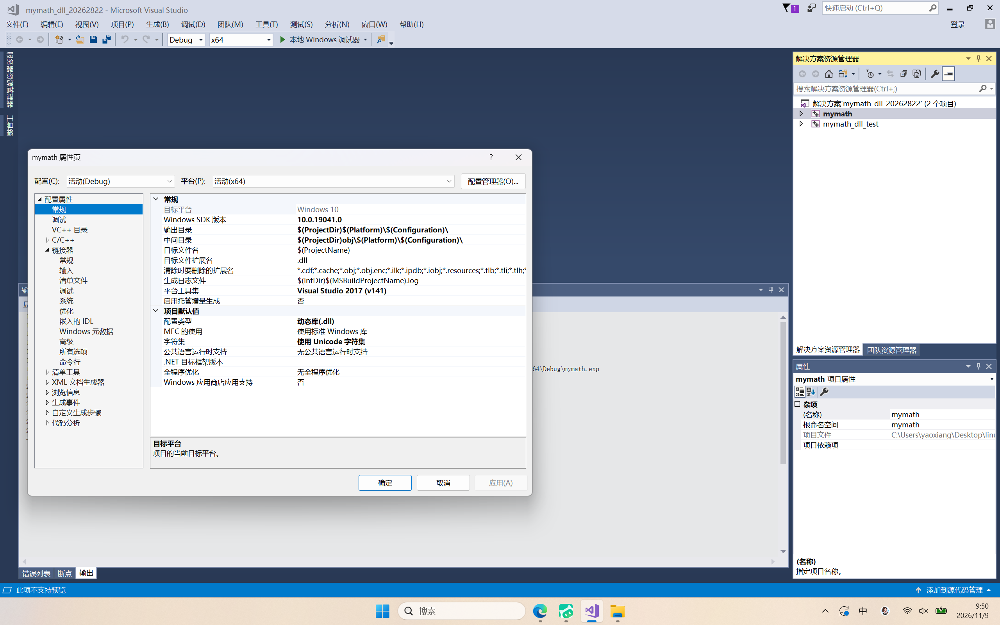
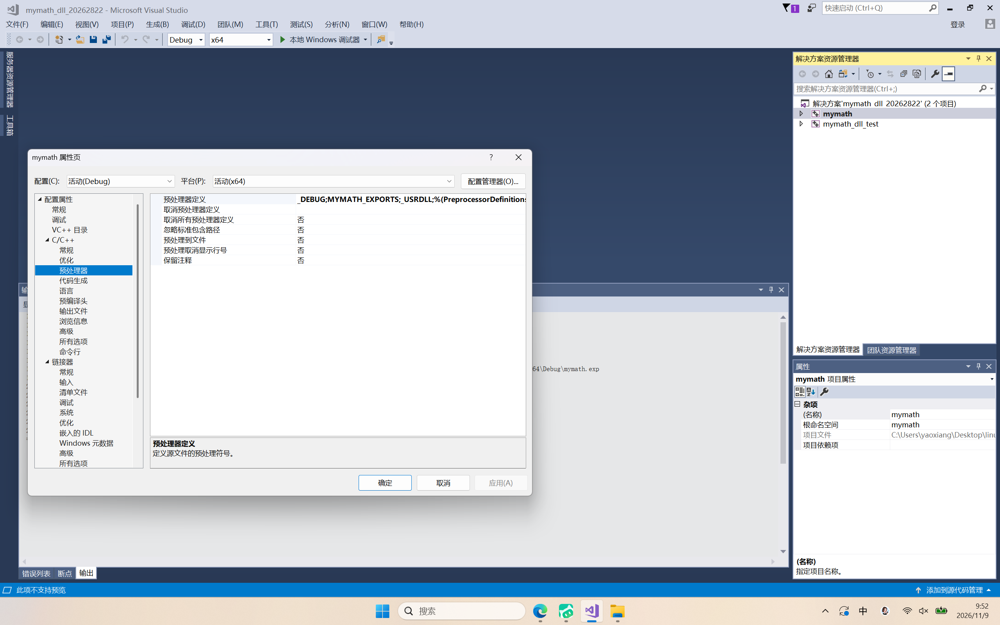
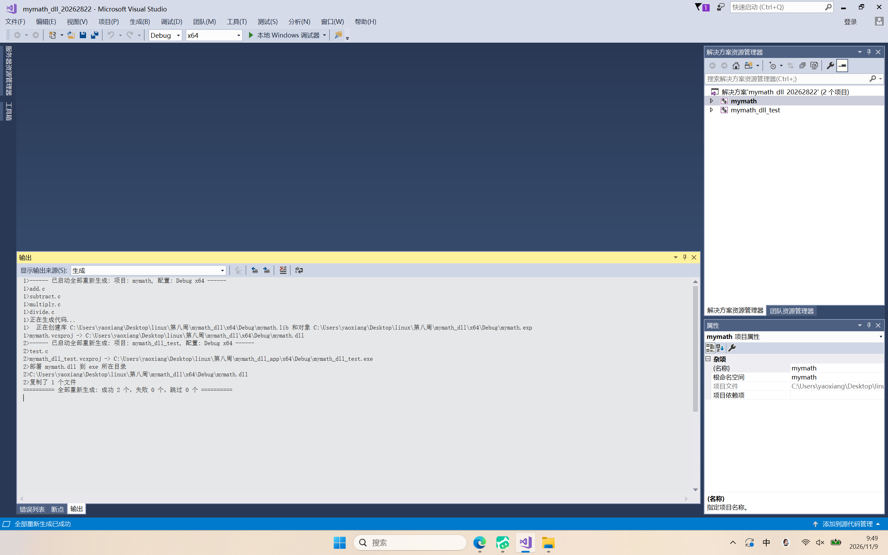
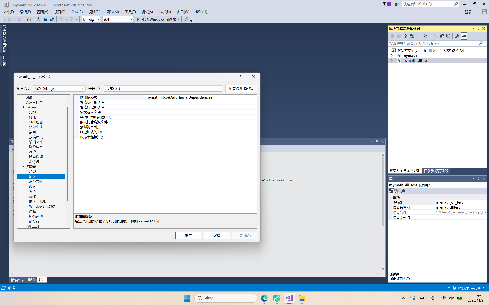
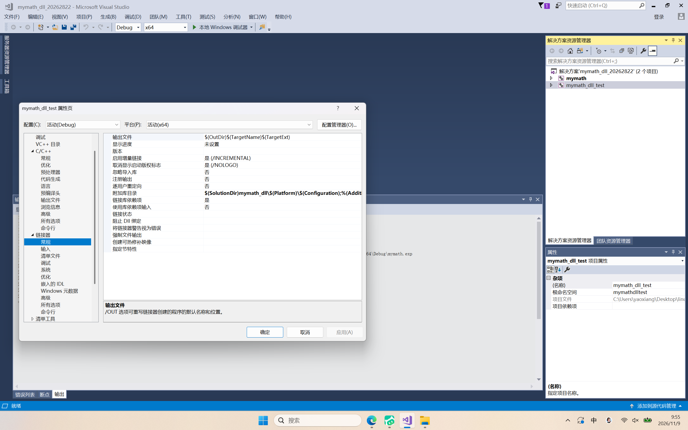
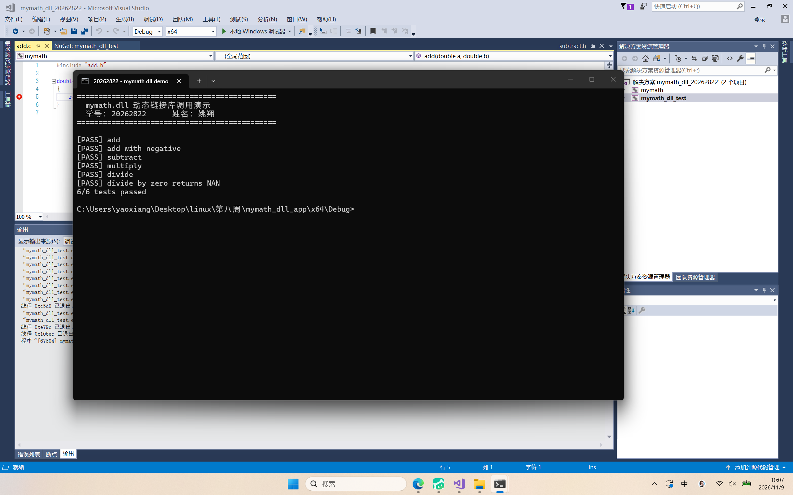
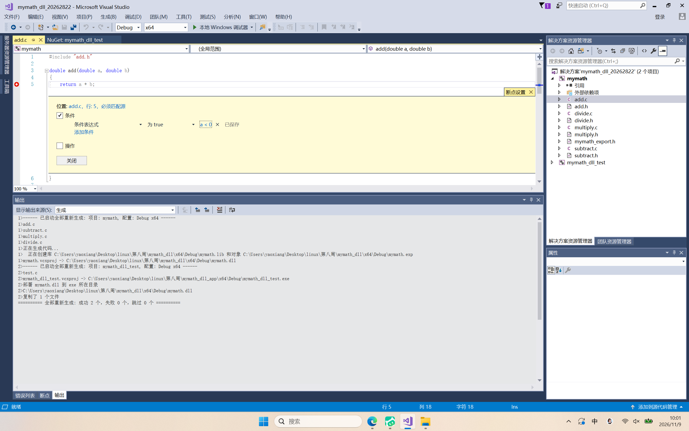
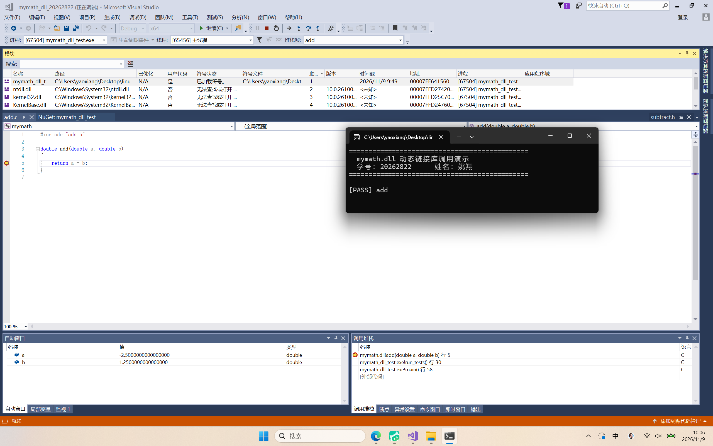

# 第八周实验报告：在 Visual Studio 2017 中制作并调用 mymath.dll

**姓名：** 姚翔　　**学号：** 20262822  
**课程：** Linux 内核原理与分析　　**专业：** 计算机技术  
**实验环境：** Visual Studio 2017 Community 15.9（MSVC v141 / 14.16.27023，Windows SDK 10.0.19041，Debug | x64）  
**完成日期：** 2026 年 11 月 9 日

---

## 一、任务与完成情况

本次任务有两项要求：把第二周的四个运算模块封装成动态链接库 `mymath.dll` 并说明 `test.c` 如何调用它；同时提交全屏、带学号、含条件断点的过程截图。下表把任务页上的每一条要求对应到本报告的具体位置与证据，便于逐条核对。

| 任务页要求 | 报告落点 | 对应证据 |
|---|---|---|
| 说明如何在 VS2017 中制作 `mymath.dll` | 第四章 | 图 1、图 2、图 3 |
| 说明 `main.c`（本代码中为 `test.c`）如何使用 `mymath.dll` | 第五章 | 图 4、图 5、图 6 |
| 截图必须包含条件断点 | 第六章 | 图 7（设置）、图 8（命中） |
| 全屏截图 | 全文配图 | 8 张均为 2560×1600 全屏画面 |
| 包含本人学号信息 | 标题栏 / 控制台横幅 | 每张图的窗口标题 `mymath_dll_20262822`，图 6 另有学号横幅 |
| 至少三张图片 | 第九章清单 | 共提交 8 张 |

需要说明的是，第二周代码里没有 `main.c`，入口文件是 `test.c`（内含 `main`，通过 `run_tests()` 逐项校验四个运算函数）。本报告按实际代码说明，任务页所说的 `main.c` 即指 `test.c`。

---

## 二、实验环境

| 项目 | 配置 |
|---|---|
| 集成开发环境 | Visual Studio 2017 Community 15.9 |
| C/C++ 工具集 | MSVC v141（14.16.27023） |
| Windows SDK | 10.0.19041.0 |
| 解决方案配置 | Debug \| x64 |
| 运行库 | 多线程调试 DLL（/MDd） |
| 宿主系统 | Windows 10 内核 10.0.26200，64 位 |

四个运算模块沿用第二周源码，函数签名保持不变：`add`、`subtract`、`multiply` 为 `double (double, double)`，`divide` 在除数为 0 时返回 `NAN`。

---

## 三、原理：为什么需要动态链接库

### 3.1 从源文件到可执行文件

C 程序的构建分四步：预处理、编译、汇编、链接。编译阶段每个 `.c` 独立生成 `.obj`，函数体已经变成机器指令；链接阶段由 `link.exe` 把若干 `.obj` 和库文件拼成 exe。

库就是"一批 `.obj` 的打包"，区别只在于代码并入 exe 的时机：

- **静态库（`.lib`）**：链接期由链接器按符号名从库里抽出用到的 `.obj`，直接并入 exe。
- **动态库（`.dll`）**：链接期只把"这个函数在哪个 DLL 里"记进 exe 的导入表，真正的代码留在 `.dll` 中，运行期由加载器映射进进程地址空间。

### 3.2 两种库的对照

| 对比项 | 静态库 `.lib` | 动态库 `.dll` |
|---|---|---|
| 代码进入 exe 的时机 | 链接期 | 运行期 |
| 交付给调用方的文件 | 头文件 + `.lib`（含机器码） | 头文件 + `.dll`（含机器码）+ `.lib`（导入库） |
| exe 能否单独运行 | 能 | 不能，必须随带 `.dll` |
| 接口不变时替换实现 | 需重新链接 exe | 直接替换 `.dll`，exe 不动 |
| 本实验产物体积 | `mymath.lib` 18,596 B | `mymath.dll` 58,368 B + 导入库 `mymath.lib` 2,148 B |
| 内存占用 | 每个 exe 各存一份代码 | 多个进程可共享同一份 DLL 映像 |

### 3.3 动态库也会生成一个 `.lib`

初次接触时最容易混淆的一点：动态库工程同样会输出 `mymath.lib`，但它不是静态库。它只有一张"符号到 DLL 内函数"的跳转表，没有函数体，所以体积只有 2 KB 左右，而同一份代码编成静态库是 18 KB。链接器靠它确认符号存在，加载器靠 `.dll` 里的导出表找到真正的入口。

---

## 四、制作 mymath.dll

### 4.1 先解决导出问题

静态库不需要声明导出，因为函数最终都在同一个 exe 里；动态库必须显式告诉编译器哪些符号进导出表，否则调用方链接时找不到符号（LNK2019）。

本实验新增一个公共头文件 `mymath_export.h`，用宏在"生成端"和"调用端"之间切换：

```c
#ifndef MYMATH_EXPORT_H
#define MYMATH_EXPORT_H
#ifdef MYMATH_EXPORTS
#define MYMATH_API __declspec(dllexport)   /* 生成 DLL 时：导出 */
#else
#define MYMATH_API __declspec(dllimport)   /* 调用 DLL 时：导入 */
#endif
#endif /* MYMATH_EXPORT_H */
```

四个模块的头文件只需加一行包含和一个前缀，函数体所在的 `.c` 完全不用改：

```c
#ifndef ADD_H
#define ADD_H
#include "mymath_export.h"
MYMATH_API double add(double a, double b);
#endif /* ADD_H */
```

### 4.2 工程配置

新建"Windows 桌面 → 动态链接库"工程，项目名 `mymath`，关键设置如下。

| 位置 | 设置项 | 值 | 作用 |
|---|---|---|---|
| 常规 | 配置类型 | 动态库(.dll) | 决定产出 `.dll` 与导入库 |
| 常规 | 目标文件扩展名 | `.dll` | — |
| C/C++ → 预处理器 | 预处理器定义 | `MYMATH_EXPORTS;_DEBUG;_USRDLL` | 让 `MYMATH_API` 走 `dllexport` 分支 |
| 常规 | 平台 / 配置 | x64 / Debug | 与调用方一致，否则 LNK1112 |
| C/C++ → 代码生成 | 运行库 | 多线程调试 DLL (/MDd) | 与调用方一致，否则 LNK2038 |
| 常规 | Windows SDK 版本 | 10.0.19041.0 | 不能写浮动的 `10.0`，否则 MSB8036 |



*图 1　`mymath` 工程属性 → 常规：配置类型为"动态库(.dll)"，目标文件扩展名 `.dll`，平台工具集 Visual Studio 2017 (v141)。*



*图 2　C/C++ → 预处理器：预处理器定义中包含 `MYMATH_EXPORTS`，这是 `__declspec(dllexport)` 生效的开关。*

### 4.3 生成结果

执行"生成 → 重新生成解决方案"（`Ctrl+Alt+F7`），输出窗口给出编译、创建导入库与链接 DLL 的完整过程。



*图 3　输出窗口：先编译四个模块，再"正在创建库 mymath.lib 和对象 mymath.exp"，最后 `mymath.vcxproj -> ...\mymath.dll`；随后生成 `mymath_dll_test.exe` 并执行"部署 mymath.dll 到 exe 所在目录 / 已复制 1 个文件"，末尾汇总"成功 2 个，失败 0 个"。*

| 产物 | 大小 | 说明 |
|---|---|---|
| `mymath.dll` | 58,368 B | 真正的实现，运行期被加载 |
| `mymath.lib` | 2,148 B | 导入库，仅链接期使用 |
| `mymath.exp` | 1,012 B | 导出表中间文件，可忽略 |
| `mymath.pdb` | 389,120 B | 调试符号，决定能否单步进入 DLL 源码 |

---

## 五、test.c 如何使用 mymath.dll

调用工程 `mymath_dll_test` 中只有 `test.c` 和 6 个头文件，没有任何模块实现。要让程序跑起来，"链接期"和"运行期"两件事都必须做对。

### 5.1 链接期：把导入库交给链接器

| 位置 | 设置项 | 值 |
|---|---|---|
| 项目依赖 | 引用 | 勾选 `mymath`（保证先生成 DLL 再链接 exe） |
| 链接器 → 常规 | 附加库目录 | `$(SolutionDir)mymath_dll\$(Platform)\$(Configuration)` |
| 链接器 → 输入 | 附加依赖项 | `mymath.lib` |



*图 4　`mymath_dll_test` 属性 → 链接器 → 输入：附加依赖项为 `mymath.lib;%(AdditionalDependencies)`。注意这里链接的是导入库，exe 中只会写入一条"运行时去 mymath.dll 找 add"的记录。*



*图 5　链接器 → 常规：附加库目录指向 `$(SolutionDir)mymath_dll\$(Platform)\$(Configuration)`，链接器据此找到上一章生成的 `mymath.lib`。*

### 5.2 运行期：把 mymath.dll 放到 exe 旁边

Windows 加载器按"exe 所在目录 → 系统目录 → PATH"的顺序查找 DLL。本实验的 `.dll` 在 `mymath_dll\x64\Debug\`，exe 在 `mymath_dll_app\x64\Debug\`，两者不在同一目录，直接运行会报"找不到 mymath.dll"（0xc000007b）。

解决办法是在调用工程添加生成后事件，把 DLL 复制到 exe 所在目录：

```bat
xcopy /Y /D "$(SolutionDir)mymath_dll\$(Platform)\$(Configuration)\mymath.dll" "$(OutDir)"
```

`/D` 表示只在源文件较新时复制，`/Y` 表示覆盖时不询问。生成日志中可以看到"部署 mymath.dll 到 exe 所在目录"和"已复制 1 个文件"。

### 5.3 运行结果

```text
==============================================
  mymath.dll 动态链接库调用演示
  学号：20262822      姓名：姚翔
==============================================

[PASS] add
[PASS] add with negative
[PASS] subtract
[PASS] multiply
[PASS] divide
[PASS] divide by zero returns NAN
6/6 tests passed
```



*图 6　`mymath_dll_test.exe` 的完整输出：学号横幅与 6 项测试全部 PASS。整个调用工程中没有任何运算函数的实现代码，结果却完全正确。*

---

## 六、调试：条件断点与 DLL 符号

动态库里的代码同样可以下断点，前提是生成的 `.pdb` 能被调试器找到。本实验把断点下在 `add.c` 第 5 行，并用条件让它在两次调用中只停一次。

### 6.1 设置条件断点

打开 `add.c`，光标置于 `return a + b;`，按 `F9` 设置断点；右键断点选择"条件..."，勾选"条件"，表达式填 `a < 0`。



*图 7　断点设置窗口：位置 `add.c 行 5`，条件已勾选，表达式为 `a < 0`，状态显示"已保存"；代码行左侧的断点已变为带白色加号的条件断点。*

### 6.2 命中断点

按 `F5` 启动调试。`add` 在本程序中被调用两次：

1. 第一次 `add(2.5, 1.25)`，`a = 2.5` 不满足 `a < 0`，断点不生效，程序直接跑过，控制台打印 `[PASS] add`；
2. 第二次 `add(-2.5, 1.25)`，`a = -2.5` 满足条件，程序停在 `return a + b;`。



*图 8　调试器停在 `mymath.dll` 的 `add.c` 第 5 行。顶部"模块"窗口显示 `mymath.dll` 已加载、符号状态为"符号已加载"；左下"局部变量"显示 `a = -2.5000000000000000`、`b = 1.2500000000000000`；右下"调用堆栈"为 `add ← run_tests ← main`；右侧控制台已打印 `[PASS] add`，说明第一次调用确实没有停下。*

### 6.3 为什么能停进 DLL

"模块"窗口中的那一行是本实验最直接的证据：进程确实加载了 `mymath.dll`，并且它的 `.pdb` 被成功匹配。若断点显示为空心圆，通常有三种原因：生成的不是 Debug 版 DLL、`mymath.pdb` 不在 DLL 同目录、或"工具 → 选项 → 调试 → 常规"中的"启用'仅我的代码'"没有取消勾选。

---

## 七、遇到的问题与解决

| 现象 | 原因 | 解决 |
|---|---|---|
| C1052：程序数据库文件由带 /DEBUG:fastlink 的链接器生成，编译器无法更新 | DLL 工程中编译器和链接器被指定到同一个 `mymath.pdb` | 去掉自定义 `ProgramDataBaseFileName`，编译器改用中间目录的默认 PDB |
| C4819：该文件包含不能在当前代码页(936)中表示的字符 | `mymath_export.h` 以 UTF-8 保存，MSVC 按 ANSI 读取 | 将头文件另存为 ANSI(GBK) |
| MSB8036：找不到 Windows SDK 版本 10.0 | `.vcxproj` 中 SDK 版本写成浮动的 `10.0` | 改为具体版本 `10.0.19041.0` |
| C1083：无法打开包括文件 "test.h" | 新建调用工程时漏拷 `test.c` 自身引用的头文件 | 补齐 `test.h` 并加入工程 |
| 运行提示找不到 mymath.dll（0xc000007b） | `.dll` 未与 exe 放在同一目录 | 增加生成后事件复制 DLL 到 `$(OutDir)` |
| LNK2019：无法解析的外部符号 | 未链接导入库，或生成端未定义 `MYMATH_EXPORTS` 导致函数没有导出 | 检查附加依赖项与预处理器定义 |
| F5 报"不是有效的 Win32 应用程序" | 解决方案的启动项目仍是库工程 | 在解决方案资源管理器中把 `mymath_dll_test` 设为启动项目 |

---

## 八、结论

1. 动态链接库把"接口"与"实现"彻底分开：调用方链接导入库、运行期加载 `.dll`，接口不变时替换 `.dll` 即可更新实现，无需重新编译 exe。
2. 导出函数依靠 `__declspec(dllexport/dllimport)` 与一个开关宏完成，头文件两端通用，`.c` 不需要改动，这是 MSVC 下最省事的做法。
3. 使用 DLL 必须同时处理两件事：链接期把 `mymath.lib`（导入库）交给链接器，运行期把 `mymath.dll` 放到 exe 旁边。只做前者会在运行时报 0xc000007b。
4. 条件断点 `a < 0` 让 `add` 在两次调用中只停一次；配合"模块"窗口可以看到 `mymath.dll` 已加载且符号可用，说明断点确实落在库文件内部。
5. 从保护源码的角度看，`.dll` 与 `.lib` 都只提供机器码，能挡住"直接拿走 `.c`"，但挡不住反汇编。若核心算法需要真正保密，应把逻辑放到服务端，或至少配合加壳、混淆等手段。

---

## 九、截图清单

| 编号 | 文件 | 内容 | 对应要求 |
|---|---|---|---|
| 图 1 | `screenshots/01-dll-project.png` | 动态库工程：配置类型 = 动态库(.dll) | 制作过程 |
| 图 2 | `screenshots/01b-dll-export.png` | 预处理器定义含 `MYMATH_EXPORTS` | 制作过程 |
| 图 3 | `screenshots/02-dll-build.png` | 生成 dll / lib / exp / exe 与 DLL 复制 | 制作过程 |
| 图 4 | `screenshots/03-dll-app-link.png` | 附加依赖项 `mymath.lib` | 调用过程 |
| 图 5 | `screenshots/03b-dll-libdir.png` | 附加库目录 | 调用过程 |
| 图 6 | `screenshots/06-dll-run.png` | 运行输出 `6/6 tests passed` | 学号与结果 |
| 图 7 | `screenshots/04-dll-condition.png` | 条件断点 `a < 0` 的设置 | 条件断点 |
| 图 8 | `screenshots/05-dll-breakpoint-hit.png` | 在 `mymath.dll` 内命中，`a = -2.5` | 条件断点 |

以上 8 张均为 2560×1600 全屏截图，包含任务栏；学号出现在窗口标题 `mymath_dll_20262822` 与图 6 的控制台横幅中。

---

## 十、参考资料

1. Microsoft Docs. *dllexport, dllimport* — <https://learn.microsoft.com/cpp/cpp/dllexport-dllimport>
2. Microsoft Docs. *Walkthrough: Create and use your own Dynamic Link Library (C++)* — <https://learn.microsoft.com/cpp/build/walkthrough-creating-and-using-a-dynamic-link-library-cpp>
3. Microsoft Docs. *Linker Tools Error LNK2019* — <https://learn.microsoft.com/cpp/error-messages/tool-errors/linker-tools-error-lnk2019>
4. Microsoft Docs. *xcopy* — <https://learn.microsoft.com/windows-server/administration/windows-commands/xcopy>
