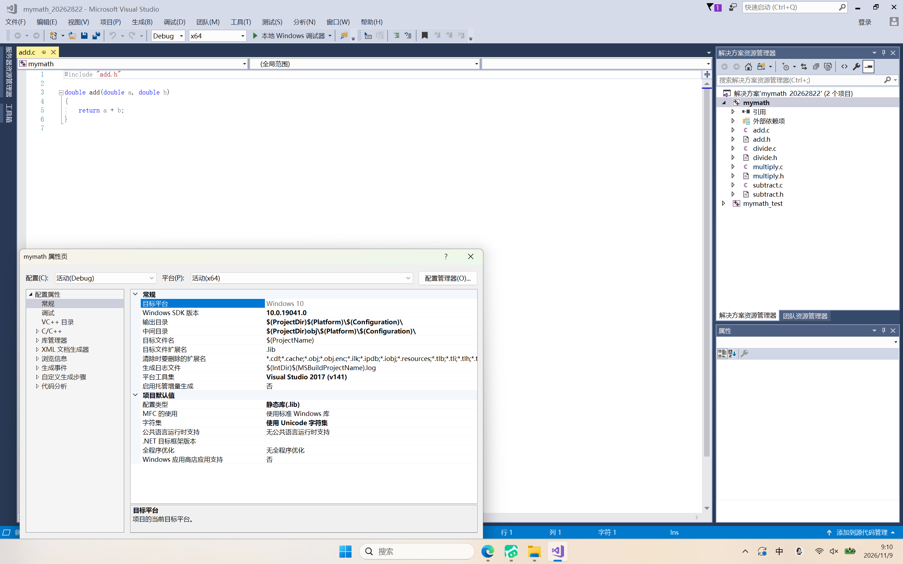
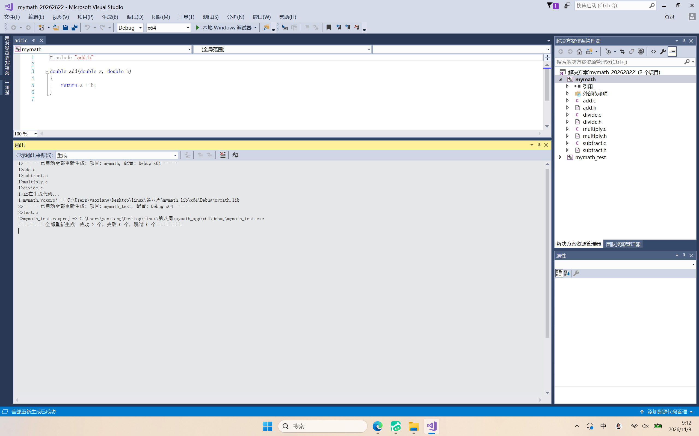
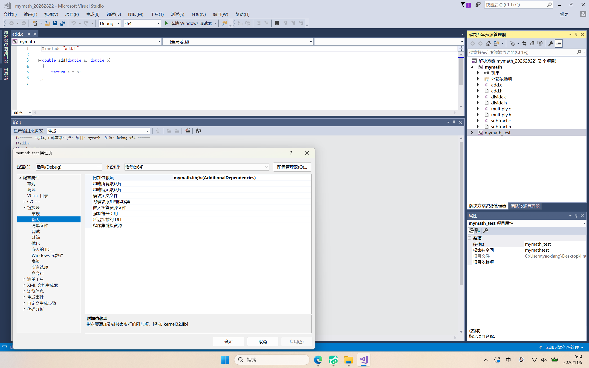
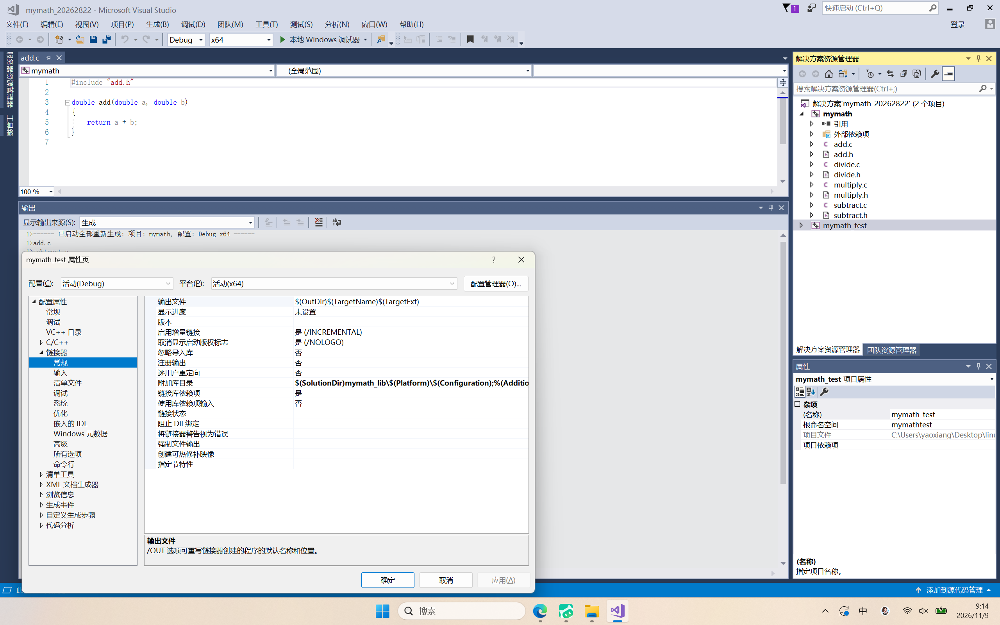
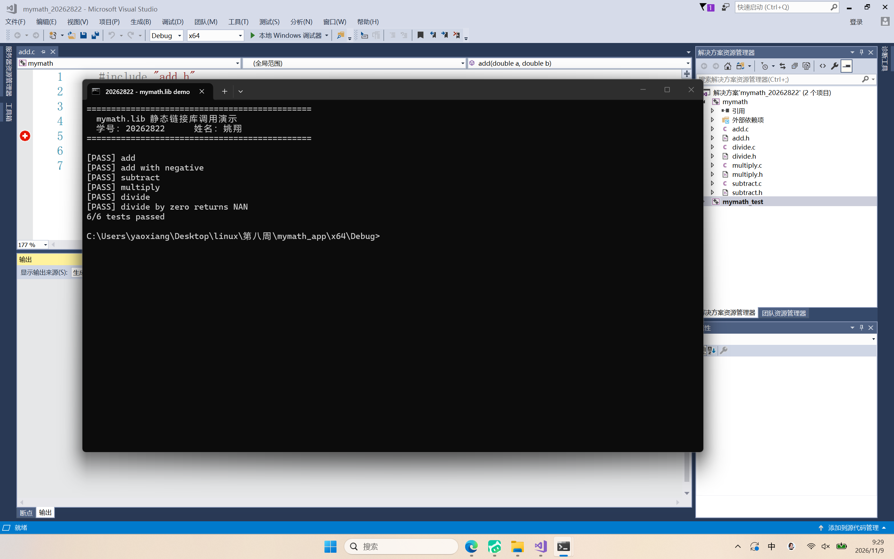
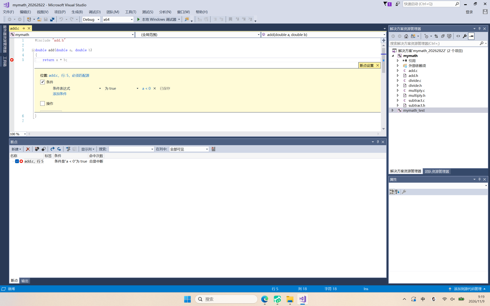
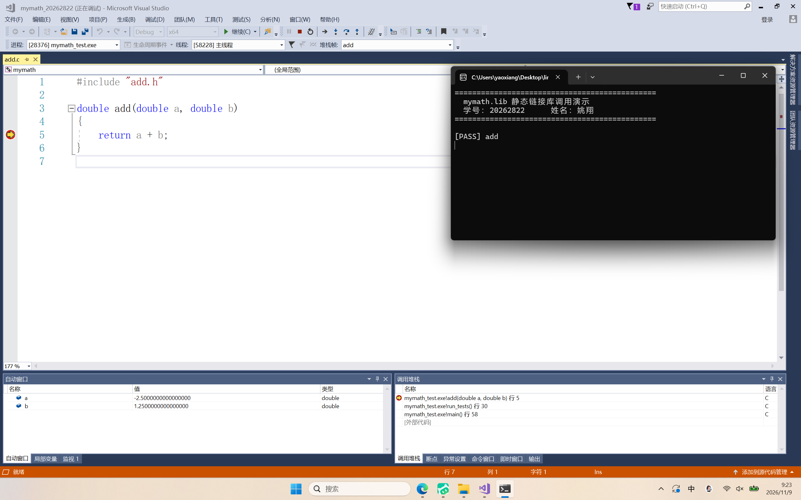

# 第八周实验报告：在 Visual Studio 2017 中生成并调用 mymath.lib 静态链接库

**姓名：** 姚翔　　**学号：** 20262822  
**课程：** Linux 内核原理与分析　　**专业：** 计算机技术  
**实验环境：** Visual Studio 2017 Community 15.9（MSVC v141 / 14.16.27023，Windows SDK 10.0.19041，Debug | x64）  
**完成日期：** 2026 年 11 月 9 日

---

## 一、任务与完成情况

本次任务要求把第二周的四个运算模块封装成静态链接库 `mymath.lib`，让只拿到 `test.c` 和头文件的人也能正常调用，同时提交全屏、带学号、含条件断点的过程截图。下表把任务页上的每一条要求对应到本报告的具体位置与证据。

| 任务页要求 | 报告落点 | 对应证据 |
|---|---|---|
| 说明如何在 VS2017 中制作 `mymath.lib` | 第四章 | 图 1、图 2 |
| 说明 `main.c`（本代码中为 `test.c`）如何使用 `mymath.lib` | 第五章 | 图 3、图 4、图 5 |
| 截图必须包含条件断点 | 第六章 | 图 6（设置）、图 7（命中） |
| 全屏截图 | 全文配图 | 7 张均为 2560×1600 全屏画面 |
| 包含本人学号信息 | 标题栏 / 控制台横幅 | 每张图的窗口标题 `mymath_20262822`，图 5 另有学号横幅 |
| 至少三张图片 | 第九章清单 | 共提交 7 张 |

第二周代码里没有 `main.c`，入口文件是 `test.c`（内含 `main`，通过 `run_tests()` 逐项校验四个运算函数）。本报告按实际代码说明，任务页所说的 `main.c` 即指 `test.c`。

同周的另一个实验把同样的四个模块做成了动态库 `mymath.dll`，两份报告的差别集中在"代码什么时候进入 exe"，结论部分有对照。

---

## 二、实验环境

| 项目 | 配置 |
|---|---|
| 集成开发环境 | Visual Studio 2017 Community 15.9 |
| C/C++ 工具集 | MSVC v141（14.16.27023） |
| Windows SDK | 10.0.19041.0 |
| 解决方案配置 | Debug \| x64 |
| 运行库 | 多线程调试 DLL（/MDd） |
| 宿主系统 | Windows 10 内核 10.0.26200，64 位 |

四个运算模块沿用第二周源码，函数签名保持不变：`add`、`subtract`、`multiply` 为 `double (double, double)`，`divide` 在除数为 0 时返回 `NAN`。

---

## 三、原理：静态库如何"藏"住源码

### 3.1 从源文件到可执行文件

C 程序的构建分四步：预处理、编译、汇编、链接。编译阶段每个 `.c` 独立生成 `.obj`，函数体已经变成机器指令；库管理器 `lib.exe` 把这些 `.obj` 打包成一个 `.lib`；链接阶段 `link.exe` 按符号名从库里抽出用到的 `.obj`，直接并入 exe。

因此对外只需要交付**四个头文件（声明）+ `mymath.lib`（机器码）**：调用方看得见 `double add(double, double);`，却看不到函数体。这就是"只交出 `test.c`"能成立的原因。

### 3.2 与动态库的分界

| 对比项 | 静态库 `.lib`（本实验） | 动态库 `.dll` |
|---|---|---|
| 代码进入 exe 的时机 | 链接期 | 运行期 |
| 交付给调用方的文件 | 头文件 + `.lib` | 头文件 + `.dll` + 导入库 `.lib` |
| exe 能否单独运行 | 能 | 不能，必须随带 `.dll` |
| 本实验产物体积 | `mymath.lib` 18,596 B | 同一份代码的导入库仅 2,148 B |
| 接口不变时替换实现 | 需重新链接 exe | 直接替换 `.dll`，exe 不动 |

---

## 四、生成 mymath.lib

### 4.1 工程配置

新建"Visual C++ → Windows 桌面 → 静态库"工程，项目名 `mymath`，加入解决方案 `mymath_20262822`。关键设置如下。

| 位置 | 设置项 | 值 | 作用 |
|---|---|---|---|
| 常规 | 配置类型 | 静态库(.lib) | 决定由 `lib.exe` 打包，而不是产出 exe |
| C/C++ → 预编译头 | 预编译头 | 不使用预编译头 | 模板自带的 `pch.h` 已删除，不关会报 C1010 |
| 常规 | 平台 / 配置 | x64 / Debug | 与调用方一致，否则 LNK1112 |
| C/C++ → 代码生成 | 运行库 | 多线程调试 DLL (/MDd) | 与调用方一致，否则 LNK2038 |
| 常规 | Windows SDK 版本 | 10.0.19041.0 | 不能写浮动的 `10.0`，否则 MSB8036 |
| 常规 | 输出目录 | `$(ProjectDir)$(Platform)\$(Configuration)\` | 让 `.lib` 与 `.pdb` 落在同一目录 |

源文件扩展名必须是 `.c`。写成 `.cpp` 会按 C++ 规则编译，函数名被修饰成 `?add@@YANNN@Z` 这类符号，而 `test.c` 找的是 `add`，链接时必然报 LNK2019。



*图 1　`mymath` 工程属性 → 常规：配置类型为"静态库(.lib)"，右侧解决方案资源管理器中可见 `mymath` 下的 4 个 `.c` 与 4 个 `.h`。*

### 4.2 四个模块的源码

模块代码保持第二周原样，`add.c` 如下（其余三个结构相同）：

```c
#include "add.h"

double add(double a, double b)
{
    return a + b;
}
```

`divide.c` 多一个除零保护：

```c
#include "divide.h"

#include <math.h>

double divide(double dividend, double divisor)
{
    if (divisor == 0.0) {
        return NAN;
    }

    return dividend / divisor;
}
```

头文件只放声明，例如 `add.h`：

```c
#ifndef ADD_H
#define ADD_H
double add(double a, double b);
#endif
```

静态库**不需要** `__declspec(dllexport)`：函数最终和调用方处在同一个 exe 里，不存在跨模块导出的问题。这是它和动态库在源码层面最直接的区别。

### 4.3 生成结果

`Ctrl+Shift+B` 之后输出窗口给出：

```text
1>mymath.vcxproj -> C:\Users\yaoxiang\Desktop\linux\第八周\mymath_lib\x64\Debug\mymath.lib
========== 生成: 成功 2 个，失败 0 个，最新 0 个，跳过 0 个 ==========
```



*图 2　输出窗口：`mymath.vcxproj -> ...\mymath_lib\x64\Debug\mymath.lib`，随后 `mymath_test.vcxproj -> ...\mymath_test.exe`，末尾汇总"成功 2 个，失败 0 个"。*

| 产物 | 大小 | 说明 |
|---|---|---|
| `mymath.lib` | 18,596 B | 四个模块的目标代码打包，这就是要交付的文件 |
| `mymath.pdb` | 69,632 B | 调试符号，决定能否在库源码行上下断点 |
| `mymath_test.exe` | 62,976 B | 调用方程序，已包含库代码 |

`.pdb` 不影响运行，但调试时靠它把机器码映射回 `add.c` 的源码行；没有它，断点会显示为空心圆。

---

## 五、test.c 如何使用 mymath.lib

调用工程 `mymath_test`（Windows 控制台应用程序、空项目）里**只有 `test.c` 和 5 个头文件，没有任何模块的 `.c`**。要让它链接成功，需要三处设置配合。

### 5.1 链接设置

| 位置 | 设置项 | 值 |
|---|---|---|
| 项目依赖 | 引用 | 勾选 `mymath`（VS 自动把 `mymath.lib` 传给链接器，并保证先编库后链接） |
| 链接器 → 常规 | 附加库目录 | `$(SolutionDir)mymath_lib\$(Platform)\$(Configuration)` |
| 链接器 → 输入 | 附加依赖项 | `mymath.lib` |



*图 3　`mymath_test` 属性 → 链接器 → 输入：附加依赖项为 `mymath.lib;%(AdditionalDependencies)`。*



*图 4　链接器 → 常规：附加库目录指向 `$(SolutionDir)mymath_lib\$(Platform)\$(Configuration)`，链接器据此找到上一章生成的 `mymath.lib`。*

也可以在 `test.c` 顶部写 `#pragma comment(lib, "mymath.lib")` 代替第三项，效果相同——但"附加库目录"仍然必须有，否则链接器不知道去哪里找这个文件。

### 5.2 运行结果

`test.c` 是第二周原有的测试框架：`main` 调 `run_tests`，`run_tests` 逐项比对期望值，除零用例用 `isnan` 判定。本次只在 `main` 开头加了三行横幅，让运行结果带上本人学号，其余代码未改动：

```c
int main(void)
{
    printf("==============================================\n");
    printf("  mymath.lib 静态链接库调用演示\n");
    printf("  学号：20262822      姓名：姚翔\n");
    printf("==============================================\n\n");

    return run_tests();
}
```

运行输出：

```text
==============================================
  mymath.lib 静态链接库调用演示
  学号：20262822      姓名：姚翔
==============================================

[PASS] add
[PASS] add with negative
[PASS] subtract
[PASS] multiply
[PASS] divide
[PASS] divide by zero returns NAN
6/6 tests passed
```



*图 5　`mymath_test.exe` 的完整输出：学号横幅与 6 项测试全部 PASS。整个调用工程里找不到 `add` 的实现代码，程序却算出了正确结果，这就是静态库生效的直接证据。*

---

## 六、调试：条件断点

静态库里的代码和普通代码一样可以下断点，前提是 Debug 配置且 `mymath.pdb` 与 `mymath.lib` 在同一目录。

### 6.1 设置条件断点

打开 `add.c`，光标置于 `return a + b;`，按 `F9` 设置断点；右键断点选择"条件..."，勾选"条件"，表达式填 `a < 0`。



*图 6　断点设置窗口：位置 `add.c 行 5`，条件已勾选，表达式为 `a < 0`，状态显示"已保存"；下方断点列表的条件列显示"条件 a < 0 为 true"，代码行左侧的断点已变为带白色加号的条件断点。*

### 6.2 命中断点

按 `F5` 启动调试。`add` 在本程序中被调用两次：

1. 第一次 `add(2.5, 1.25)`，`a = 2.5` 不满足 `a < 0`，断点不生效，程序直接跑过，控制台打印 `[PASS] add`；
2. 第二次 `add(-2.5, 1.25)`，`a = -2.5` 满足条件，程序停在 `return a + b;`；
3. 再按 `F5`，后续 `subtract`、`multiply`、`divide` 都不再命中，程序跑完并输出 `6/6 tests passed`。



*图 7　调试器停在 `add.c` 第 5 行。左下"局部变量"显示 `a = -2.5000000000000000`、`b = 1.2500000000000000`；右下"调用堆栈"为 `add 行 5 ← run_tests 行 30 ← main 行 58`；右上控制台已打印 `[PASS] add`，说明第一次调用确实没有停下。*

"第一次不停、第二次才停"这组对比，比任何文字说明都更能证明条件断点生效，也证明断点确实落在库内部的源码行上。

### 6.3 断点是空心圆怎么办

空心圆表示符号没加载，按顺序排查：确认用的是 Debug 配置生成的库；确认 `mymath.pdb` 与 `mymath.lib` 同目录；确认"工具 → 选项 → 调试 → 常规"里"启用'仅我的代码'"没有勾选。

---

## 七、遇到的问题与解决

| 现象 | 原因 | 解决 |
|---|---|---|
| C1010：在查找预编译头时遇到意外的文件结尾 | 模板自带 `pch.h`/`pch.cpp` 被删除，但工程仍要求使用预编译头 | 属性 → C/C++ → 预编译头 → "不使用预编译头" |
| MSB8036：找不到 Windows SDK 版本 10.0 | `.vcxproj` 中 SDK 版本写成浮动的 `10.0` | 改为具体版本 `10.0.19041.0` |
| C1083：无法打开包括文件 "test.h" | 新建调用工程时漏拷 `test.c` 自身引用的头文件 | 补齐 `test.h` 并加入工程 |
| LNK1112：模块计算机类型"x86"与目标计算机类型"x64"冲突 | 库与 exe 的平台不一致 | 两个工程统一为 x64 |
| LNK2038：检测到"RuntimeLibrary"的不匹配项 | 库与 exe 的运行库不一致（/MDd 与 /MTd 混用） | 两边都设为"多线程调试 DLL (/MDd)" |
| LNK2019：无法解析的外部符号 | 源文件写成 `.cpp` 导致 C++ 名字修饰，或没链接 `mymath.lib` | 源文件用 `.c`；检查附加依赖项与附加库目录 |
| 断点为空心圆，程序不中断 | `mymath.pdb` 缺失或"仅我的代码"生效 | 见 6.3 |

---

## 八、结论

1. 静态库把四个模块的目标代码打包进 `mymath.lib`，调用方只需头文件加库文件即可使用，源码不外泄；`add()` 的实现只以机器码形式存在于 `.lib` 中。
2. 静态库不需要导出声明，函数名与调用方处在同一地址空间，这是它比动态库简单的地方，也是它无法单独替换实现的原因——接口不变也要重新链接 exe。
3. 使用静态库的关键是链接期三处设置：项目引用、附加库目录、附加依赖项。缺任何一处都会在链接阶段暴露为 LNK2019 或 LNK1104。
4. 条件断点 `a < 0` 让 `add` 在两次调用中只停一次；配合局部变量 `a = -2.5` 与调用堆栈，可以确认断点确实落在库内部的源码行，而不是调用方。
5. 与同周的动态库实验相比：静态库产物体积大（18,596 B 对 2,148 B 的导入库）、exe 可独立运行、换实现要重编；动态库反之，但必须随带 `.dll`。两者都只提供机器码，挡得住"直接拿走 `.c`"，挡不住反汇编。

---

## 九、截图清单

| 编号 | 文件 | 内容 | 对应要求 |
|---|---|---|---|
| 图 1 | `screenshots/01-lib-project.png` | 静态库工程：配置类型 = 静态库(.lib) | 制作过程 |
| 图 2 | `screenshots/02-lib-build.png` | 生成 `mymath.lib` 与 `mymath_test.exe` | 制作过程 |
| 图 3 | `screenshots/03-app-link.png` | 附加依赖项 `mymath.lib` | 调用过程 |
| 图 4 | `screenshots/03b-lib-dir.png` | 附加库目录 | 调用过程 |
| 图 5 | `screenshots/06-run.png` | 运行输出 `6/6 tests passed` | 学号与结果 |
| 图 6 | `screenshots/04-condition.png` | 条件断点 `a < 0` 的设置 | 条件断点 |
| 图 7 | `screenshots/05-breakpoint-hit.png` | 命中现场，`a = -2.5` | 条件断点 |

以上 7 张均为 2560×1600 全屏截图，包含任务栏；学号出现在窗口标题 `mymath_20262822` 与图 5 的控制台横幅中。

---

## 十、参考资料

1. Microsoft Docs. *Walkthrough: Create and use a static library (C++)* — <https://learn.microsoft.com/cpp/build/walkthrough-creating-and-using-a-static-library-cpp>
2. Microsoft Docs. *LIB Reference* — <https://learn.microsoft.com/cpp/build/reference/lib-reference>
3. Microsoft Docs. *Linker Tools Error LNK2019* — <https://learn.microsoft.com/cpp/error-messages/tool-errors/linker-tools-error-lnk2019>
4. Microsoft Docs. *`/MD, /MT, /LD` (Use Run-Time Library)* — <https://learn.microsoft.com/cpp/build/reference/md-mt-ld-use-run-time-library>
