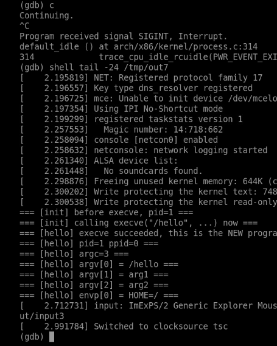
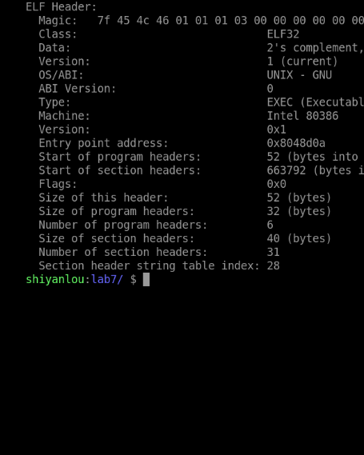
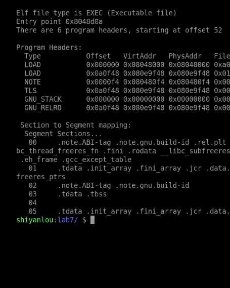
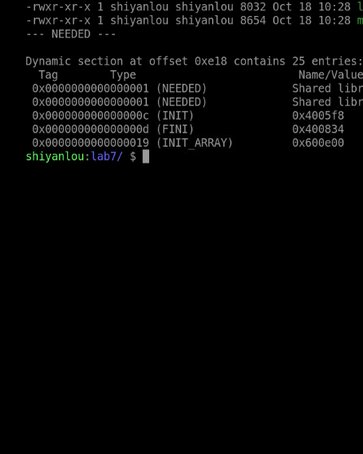
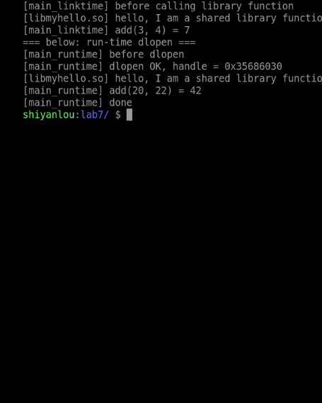
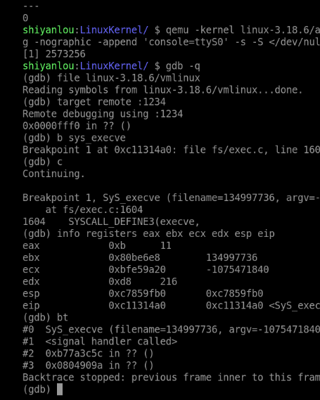
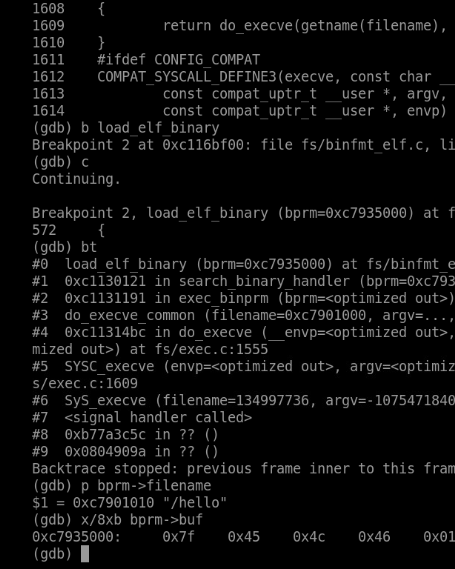
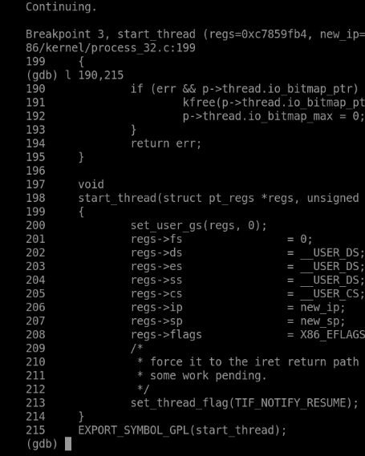
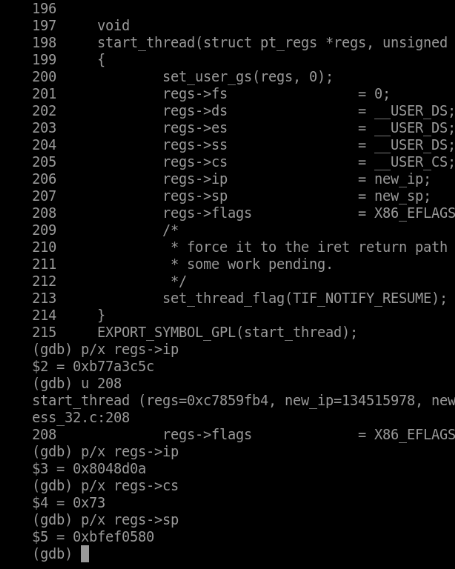
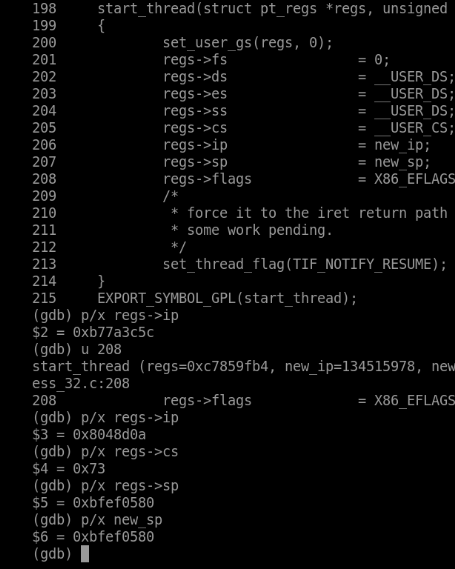

# 20262822《Linux内核原理与分析》第八周作业

**真实姓名：姚翔　学号：20262822　整理日期：2026年10月31日**  
**学习内容：教材第 8 章“进程调度与进程切换”；实验七“Linux 内核如何装载和启动一个可执行程序”；课程视频“Linux 内核的实质和 Linux 系统的一般执行过程”。**

**原创声明：** 原创作品转载请注明出处。  
**课程出处：** [《Linux 内核分析》MOOC 课程](http://mooc.study.163.com/course/USTC-1000029000)  
**课程网址：** http://mooc.study.163.com/course/USTC-1000029000

## 一、实验七：ELF 装载、动态链接与 execve 后的新执行起点

### 1. 实验操作与结果

本实验先分析可执行文件和两种动态链接方式，再用最小 initramfs 跟踪 `/init` 执行 `execve("/hello", ...)`。主要命令如下：

```bash
cd ~/lab7
gcc -m32 -static -o init exec_test.c
gcc -m32 -static -o hello hello.c
readelf -h hello
readelf -l hello
mkdir -p /tmp/ird7
cp init hello /tmp/ird7/
(cd /tmp/ird7 && find . | cpio -o -H newc | gzip > /tmp/e7.img)
cd ~/LinuxKernel
qemu -kernel linux-3.18.6/arch/x86/boot/bzImage \
  -initrd /tmp/e7.img -nographic -append "console=ttyS0" \
  -s -S </dev/null >/tmp/out7 2>&1 &
```

源码的分工如下。前两个文件用于客户机内的 exec 跟踪，后三个文件用于实验终端内的动态链接比较；两组实验的运行环境应分别核对。

```text
源码/
├── exec_test.c       /init：准备 argv、envp，调用 execve
├── hello.c           /hello：打印身份、参数和环境，随后常驻
├── libmy.c           共享库：hello_from_lib 与 add
├── main_linktime.c   ELF 依赖共享库，装载时由动态链接器处理
└── main_runtime.c    用 dlopen、dlsym 在运行中请求共享库
```

控制台先输出旧程序准备执行 `/hello`，随后显示新程序启动、`argc=3` 以及 `/hello`、`arg1`、`arg2`。新旧程序的 PID 均为 1，说明 exec 更换了该进程执行的程序；它没有像 fork 一样产生一个新的子进程。



**图1：** exec 前后 PID 保持为 1，新程序接收到三个参数与环境变量。

### 2. 从 ELF 文件认识装载

#### （1）文件头与入口

`readelf -h hello` 表明目标为 32 位 Intel 80386 ELF，可执行文件类型为 `EXEC`，入口地址为 **0x08048d0a**。这是文件声明的执行入口，不能直接写成 C 的 `main` 地址；静态链接的 C 程序通常先进入运行时启动代码，再调用 `main`。



**图2：** ELF 文件头给出位数、体系结构、文件类型及入口地址。

#### （2）程序头决定内存映射

截图列出 6 个程序头，其中有 **两个 `PT_LOAD`**，另有 `NOTE`、`TLS`、`GNU_STACK`、`GNU_RELRO`。不能把第三行 `NOTE` 也计为装载段。两个 LOAD 分别具有可读可执行、可读可写权限，承担代码/只读内容与可写数据等映射。



**图3：** 六个程序头中两个 LOAD 分别映射可执行与可写内容。

| 字段 | 装载时的含义 |
|---|---|
| `p_offset` | 段数据在文件中的偏移 |
| `p_vaddr` | 段在进程虚拟地址空间中的地址依据 |
| `p_filesz` | 文件中实际提供的数据长度 |
| `p_memsz` | 内存中所需长度，可以大于文件长度 |
| `p_flags` | 段的读、写、执行权限 |
| `p_align` | 装载对齐要求 |

第二个 LOAD 中内存长度大于文件长度，多出的区域需要零初始化，可对应 BSS 等内容。实现时既涉及文件末页剩余部分清零，也可能建立额外的零页映射；不能把所有 BSS 初始化都归结为一次 `padzero`。程序装载主要依据程序头，不能把面向链接和分析的节表等同于装载映射表。

### 3. 装载时与运行时动态链接

#### （1）构建与检查命令

```bash
gcc -fPIC -shared -o libmyhello.so libmy.c
gcc -o main_linktime main_linktime.c -L. -lmyhello
readelf -d main_linktime | grep NEEDED
LD_LIBRARY_PATH=. ./main_linktime
gcc -o main_runtime main_runtime.c -ldl
./main_runtime
```

装载时动态链接的程序在编译链接阶段记录对 `libmyhello.so` 的依赖。截图中的 `NEEDED` 正是这一记录；实际装入共享库及解析符号由用户态动态链接器负责，不能把它描述成内核直接逐个完成所有共享库函数链接。



**图4：** 动态段中的 NEEDED 记录 libmyhello.so 等依赖。

运行结果中，直接链接的调用得到 `add(3,4)=7`；`dlopen` 示例在运行时装载库、取得函数地址，得到 `add(20,22)=42`。两者使用同一份共享库，区别在于依赖建立和显式请求装载的时机。



**图5：** 装载时与运行时动态链接分别运行成功，计算结果为 7 和 42。

#### （2）程序与错误处理

共享库实现：

```c
#include <stdio.h>

/* 共享库实现：libmyhello.so */
void hello_from_lib(void)
{
    printf("[libmyhello.so] hello, I am a shared library function\n");
}

int add(int a, int b)
{
    return a + b;
}
```

装载时动态链接的调用方：

```c
#include <stdio.h>

/*
 * 方式一：装载时动态链接（load-time dynamic linking）
 * 编译时链接 libmyhello.so，生成的 ELF 中记录 DT_NEEDED，
 * 由动态链接器 ld-linux.so 在 execve 装载程序时一并把这个 .so 映射进来。
 *
 *   gcc -o main_linktime main_linktime.c -L. -lmyhello
 *   readelf -d main_linktime | grep NEEDED
 *   ./main_linktime            (需要 LD_LIBRARY_PATH=.)
 */
extern void hello_from_lib(void);
extern int add(int a, int b);

int main(void)
{
    printf("[main_linktime] before calling library function\n");
    hello_from_lib();
    printf("[main_linktime] add(3, 4) = %d\n", add(3, 4));
    return 0;
}
```

运行时动态链接的调用方：

```c
#include <stdio.h>
#include <dlfcn.h>

/*
 * 方式二：运行时动态链接（run-time dynamic linking）
 * 编译时完全不依赖 libmyhello.so，程序运行时由 dlopen() 主动装载，
 * 再用 dlsym() 找到函数地址后调用。
 *
 *   gcc -o main_runtime main_runtime.c -ldl
 *   ./main_runtime
 */
int main(void)
{
    void *handle;
    void (*fn)(void);
    int (*add)(int, int);
    char *err;

    printf("[main_runtime] before dlopen\n");

    handle = dlopen("./libmyhello.so", RTLD_NOW);
    if (!handle) {
        printf("[main_runtime] dlopen failed: %s\n", dlerror());
        return 1;
    }
    printf("[main_runtime] dlopen OK, handle = %p\n", handle);

    dlerror();
    fn = (void (*)(void)) dlsym(handle, "hello_from_lib");
    err = dlerror();
    if (err) {
        printf("[main_runtime] dlsym hello_from_lib failed: %s\n", err);
        dlclose(handle);
        return 1;
    }
    fn();

    add = (int (*)(int, int)) dlsym(handle, "add");
    printf("[main_runtime] add(20, 22) = %d\n", add(20, 22));

    dlclose(handle);
    printf("[main_runtime] done\n");
    return 0;
}
```

原程序检查了 `dlopen` 和第一个 `dlsym`，第二次查询 `add` 后也应按同样方法清除并读取 `dlerror`，确认成功再调用，避免空函数指针。`LD_LIBRARY_PATH=.` 用于本次实验的库搜索，`dlopen("./libmyhello.so", ...)` 则提供相对路径；程序的当前目录变化后，两者都需要重新检查。

### 4. 跟踪 execve 的内核处理

#### （1）断点与调用链

```gdb
file linux-3.18.6/vmlinux
target remote :1234
break sys_execve
break load_elf_binary
break start_thread
continue
bt
```

本次用户调用对应 i386 系统调用号 11，即 `eax=0xb`。内核检查文件名、参数与环境，把待执行文件组织为 `linux_binprm`，再寻找合适的二进制格式处理函数。跟踪时需要识别目标为 `/hello` 的这次请求，避免把启动过程装载初始 `/init` 的动作混在一起。



**图6：** sys_execve 断点及寄存器、调用栈用于定位用户的装载请求。

`load_elf_binary` 断点处可以检查 `bprm->filename` 及文件头。`/hello` 与 ELF 魔数 `7f 45 4c 46` 把本次调试对象和前面的 readelf 分析连接起来。



**图7：** load_elf_binary 的参数与调用链表明正在处理目标 ELF。

#### （2）装载主体的职责

在 Linux 3.18.6 中，可将主体工作概括为：检查 ELF 和程序头；处理可能存在的解释器；准备替换当前进程的执行环境；按 LOAD 映射内容并处理零初始化；安排用户栈、参数与辅助向量；最后设置即将返回用户态的寄存器现场。

`setup_arg_pages` 参与参数栈映射，`create_elf_tables` 则构造包含 `argc`、`argv`、`envp` 和辅助向量的用户初始栈。不能把“传了三个参数”简单解释成调用内核 C 函数时的三个栈槽，它是面向新程序启动协议组织的数据。[Linux 3.18.6 binfmt_elf.c](https://github.com/gregkh/linux/blob/v3.18.6/fs/binfmt_elf.c)

### 5. start_thread 为什么改变 exec 之后的执行位置

#### （1）修改的是保存的用户寄存器

`start_thread(regs, new_ip, new_sp)` 为当前任务准备新的用户返回状态，关键操作如下：

```c
/* 按 Linux 3.18.6 i386 源码整理关键赋值。 */
regs->ip = new_ip;
regs->sp = new_sp;
regs->cs = __USER_CS;
regs->ss = __USER_DS;
regs->flags = X86_EFLAGS_IF;
```

这些赋值没有立即在内核中调用用户 `main`，而是改变将来返回用户态时使用的控制现场。函数名称中的 thread 也不表示这里又创建了一个调度实体。



**图8：** start_thread 设置新的用户代码段、入口、栈和标志。

本次旧 `regs->ip=0xb77a3c5c`，执行赋值后变为 **0x08048d0a**，恰好等于静态 `/hello` 的 ELF 入口。由文件头到内核字段的对应，解释了为什么成功的 exec 不再回到旧程序调用点之后。



**图9：** 保存的用户 IP 从旧程序位置变为 hello 的 ELF 入口。

同时，`regs->sp` 与参数 `new_sp` 都为 **0xbfef0580**，`cs=0x73`。新入口和新栈必须一起准备：只有入口而没有符合启动协议的栈，运行时仍无法正确读取参数。



**图10：** 新用户栈指针等于 new_sp，用户代码段选择子为 0x73。

#### （2）静态目标与动态目标的区别

本次 `/hello` 静态链接，观察到的入口直接对应它的 ELF `e_entry`。动态 ELF 若包含 `PT_INTERP`，初始执行通常先交给解释器/动态链接器；主程序入口等信息通过辅助向量传递，随后才进入主程序。因此，“exec 总是直接跳到主程序 e_entry”不是适用于所有 ELF 的结论。

#### （3）同一个进程，新的程序映像

成功的 exec 不返回旧程序；若失败，用户接口通常返回 `-1` 并设置 `errno`。它会替换地址空间和用户执行现场，但通常保留进程身份；未设置 `FD_CLOEXEC` 的文件描述符一般继续保持打开，不能说“旧进程所有资源一律清空”。本实验使用单线程 PID 1，前后 PID 相同就是这一语义的直接观察。[execve 接口说明](https://man7.org/linux/man-pages/man2/execve.2.html)

#### （4）exec 后的初始用户栈与内核保存现场

`start_thread` 仍在内核中执行，它修改的 `regs` 属于保存的用户返回现场。本次 `regs->ip=0x08048d0a`、`regs->sp=0xbfef0580`，分别决定回到用户态后的入口和栈位置，不能将它们误当成此刻内核正在使用的 EIP、ESP。

新用户栈按启动协议组织。下面是本次 `argc=3` 的逻辑布局，省略对齐、辅助数据细节；指针数组和字符串内容不是同一层：

```text
低地址
new_sp → argc = 3
          argv[0] 指针 → "/hello"
          argv[1] 指针 → "arg1"
          argv[2] 指针 → "arg2"
          NULL，结束 argv
          envp 各项指针
          NULL，结束 envp
          辅助向量 auxv，最后为 AT_NULL
          对齐与辅助数据、参数及环境字符串等
高地址
```

这不是内核直接按 C 调用约定调用 `main(argc, argv)`：CPU 先进入 ELF 启动入口，用户运行时再读取这份初始栈并建立 C 程序环境。静态目标通常先进入它自己的启动代码；带 `PT_INTERP` 的动态目标通常先进入解释器，解释器可由 `AT_ENTRY` 等辅助信息取得主程序入口。两条路径都依赖新用户栈，却不一定先执行同一个 ELF 的入口。可对照 [Linux 3.18.6 的 create_elf_tables 与装载实现](https://github.com/gregkh/linux/blob/v3.18.6/fs/binfmt_elf.c)。

### 6. 测试程序与参数验证

下面保留原始实测程序。其中 `exec_test.c` 开头注释中的“execve 返回后”应按前文理解为成功后进入新程序，而非回到旧调用点；实际执行逻辑也仅在失败时落到后面的打印语句。

```c
#include <stdio.h>
#include <unistd.h>

/*
 * /init —— 作为 initramfs 的 init，用 execve 装载 /hello。
 * 观察点：execve 返回后，这个进程"变成"了 /hello，
 * 用户态 IP 跳到了 /hello 的 ELF 入口（elf_entry）。
 */
int main(void)
{
    char *argv[] = { "/hello", "arg1", "arg2", NULL };
    char *envp[] = { "HOME=/", "PATH=/bin:/sbin", NULL };

    printf("=== [init] before execve, pid=%d ===\n", (int)getpid());
    printf("=== [init] calling execve(\"/hello\", ...) now ===\n");
    fflush(stdout);

    execve("/hello", argv, envp);

    /* 只有 execve 失败才会走到这里 */
    printf("=== [init] execve FAILED ===\n");
    fflush(stdout);

    for (;;)
        pause();

    return 0;
}
```

目标程序输出参数与身份，最后保持 PID 1 存活：

```c
#include <stdio.h>
#include <unistd.h>

/*
 * /hello —— 被 execve 装载的目标可执行程序
 * 装载成功后它会打印自己的 pid/ppid/argv，然后常驻，
 * 这样它作为 PID 1 不会退出，内核不会 panic。
 */
int main(int argc, char *argv[], char *envp[])
{
    int i;

    printf("=== [hello] execve succeeded, this is the NEW program ===\n");
    printf("=== [hello] pid=%d ppid=%d ===\n", (int)getpid(), (int)getppid());
    printf("=== [hello] argc=%d ===\n", argc);
    for (i = 0; i < argc; i++)
        printf("=== [hello] argv[%d] = %s ===\n", i, argv[i]);

    printf("=== [hello] envp[0] = %s ===\n", envp[0] ? envp[0] : "(null)");
    fflush(stdout);

    for (;;)
        pause();

    return 0;
}
```

`argv` 末尾必须为空指针，`argc=3` 计算的是三个非空参数，不计终止项。新程序显示的环境变量来自提供的 `envp`。二者经新用户栈交给运行时，再以 C 接口形式传递给 `main`。

### 7. 实验中的问题与处理

| 问题 | 解释与处理 | 对应验证 |
|---|---|---|
| ELF 的入口就是 main 吗？ | 先进入运行时启动入口，再由启动代码调用 main | readelf 入口与 start_thread 的新 IP 一致 |
| 程序头有三段 LOAD 吗？ | 逐行识别 Type，NOTE 不属于 LOAD | 截图共 6 个程序头，只有 2 个 LOAD |
| exec 为什么不执行后面的正常语句？ | 成功后使用新 IP、新 SP 返回用户态 | IP 变为 0x08048d0a，新程序实际输出 |
| 动态库找不到怎么办？ | 检查库路径、NEEDED、位数和解释器依赖 | LD_LIBRARY_PATH 配合 readelf，dlopen 检查 dlerror |
| exec 和 fork 是否都是创建进程？ | fork 建立新任务，exec 更换现有任务执行内容 | exec 前后 PID 仍为 1 |

### 8. 实验认识

本实验把磁盘上的 ELF、地址空间中的映射和 CPU 即将使用的用户现场联系起来。程序能运行，需要文件格式、映射权限、参数栈和返回寄存器彼此一致；仅知道入口地址，仍不足以解释完整的装载过程。

## 二、教材第 8 章学习：进程调度与进程切换

### 1. 阅读范围与问题主线

本周阅读第 8 章“进程调度与进程切换”，印刷页 **255—282**，对应扫描 PDF 的第 **274—301** 页。教材开篇把本章压缩成两个问题：**什么时候**从就绪队列挑选进程，以及怎样让选中的进程**占用 CPU 执行**。前者是调度时机，后者是上下文切换。

| 教材部分 | 印刷页 | 本周重点解决的问题 |
|---|---|---|
| 8.1 进程调度概述 | 255—261 | 调度策略与调度算法有什么区别？CFS 怎样体现公平？ |
| 8.2 进程调度的时机 | 261—263 | 哪些位置可以调度？中断返回与主动让出有何不同？ |
| 8.3 进程上下文切换 | 263—281 | 切换换了什么？32/64 位与 ARM64 的实现差别在哪里？ |
| 本章实验 | 282 | 通过调用点和实际切换验证对调度过程的理解 |

本章与实验七的连接点是 **8.3.4“64 位 x86 架构下 fork 和 execve 相关的进程切换”**：exec 修改的是保存的用户现场，真正恢复这份现场要等到该任务再次被调度。实验七看到 `start_thread` 改写 `regs->ip`，本章解释这份现场在切换中处于什么位置。

### 2. 问题一：调度策略与调度算法有什么区别？

**疑问与原因。** 两个词经常混用，看到 CFS、实时调度、红黑树时，不容易判断它们分别属于哪一层。

**理解与解决。** 教材把它们分成两个层次：

- **调度策略**回答“要达成什么目标”：吞吐量、响应时间、公平性、实时性，以及如何在冲突目标间取舍；
- **调度算法**回答“用什么数据结构和步骤实现”：就绪队列怎么组织、按什么键排序、选择下一个任务的复杂度是多少。

| 层次 | 关注点 | 例子 |
|---|---|---|
| 策略 | 选择谁、为什么这样选 | 公平分享 CPU、优先响应交互任务、保证实时期限 |
| 算法 | 怎样高效地选出它 | 红黑树按 `vruntime` 排序，取最左节点 |

把两者分开后，就能理解为什么同一套 CFS 数据结构可以配合不同的调度参数和策略调整；也能理解“公平”是策略目标，红黑树只是实现手段。

### 3. 问题二：I/O 密集与 CPU 密集进程为什么要不同对待？

**疑问与原因。** 如果调度器只按“谁等得久”排队，似乎也能运行；为什么教材要先按消耗资源的类型给进程分类？

**理解与解决。** 两类进程的行为不同：

- **I/O 密集型**：大部分时间等待 I/O，一旦就绪往往只需要很短 CPU 时间；如果让它等太久，交互体验会明显变差。
- **CPU 密集型**：长时间占用 CPU，吞吐量更依赖连续的时间片。

调度策略要在“尽快响应交互”和“减少切换开销、提高吞吐”之间取舍。CFS 用权重和虚拟运行时间而不是固定优先级来近似这种平衡：睡眠久的任务 `vruntime` 增长慢，醒来后更容易被选中；CPU 密集任务持续运行，`vruntime` 增长快，自然让出位置。

这不是说 CFS 明确给每个进程贴上“I/O 型”或“CPU 型”标签，而是通过运行时间的累计实现近似效果。把机制与分类当成一一对应，就会过度解释。

### 4. 问题三：CFS 的“公平”是怎样计算的？

**疑问与原因。** “完全公平”听起来像每个进程精确轮流运行相同时间，但实际系统中不同 nice 值的进程获得的 CPU 比例并不相同。

**理解与解决。** CFS 的公平是**按权重分配**的公平，不是绝对平均：

```text
每个任务维护 vruntime（虚拟运行时间）
  实际运行时间按权重折算后累加到 vruntime
  权重越大（nice 越小），同样实际时间折算出的 vruntime 越少
  调度器每次选择 vruntime 最小的任务（红黑树最左节点）
```

因此，权重高的任务可以在相同 `vruntime` 增量下获得更多实际 CPU 时间。新任务加入时，`vruntime` 的初始化要参考运行队列的当前状态，避免新任务长期霸占 CPU 或长期得不到运行；具体处理随版本变化，不能把某个版本的初始化公式当成通用规则。

红黑树的作用是高效维护“最小 `vruntime`”这个查询：插入、删除和取最左节点都是对数复杂度。教材 8.1.3 用一段调度周期与任务数的表格说明时间片随负载变化，这些数值是特定配置下的示例，不是所有系统的固定参数。

### 5. 问题四：`schedule()` 被调用就一定会切换吗？

**疑问与原因。** 函数名表示“调度”，直觉上调用一次就应该换一个任务；但实验五看到系统调用返回前调用 `schedule`，并不是每次都发生切换。

**理解与解决。** `schedule` 负责“运行调度器”，不保证“换人”。核心流程是：

```text
schedule
  → __schedule
      更新当前任务状态、运行队列
      pick_next_task 选择 next
      如果 prev == next：不切换，直接返回
      如果 prev != next：context_switch
```

如果当前任务仍是最合适的，或者没有其他可运行任务，调度器可以选择同一个任务继续。此时没有内核栈和地址空间的交接，只有一次调度计算。把“调用 schedule”“发生调度”“发生任务切换”分成三个不同事件，才能正确解释实验五的返回路径。

### 6. 问题五：为什么中断返回是主要的调度时机？

**疑问与原因。** 用户程序并没有主动要求切换，为什么时间片用完、设备中断之后会换到另一个进程？

**理解与解决。** 中断把 CPU 从当前执行流中带走，返回前正好是一个可以安全处理的边界：此时现场已经保存，内核知道当前任务状态，也知道是否有更高优先级的任务就绪。教材 8.2 把时机归为几类：

| 时机 | 触发方式 | 特点 |
|---|---|---|
| 中断返回前 | 时钟、设备中断 | 最常见的抢占点，需检查 `need_resched` |
| 系统调用返回前 | 用户主动进入内核 | 实验五的 `work_pending` 分支 |
| 内核线程主动调用 | 内核代码显式让出 | 没有用户态现场需要恢复 |
| 任务阻塞 | 等待 I/O、锁、信号 | 状态改变后调用 `schedule` |

“可以调度”与“一定调度”仍要分开：返回路径先检查标志，只有确实需要且允许抢占时才进入 `schedule`。内核抢占还受 `preempt_count` 等条件约束，不能把每个中断返回都当成切换点。

### 7. 问题六：`switch_to` 换了什么？为什么用 `jmp` 而不是 `call`？

**疑问与原因。** 从 C 代码看，`context_switch` 调用 `switch_to` 后还能继续执行；但汇编里 `switch_to` 用 `jmp` 进入 `__switch_to`，看起来不符合“调用—返回”的直觉。

**理解与解决。** `switch_to` 交换的是**内核栈和恢复位置**。以教材分析的 32 位实现为例，主要动作是：

```asm
pushfl                     # 在 prev 内核栈保存标志
pushl %ebp                 # 保存帧指针
movl %esp, prev_sp         # 记住 prev 暂停时的栈位置
movl next_sp, %esp         # 切换到 next 内核栈
movl $1f, prev_ip          # prev 将来从标号 1 恢复
pushl next_ip              # 在 next 栈上放置返回目标
jmp __switch_to            # 进入体系结构状态处理
1:
popl %ebp
popfl
```

`jmp` 本身不压返回地址，所以前一条 `pushl next_ip` 人工在 **next 的栈**上准备了返回目标。`__switch_to` 返回时，取到的是 next 的恢复地址，而不是 prev 的。若用 `call`，返回地址会压在 prev 的栈上，换栈后就对不上了。

这也解释了为什么“同一个函数返回”可能已经换了任务：`context_switch` 的调用者恢复执行时，使用的可能是另一个任务的内核栈。理解这一点，必须同时跟踪“当前栈属于谁”和“返回地址指向哪里”。

### 8. 问题七：fork 和 execve 相关的切换特殊在哪里？

**疑问与原因。** 新任务没有“上次暂停的位置”，exec 又刚换掉用户现场；这两种情况似乎无法套用普通的“保存—恢复”模型。

**理解与解决。** 教材 8.3.4 把它们作为切换的特殊入口：

| 情形 | 首次/恢复位置 | 关键准备 |
|---|---|---|
| fork 的子进程第一次运行 | `ret_from_fork` | `copy_thread` 预先设置 `thread.ip`、`thread.sp` 和 `pt_regs` |
| execve 后的任务返回用户态 | 新程序入口 | `start_thread` 改写保存的 `regs->ip`、`regs->sp` |
| 已运行任务恢复 | `switch_to` 的标号 1 | 上次保存的 `thread.ip` 与内核栈 |

fork 的子进程没有旧栈可恢复，内核为它构造了一份；exec 的任务有栈，但用户现场被替换，返回时使用新入口。普通切换则保存并恢复同一任务的旧现场。三者都需要“栈 + 返回位置”匹配，只是准备方式不同。

### 9. 问题八：32 位与 64 位 `switch_to` 的差别在哪里？

**疑问与原因。** 教材同时给出 3.18.6 的 32 位实现和 5.4.34 的 64 位实现，字段名和寄存器都变了，容易以为机制也变了。

**理解与解决。** 机制相同，表达方式不同：

| 维度 | 32 位（3.18.6） | 64 位（5.4.34） |
|---|---|---|
| 栈指针字段 | `thread.sp` | `thread.sp` |
| 恢复地址 | `thread.ip` | `inactive_task_frame.ret_addr` |
| 保存的寄存器 | 标志、`ebp` 等压栈 | `r12—r15`、`bx`、`bp` 等保存在栈帧 |
| 切换入口 | `jmp __switch_to` | `jmp __switch_to_asm` |

64 位版本把“恢复地址 + 被调用者保存寄存器”组织成一个栈帧，`thread.sp` 指向它；恢复时先弹出寄存器，再返回到 `ret_addr`。字段变了，但“换栈、准备返回目标、恢复体系结构状态”的顺序没有变。阅读时必须按版本和位数选择对应结构，不能把 `thread.ip` 套到 64 位。

教材 8.3.5 还给出 ARM64 的实现：`cpu_context` 保存 `x19—x28`、`fp`、`sp`、`pc`，`switch_to` 把当前任务的这些寄存器存入 `prev->thread.cpu_context`，再从 `next->thread.cpu_context` 恢复。它没有 x86 的 `thread.ip`/`thread.sp` 命名，但 `pc` 与 `sp` 承担同样的“续执行位置 + 栈”职责。三种架构的寄存器集合不同，切换的抽象步骤一致。

### 10. 问题九：地址空间切换与任务切换是一回事吗？

**疑问与原因。** `context_switch` 里既有 `switch_mm` 又有 `switch_to`，两者都发生在“切换”过程中，容易合并成一个动作。

**理解与解决。** 两者处理的对象不同：

- `switch_mm` 处理**地址空间**：必要时切换页表基址、刷新 TLB 相关状态；
- `switch_to` 处理**任务执行现场**：切换内核栈、保存/恢复寄存器与返回位置。

它们不必同时发生：同一进程的线程共享 `mm`，切换时可能跳过地址空间切换；内核线程没有用户 `mm`，可以借用前一个任务的 `active_mm`，也可能避免重写页表基址。把“换地址空间”和“换任务”分开，才能解释这些优化路径。

### 11. 本章留下的验证问题

教材给出了 32/64 位和 ARM64 的实现，本周的实验七只观察到 exec 改写保存现场，尚未直接观察 `switch_to` 的栈交换。下面三点留到后续验证：

1. 在 `__schedule`、`context_switch`、`__switch_to` 设断点，记录 `prev`、`next` 和 ESP；
2. 核对 32 位入口处 `ESP = next->thread.sp - 4` 的关系，确认人工压入的返回地址；
3. 比较普通恢复、fork 首次运行和 exec 后返回三种情况的栈内容。

这些是验证计划，不是本周已经完成的观察。

## 三、课程视频学习：Linux 内核的实质与一般执行过程

本周视频“Linux 内核的实质和 Linux 系统的一般执行过程”把前七周的内容收束到一个整体图景。我整理为三点：

### 1. 内核的实质是“管理 + 响应”

用户看到的是程序在运行；内核看到的是任务、地址空间、文件、设备和中断。内核通过数据结构记录资源，通过系统调用提供服务，通过中断响应外部事件，通过调度分配 CPU。所谓“内核的实质”，可以理解为在有限的硬件上维护这些关系，并在事件到来时决定谁继续执行。

### 2. 一般执行过程是一条往返链

视频把一次完整的执行描述为：用户态运行 → 中断/异常/系统调用进入内核 → 保存现场并处理 → 返回前决定是否调度 → 恢复现场或切换到下一个任务。这条链与教材第 8 章的调度时机、实验五的返回路径、实验七的 exec 现场能够对应起来：

```text
用户态 X 运行
  → 事件进入内核，保存现场
      → 处理事件
      → 返回前检查是否需要调度
          ├─ 不需要：恢复 X，返回用户态
          └─ 需要：切换到 Y，恢复 Y 的现场
  → 用户态继续
```

### 3. 三种“进入内核”的方式要分开

视频提醒不要把系统调用、异常和硬件中断混为一谈：它们都从用户态转入内核，但触发原因、保存的现场和返回方式不同；异常还要决定是重试指令、继续执行还是终止任务。这个区分与教材第 7 章的中断分类一致，也为下周第 9 章的“一般执行过程与 5 种特殊情况”做了铺垫。

视频给的是整体框架，具体步骤和特殊情况我留到第 9 章逐条核对，不把概览当成细节结论。

## 四、本周问题、原因与解决

| 问题 | 原因分析 | 处理与验证 |
|---|---|---|
| ELF 入口为什么不是 `main`？ | 忽略了 CRT 启动代码 | 入口指向 `_start`，由它调用 `main` |
| 6 个程序头是否都是装载段？ | 把 `NOTE` 等类型当成 `LOAD` | 只有 2 个 `PT_LOAD` |
| exec 成功后为什么不返回？ | 把系统调用当成普通函数 | `start_thread` 改写 `regs->ip/sp` |
| 动态链接是否由内核完成？ | 混淆内核映射与用户态解释器 | 内核映射解释器，`ld.so` 解析依赖 |
| `schedule()` 是否一定切换？ | 把调度计算当成任务交接 | `prev == next` 时不切换 |
| `switch_to` 为什么能 `jmp` 后返回？ | 忽略了人工压入的返回目标 | `push next_ip` 在 next 栈上准备返回地址 |
| 地址空间切换是否必然发生？ | 把 `switch_mm` 与 `switch_to` 合并 | 共享 `mm` 或内核线程可走优化路径 |

## 五、AI 辅助学习中的核验记录

| 向 AI 梳理的问题 | 需要核验的点 | 本次形成的结论 |
|---|---|---|
| exec 是否创建新进程？ | `task_struct` 与 `mm` 的变化 | 保留任务身份，替换地址空间与执行现场 |
| `start_thread` 是否会立即执行用户代码？ | 修改的是当前寄存器还是保存现场 | 修改保存现场，返回用户态时才生效 |
| CFS 是否严格轮流？ | 权重与 `vruntime` 的关系 | 按权重分配的公平，不是绝对平均 |
| `schedule` 与 `switch_to` 的分工？ | 选择任务与交接 CPU | 前者选 `next`，后者换栈和现场 |
| 64 位为何没有 `thread.ip`？ | 栈帧结构的版本差异 | 恢复地址放入 `inactive_task_frame` |
| 内核线程切换是否重写页表？ | `mm`、`active_mm` 与 lazy TLB | 不一定，按地址空间关系决定 |

AI 帮我理清了名词之间的层次，但涉及具体字段时，我仍以教材 8.3 节和 Linux 3.18.6/5.4.34 的源码为准。尤其是 32 位与 64 位结构不能互相套用，这一点在核对中被反复强调。

## 六、本周学习总结

实验七把“文件变成进程”的过程拆成 ELF 格式、动态链接、`execve` 装载和 `start_thread` 四步：文件头给出入口，程序头决定映射，解释器处理依赖，`start_thread` 改写保存的用户现场。第 8 章则说明这份现场何时被使用：任务被调度时，`switch_to` 换栈并恢复现场；exec 只是提前把现场改成了新程序。

我本周修正了三个理解：第一，`e_entry` 通常不是 `main`；第二，`schedule()` 被调用不等于一定切换；第三，`switch_to` 的 `jmp` 之所以能“返回”，是因为返回地址被人工压到了 next 的栈上。把这三点与实验七的 `regs->ip` 变化放在一起，程序装载与进程切换就不再是两个孤立的章节。

## 参考资料

1. 孟宁、娄嘉鹏：《庖丁解牛 Linux 操作系统分析》，第 8 章“进程调度与进程切换”，印刷页 255—282。
2. [《Linux 内核分析》MOOC](http://mooc.study.163.com/course/USTC-1000029000)，第七、八周视频与实验七。
3. [作者提供的课程与教材配套资料](https://github.com/mengning/linuxkernel)。
4. Linux 3.18.6 源码：[exec 主体](https://github.com/gregkh/linux/blob/v3.18.6/fs/exec.c)、[ELF 装载](https://github.com/gregkh/linux/blob/v3.18.6/fs/binfmt_elf.c)、[调度核心](https://github.com/gregkh/linux/blob/v3.18.6/kernel/sched/core.c)、[32 位 switch_to](https://github.com/gregkh/linux/blob/v3.18.6/arch/x86/include/asm/switch_to.h)。
5. Linux 5.4.34 源码：[64 位创建现场](https://github.com/gregkh/linux/blob/v5.4.34/arch/x86/kernel/process_64.c)、[调度核心](https://github.com/gregkh/linux/blob/v5.4.34/kernel/sched/core.c)。
6. [Linux man-pages：execve(2)](https://man7.org/linux/man-pages/man2/execve.2.html)、[elf(5)](https://man7.org/linux/man-pages/man5/elf.5.html)、[sched_yield(2)](https://man7.org/linux/man-pages/man2/sched_yield.2.html)。
