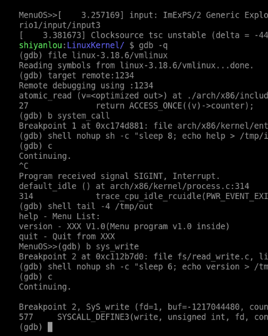
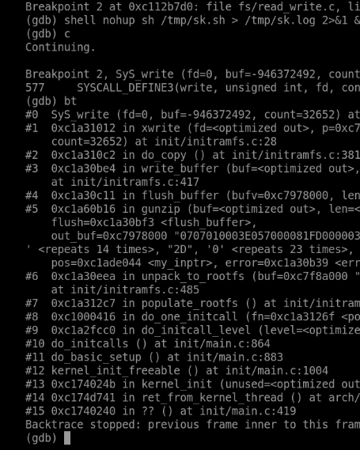
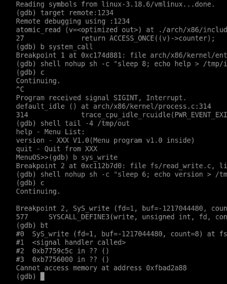
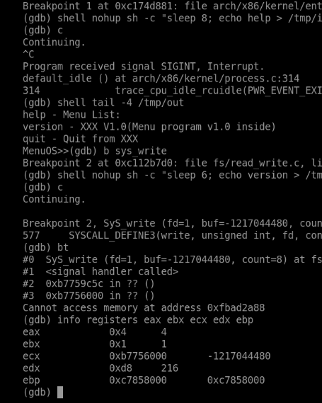
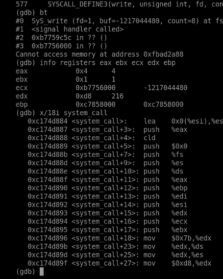
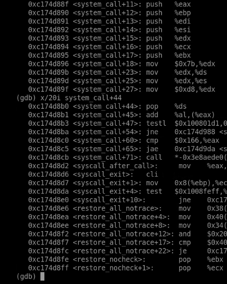
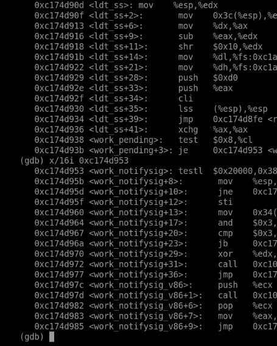
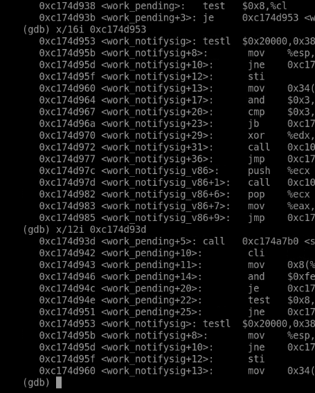
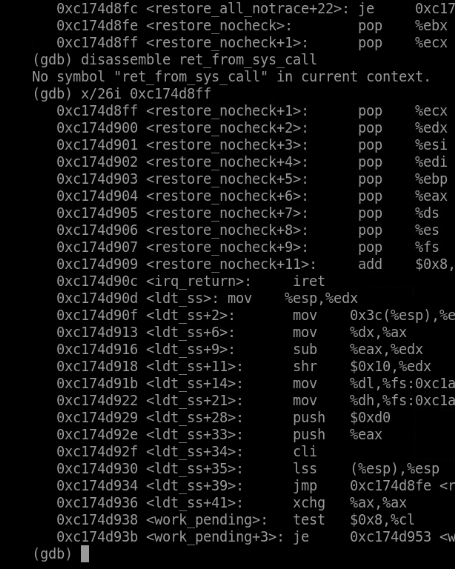

# 20262822《Linux内核原理与分析》第六周作业

**真实姓名：姚翔　学号：20262822　整理日期：2026年10月31日**  
**学习内容：教材第 6 章“可执行程序工作原理”；实验五“分析 system_call 中断处理过程”；课程视频“扒开系统调用的三层皮（下）”。**

**原创声明：** 原创作品转载请注明出处。  
**课程出处：** [《Linux 内核分析》MOOC 课程](http://mooc.study.163.com/course/USTC-1000029000)  
**课程网址：** http://mooc.study.163.com/course/USTC-1000029000

## 一、实验五：跟踪 system_call 的入口、分发与返回

### 1. 实验环境、操作与初步结果

实验使用 Linux 3.18.6 的 i386 内核、QEMU 和 GDB。内核映像用于启动，未压缩的 `vmlinux` 用于符号和源码调试；二者必须对应同一次构建。主要操作如下，QEMU 与 GDB 分别在两个终端运行：

```bash
cd ~/LinuxKernel
mkfifo /tmp/in
qemu -kernel linux-3.18.6/arch/x86/boot/bzImage \
  -initrd rootfs.img -nographic -append "console=ttyS0" \
  -s < /tmp/in > /tmp/out 2>&1 &
exec 3>/tmp/in
gdb linux-3.18.6/vmlinux
```

```gdb
target remote :1234
break system_call
break SyS_write
continue
```

串口输出保存到 `/tmp/out`，命名管道用于输入 MenuOS 命令，文件描述符 3 保持管道写端开启；`-s` 提供远程调试端口。本次命令没有 `-S`，连接时内核可能已经运行，不能把连接位置直接当成系统调用入口。

```text
linux-3.18.6/
├── arch/x86/kernel/entry_32.S   system_call、现场保存、返回分支
├── arch/x86/syscalls/          i386 系统调用表的生成依据
├── fs/read_write.c            write 的服务实现
└── vmlinux                    与运行内核对应的调试符号
```

向 MenuOS 注入 `help` 或 `version` 后，程序需要输出文字，能够触发 `write`。截图中的服务断点参数为 `fd=1`、用户缓冲区、`count=8`，把实验四中自行准备的参数与真实内核服务连接起来。



**图1：** MenuOS 输出时命中 SyS_write，参数为标准输出与 8 字节缓冲区。

### 2. 如何识别一次系统调用

#### （1）命中服务函数不等于命中用户态入口

最初命中 `SyS_write` 时，调用栈包含 `xwrite`、`do_copy`、`gunzip`、`unpack_to_rootfs`、`populate_rootfs` 等函数。这是内核解包 initramfs 的内部写入路径。它说明服务函数可以被内核内部路径调用，不能仅凭断点名称就认定用户程序执行了 `int $0x80`。



**图2：** 启动阶段的写入调用栈来自 initramfs 解包，应与用户系统调用区分。

后续命中中，参数指向用户空间，并出现用户地址范围的栈帧，结合 MenuOS 命令触发的输出，可以识别用户程序请求内核服务的情形。GDB 的 `<signal handler called>` 是跨特殊栈帧展开时的显示形式，不能据此断定应用真的执行了信号处理函数，也不足以单独确定使用的是 `int 0x80` 还是快速系统调用入口。



**图3：** 用户输出调用的回溯中出现特殊展开帧及用户地址。

#### （2）寄存器证据

本次停止位置可见 `eax=4`、`ebx=1`、`ecx=0xb7756000`、`edx=8`，与 i386 的 `write(fd, buf, count)` 约定相符。但普通 C 函数执行后可以改写寄存器，长期保存的用户现场应结合入口构造的 `pt_regs` 查看，不能假定服务函数内任意位置的寄存器都保持原值。



**图4：** 本次 write 断点处的寄存器值与调用号、三个参数对应。

### 3. system_call 的入口与保存现场

本节分析的是 Linux 3.18.6 i386 的 `system_call`，不是新版本的同类入口符号。实际服务断点观察与这条入口的静态分析分别提供证据：前者验证调用参数与业务效果，后者解释传统 `int $0x80` 路径如何工作。

从用户态经中断门进入内核时，处理器完成特权级切换并保存必要的返回控制状态；通用寄存器和段寄存器还需要入口汇编继续保存。源码逻辑可概括为：

```text
用户态：eax=调用号，其他约定寄存器=参数
    ↓ int $0x80
硬件：切换到内核栈，保存用户返回控制现场
    ↓
system_call：保存 orig_ax，SAVE_ALL 形成 pt_regs
    ↓
检查跟踪/审计等入口工作，检查调用号范围
    ↓
调用 sys_call_table 中的服务函数
```

截图中的压栈顺序与 `SAVE_ALL` 对应。第一次保存的 `eax` 作为原始调用号，后续保存的 `eax` 槽可以容纳最终返回值，二者不能混为同一个位置。



**图5：** system_call 的反汇编展示原始调用号和通用寄存器的保存。

入口还设置供内核入口使用的段寄存器值。截图中的 `0x7b` 对应这一版本的 `__USER_DS`，不能将它写成“由用户数据段改成 `__KERNEL_DS`”；在 x86 平坦段模型下，数值和源码常量需要逐项核对。[Linux 3.18.6 entry_32.S](https://github.com/gregkh/linux/blob/v3.18.6/arch/x86/kernel/entry_32.S)

典型 32 位现场中，低地址向高地址依次包含 `bx、cx、dx、si、di、bp、ax` 等字段，`ax` 位于栈帧偏移 `0x18`，`orig_ax` 位于 `0x2c`，随后是用户返回的 `ip、cs、flags、sp、ss`。这些偏移与配置、入口代码一起分析，不能套到 x86-64。

### 4. 调用号检查与分发

正常分发路径的关键逻辑如下。这里是按该版本整理的流程示意，省略跟踪等分支，不作为独立汇编程序编译：

```asm
cmpl $NR_syscalls, %eax
jae syscall_badsys
call *sys_call_table(,%eax,4)
movl %eax, PT_EAX(%esp)
```

每项入口地址为 4 字节，所以索引使用 `eax*4`。范围检查使用无符号的“大于等于”跳转；截图中的界限值为 `0x166`，即 358，因此该检查所允许的索引范围是 **0～357**，不能说“358 仍是有效调用号”。无效入口转入错误处理，避免越界取函数指针。



**图6：** 调用号范围检查、间接调用和返回值写回保存现场。

服务函数执行后，`eax` 被写回保存现场的返回值槽。即使后续返回路径还要临时使用处理器寄存器，最终恢复现场时，用户仍能在约定的累加寄存器中取得结果。这也解释了实验四中 `"=a"(ret)` 的意义。

### 5. 返回前的工作与现场恢复

#### （1）调度并非每次发生

系统调用完成后，需要检查线程标志；当存在重调度请求时，返回路径可以转入 `work_pending` 并调用 `schedule`。检查后通常还要重新读取标志，避免只处理一次就遗漏随后出现的工作。



**图7：** work_pending 分支围绕待处理标志决定后续路径。

反汇编中可以直接看到对 `schedule` 的调用。这说明返回用户态前存在明确的调度检查点，但不是每次系统调用都会切换任务；如果没有必要工作，会走较短的恢复路径。系统调用处理函数本身也可能因等待资源而阻塞，调度并不限于返回前。



**图8：** 返回路径中的 schedule 调用及重新检查标志的操作。

#### （2）恢复顺序与 iret

恢复时必须按与压栈布局相符的顺序取值。若从一条指令的中间字节开始反汇编，可能得到错误指令，因此应优先使用符号边界及源码核对。`RESTORE_REGS` 的第一个通用寄存器恢复项是 `ebx`，之后才依次恢复其他保存值；最终的 `eax` 恢复为服务返回值。



**图9：** 恢复寄存器及 iret 所在区域；具体指令须从正确边界核对。

在本文讨论的 `int $0x80` 返回路径中，`iret` 使用保存的控制现场回到用户态，恢复指令地址、代码段、标志，以及跨特权级返回所需的用户栈。它与普通函数的 `ret` 不同。快速入口在合适条件下可以使用其他返回指令，不能把所有 Linux 系统调用都概括为同一条 `iret` 路径。

#### （3）从系统调用推广到一般中断处理

系统调用与一般中断都需要组织入口、保存足够的被打断现场、执行处理逻辑，并在返回前处理必要工作，但触发原因与可执行操作不同。不能把 `sys_call_table` 分发当成所有中断都具有的步骤。

| 环节 | 本文的 int 0x80 系统调用 | 一般硬件中断 |
|---|---|---|
| 触发 | 用户程序主动请求服务 | 设备、时钟等事件产生 IRQ |
| 入口选择 | 按系统调用入口进入，再按调用号分发 | 按中断向量进入相应中断处理路径 |
| 主要工作 | 校验参数并执行内核服务 | 处理设备事件，必要时唤醒等待任务或安排后续工作 |
| 上下文约束 | 进程上下文，在允许的位置可以阻塞 | 硬中断上下文通常不能像进程代码一样睡眠 |
| 返回 | 恢复用户现场及服务返回值 | 恢复被打断的用户态或内核态执行；调度须在允许边界发生 |

由此可以归纳：中断或异常入口先保证现场可恢复，处理函数改变系统状态，退出路径再决定如何继续执行。异常还要依据类型决定重试原指令、继续执行或终止任务，不能统一套用系统调用“回到下一条指令”的说法。一次特权级转换不必更换当前任务，而一次调度选择也不一定产生 `prev != next` 的实际切换。依据见 [Linux 3.18.6 的入口与中断返回代码](https://github.com/gregkh/linux/blob/v3.18.6/arch/x86/kernel/entry_32.S)。

### 6. 实验中的问题与处理

| 问题 | 原因 | 解决办法与依据 |
|---|---|---|
| 首次 write 断点为何不是 MenuOS 输出？ | 内核解包根文件系统也调用了写入服务 | 依据完整调用链区分内部调用与用户请求 |
| 为什么服务断点和入口断点的表现不同？ | 服务可能由不同入口或内核内部到达 | 分开验证服务参数和入口源码，不从单个断点反推全部路径 |
| 回溯显示 signal handler 是否代表信号？ | 调试器对特殊栈帧的展开存在表示差异 | 与用户地址、参数和源码共同判断 |
| 如何理解 syscall 返回值不被后续操作覆盖？ | 返回值写入 pt_regs，末尾再恢复 | 对照 `mov %eax,0x18(%esp)` 与恢复顺序 |
| 调度为何出现在系统调用返回前？ | 需要在合适边界处理重调度请求 | 对照标志检查、schedule 调用及重新检查流程 |

### 7. 实验认识

本实验把一次 `write` 分成了接口、入口、服务和返回四层。最有价值的调试方法，是先确认断点所处的上下文，再解释栈与寄存器；只看到熟悉的函数名，还不足以说明一次用户态到内核态的完整转换。系统调用可以在同一进程中完成，返回前也可能调度其他任务，这两件事应分别分析。

## 二、教材第 6 章学习：可执行程序工作原理

### 1. 阅读范围与问题主线

本周阅读《庖丁解牛 Linux 操作系统分析》第 6 章“可执行程序工作原理”，印刷页 **198—233**，对应所用扫描 PDF 的第 **217—252** 页。第 5 章解释了进程如何被描述和创建，本章接着回答：磁盘上的文件怎样变成进程可以执行的映像，`execve` 又在这中间做了什么。

| 教材部分 | 印刷页 | 本周重点解决的问题 |
|---|---|---|
| 6.1 ELF 目标文件格式 | 198—203 | 目标文件有哪几类？ELF 怎样同时服务链接与装载？ |
| 6.2 程序的编译过程 | 204—208 | 预处理、编译、汇编、链接各留下什么产物？ |
| 6.3 链接与库 | 208—217 | 符号与重定位解决什么？静态库与共享库的差别在哪里？ |
| 6.4 可执行程序的加载 | 218—230 | `execve` 如何替换映像？`start_thread` 改的是哪份现场？ |
| 6.5 系统调用、fork 和 execve 总结 | 231—233 | 三个概念为什么必须放在一起理解？ |

本章与实验五的交界很清楚：实验五分析的是系统调用从入口到返回的公共通道，本章分析的是 `execve` 这个具体服务在通道内部做了什么。入口代码不关心调用号背后是读文件还是换程序，它只负责保存现场、分发和恢复；真正的差别在服务函数和它修改的进程状态里。

### 2. 问题一：目标文件、可执行文件和进程映像是什么关系？

**疑问与原因。** 教材先说“目标文件”，又说可执行文件和共享目标文件，容易让人以为这是三种互不相干的格式；看到 `readelf` 同时输出节表和段表，也容易把两者混为一谈。

**理解与解决。** 三者使用同一套 ELF 容器，只是用途和约束不同：

| 类型 | `e_type` | 主要用途 | 能否直接运行 |
|---|---|---|---|
| 可重定位文件 | `ET_REL` | 编译器生成的 `.o`，等待链接 | 否 |
| 可执行文件 | `ET_EXEC` | 固定地址的可执行映像 | 是 |
| 共享目标文件 | `ET_DYN` | 共享库，或被装载到随机基址的可执行文件 | 由解释器/内核决定 |

ELF 同时维护两套视图。**节（section）**面向链接、调试和分析，例如 `.text`、`.data`、`.bss`、`.symtab`；**段（segment）**面向装载，由程序头表描述，例如两个 `PT_LOAD`。链接器按节合并和重定位，装载器按段建立映射；不能用节表代替程序头表来判断“哪些内容会被装入内存”。教材 6.1.3 给出的 `readelf -h/-l/-S/-d` 正好对应文件头、程序头、节表和动态段四种视图，读一个 ELF 文件时可以按这四张表逐层核对。

`p_filesz` 与 `p_memsz` 的差别正好说明“文件内容”和“进程映像”不是一回事：文件中没有的尾部区域要在内存中补零，对应 BSS 一类内容。文件里还可能包含符号表、调试信息等不参与运行的节，它们不必占据进程地址空间。

### 3. 问题二：ELF 的入口为什么通常不是 `main`？

**疑问与原因。** 写 C 程序时只关心 `main`，而 `readelf -h` 给出的 `e_entry` 往往是一个陌生地址，看起来像“程序从别处开始”。

**理解与解决。** `e_entry` 是内核返回用户态时使用的第一条指令地址。对通常的 C 程序，它指向运行时启动代码 `_start`，而不是 `main`。启动代码从栈上取得 `argc`、`argv`、`envp`，完成必要的运行时初始化，再调用 `main`；`main` 返回后还要经过退出处理，而不是直接回到内核。

```text
内核设置 regs->ip = e_entry
    → _start（CRT 启动代码）
        → 读取初始栈上的 argc/argv/envp
        → __libc_start_main 等初始化
            → main
        → exit/_exit
```

因此，`e_entry` 与 `main` 的地址不能互相替代。静态链接时 `e_entry` 属于主程序自身；带 `PT_INTERP` 的动态程序，内核首先把控制权交给解释器，主程序入口通过辅助向量 `AT_ENTRY` 传递，这属于下一节讨论的装载分工。

### 4. 问题三：静态链接与动态链接，地址在什么时候确定？

**疑问与原因。** “链接”看起来只是把多个 `.o` 拼在一起，但静态库、共享库和地址空间布局之间的关系并不直观：为什么同一份代码装到不同进程里还能工作？

**理解与解决。** 链接要解决两件事：**符号解析**（这个 `call` 指向哪个定义）和**重定位**（这个地址在最终布局中是多少）。在链接之前，教材 6.2 先把构建过程分成四步，每一步的产物不同：

| 阶段 | 主要工作 | 典型产物 |
|---|---|---|
| 预处理 | 展开宏、包含头文件、处理条件编译 | 展开后的 `.i` 源文件 |
| 编译 | 语法语义分析、优化、生成汇编 | `.s` 汇编文件 |
| 汇编 | 把汇编翻译成机器指令，生成可重定位目标 | `.o` 目标文件 |
| 链接 | 合并节、解析符号、重定位 | 可执行文件或共享库 |

静态链接在生成可执行文件时完成符号解析和重定位，库代码被复制进产物，地址在链接时基本确定。动态链接把一部分工作推迟：

| 方式 | 代码何时进入进程 | 地址/符号何时确定 | 典型产物 |
|---|---|---|---|
| 静态链接 | 链接时复制进可执行文件 | 链接时基本确定 | 体积大、依赖少的可执行文件 |
| 装载时动态链接 | `execve` 后由解释器映射共享库 | 装载时重定位，可延迟绑定 | 记录 `DT_NEEDED` 的可执行文件 |
| 运行时动态链接 | 程序主动 `dlopen` | 调用 `dlsym` 时取得地址 | 插件式程序 |

共享库要被多个进程映射到不同地址，因此通常用位置无关代码 `-fPIC`，通过 GOT/PLT 间接访问外部符号。这里要区分“编译时看不到绝对地址”和“运行时没有地址”：动态链接器仍然要在装载或首次调用时完成重定位，只是把时间推后了。

### 5. 问题四：装载时动态链接与运行时动态链接差在哪里？

**疑问与原因。** 两种方式都能调用同一个 `.so`，从运行结果看不出区别，容易认为只是编译选项不同。

**理解与解决。** 差别在于“谁在什么时候提出依赖”：

- **装载时动态链接**：链接器把依赖写入动态段的 `DT_NEEDED`。`execve` 装载主程序时，内核发现 `PT_INTERP`，先映射并启动动态链接器；后者按 `NEEDED` 装入共享库并完成符号解析，再把控制权交给主程序入口。
- **运行时动态链接**：可执行文件本身不记录对该库的依赖，程序运行到某处才调用 `dlopen` 请求装载，用 `dlsym` 取得函数地址。库不存在时，错误发生在 `dlopen` 返回处，而不是程序启动时。

这也说明内核并不“逐个函数”完成共享库链接。内核负责识别 ELF、映射主程序和解释器、准备初始栈；共享库的搜索、依赖排序和符号绑定主要由用户态动态链接器完成。把这条边界划清，才能解释为什么 `LD_LIBRARY_PATH`、`ld.so.cache` 这类用户态配置会影响程序能否启动。

### 6. 问题五：`execve` 成功后为什么不返回旧程序？

**疑问与原因。** 按普通函数调用的经验，调用结束后应该继续执行下一条语句；但 `execve` 成功时，后面的代码永远不会运行，看起来像“函数没有返回”。

**理解与解决。** `execve` 不是普通函数，它替换的是当前任务的用户态执行环境。教材 6.4.3 给出的主路径可以概括为：

```text
sys_execve / x64_sys_execve
  → do_execve
      → do_execve_common
          → do_execve_file
              → exec_binprm
                  → search_binary_handler
                      → load_elf_binary
                          → start_thread
```

`load_elf_binary` 校验 ELF、处理解释器、建立新的地址空间映射、准备用户栈和辅助向量；`start_thread` 最后修改**保存的用户返回现场**：把 `regs->ip` 改为新程序入口（静态目标为 `e_entry`，动态目标为解释器入口），把 `regs->sp` 改为新栈顶。系统调用返回路径照常执行 `iret`，但此时“返回”的目的地已经是新程序。

所以“不返回”只是从旧程序的角度看：控制流确实回到了用户态，只是落在了另一个程序的入口。若装载失败，内核不会替换现场，`execve` 才按普通错误返回 `-1` 并设置 `errno`。

### 7. 问题六：`execve` 前后 PID 不变，变的是什么？

**疑问与原因。** PID 相同，容易让人以为“还是原来那个进程，只是换了个程序”，进而误以为地址空间、文件描述符都原样保留。

**理解与解决。** 保持不变的是任务身份和一部分进程级资源，替换的是执行内容：

| 对象 | `execve` 后的变化 |
|---|---|
| `task_struct` 与 PID | 保留，仍由同一任务继续执行 |
| 用户地址空间 | 替换为新程序的 `mm`，旧映射拆除 |
| 代码与数据 | 来自新 ELF 的 `PT_LOAD` 段 |
| 用户栈 | 重新建立，放入 `argc/argv/envp/auxv` |
| 打开的文件描述符 | 默认保留；设置 `FD_CLOEXEC` 的除外 |
| 信号处理函数 | 已安装的处理函数恢复默认，被忽略的信号保持忽略 |
| 凭据、进程组等 | 通常保留 |

“同一进程”是就调度实体和身份而言；“新程序”是就地址空间和执行现场而言。两者并不矛盾。`fork` 与 `execve` 的分工也在这里显现：前者建立一个新的任务和资源关系，后者在已有任务中换掉程序映像。

### 8. 问题七：内核为什么要经过 `search_binary_handler`，而不是直接调用 ELF 加载器？

**疑问与原因。** Linux 上绝大多数可执行文件是 ELF，看起来可以写死一个加载函数；教材却安排了格式注册与遍历的流程。

**理解与解决。** 可执行文件不止 ELF 一种。脚本以 `#!` 开头，需要交给解释器；`binfmt_misc` 允许运行其他格式；不同架构还可能有各自的加载器。内核用 `linux_binfmt` 链表保存已注册的格式，每个格式提供 `load_binary` 回调。`search_binary_handler` 依次尝试，直到某个格式认领该文件。

```text
exec_binprm
  → search_binary_handler(bprm)
      → 遍历 formats 链表
          ├─ elf_format.load_binary → load_elf_binary
          ├─ script_format        → 处理 #! 解释器
          └─ 其他/杂项格式
```

这层间接带来的好处是扩展性，代价是每次 `execve` 都要做格式识别。阅读时要注意：`search_binary_handler` 是“选择装载器”，不是“执行程序”；真正的映射和现场准备发生在具体格式的 `load_binary` 中。

### 9. 问题八：第 6 章与实验五的 `system_call` 怎样接起来？

**疑问与原因。** 实验五跟踪的是 `system_call`，本章讨论的是 ELF 和 `execve`，两套名词放在一起时，容易把“入口”“服务函数”“装载器”当成同一条调用链上的相邻函数。

**理解与解决。** 可以按“公共通道”和“具体业务”分层：

```text
用户态调用 execve
  → int $0x80（或 sysenter）
      → system_call：保存现场、检查调用号
          → sys_execve：具体服务
              → do_execve → … → load_elf_binary
                  → start_thread：改保存的用户现场
      → 返回路径：work_pending / 恢复寄存器 / iret
  → 用户态从新程序入口开始执行
```

`system_call` 对 `write` 和 `execve` 做的事是一样的：保存现场、按号分发、恢复现场。不同的是服务函数是否修改了这份现场。`write` 只写返回值，所以 `iret` 回到原程序的下一条指令；`execve` 改了 `ip` 和 `sp`，所以 `iret` 落到新程序入口。实验五看到的“返回前调度检查”在这里同样成立：换完程序的任务也可能在返回前被调度，只是它下次被选中时使用的是新映像。

### 10. 本章留下的验证问题

教材给出了机制和源码路径，但本周的实验五是系统调用的公共入口，尚未直接观察 `load_elf_binary` 和 `start_thread`。我把下面三点留作后续验证，而不把它们写成已经完成的观察：

1. 用 `readelf -h/-l` 核对一个静态程序的 `e_entry` 与两个 `PT_LOAD` 段；
2. 在 `sys_execve`、`load_elf_binary`、`start_thread` 设断点，确认 `regs->ip` 从旧程序地址变为新入口；
3. 比较静态目标与带 `PT_INTERP` 的动态目标，确认后者首先进入解释器而非主程序 `e_entry`。

这样安排的原因很简单：第 6 章解释“应该发生什么”，实验五证明“公共通道怎样工作”，两者之间的具体装载过程还需要独立证据。

## 三、课程视频学习：系统调用的“三层皮”（下）

本周课程视频为“扒开系统调用的三层皮（下）”。结合教材第 4 章和实验五，我把视频的主线整理为三层：

| 层次 | 关注对象 | 本周对应的证据 |
|---|---|---|
| 库函数 API | `write()` 等 C 接口，参数与返回值语义 | 实验四的库函数调用 |
| 架构 ABI | 调用号、寄存器传参、陷入指令 | 实验四的内嵌汇编、实验五的 `eax=4` |
| 内核处理 | 入口保存、调用号分发、服务函数、返回 | 实验五的 `system_call` 与 `SyS_write` |

视频（下）的重点落在第三层。它把“系统调用”从一个 C 函数名还原为一段可检查的协议：用户态准备号与参数，入口保存现场，内核按表分发，服务函数执行，返回路径恢复现场。这个视角与实验五的截图能够一一对应，也解释了为什么仅凭 `SyS_write` 断点还不能证明发生了一次用户请求——服务函数也可能被内核内部调用。

我在观看后补做了两个核对：

- **调用号与参数分离**：`eax` 承载调用号，`ebx/ecx/edx` 承载前三参数；进入 C 服务函数后，编译器可能复用这些寄存器，因此要回到 `pt_regs` 看保存值。
- **返回不等于切换**：返回路径上的 `schedule` 是调度检查点，只有选中了不同任务才发生切换；这与“系统调用一定导致进程切换”的直觉不同。

视频没有给出可直接复现的调试命令，以上结论以教材第 4 章、实验五截图和 Linux 3.18.6 源码为准；视频在这里起的是组织问题的作用，而不是替代证据。

## 四、本周问题、原因与解决

| 问题 | 原因分析 | 处理与验证 |
|---|---|---|
| 为什么第一次 `write` 命中来自 initramfs？ | 内核解包也调用写服务 | 查看完整调用栈，区分内部路径与用户请求 |
| `system_call` 保存的 `eax` 为什么有两份？ | 原始调用号与返回值需要分别保存 | 对照 `orig_ax` 与 `PT_EAX` 偏移 |
| 358 能否作为有效调用号？ | 把“上界值”误当成“可用值” | 无符号 `>=` 检查，有效范围 0—357 |
| 返回值会被后续指令覆盖吗？ | 只观察了服务函数内部寄存器 | 返回值写入 `pt_regs`，恢复时再装回 |
| `execve` 成功后为什么不执行下一条语句？ | 把系统调用当成普通函数 | 第 6 章：`start_thread` 替换保存的用户现场 |
| ELF 的节和段是不是一回事？ | 混淆链接视图与装载视图 | 节用于链接，段用于映射；看程序头表 |
| 动态链接是否由内核完成？ | 把解释器的工作归给内核 | 内核映射解释器，符号绑定由 `ld.so` 完成 |

## 五、AI 辅助学习中的核验记录

本周按“先自己读源码和截图—再借助 AI 梳理名词—最后回到教材与版本源码核对”的顺序处理难点。AI 帮我最快的地方是把混在一起的概念分层；凡是涉及具体偏移、调用号和版本行为的内容，我都回到 Linux 3.18.6 的源码与截图核对。

| 向 AI 梳理的问题 | 需要核验的点 | 本次形成的结论 |
|---|---|---|
| `pt_regs` 里为什么没有独立的“返回值”字段？ | `ax` 槽在入口和返回时的不同含义 | 同一槽先存调用号，后被返回值覆盖 |
| 系统调用一定从用户态发起吗？ | 内核内部能否直接调用服务函数 | 可以，首次 `write` 命中就是例子 |
| `execve` 算不算创建进程？ | 任务身份与程序映像的区别 | 不算，替换同一任务的执行内容 |
| 静态程序的入口为什么不是 `main`？ | `e_entry` 与 CRT 启动代码 | 先进入 `_start`，再调用 `main` |
| `DT_NEEDED` 由谁处理？ | 内核与动态链接器的分工 | 内核映射解释器，`ld.so` 处理依赖 |
| 系统调用返回前为什么能调度？ | 返回路径的标志检查 | `work_pending` 是合法调度点，不保证切换 |

其中最值得记录的一点是：同一个寄存器或同一个字段，在入口、服务函数和返回三个时刻可能有不同含义。把它们当成“一直是同一个值”，就会得出错误结论。

## 六、本周学习总结

实验五让我第一次完整看到系统调用的“公共通道”：入口保存现场，按调用号分发，服务函数执行，返回路径处理待办工作并恢复现场。第 6 章则把通道内部的一个具体业务展开：`execve` 通过 `search_binary_handler` 找到 ELF 装载器，建立新地址空间和用户栈，最后用 `start_thread` 改写保存的 `ip` 和 `sp`。两条线合起来，才能解释“为什么系统调用能返回，而 `execve` 成功后旧程序却不再继续”。

我本周修正了三个理解：第一，服务函数断点不等于用户态入口；第二，ELF 的节与段分别服务链接和装载，不能互相替代；第三，`execve` 的“不返回”是现场被替换，不是控制流消失。下一次实验如果跟踪 `load_elf_binary` 和 `start_thread`，我会重点核对 `regs->ip` 的前后变化，把本章的源码分析与实际寄存器对应起来。

## 参考资料

1. 孟宁、娄嘉鹏：《庖丁解牛 Linux 操作系统分析》，第 6 章“可执行程序工作原理”，印刷页 198—233。
2. [《Linux 内核分析》MOOC](http://mooc.study.163.com/course/USTC-1000029000)，第五、六周视频与实验五。
3. [作者提供的课程与教材配套资料](https://github.com/mengning/linuxkernel)。
4. Linux 3.18.6 源码：[系统调用入口](https://github.com/gregkh/linux/blob/v3.18.6/arch/x86/kernel/entry_32.S)、[exec 主体](https://github.com/gregkh/linux/blob/v3.18.6/fs/exec.c)、[ELF 装载](https://github.com/gregkh/linux/blob/v3.18.6/fs/binfmt_elf.c)、[write 服务](https://github.com/gregkh/linux/blob/v3.18.6/fs/read_write.c)。
5. [Executable and Linkable Format (ELF) 规范](https://refspecs.linuxfoundation.org/elf/elf.pdf)、[Linux man-pages：execve(2)](https://man7.org/linux/man-pages/man2/execve.2.html)、[elf(5)](https://man7.org/linux/man-pages/man5/elf.5.html)。
6. [QEMU GDB 使用说明](https://www.qemu.org/docs/master/system/gdb.html)。
