# 20262822《Linux内核原理与分析》第四周作业

**姓名：** 姚翔  
**学号：** 20262822  
**整理日期：** 2026 年 10 月 18 日  
**学习内容：** 实验三“跟踪 Linux 内核的启动过程”与教材第 4 章“深入理解系统调用”。

## 一、实验三：从 start_kernel 到 init——跟踪 Linux 内核的启动过程

### 1. 实验环境与操作步骤

本次实验在蓝桥云课实验楼的 32 位 Ubuntu 环境中完成，使用课程提供的 Linux 3.18.6、QEMU、GDB 和 `rootfs.img`。先进入实验目录，启动内核并加载根文件系统：

```bash
cd ~/LinuxKernel
qemu -kernel linux-3.18.6/arch/x86/boot/bzImage -initrd rootfs.img \
     -nographic -append "console=ttyS0"
```

`-kernel` 指定可启动内核镜像，`-initrd` 把初始根文件系统映像交给内核。实验指导采用图形窗口，本次操作增加 `-nographic` 和 `console=ttyS0`，让内核输出与 MenuOS 交互出现在终端中，便于观察启动过程。

后续阅读与调试主要涉及以下文件：

```text
LinuxKernel/
├── linux-3.18.6/
│   ├── arch/x86/boot/bzImage       —— QEMU 加载的启动镜像
│   ├── vmlinux                    —— GDB 加载的 ELF 文件与调试符号
│   ├── init/main.c                —— start_kernel、rest_init、kernel_init
│   ├── init/init_task.c            —— 初始任务与初始线程栈的静态定义
│   └── kernel/sched/idle.c         —— idle 执行路径
├── rootfs.img                     —— 包含用户态 /init 的初始根文件系统
└── menu/                          —— 课程 MenuOS 程序相关材料
```

`bzImage` 与 `vmlinux` 来自同一次内核构建，分别用于启动与符号调试；修改内核后，应重新编译并同时更新二者。下面先观察内核是否进入用户态程序，再用断点回答“启动过程中谁在执行、在哪里创建新任务”。

### 2. 运行结果：内核启动后为什么会出现 MenuOS

内核完成必要初始化后，继续装载初始根文件系统中的用户程序。终端出现 `MenuOS>>`，说明本次启动已经进入可交互的 MenuOS，而不只是停留在打印内核日志的阶段。

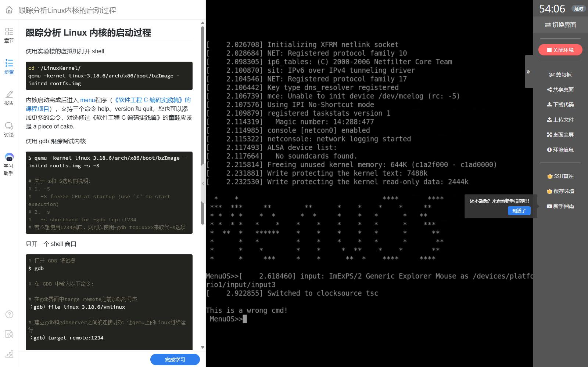

**图1：** 启动日志尾部与 `MenuOS>>` 提示符；图中的错误命令提示来自菜单输入，不表示内核启动失败。

输入 `help` 后，菜单列出 `help`、`version`、`quit` 等命令。这里要区分内核与用户程序：命令表属于 MenuOS，内核负责为它提供运行环境，并不直接把 `help` 当成自己的启动函数执行。

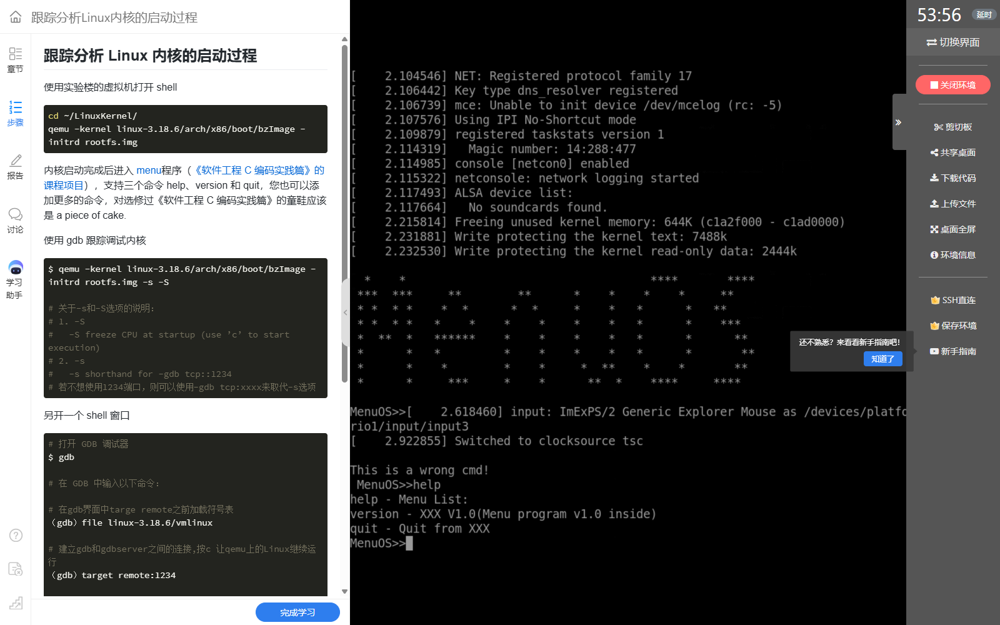

**图2：** `help` 显示菜单命令及说明，确认用户程序能够接收输入并处理命令。

为了从输出中找出启动阶段，我查看了关键日志。`Linux version 3.18.6` 用于确认内核版本，`Kernel command line: console=ttyS0` 对应启动参数，PID 哈希表、内存和处理器初始化信息说明基础子系统依次投入工作；`Freeing unused kernel memory: 644K` 表示初始化专用内存被回收。

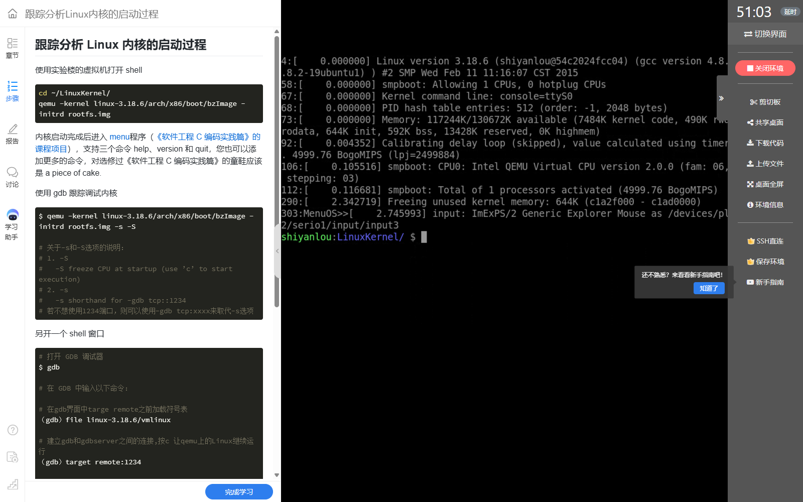

**图3：** 日志记录了版本、单 CPU 配置、PID 哈希表、内存、延时校准和初始化内存回收等节点。日志能说明阶段，具体执行关系还需要用断点和源码确认。

### 3. 建立调试连接：先暂停启动，再加载符号

为了在内核进入 `start_kernel` 前取得控制权，启动另一轮带调试选项的 QEMU：

```bash
cd ~/LinuxKernel
qemu -kernel linux-3.18.6/arch/x86/boot/bzImage -initrd rootfs.img \
     -display none -serial file:boot2.log -s -S &
```

`-s` 开启默认 TCP 1234 端口的 GDB 调试接口，`-S` 暂停客户机 CPU，二者大小写不能互换。此处串口输出写入 `boot2.log`，所以观察控制台与前面的交互启动使用不同的输出方式；调试连接正常后，用 GDB 的 `continue` 才让客户机继续运行。[QEMU 官方调试文档](https://www.qemu.org/docs/master/system/gdb.html)说明了这两个选项的区别。

另开终端，在相同目录加载与启动镜像配套的符号：

```gdb
file linux-3.18.6/vmlinux
target remote:1234
```

GDB 的 `file` 命令读取 ELF 和符号信息，并不代替 QEMU 启动内核。出现 `Reading symbols ... done` 后，调试器才能把地址与函数名、源码位置联系起来。

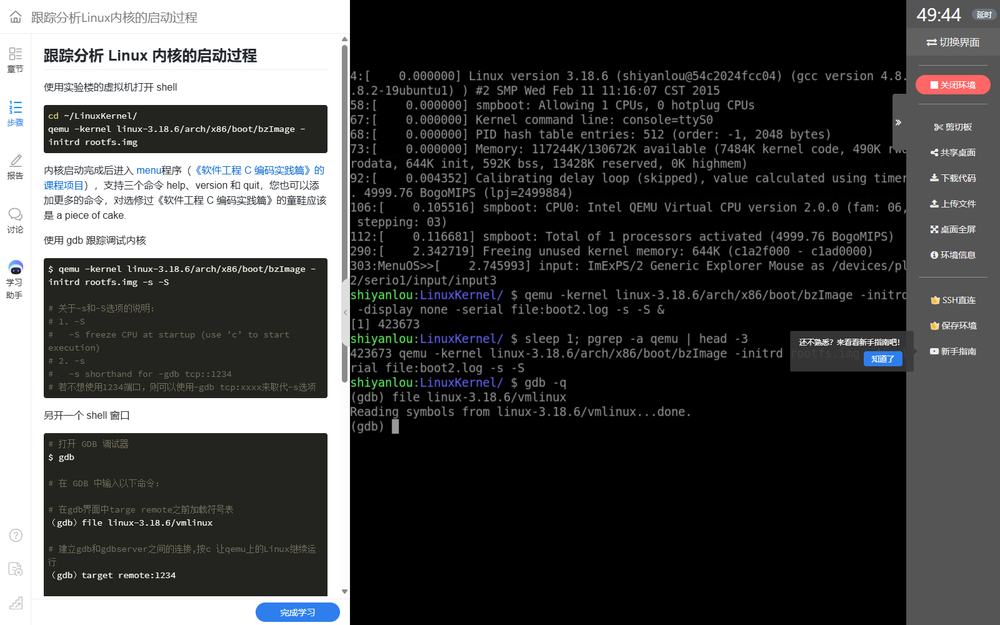

**图4：** `file linux-3.18.6/vmlinux` 成功读取符号。

`target remote:1234` 建立连接后，GDB 显示 `0x0000fff0 in ?? ()`。这是 CPU 复位阶段的地址表现，尚未进入带有 Linux C 语言符号的执行位置，不能把它写成“内核第一条指令”，也不能仅凭 `??` 判断符号文件加载失败。

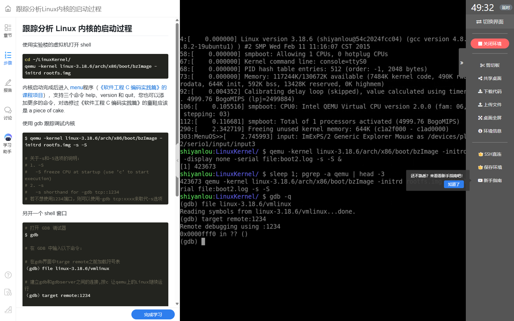

**图5：** 远程连接成功，客户机停在早期复位位置，随后可设置内核断点。

### 4. 跟踪 start_kernel：从地址定位到初始化主线

```gdb
break start_kernel
continue
list
bt
```

先设置符号断点再继续执行，避免内核已经越过目标。截图中断点命中 `start_kernel()`，位置为课程源码 `init/main.c:501`，表明启动镜像和调试符号已经能够配合工作。

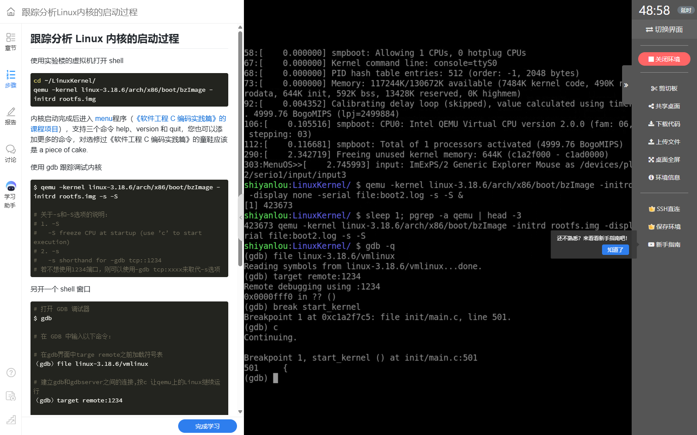

**图6：** `Breakpoint 1, start_kernel () at init/main.c:501`，进入通用内核初始化入口。

`list` 给出函数入口附近的代码，`bt` 显示它的上层为 `i386_start_kernel()`。后者位于 `arch/x86/kernel/head32.c`，本身也是 C 函数；再往前才需要继续分析体系结构相关的汇编启动准备。因此，`start_kernel` 是通用初始化的 C 入口，但不能据此说它一定是整个启动过程中执行的第一个 C 函数。

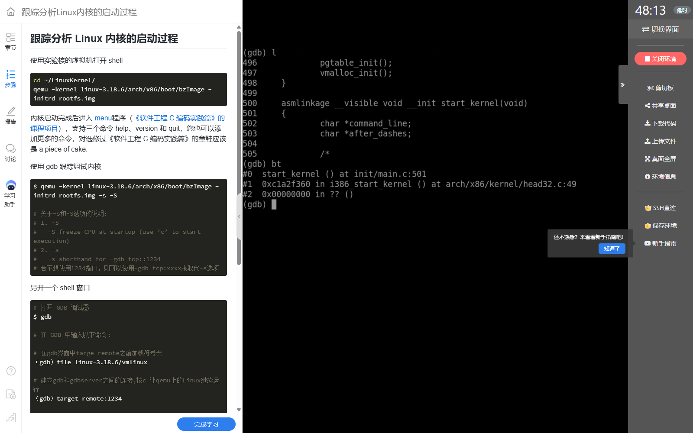

**图7：** 源码入口与 `start_kernel ← i386_start_kernel` 的调用关系。最底部未知栈帧不作为额外的函数调用证据。

#### （1）为什么 start_kernel 不能当成普通 main 来理解

普通程序的 `main` 执行前，操作系统已提供进程、虚拟内存和运行库环境；`start_kernel` 则是在前期引导建立最低运行条件后，继续把内核自己的服务组织起来。函数运行时已有初始任务 `init_task` 和初始内核栈，并非等执行到 `rest_init` 才第一次出现任务描述符。

#### （2）按依赖关系分析初始化过程

以下按 Linux 3.18.6 的实现归纳主要阶段，省略配置分支及辅助检查，不把简化顺序当作可替换原函数的完整源码。课程源码的行号以 GDB 实测为准，上游同版本代码用于对照函数及依赖关系。

| 阶段 | 主要函数或操作 | 解决的问题与先后关系 |
| --- | --- | --- |
| 初始任务状态 | `set_task_stack_end_magic` | 为初始任务建立栈末端检查标记 |
| 早期中断与启动 CPU | `local_irq_disable`、`boot_cpu_init` | 先控制早期中断，再准备启动 CPU 状态，避免中断设施未齐备时过早响应普通可屏蔽中断 |
| 体系结构与参数 | `setup_arch`、`setup_command_line`、`parse_early_param` | 处理架构相关资源及启动参数；串口 console 参数也由启动路径处理 |
| 内存基础设施 | `build_all_zonelists`、`page_alloc_init`、`mm_init` | 准备页分配及更高层分配器，为后续对象创建提供内存 |
| 异常与调度基础 | `trap_init`、`sched_init` | 建立异常处理与调度基础；调度器应先于正常时钟中断投入使用 |
| 中断及时间体系 | `early_irq_init`、`init_IRQ`、`tick_init`、`init_timers`、`timekeeping_init` | 准备 IRQ、时钟和定时器，随后才允许正常中断处理 |
| 开中断与控制台 | `local_irq_enable`、`console_init` | 在必要设施已就绪后允许中断，并组织控制台输出 |
| 进程及文件系统基础 | `pidmap_init`、`fork_init`、`proc_caches_init`、`vfs_caches_init`、`proc_root_init` | 为进程标识、进程创建及文件访问建立基础结构 |
| 转入启动收尾 | `rest_init` | 创建后续任务，让初始执行流进入 idle 路径 |

理解这段代码的重点是依赖关系：没有内存分配基础，后面的任务对象难以创建；没有异常、中断和调度设施，就不应让周期性中断任意打断启动过程。“先 `sched_init`，再完成时钟与 IRQ 初始化，之后开中断”比只记一长串函数名更能解释其设计。

### 5. 跟踪 rest_init：启动路径从这里分成不同任务

```gdb
break rest_init
continue
```

断点命中 `rest_init()`，课程源码位置为 `init/main.c:394`。此时通用初始化已经走到收尾，接下来需要创建承担后续初始化工作的任务，而初始任务保留为 idle。

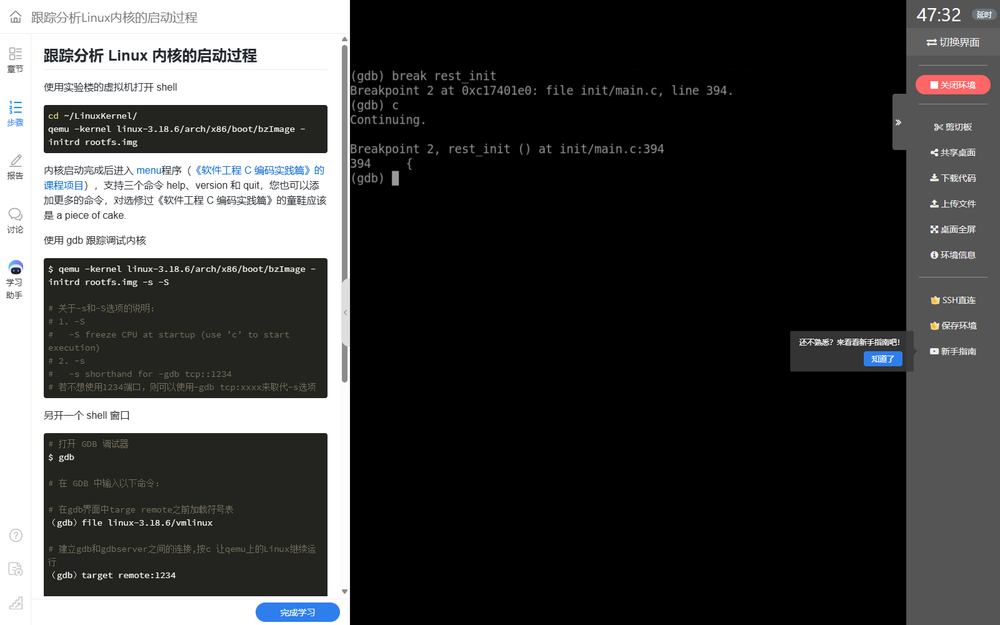

**图8：** 命中 `rest_init`，即分析 0、1、2 号任务分工的重要位置。

下面摘出两个创建动作及启动任务的后续去向；中间的同步与其他准备代码未列出：

```c
kernel_thread(kernel_init, NULL, CLONE_FS);
pid = kernel_thread(kthreadd, NULL, CLONE_FS | CLONE_FILES);
/* 创建与同步完成后，启动任务执行一次调度，再进入 idle。 */
schedule_preempt_disabled();
cpu_startup_entry(CPUHP_ONLINE);
```

第一个创建动作先执行，使承担初始化的任务得到 PID 1；第二个动作创建 `kthreadd`，通常为 PID 2。`kernel_init_freeable` 会等待 `kthreadd_done`，与 `rest_init` 中的完成通知配合，避免 PID 1 在内核线程管理设施尚未准备好时继续相关初始化。

这里的创建关系不是普通的直接调用：`kernel_thread(kernel_init, ...)` 创建可调度的新任务，`kernel_init` 在新任务取得 CPU 时运行；原任务则沿自己的内核栈进入 `cpu_startup_entry`。源码对照见 [Linux 3.18.6 的 init/main.c](https://github.com/gregkh/linux/blob/v3.18.6/init/main.c)。

### 6. 跟踪 kernel_init 与 /init：同一个 PID 的两种执行阶段

#### （1）PID 1 先在内核中执行初始化

```gdb
break kernel_init
continue
```

截图命中 `kernel_init(unused=0x0)`，课程源码为 `init/main.c:931`。此时 PID 1 正执行内核初始化函数，还没有因为函数名包含 `init` 就自动变成用户态程序。

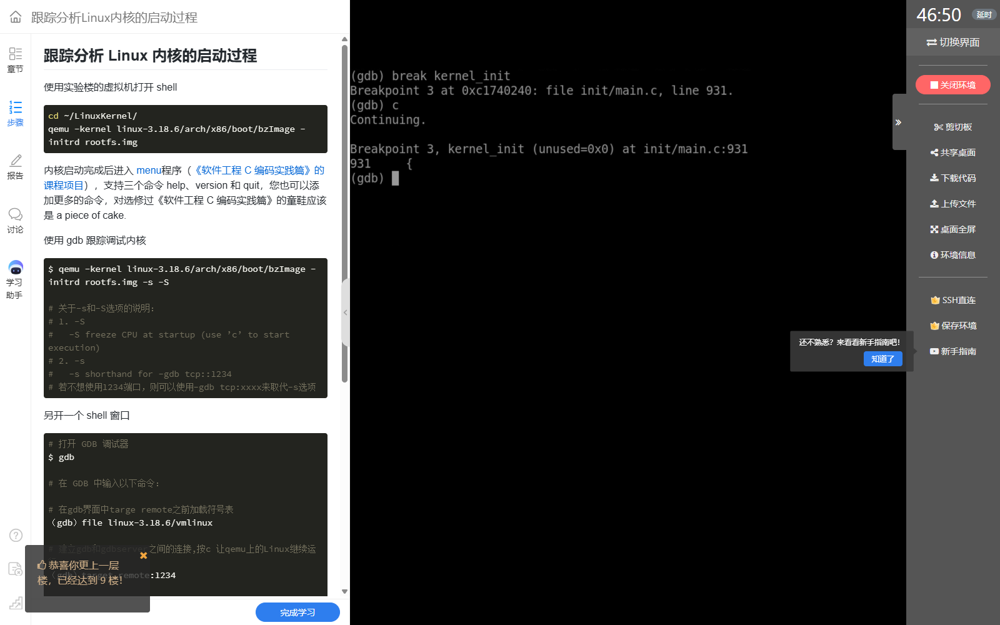

**图9：** `kernel_init` 断点表明新任务开始承担启动收尾工作。

`kernel_init_freeable` 继续处理设备与 initcall 初始化，准备控制台和根文件系统相关条件；随后等待异步初始化完成、回收初始化专用内存，并准备执行用户态初始化程序。若初始根文件系统中存在 `/init`，本版本优先尝试该程序；需要时才继续其他 init 路径。

#### （2）run_init_process 的参数确认要装载谁

```gdb
break run_init_process
continue
bt
```

断点命中时参数为 `init_filename="/init"`，对应课程源码 `init/main.c:907`。这比只看到菜单提示符更具体：它定位到内核准备装载哪个用户程序，但该断点仍处于内核中的装载入口。


**图10：** `run_init_process` 收到 `/init`，说明本次启动选择了初始根文件系统中的这个程序。

调用栈的前三个可辨认帧依次为 `run_init_process`、`kernel_init`、`ret_from_kernel_thread`。它支持“PID 1 先以新建内核任务的入口运行，随后准备装载用户程序”的解释。更下方出现 `??` 和回溯停止提示，不应把未知帧强行标成 `rest_init` 的普通调用帧。

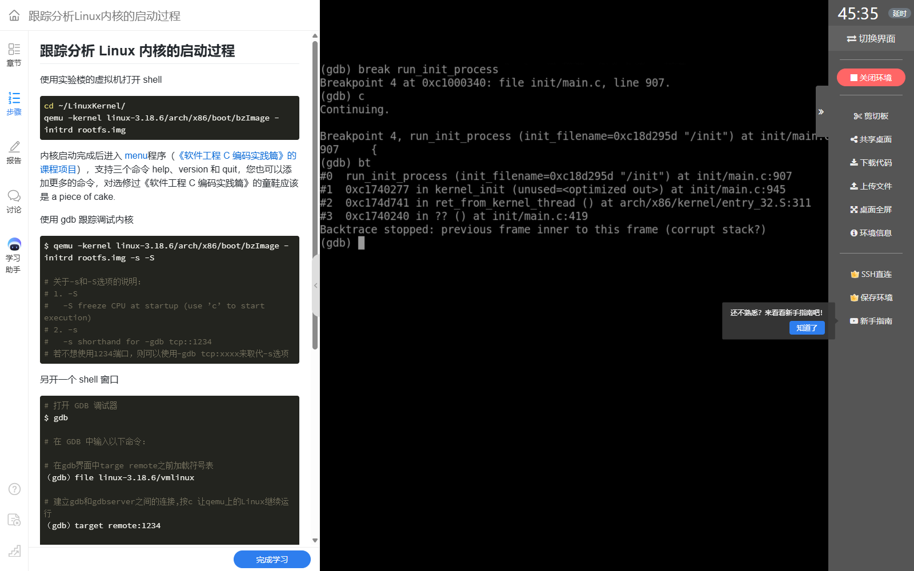

**图11：** 可辨认的调用关系与内核线程启动返回入口；跨启动边界的完整因果关系需要结合任务创建源码理解。

#### （3）exec 成功后为什么仍是 1 号进程

`run_init_process` 把程序路径放入启动参数，并进入 `do_execve` 路径。exec 的作用是装载并替换当前任务的用户程序映像，设置新的用户地址空间及返回现场，不是再创建一个 PID。装载成功并经架构相关返回路径进入用户态后，执行的才是 `/init` 的用户代码，本实验表现为 MenuOS。

因此，要分清三个时间点：创建 PID 1；PID 1 执行 `kernel_init`；同一 PID 1 经 exec 执行用户态 `/init`。命中 `run_init_process` 只能直接证明准备执行 `/init`，图1、图2中的用户交互与装载机制共同补全后续过程。[Linux 3.18.6 的 exec 实现](https://github.com/gregkh/linux/blob/v3.18.6/fs/exec.c)可用于对照这一区别。

### 7. 跟踪 idle：0 号进程不是最后 fork 出来的

让内核继续执行，在 GDB 中按 `Ctrl+C` 暂停，再运行 `bt`。本次停在 `default_idle`，调用栈向上能找到 `cpu_startup_entry`、`rest_init`、`start_kernel` 和 `i386_start_kernel`。

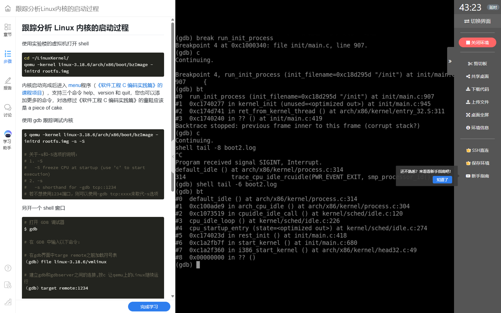

**图12：** 原始启动执行流最终进入 idle；这条栈与 PID 1 的 `kernel_init → run_init_process` 栈属于不同任务路径。

把截图中可辨认的路径按执行方向整理如下：

```text
i386_start_kernel
  → start_kernel
  → rest_init
  → cpu_startup_entry
  → cpu_idle_loop
  → cpuidle_idle_call / arch_cpu_idle
  → default_idle
```

初始任务 `init_task` 和初始线程栈在源码中静态定义，引导代码在进入通用初始化前已建立相关执行环境；它不是由 `rest_init` 再 fork 出来的。启动后，原执行流在无普通可运行任务时承担 idle 工作。idle 也不等于始终浪费 CPU 的简单死循环：架构实现可以通过等待中断等机制进入空闲状态，之后响应唤醒和调度需要。参见 [初始任务定义](https://github.com/gregkh/linux/blob/v3.18.6/init/init_task.c)与 [idle 实现](https://github.com/gregkh/linux/blob/v3.18.6/kernel/sched/idle.c)。

### 8. 用两条执行路径总结 0、1、2 号进程

```text
静态初始任务 / 启动 CPU 执行流（PID 0）
  i386_start_kernel → start_kernel → rest_init
                                     │
                                     ├─ 创建 PID 1，入口 kernel_init
                                     │    → 后续初始化及装载准备
                                     │    → run_init_process("/init")
                                     │    → exec 成功后进入用户态 MenuOS
                                     │
                                     ├─ 创建 PID 2，入口 kthreadd
                                     │    → 管理常规内核线程创建请求
                                     │
                                     └─ 原 PID 0 执行调度并进入 idle
                                          → cpu_startup_entry → 空闲循环
```

上图中的“创建”表示新任务的产生，不表示当前内核栈直接调用新任务的完整执行流程。PID 1 和 PID 2 获得运行机会后才沿各自的栈执行，PID 0 的 idle 栈不会变成 PID 1 的用户栈。

| 任务 | 来源 | 主要职责 | 与截图的对应关系 |
| --- | --- | --- | --- |
| PID 0：启动 CPU 的 idle/swapper | 静态初始任务及引导执行流 | 早期初始化，随后在该 CPU 无其他可运行任务时进入空闲路径 | 图7与图12串起通用初始化和 idle |
| PID 1：init | `rest_init` 创建，入口为 `kernel_init` | 完成后续初始化，再装载用户态 init 程序 | 图9—图11定位内核入口与 `/init` 装载准备；图1、图2显示用户交互 |
| PID 2：kthreadd | `rest_init` 创建 | 承担常规内核线程创建请求 | 通过 `rest_init` 源码与初始化同步关系分析 |

“0 号进程先存在、1 号进程被创建、1 号进程再装载用户程序”是本实验最重要的区分。`kthreadd` 也有明确分工，但不能笼统地说所有内核线程都由它创建，因为 PID 1、PID 2 的早期创建就是启动路径直接完成的。

### 9. quit 引发 panic：init 为什么不能像普通程序一样退出

本次记录中，执行菜单退出操作后出现 `Attempted to kill init!`，同时能看到 `PID: 1 Comm: init` 和退出相关调用。输出还伴随保护异常与递归故障信息，所以不能把这一屏全部视为正常退出信息。

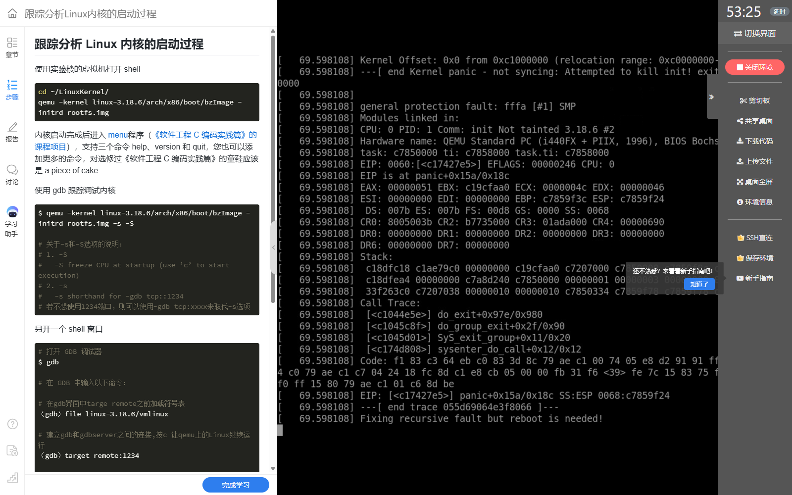

**图13：** panic 信息与 PID 1 标识，显示当前初始化程序退出会破坏系统的基本用户态运行条件。

结合 [Linux 3.18.6 的退出处理源码](https://github.com/gregkh/linux/blob/v3.18.6/kernel/exit.c)，初始 PID 命名空间的 init 具有特殊地位，失去该任务会触发内核保护。该现象与本次 `/init` 身份一致，也提醒我：判断启动成功应结合已经出现的菜单交互与断点，而不应被最后一次退出后的 panic 反向误导成“内核从未成功启动”。

### 10. 遇到的问题、分析与解决方案

| 问题或疑问 | 原因分析 | 解决方法与核验依据 |
| --- | --- | --- |
| QEMU 加 `-S` 后没有继续输出，是不是卡死了？ | CPU 被主动暂停，等待调试器 | 按 `file → target remote → break → continue` 操作，图4—图6能接续验证 |
| 为什么 QEMU 用 bzImage，GDB 用 vmlinux？ | 启动格式与符号调试用途不同 | 保持二者来自同次构建；图4的符号加载和图6的源码断点相互印证 |
| 连接后看到 `0x0000fff0 in ??` 怎么办？ | 连接时仍在早期复位位置 | 不把它当 Linux C 入口，设置 `start_kernel` 断点后继续；图5、图6展示了两个不同阶段 |
| 为什么只看日志还不能说明谁创建 init？ | 日志反映阶段，未直接给出任务创建语义 | 对照 `rest_init` 的创建动作，再看 `kernel_init` 与 `/init` 断点 |
| `kernel_init` 是否就是用户态 `/init`？ | 函数名相似，但程序映像和执行阶段不同 | 分开记录创建、内核初始化、exec 装载三个环节；图9—图11验证其联系 |
| 在 `run_init_process` 断点就进入用户态了吗？ | 函数正处于内核装载入口 | 把断点写成“准备装载”，把 exec 后用户现场恢复与菜单交互作为后续环节 |
| `bt` 出现未知帧或 `corrupt stack?` 如何解释？ | 优化、线程入口和早期启动现场会影响回溯 | 采用可辨认帧，结合创建源码与另一任务的 idle 栈交叉判断，不扩写未知帧 |
| 0 号进程是不是 `rest_init` 创建的？ | 混淆了静态初始任务与后续动态创建 | 查 `init_task` 定义，并用图12追踪原启动执行流进入 idle |
| 上游代码行号为什么与实验不同？ | 课程内核树可能包含教学修改 | 操作以函数名断点为主，实测行号按截图记录，不照搬上游行号 |
| 为什么退出菜单后内核 panic？ | 用户态初始化程序是特殊的 PID 1 | 对照图13与退出保护源码，区分已完成的启动与退出造成的新状态 |

### 11. 我对 Linux 内核启动过程的理解

这次实验让我把“内核启动”从一屏快速滚动的文字，理解为建立运行条件、创建后续任务、装载用户程序的过程。`start_kernel` 主要把内存、异常、中断、调度和文件访问等基础设施准备好；`rest_init` 则把工作分派到不同任务，并保留原始任务承担 idle。

最容易混淆的是“调用函数”和“创建任务”。`rest_init` 创建 PID 1，不表示它在原栈中一路直接调用到 MenuOS；PID 1 有自己的执行路径，先运行 `kernel_init`，再通过 exec 装载 `/init`。exec 更换程序映像，但 PID 1 的身份延续。与此同时，PID 0 在自己的内核栈上进入 idle，系统可以在这些任务间调度。

因此，我认为启动的关键成果是让系统能够从初始化阶段转入以任务调度为基础的持续运行：有可用的内核服务，有用户态初始化程序，也有无普通任务可运行时的 idle 路径。断点、参数、可靠的调用栈和控制台交互必须相互印证，才能准确描述这一过程。

## 二、教材第 4 章学习报告：深入理解系统调用

### 1. 阅读范围与本章主线

本次学习《庖丁解牛 Linux 操作系统分析》第 4 章，印刷页 112—153，对应所提供 PDF 第 131—172 页。本章包括 4.1“系统调用概述”、4.2“触发系统调用的方法”、4.3“深入理解 x86 Linux 系统调用”和 4.4“深入理解 ARM64 Linux 系统调用”。教材主要围绕 Linux 5.4 系列展开，其中 ARM64 分析明确使用 Linux 5.4.34；实验三使用的是 32 位 Linux 3.18.6，阅读时要把版本和体系结构分开。

我用一条主线理解本章：**用户程序准备服务编号与参数 → 执行受控入口指令 → 内核保存现场并查表分派 → 执行内核服务 → 处理返回前的工作 → 恢复用户现场**。启动实验解释这些设施如何被准备好，本章则解释正常运行时用户程序怎样使用它们。

### 2. 问题一：调用一个 C 函数，为什么有时会进入内核？

**问题分析：** 初学时容易把库函数、系统调用和内核处理函数当成同一个东西。教材 4.1.2 区分了应用程序接口、封装例程与内核服务；一个库函数可能完全在用户态计算，也可能调用一个或多个内核服务。

**解决方法：** 我把层次拆开理解：`abs` 这类计算通常不需要进入内核；文件访问等操作需要内核检查权限、管理资源，再由库函数提供易用接口。不能只看函数名字判断是否发生了陷入，也不能认为“一个 API 必然等于一个系统调用”。时间获取还可能使用 [vDSO 等用户态快速路径](https://man7.org/linux/man-pages/man7/vdso.7.html)，分析具体程序时应以实际实现和指令为准。

```text
应用代码中的库函数 API
  → 用户态封装：准备参数、转换错误等
  → 体系结构约定的系统调用入口
  → 系统调用号对应的内核服务
  → 返回封装层，再返回应用代码
```

返回值也应分层理解：内核可能返回负的错误码，而常见 libc 封装会将失败转换为 `-1` 并设置 `errno`。直接内嵌汇编取得的原始结果，不能不经转换就照搬库函数的错误判断方式。

**得到的认识：** API 是程序员使用的接口，系统调用 ABI 是跨越用户态与内核态的具体约定，内核处理函数才负责完成对应的服务；三者不能混为一层。

### 3. 问题二：用户态与内核态，是不是只按地址大小区分？

**问题分析：** 教材 4.1.1 用权限级别和地址空间帮助理解隔离。x86 Linux 通常使用 Ring 3 与 Ring 0，ARM64 Linux 通常使用 EL0 与 EL1。但仅看指令地址的数值大小，不足以完整判定权限；权限还由处理器状态、页表和访问控制共同约束。

**解决方法：** 把“当前处于什么执行级别”和“该地址当前是否可访问”分开。32 位 x86 的 3 GB/1 GB 划分是常见配置示例，不能直接推广到全部架构和配置；教材讨论的 48 位 x86-64 地址空间也不等于机器安装了那么多物理内存。虚拟地址经地址转换后才对应物理内存，合法地址仍需满足映射和权限条件。

**与实验的联系：** `0xc...` 一带的内核符号地址可以帮助定位课程 32 位内核中的执行位置，但看到这些地址不能代替对当前执行路径与权限机制的分析。图10命中的是内核函数，不能因为参数写着 `/init` 就说已经在用户态运行。

### 4. 问题三：三种架构怎样传递系统调用号和参数？

教材 4.2 用 `time`、`gettimeofday` 展示库函数与汇编两种入口。我按体系结构建立对照表，避免把普通函数调用约定与系统调用约定混用：

| 架构 / ABI | 常见触发指令 | 系统调用号 | 前六个参数 | 返回值 |
| --- | --- | --- | --- | --- |
| i386 | `int $0x80` | `eax` | `ebx, ecx, edx, esi, edi, ebp` | `eax` |
| x86-64 | `syscall` | `rax` | `rdi, rsi, rdx, r10, r8, r9` | `rax` |
| ARM64 | `svc #0` | `w8`，即 `x8` 的低 32 位 | `x0—x5` | `x0` |

本表按 Linux 系统调用 ABI 整理，并用 [Linux man-pages 的 syscall(2) 架构表](https://man7.org/linux/man-pages/man2/syscall.2.html)核对。i386 还存在快速系统调用路径，此处列的是教材用来解释机制的 `int $0x80`。

**最需要纠正的疑问：** x86-64 普通 C 函数的第 4 个整数 / 指针参数通常用 `rcx`，但系统调用第 4 个参数用 `r10`。`syscall` 会使用 `rcx` 和 `r11` 保存返回位置及标志，不能把普通函数的寄存器表原样套过来；教材后面的入口汇编注释也给出了这一差异。

教材示例中，i386 的 `time` 编号为 13，x86-64 的 `time` 编号为 201；ARM64 的示例经 `gettimeofday` 获取时间，编号为 169。编号属于各自 ABI，不能只替换触发指令而继续沿用另一架构的编号。ARM64 的 `svc #0` 中，立即数 0 也不是“第 0 号系统调用”，真正的编号按 Linux 约定放在 `w8/x8`。

下面是教材时间示例的**寄存器准备示意**，用于阅读控制流，不是三个可以拼接运行的程序：

```text
i386 time(NULL)：        eax ← 13， ebx ← 0，执行 int $0x80，结果取 eax
x86-64 time(NULL)：      rax ← 201，rdi ← 0，执行 syscall，结果取 rax
ARM64 gettimeofday：    w8 ← 169，x0 ← &tv，x1 ← 0，执行 svc #0
```

**解决方案：** 先确认目标架构和程序位数，再查对应的调用号、参数和返回寄存器；遇到编译或结果异常，优先检查 ABI 是否混用。编译 32 位示例时，64 位主机上的 `-m32` 还需要配套的 32 位编译及链接环境。

### 5. 问题四：CPU 为什么知道系统调用入口在哪里？

**问题分析：** 用户程序并不是随意跳转到任意内核地址。入口必须由内核事先配置，硬件再按规定机制进入；这是系统调用成为受控接口的基础。

| 架构路径 | 启动时准备的关键设施 | 触发后进入的位置 |
| --- | --- | --- |
| i386 `int $0x80` | IDT 中的系统调用向量与允许用户调用的入口 | 教材 5.4 的 `entry_INT80_32`；64 位内核的兼容入口另有命名 |
| x86-64 `syscall` | 系统调用相关 MSR，包括保存入口地址的 `MSR_LSTAR` | `entry_SYSCALL_64` |
| ARM64 `svc #0` | `VBAR_EL1` 指向异常向量表 | 来自低异常级别 AArch64 的同步异常入口，再分派 SVC |

教材 4.3.1 从 `trap_init`、IDT 与 CPU 初始化讲到 x86 入口，4.4.1 则追踪 ARM64 异常向量表。ARM64 向量表按异常来源及执行状态分组，每组再区分同步异常、IRQ、FIQ、SError；用户态 AArch64 的 SVC 使用对应同步异常入口。同步异常也包含其他原因，不能把所有同步异常都当作系统调用。

**与实验的联系：** `start_kernel` 中的异常、IRQ 和 CPU 相关初始化，使启动后的程序能够按这些入口请求内核服务。前面读到的启动函数，因而与本章的正常运行路径连接起来，而不是两份互不相关的函数清单。

### 6. 问题五：进入内核后，现场究竟由谁保存？

**问题分析：** “系统调用会保存现场”只是概括，不同架构中硬件与内核汇编承担的工作不完全相同。不能认为每种入口都会由 CPU 自动把所有寄存器压栈。

教材 4.3.2—4.3.4 与 4.4.2 给出的区别可以整理为：

| 路径 | 硬件先保存或设置什么 | 内核入口继续做什么 |
| --- | --- | --- |
| i386 从用户态执行 `int $0x80` | 发生权限级别切换时，保存用户栈、标志及返回位置等关键状态 | 保存其余寄存器，形成供内核处理使用的现场 |
| x86-64 执行 `syscall` | 返回位置与标志分别进入 `rcx`、`r11`，转入配置的内核入口 | 切换到合适的内核栈，并构造 `pt_regs` 等现场；不能假定硬件自动切换 `rsp` |
| ARM64 执行 `svc` | 用 `ELR_EL1`、`SPSR_EL1` 等记录返回位置和状态，异常原因可从 `ESR_EL1` 读取 | 将通用寄存器及关键状态保存到内核栈，随后按异常原因与调用号处理 |

**解决方法：** 逐层回答“硬件完成了哪部分”“入口汇编补充了哪部分”“C 函数拿到什么”。`pt_regs` 是保存现场的结构化视图，内核可以从中读取原调用号、参数与用户返回状态，也可以把服务返回值写回对应位置。恢复现场后，用户寄存器才取得相应结果。

特别是 `swapgs`，它的作用与 GS 基址切换相关，并不是一条指令就把整套 CPU 通用寄存器做了快照。保存和恢复仍应落实到具体的入口代码、内核栈及现场结构。

### 7. 问题六：系统调用表怎样找到真正的内核处理函数？

教材 4.3.3 与 4.4.3 把“服务编号”落实到系统调用表。x86 的 `syscall_32.tbl`、`syscall_64.tbl` 参与生成各自的编号和分派信息；ARM64 通过相关头文件与宏生成表项。入口取得编号后，先检查编号，再从相应表中定位处理函数。

```text
保存现场中的系统调用号
  → 编号范围检查与入口处理
  → 对应的系统调用表项
  → 包装函数从 pt_regs 提取参数
  → 具体内核服务
  → 把返回值写回保存现场
```

**阅读时遇到的困难：** 直接搜索 `sys_gettimeofday` 等名字，未必能找到普通的函数定义，因为 `SYSCALL_DEFINE` 和体系结构包装宏会生成多层函数。

**解决方案：** 我先用调用表确定服务名称，再搜索 `SYSCALL_DEFINE` 及对应模块，如时间服务位于 `kernel/time/`；之后查看架构包装如何把 `pt_regs` 转成服务参数。这样就能解释表项接受现场指针、内部实现却接受具体参数的原因。教材在 ARM64 的宏展开分析中展示了这种转换，不能把包装层与最终服务代码误认为互不相关的函数。

服务处理阶段仍需检查用户地址。教材时间服务中的 `put_user`、`copy_to_user` 等接口说明，传进来的指针不是可以任意解引用的可信内核地址；访问失败时需要返回相应错误，再由返回路径传递给用户程序。

### 8. 问题七：为什么服务函数结束了，还不能马上返回用户态？

**问题分析：** 用户进程可能需要响应信号、重调度或执行其他返回前工作。教材 4.3.5 追踪到 `syscall_return_slowpath`、`prepare_exit_to_usermode` 和 `exit_to_usermode_loop`，说明“执行完服务”与“完成返回”是不同阶段。

以教材 x86 路径为例，检查发现 `_TIF_NEED_RESCHED` 时才需要调度，发现待处理信号时再处理相应信号；处理过程中还可能产生新的工作，所以返回前要重新检查。源码对照可见 [Linux 5.4 的 x86 入口公共代码](https://github.com/torvalds/linux/blob/v5.4/arch/x86/entry/common.c)。ARM64 的返回路径同样检查待处理工作，再恢复现场并执行异常返回。

**得到的认识：** 系统调用不保证每次都切换进程；若发生调度，当前任务的返回现场保存在它自己的内核栈上，重新获得 CPU 后还要完成返回路径。用户态进入内核态是执行级别变化，进程切换则是当前执行任务改变，二者既有关联，又不是同一个概念。

### 9. 借助 AI 梳理问题，再用教材和源码核验

本次整理中，我优先借助 AI 拆分疑问，再返回教材、截图和源码核对；AI 的解释用于建立线索，结论仍需要有依据。

| 向 AI 梳理的问题 | 容易得到的过度简化 | 本次核验后的处理 |
| --- | --- | --- |
| `kernel_init` 是否等于用户态 init？ | 名称相同就当作同一段用户程序 | 用实验断点区分内核初始化函数、exec 装载入口和用户程序运行 |
| x86-64 系统调用怎样传第 4 个参数？ | 直接沿用普通 C 调用的 `rcx` | 对照教材入口汇编和 ABI 文档，改为 `r10` |
| 系统调用是否一定切换进程？ | 进入内核就认为进程已经切换 | 对照返回前标志检查，区分执行级别切换与任务调度 |
| `pt_regs` 为什么既有参数又有返回位置？ | 只当作普通函数传参结构 | 对照保存与恢复现场，理解它承载用户执行现场的多种信息 |
| 怎么找不到 `sys_*` 的函数体？ | 只反复全文搜索函数名 | 从调用表、`SYSCALL_DEFINE`、架构包装和所属模块逐步定位 |

这些问题也让我改进了学习方法：不把“解释听起来合理”当成验证通过，而是要求解释能够对上寄存器约定、函数入口、现场结构及实际截图。

### 10. 本章问题与解决方案汇总

| 核心问题 | 采用的解决方法 | 对应教材 |
| --- | --- | --- |
| API、系统调用、内核服务是否相同？ | 按接口、跨权限入口、内核处理三层拆解 | 4.1.2，115—116 页 |
| 用户态 / 内核态能否只看地址？ | 同时考虑权限级别、映射与访问控制 | 4.1.1，112—115 页 |
| 换架构后为什么编号和寄存器不通用？ | 分别核对 i386、x86-64、ARM64 ABI | 4.1.3—4.2.4，117—124 页 |
| 系统调用入口如何被找到？ | x86 对照 IDT / MSR，ARM64 对照异常向量表 | 4.3.1、4.4.1 |
| 谁负责保存现场？ | 区分硬件动作、入口汇编和 `pt_regs` | 4.3.2、4.3.4、4.4.2 |
| 为什么搜不到普通的 `sys_*` 定义？ | 按调用表、宏展开、架构包装和模块实现查找 | 4.3.3、4.4.3 |
| 服务完成后为什么仍可能调度？ | 看返回前的重调度、信号等标志及循环检查 | 4.3.5，137—139 页 |

## 三、本周学习收获

实验三让我理解内核怎样从初始执行流走到 PID 1 的用户程序，教材第 4 章则说明用户程序运行后怎样再次受控进入内核。启动阶段配置的异常入口、调度和内存设施，在正常运行阶段成为系统调用能够工作的前提。

本周最重要的收获有两点。第一，分析控制流要同时分清任务身份、执行级别和程序映像：PID 1 在内核中运行 `kernel_init`，与同一个 PID 1 后来执行用户态 `/init`，属于不同阶段；一次系统调用进入内核，也不自动意味着换成了另一个任务。第二，观察要有边界：断点证明到达某个位置，参数证明准备处理的对象，可靠栈帧说明当前调用关系；完整结论还需要创建、装载及返回机制共同解释。

接下来的学习中，我会继续按“用户入口 → 保存现场 → 内核服务 → 返回前工作 → 恢复用户执行”的顺序阅读代码，并始终写清楚对应的内核版本和体系结构。

## 四、参考资料

1. 孟宁、娄嘉鹏：《庖丁解牛 Linux 操作系统分析》，第 4 章“深入理解系统调用”，112—153 页；第 3 章启动与调试内容用于联系实验。
2. [《Linux 内核分析》MOOC 课程](http://mooc.study.163.com/course/USTC-1000029000)，课程实验三“跟踪分析 Linux 内核的启动过程”。
3. [作者提供的课程与教材配套资料](https://github.com/mengning/linuxkernel)。
4. [Linux 3.18.6：init/main.c](https://github.com/gregkh/linux/blob/v3.18.6/init/main.c)、[初始任务](https://github.com/gregkh/linux/blob/v3.18.6/init/init_task.c)、[idle 路径](https://github.com/gregkh/linux/blob/v3.18.6/kernel/sched/idle.c)、[exec 实现](https://github.com/gregkh/linux/blob/v3.18.6/fs/exec.c)、[退出处理](https://github.com/gregkh/linux/blob/v3.18.6/kernel/exit.c)。
5. [QEMU 官方文档：GDB 调试](https://www.qemu.org/docs/master/system/gdb.html)。
6. [Linux man-pages：syscall(2)](https://man7.org/linux/man-pages/man2/syscall.2.html)，用于核对架构 ABI；[vDSO(7)](https://man7.org/linux/man-pages/man7/vdso.7.html)，用于理解用户态快速路径。
7. [Linux 5.4：x86 系统调用入口公共代码](https://github.com/torvalds/linux/blob/v5.4/arch/x86/entry/common.c)，用于对照教材的保存现场、分派及返回前工作。
